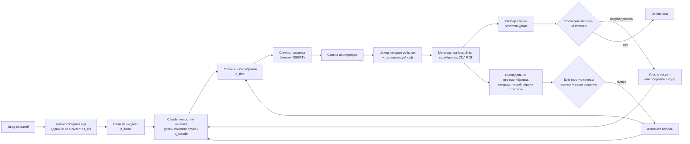
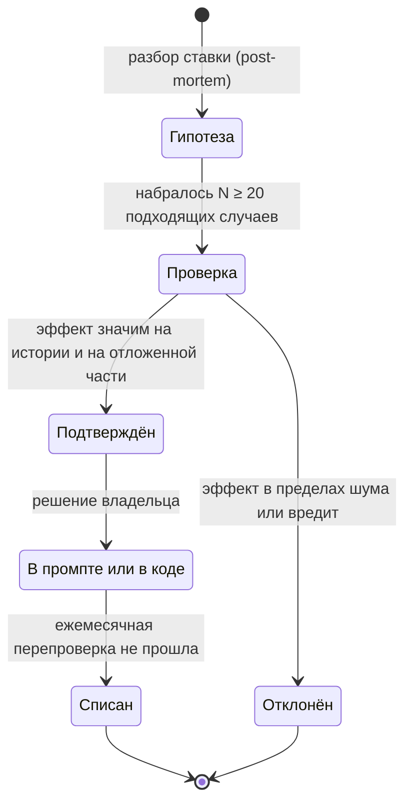

# Как модель учится на ставках (и как этому научиться самому)

Документ для владельца проекта. В нём два вопроса: как сделать, чтобы AI Capper действительно учился на своих прогнозах и ставках, и как на данных этого проекта самому освоить обучение моделей, вплоть до дообучения открытой LLM.

Связанные документы:
- [PLAN.md](PLAN.md): архитектура, схема БД, этапы работ. Здесь схема дополняется только таблицами, нужными для обучения.
- [TOKEN_ECONOMY.md](TOKEN_ECONOMY.md): как не переплачивать за токены. Здесь стоимость упоминается только там, где она влияет на выбор.
- [Макет](../mockup/README.md), экран «Обучение модели» (`#learning`).

## Коротко

1. **Веса Claude изменить нельзя.** Через стандартный Claude API дообучение (fine-tuning) моделей Claude недоступно. Поэтому «Claude учится» означает только одно: меняется то, что попадает ему в контекст (уроки, похожие случаи, версия промпта и стратегии). Настоящее обучение весов возможно только для **своих** моделей: классической ML-модели и открытой LLM.
2. **Без измерений обучение превращается в самообман.** Сначала нужны неизменяемые снимки каждого прогноза (вероятность, входные данные, версии), исход каждого события и закрывающие кэфы. Пока их нет, учиться не на чем.
3. **Эталон — рынок, а не винрейт.** Сравнивать модель надо с вероятностями закрывающей линии, очищенными от маржи. Рынок ставок эффективен, маржа букмекера 5–8%, и большинство моделей, включая хорошие, рынку проигрывают.
4. **ROI на сотнях ставок — почти чистый шум.** Чтобы отличить реальный перевес в +3% от нуля, нужны тысячи ставок (расчёт в [разделе 3.3](#33-сколько-нужно-ставок-реальность-выборки)). Ранние честные сигналы — CLV (выигрыш у закрывающей линии) и калибровка.
5. **Дообучение открытой LLM — учебный трек, а не путь к прибыли.** Оно полезно, чтобы разобраться в SFT, LoRA и RL. В основной продукт такая модель попадёт, только если на отложенном тесте обгонит связку «своя ML-модель + Claude».

## 0. Как система «учится» сейчас

| Механизм | Где | Почему это не обучение |
|---|---|---|
| В промпт подаются последние 10 ставок | `bot.py:288` | Модель видит 10 исходов без своих прошлых вероятностей. По 10 случаям ничего не выучить |
| Правила адаптации суммы («3 проигрыша подряд — сумма −40%») | `Tennis-Analytics/Стратегия-ставок.md:232` | Правило реагирует на серии, а серии при честных вероятностях случайны (см. [ловушки](#4-ловушки)) |
| «Аудит каждые 10 ставок» с выводами вида «П(-1.5) — 1 из 4, снизить приоритет» | `Tennis-Analytics/Инструкция-Авто.md:157` | Выводы делаются по 4–5 случаям, то есть подгоняются под шум |
| В истории есть вероятность выбранного рынка по каждому событию | `Tennis-Analytics/Инструкция-Авто.md:104` | Это полезно. Но результат хранится только по экспрессу целиком (`Инструкция-Авто.md:122`), поэтому калибровку по событиям посчитать нельзя. Закрывающих кэфов нет |

Вывод: в новой версии сначала строим фундамент данных ([раздел 2](#2-данные-для-обучения)), и только потом обучение.

## 1. Что значит «учится»: пять уровней



| Уровень | Что меняется | Где живёт | Стоимость | Когда имеет смысл |
|---|---|---|---|---|
| 1. Память и уроки | Текст в контексте Claude: проверенные уроки из разборов ставок | Таблица `lessons`, блок уроков в кэшируемом системном промпте | Разбор одной ставки на Sonnet 5.5 стоит центы, блок уроков из 10–15 пунктов почти бесплатен при кэше | С этапа 4 ([PLAN.md](PLAN.md)), но урок включается только после проверки |
| 2. Поиск похожих случаев | Какие прошлые прогнозы (с исходом и ошибкой) подаются Claude как примеры | SQL-выборка по признакам, позже при необходимости pgvector | +1–3 тыс. токенов на анализ | Когда накопится 300–500 прогнозов с исходами |
| 3. Оптимизация промпта и стратегии | Текст инструкций, пороги стратегии, набор уроков. Это «параметры» Claude | Таблица `strategy_versions`, экран «Версии стратегии» | Прогон eval-набора: порядка $5–20 за версию (оценка в [1.3](#13-уровень-3-промпт-как-параметры-оптимизация-против-eval-набора)) | Когда есть eval-набор хотя бы из 200–300 событий после даты среза знаний модели |
| 4. Своя классическая ML-модель | Настоящие веса: Эло по покрытиям, логистическая регрессия, градиентный бустинг, калибратор, стэкинг | Python в воркере, таблица `ml_models` | Бесплатно (CPU, минуты) | Сразу, на этапе 1. Это фундамент |
| 5. Дообучение открытой LLM | Веса открытой модели: LoRA-адаптер, SFT и RL | Отдельный учебный каталог или ноутбук, арендованный GPU | Часы GPU и много вашего времени | Как учебный проект. В продукт только при победе на тесте |

**Уровни 1–3 применимы к Claude** (меняется контекст, веса не трогаем). **Уровни 4–5 — наши собственные модели**, у них обучаются веса.

### 1.1. Уровень 1: память и уроки

Жизненный цикл урока:



Как это работает:

1. **Разбор.** После расчёта ставки Sonnet 5.5 получает снимок прогноза, исход и закрывающий кэф и возвращает структурированный ответ (structured outputs: `output_config.format` с JSON-схемой) с полями «что пошло не так», «гипотеза», **«условие применимости в машинно-проверяемом виде»**. Пример условия: `surface = 'hard' AND market = 'HCP_-1.5' AND opp_lefty AND opp_first_serve_kmh >= 210`.
2. **Проверка на истории, а не на своих ставках.** Условие выполняется SQL-запросом по всем прошлым прогнозам и по историческим матчам, где признаки посчитаны (Sackmann). Для найденных случаев считаем средний остаток `mean(y − p)` и его доверительный интервал.
3. **Порог.** N ≥ 20 — это минимум, чтобы вообще начинать проверку, а не доказательство. Пример: чтобы отличить смещение в 6 п.п. от нуля при вероятностях около 0,75, нужно около 200 случаев: n ≈ (1,96 · √(0,75·0,25) / 0,06)² ≈ 200. На 17 случаях доверительный интервал такого смещения около ±21 п.п. Поэтому уроки почти всегда приходится подтверждать на большой исторической базе.
4. **Сжатие эффекта.** Даже подтверждённую поправку применяем с усадкой к нулю: `effect × n / (n + k)`, где k ≈ 100–200. Маленькая выборка даёт маленькую поправку.
5. **Куда урок попадает.** Если у урока числовой эффект («фаворит после пятисетовика за 48 часов переоценён на 6 п.п.»), правильнее применять его **кодом** как поправку к `p_base`, а Claude только объясняет её в тексте. Если урок процессный («слухам из соцсетей без подтверждения турнира не верить»), он идёт текстом в промпт. Активных уроков не больше 10–15: так они не противоречат друг другу и не раздувают промпт.
6. **Множественные проверки.** Если за месяц проверено 40 гипотез, то при пороге значимости 5% около двух подтвердятся случайно. Поэтому нужна отложенная часть данных (подтверждение на более поздних матчах) и ежемесячная перепроверка.

Блок уроков меняется редко, поэтому его ставят в системный промпт после стабильной части стратегии. Тогда он попадает в кэш, детали в [TOKEN_ECONOMY.md](TOKEN_ECONOMY.md).

### 1.2. Уровень 2: поиск похожих случаев

Вместо «последних 10 ставок» (`bot.py:288`) Claude получает 3–5 **похожих** прошлых прогнозов с вероятностью, исходом и коротким разбором ошибки.

- Похожесть сначала задаём признаками, без эмбеддингов: то же покрытие и рынок, близкая разница рейтингов Эло (±50), тот же диапазон кэфов, похожий флаг усталости. Это один SQL-запрос, понятный и дешёвый. pgvector нужен, только если понадобится похожесть по тексту новостей.
- Берём только случаи **до** даты текущего матча, иначе возникает утечка будущего.
- Подбираем примеры сбалансированно (и попадания, и промахи), иначе Claude начнёт «якориться» на исходах.
- Эффект обязательно проверяем на eval-наборе ([1.3](#13-уровень-3-промпт-как-параметры-оптимизация-против-eval-набора)). Если log-loss не улучшается, блок отключаем: токены он тратит в любом случае.

### 1.3. Уровень 3: промпт как параметры, оптимизация против eval-набора

Промпт, пороги стратегии (вероятность от 65%, кэф 1.13–1.80, не больше 3 событий) и набор уроков — это «параметры» системы с Claude. Их можно оптимизировать так же, как веса, только вручную или полуавтоматически.

**Eval-набор.** Это события с замороженными досье (данные на момент до матча) и известным исходом. Обязательные условия:
- матчи **после даты среза знаний** модели (у Claude Opus 5.5 это июнь 2026; для других моделей проверяйте карточку модели), иначе Claude может «помнить» результат;
- **без веб-поиска** в eval-режиме: поиск по прошедшему матчу найдёт его результат;
- деление **по времени**: train (читаем ошибки и придумываем правки), validation (выбираем лучший вариант), test (проверяем один раз перед включением версии). Начиная с июля 2026 матчей основного тура ATP и WTA уже сотни.

**Цикл улучшения (hill-climbing).**
1. Прогнать активную версию, записать log-loss, Brier, ECE и стоимость на validation.
2. Прочитать худшие промахи на train. Claude может сам предложить правку промпта, решение принимаете вы.
3. Вносить **одно** изменение за раз. Новая версия становится кандидатом (`v4 · промпт на английском, сжатое досье` на макете).
4. Сравнить с активной версией на тех же событиях парным бутстрэпом ([3.4](#34-как-сравнивать-две-версии)).
5. На test кандидат включается, только если улучшение выходит за пределы шума и стоимость анализа не выросла сверх оговорённого.

**Что фиксировать в версии:** хэш промпта, список уроков, модель (`claude-opus-5-5`), `effort`, версию набора признаков, метрики на каждом срезе, стоимость. Ответы Claude недетерминированы, поэтому для честного сравнения каждое событие прогоняют 2–3 раза или хотя бы сравнивают на одинаковом числе повторов.

**Стоимость прогона** (оценка, проверьте токены своих досье через `messages.count_tokens`): компактное досье на одно событие около 6 тыс. входных и около 2 тыс. выходных токенов (вместе с размышлениями).
- Sonnet 5.5 ($2/$10 за 1 млн токенов): около $0,03 за событие, 300 событий ≈ $10.
- Opus 5.5 ($4/$20): около $0,06 за событие, 300 событий ≈ $19.
- Через Message Batches API (асинхронно, −50%) это примерно $5 и $10. Повторы умножают сумму.

**Пороги стратегии на ROI не подбираем.** ROI слишком шумный ([3.3](#33-сколько-нужно-ставок-реальность-выборки)): подбор порогов под ROI на 200 ставках гарантированно переобучится. Оптимизируем качество вероятностей (log-loss, калибровку, CLV), а решения о ставке выводим из откалиброванной вероятности.

### 1.4. Уровень 4: своя классическая ML-модель

Здесь работает принцип «цифры считает код, контекст даёт Claude».

| Шаг | Что делаем | Детали |
|---|---|---|
| 1 | Эло по покрытиям | Общий рейтинг и рейтинг по покрытию, прогноз по их смеси. K убывает с числом матчей игрока, например K = 250 / (m + 5)^0,4: этот подход FiveThirtyEight описан у Kovalchik (2016). Данные: Jeff Sackmann `tennis_atp` и `tennis_wta` |
| 2 | Признаки на момент матча | Разница Эло (общий и по покрытию), логарифм отношения рейтингов, дни отдыха, минуты и сеты за последние 3 и 7 дней, возраст, формат (до 2 или 3 побед в сетах), уровень турнира, скользящая статистика подачи и приёма |
| 3 | Модель | Логистическая регрессия как опорная. Затем градиентный бустинг (LightGBM, XGBoost или CatBoost), если он реально лучше на тесте |
| 4 | Walk-forward валидация | Обучение на годах ≤ Y, тест на Y+1, затем сдвиг. Случайное перемешивание матчей недопустимо |
| 5 | Калибровка | Platt scaling (логистическая регрессия поверх логита) при малых данных, isotonic regression при тысячах примеров. Бустинг почти всегда нужно калибровать |
| 6 | Стэкинг с Claude и рынком | `logit(p_final) = a + b·logit(p_base) + c·[logit(p_claude) − logit(p_base)] + d·logit(q_market)`. Коэффициенты подбираются на validation |

Смысл коэффициента **c**: система сама учится, насколько доверять поправкам Claude. При c ≈ 0 поправки Claude не несут информации, при c ≈ 1 их стоит брать как есть, при c > 1 Claude слишком осторожен. Это самый честный способ «учиться» на работе Claude.

**Рынки на сеты.** Рынки П(−1.5) и П(+1.5) можно грубо вывести из вероятности победы в матче p. Для матча до двух побед в сетах при независимых сетах с вероятностью s выигрыша сета p = s²(3 − 2s), а P(2:0) = s². Пример: p = 0,75 даёт s ≈ 0,674 и P(2:0) ≈ 0,45. Правило стратегии «для П(−1.5) вероятность сухой победы ≥ 55%» в такой модели требует p ≈ 0,83. На деле сеты не независимы, поэтому эту оценку калибруют на истории со счетами из данных Sackmann.

### 1.5. Уровень 5: дообучение открытой LLM

Делаем это на открытой модели размером 0,5–8 млрд параметров (актуальные версии семейств Qwen, Llama, Gemma или Mistral; перед использованием проверьте лицензию). Claude здесь не участвует.

**SFT с LoRA или QLoRA (обучение с учителем).**
- Вход: досье в фиксированном формате. Выход: короткое обоснование и JSON вида `{"p": 0.71}`.
- LoRA обучает небольшие добавочные матрицы, а не все веса модели. QLoRA делает то же поверх модели, квантованной в 4 бита. Поэтому хватает одной видеокарты.
- **Откуда брать ответы-образцы.** Вариант «дистиллировать анализы Claude» упирается в условия использования Anthropic: они ограничивают использование ответов для разработки конкурирующих моделей. Перед таким шагом прочитайте актуальную редакцию. Безопасный учебный вариант: целевая вероятность берётся из своей откалиброванной модели уровня 4 или из рынка, очищенного от маржи, а обоснование собирается шаблоном из признаков.
- Чему SFT научит: формату, стилю и подражанию учителю. Перевес над рынком SFT не даёт. Нельзя ставить целью сам исход (0 или 1): модель научится выдавать крайние вероятности.

**RL с проверяемой наградой (GRPO или PPO).**
- Промпт: обезличенное досье на момент до матча. Модель генерирует рассуждение и вероятность p.
- Награда — логарифмическая оценка: `r = y·ln(p) + (1 − y)·ln(1 − p)`, p ограничиваем диапазоном [0,02; 0,98]. За нечитаемый ответ ставим штраф, например −3.
- Почему именно она: log-score — **строго собственное правило оценки** (proper scoring rule). Его математическое ожидание максимально, когда модель называет свою настоящую уверенность. Поэтому модели невыгодно ни преувеличивать уверенность, ни прятаться за 0,5.
- Почему подходит GRPO: на один матч генерируется группа из 4–16 ответов, и преимущество каждого считается относительно среднего по группе. Исход y у всех ответов группы общий, поэтому случайность исхода частично вычитается, и сравниваются именно рассуждения.
- Данные: исторические матчи ATP и WTA за десятилетия (порядка 2,5–3 тыс. матчей основного тура ATP в год). Имена, турниры и даты обезличиваем. Тест проводим на матчах после даты среза знаний базовой модели.

**Инструменты и железо (ориентиры, не обещания).**

| Задача | Инструменты | Железо |
|---|---|---|
| Данные, метрики, уровень 4 | pandas, scikit-learn, LightGBM | Ноутбук, CPU |
| SFT с LoRA на модели 0,5–3B | Hugging Face Transformers, TRL (`SFTTrainer`), PEFT, bitsandbytes или Unsloth | Colab с GPU T4 (16 ГБ) или аналог |
| QLoRA на модели 7–8B | То же | Одна арендованная видеокарта на 16–24 ГБ |
| GRPO | TRL (`GRPOTrainer`) или Unsloth, vLLM для быстрой генерации | В разы дороже SFT: на каждый пример генерируется группа ответов |

Честный критерий успеха уровня 5 состоит из трёх ступеней. Обязательно: обойти по log-loss ту же модель без дообучения. Хорошо: приблизиться к модели уровня 4. Маловероятно: обойти закрывающую линию.

## 2. Данные для обучения

### 2.1. Принципы

1. **Снимок прогноза неизменяем.** Строку в `predictions` только добавляем (INSERT). Исправленный прогноз — это новая строка со ссылкой на старую. Если прогноз переписать задним числом, все метрики станут ложными.
2. **Данные на момент прогноза (point-in-time).** У каждого снимка есть `as_of`: признаки и досье собраны только из данных старше этого момента.
3. **Храним все проанализированные события, а не только поставленные.** Иначе система никогда не узнает, правильно ли она отказывалась от ставок.
4. **Исход каждого события отдельно**, а не только экспресса. Для фор нужен счёт по сетам.
5. **Кэфы обеих сторон:** у пользователя, на открытии и на закрытии. По двум сторонам можно честно убрать маржу.
6. **Версии всего:** стратегии и промпта, модели Claude и `effort`, набора признаков, своей ML-модели, применённых уроков.

### 2.2. Схема (дополнение к схеме из PLAN.md)

```sql
-- Снимок прогноза: только INSERT
CREATE TABLE predictions (
  id               uuid PRIMARY KEY,
  user_id          uuid NOT NULL REFERENCES users(id),
  match_id         bigint NOT NULL REFERENCES matches(id),
  market           text NOT NULL,            -- 'ML', 'HCP_-1.5', 'HCP_+1.5'
  selection        smallint NOT NULL,        -- 1 или 2
  created_at       timestamptz NOT NULL DEFAULT now(),
  as_of            timestamptz NOT NULL,     -- данные не новее этого момента
  dossier_id       uuid NOT NULL REFERENCES dossiers(id),  -- полный текст досье + sha256
  features         jsonb NOT NULL,           -- признаки на момент as_of
  feature_set      text NOT NULL,            -- 'fs-2026-10'
  strategy_version text NOT NULL REFERENCES strategy_versions(id),
  ml_model_id      text REFERENCES ml_models(id),
  llm_model        text,                     -- 'claude-opus-5-5'
  effort           text,                     -- 'medium'
  lessons_applied  text[] NOT NULL DEFAULT '{}',
  p_base           real NOT NULL,            -- своя ML-модель
  p_claude         real,                     -- после поправки Claude
  p_final          real NOT NULL,            -- после стэкинга и калибровки
  q_market_at_pred real,                     -- рынок без маржи в момент прогноза
  rationale        text,
  agent_run_id     uuid REFERENCES agent_runs(id),
  supersedes       uuid REFERENCES predictions(id),
  is_eval          boolean NOT NULL DEFAULT false   -- бэктест или eval, а не боевой прогноз
);

CREATE TABLE lessons (
  id            text PRIMARY KEY,            -- 'L-017'
  text          text NOT NULL,
  scope_sql     text NOT NULL,               -- машинно-проверяемое условие
  kind          text NOT NULL,               -- 'numeric' | 'process'
  status        text NOT NULL,               -- hypothesis | confirmed | rejected | retired
  n_cases       int,
  effect        real,                        -- средний остаток y − p
  effect_ci     numrange,
  source_bets   bigint[],
  validated_at  timestamptz,
  in_prompt     boolean NOT NULL DEFAULT false
);

CREATE TABLE strategy_versions (
  id           text PRIMARY KEY,             -- 'v3'
  prompt_sha   text NOT NULL,
  lessons      text[] NOT NULL,
  config       jsonb NOT NULL,               -- пороги стратегии
  status       text NOT NULL,                -- candidate | active | archived
  approved_by  uuid, approved_at timestamptz
);

CREATE TABLE eval_runs (
  id           uuid PRIMARY KEY,
  version_id   text NOT NULL,                -- strategy_versions.id или ml_models.id
  split        text NOT NULL,                -- train | validation | test
  n_events     int NOT NULL,
  metrics      jsonb NOT NULL,               -- logloss, brier, ece, clv, roi + ДИ
  cost_usd     numeric(10,4),
  created_at   timestamptz NOT NULL DEFAULT now()
);
-- ml_models: id, тип, период обучения, признаки, метрики walk-forward, путь к артефакту
```

Исход и закрывающий кэф берутся из `matches` (результат и счёт по сетам) и `odds_snapshots` (`kind = 'closing'`). Обучающие строки собирает представление `v_training_rows`, которое соединяет три таблицы.

### 2.3. Экспорт в JSONL

Одна строка — один прогноз. Ниже строка отформатирована для чтения, в файле она в одну строку.

```json
{"prediction_id": "8f1c…", "as_of": "2026-10-07T07:40:00Z", "match_id": 418233,
 "tour": "ATP", "level": "M1000", "surface": "hard", "best_of": 3,
 "market": "ML", "selection": 1,
 "features": {"elo_diff": 182, "elo_surface_diff": 205, "rest_days_1": 2, "rest_days_2": 1,
              "minutes_last_3d_1": 95, "minutes_last_3d_2": 188, "lefty_2": false},
 "dossier_sha256": "c41e…", "strategy_version": "v3", "llm_model": "claude-opus-5-5", "effort": "medium",
 "lessons_applied": ["L-014", "L-017"],
 "p_base": 0.79, "p_claude": 0.81, "p_final": 0.80,
 "odds_taken": 1.17, "odds_close": [1.15, 5.60], "q_close_novig": 0.830,
 "outcome": 1, "settled_at": "2026-10-07T12:02:00Z"}
```

Из неё скриптом собираются учебные форматы:
- **SFT** (`messages`): `user` — досье, `assistant` — обоснование и `{"p": …}`. Цель `p` берётся из модели уровня 4 или из рынка, см. [1.5](#15-уровень-5-дообучение-открытой-llm).
- **RL**: `prompt` — обезличенное досье. Отдельно, невидимо для модели, хранятся `outcome` и `q_close_novig` для расчёта награды и сравнения с рынком.

### 2.4. Перенос текущей истории

`История-ставок.json` переносится скриптом этапа 0 ([PLAN.md](PLAN.md)):
- вероятность выбранного рынка по каждому событию сохраняется как `p_claude`, а `strategy_version` получает значение `legacy`;
- исходы отдельных событий в проигранных экспрессах неизвестны. Их восстанавливаем по результатам матчей (Sackmann или tennis-data.co.uk, сопоставление по именам и дате), а что не найдётся, вносим вручную;
- закрывающих кэфов и `as_of` нет, поэтому эти строки идут в метрики калибровки, но не в eval-наборы и не в CLV.

## 3. Метрики и честная оценка

### 3.1. Метрики

| Метрика | Формула | Что показывает | Ориентир |
|---|---|---|---|
| Log-loss | −(1/N)·Σ[y·ln p + (1−y)·ln(1−p)] | Главная метрика качества вероятностей. Сильно штрафует уверенные промахи | Монетка 0,693. Ниже — лучше |
| Brier | (1/N)·Σ(p − y)² | То же, мягче к крайним ошибкам, легче объяснять | Монетка 0,25. В теннисе даже идеальный прогноз даёт около 0,20 (в нашей симуляции с типичным разбросом вероятностей), потому что исход матча случаен |
| Калибровка и ECE | ECE = Σ_b (n_b/N)·\|p̄_b − ȳ_b\| по корзинам 5 п.п. | Сбывается ли «70%» в 70% случаев | В корзине нужно от 30–50 событий, иначе это шум. Показываем ДИ Уилсона |
| Brier skill score к рынку | 1 − Brier_модели / Brier_рынка | Лучше ли модель закрывающей линии | Больше 0 — лучше рынка. Обычно меньше 0 |
| CLV (EV относительно закрытия) | odds_taken · q_close − 1, для экспресса Π odds_i · Π q_i − 1 | Взята ли цена лучше итоговой рыночной | Устойчиво больше 0 — главный ранний признак перевеса |
| ROI с бутстрэп-ДИ | прибыль / оборот. ДИ: 10 000 пересэмплирований ставок, перцентили 2,5–97,5 | Итог в деньгах | Без ДИ не показывать |

Единица для ROI — ставка (экспресс). Для log-loss, Brier и калибровки — отдельное событие.

### 3.2. Эталон: закрывающая линия без маржи

Закрывающий кэф вобрал в себя всю информацию рынка к началу матча. Поэтому модель сравниваем именно с ним.

Пример (матч Синнер — Руне с макета, закрытие 1.17 и 5.10):
- 1/1,17 = 0,8547 и 1/5,10 = 0,1961, в сумме 1,0508, то есть маржа 5,1%;
- без маржи (пропорциональный метод): q₁ = 0,8547 / 1,0508 ≈ 0,813, q₂ ≈ 0,187.

У фаворитов и аутсайдеров маржа заложена неравномерно (favorite–longshot bias). Метод Шина и степенной метод это учитывают. Выберите один метод и используйте его везде.

Закрывающая линия «острого» букмекера с низкой маржой — лучший эталон, чем линия вашего букмекера. Исторические кэфы есть в tennis-data.co.uk; на какой момент сняты кэфы, проверьте в описании колонок. Для текущих матчей закрывающий кэф вносится вручную на экране «Ставки» или берётся из платного API (вопрос из [PLAN.md](PLAN.md)).

На макете рынок для графиков считается как `1 / closing × 0.955` (`mockup/js/data.js:122`). Для демо это допустимо, в продукте маржу снимаем по кэфам обеих сторон.

### 3.3. Сколько нужно ставок: реальность выборки

Результат одной ставки с кэфом o и вероятностью p ≈ 1/o имеет разброс σ ≈ o·√(p(1−p)). Нужное число ставок оценивается как n ≈ (z·σ / ROI)².

| Средний кэф | σ одной ставки | ±95% ДИ ROI после 100 | после 500 | после 1000 | Ставок, чтобы ROI +3% отличился от нуля (50% / 80% мощности) | То же для +2% |
|---|---|---|---|---|---|---|
| 1.50 (одно событие) | 0,71 | ±13,9% | ±6,2% | ±4,4% | ~2 100 / ~4 400 | ~4 800 / ~9 800 |
| 2.20 (типичный экспресс) | 1,10 | ±21,5% | ±9,6% | ±6,8% | ~5 100 / ~10 500 | ~11 500 / ~23 500 |
| 3.00 | 1,41 | ±27,7% | ±12,4% | ±8,8% | ~8 500 / ~17 400 | ~19 200 / ~39 200 |

Что из этого следует:
- При одном экспрессе в день (около 365 в год) статистически доказать ROI +3% по прибыли можно лет за 14. ROI +15% на 100 ставках совместим и с убыточной стратегией.
- **CLV шумит гораздо меньше.** Отклонение цены от закрытия зависит от движения линии, а не от того, кто выиграл. Если, например, разброс CLV одной ставки 5–8%, средний CLV +2% отличается от нуля уже на десятках ставок. Поэтому 100–200 прогнозов с устойчиво положительным CLV — разумный минимум, прежде чем поднимать суммы. Реальный разброс измерьте на своих данных.
- **Сравнение моделей по Brier тоже требует большой выборки.** Наша симуляция: если две версии дают похожие прогнозы на одних и тех же 220 событиях, стандартная ошибка разницы Brier составляет 0,002–0,004. Разница меньше примерно 0,005 — это шум. Чтобы показать, что модель лучше рынка (ошибки которого с ней почти не связаны), нужны тысячи событий.

### 3.4. Как сравнивать две версии

1. Одни и те же события, одинаковое число повторов.
2. Для каждого события считаем разницу потерь dᵢ = loss_A − loss_B.
3. Делаем бутстрэп по событиям (10 000 раз) и берём 95% ДИ среднего d.
4. Решение: ДИ целиком ниже нуля — B лучше. Пересекает ноль — разницы не обнаружено, оставляем более дешёвую версию.

### 3.5. Правила решения

- Пока CLV и калибровка не подтверждены на 100–200 прогнозах, ставим минимальные фиксированные суммы, независимо от серий.
- Правила вида «3 проигрыша — сумма −40%» (`Стратегия-ставок.md:236`) заменяем лимитами по просадке банка. Серии не несут информации, если вероятности откалиброваны.
- Когда вероятности откалиброваны, сумму можно считать долей Келли: f* = (p·o − 1) / (o − 1). Берём 1/4 этой доли и не больше потолка из стратегии. Келли очень чувствителен к завышенной p, поэтому без подтверждённой калибровки его использовать нельзя.

## 4. Ловушки

| Ловушка | Как проявится в AI Capper | Защита |
|---|---|---|
| Утечка будущего (look-ahead) | Эло пересчитано с учётом самого матча, «текущая форма» обновлена после турнира, веб-поиск в бэктесте находит результат | `as_of` у каждого признака, запросы вида `WHERE date < match.start`, в eval выключены web_search и web_fetch. Тест-приманка: на перемешанных исходах log-loss должен быть около 0,693 |
| Память LLM о результатах | Claude или открытая модель «знает», кто выиграл исторический матч, и метрики выглядят прекрасно | Eval только на матчах после даты среза знаний (Opus 5.5 — июнь 2026). Обезличивание игроков и турниров. Контрольный вопрос модели «кто выиграл?»: если знает, исключить матч |
| Подгонка уроков под шум | «П2(+1.5) на грунте — 4 из 5» (`Инструкция-Авто.md:168`). При истинной вероятности 0,6 исход «4 и больше из 5» случается в 34% случаев, «1 или меньше из 4» — в 18% | N ≥ 20 только для начала проверки, подтверждение на истории и отложенной части, усадка эффекта, ежемесячная перепроверка |
| Ошибка игрока (серии) | «3 проигрыша подряд» при вероятности проигрыша около 0,5 почти гарантированно случится: за 50 ставок с вероятностью около 98% | Управлять риском через просадку и откалиброванную вероятность, а не через серии |
| Ошибка выжившего и отбора | Анализируются только поставленные события. В базе в основном топ-игроки. Отказы и снятия считаются по-разному | Хранить прогнозы по всем событиям, единое правило для отказов (void), метрики отдельно по уровням турниров |
| Нестационарность | Игроки меняются, рынок становится точнее, сезон и покрытие сдвигают картину | Скользящие окна, затухание весов старых матчей, еженедельная перекалибровка, график «скользящий Brier против рынка» |
| Подглядывание в тест | Правки промпта придумываются по тем же событиям, на которых потом меряются | Train, validation, test по времени. Test открывается один раз на версию |
| Взлом награды в RL | Модель выдаёт крайние p, ломает формат, сокращает рассуждение до нуля или угадывает матч по датам и статистике | Обрезка p, строгая JSON-схема, штраф за формат, KL-штраф к исходной модели, ручное чтение примеров, обезличивание, тест после даты среза |
| Якорь на рынок | Claude видит кэф и подстраивает вероятность под него. Получается копия рынка без перевеса | Эксперимент на eval: досье с кэфами и без. Рынок учитывается явно в стэкинге (`d·logit(q)`), а не в голове модели |
| Эффективность рынка | Маржа 5–8% означает, что надо быть точнее рынка больше чем на маржу. Выигрывающие счета букмекеры ограничивают | Ожидать скромных результатов. Перевес чаще бывает в менее ликвидных турнирах, но данные там хуже |

## 5. Учебный трек

Каждый шаг — упражнение на данных этого проекта. Шаги 1–4 одновременно строят уровень 4 продукта, то есть учёба и разработка идут вместе.

| # | Шаг | Упражнение | Что должно получиться | Что вы освоите |
|---|---|---|---|---|
| 1 | Метрики своей истории | Загрузить `История-ставок.json` в pandas, восстановить исходы событий, посчитать Brier, log-loss, калибровку по событиям, ROI с бутстрэп-ДИ | Таблица метрик и диаграмма калибровки. Вы увидите, насколько широк ДИ ROI на вашем числе ставок | pandas, `sklearn.metrics` (`brier_score_loss`, `log_loss`), `calibration_curve`, бутстрэп |
| 2 | Эло по покрытиям | Посчитать Эло по `atp_matches_*.csv` (Sackmann) за 2000–2025 годы, общее и по покрытию, затем log-loss на 2024–2025 | Эло заметно лучше монетки и хуже закрывающей линии. Если Эло «обыграл» рынок, ищите утечку | Рейтинговые системы, временные ряды без утечки |
| 3 | Логистическая регрессия, бустинг, калибровка | Добавить признаки усталости и отдыха, сделать walk-forward по годам, сравнить Platt и isotonic | Небольшой выигрыш у одного Эло. У бустинга без калибровки хуже ECE | Признаки, walk-forward, калибровка |
| 4 | Сравнение с рынком | Взять кэфы tennis-data.co.uk, убрать маржу, посчитать skill score и бэктест «ставим, если p > q» с бутстрэпом | Скорее всего, ROI после маржи около нуля или ниже. Любой «плюс» перепроверить на следующем годе | Эффективность рынка, честный бэктест |
| 5 | Eval-набор для Claude | 300 матчей после июня 2026, замороженные досье, без веб-поиска, Batches API. Сравнить `p_base` и `p_claude` и подобрать коэффициент c в стэкинге | Ответ на вопрос, добавляет ли Claude информацию к модели, и сколько это стоит | Eval-методика, structured outputs, контроль стоимости |
| 6 | Уроки с проверкой | Конвейер «разбор → условие в SQL → проверка на истории → отложенная часть». Проверить уроки L-014 и L-017 с макета на данных Sackmann | Большинство гипотез не подтвердится. Это нормальный результат | Проверка гипотез, множественные сравнения, усадка |
| 7 | LoRA SFT маленькой модели | Модель 0,5–3B, формат «досье → обоснование и `{"p": …}`», цель — `p_final` уровня 4. Colab с T4 | Почти 100% валидного JSON. Log-loss близок к учителю, но не лучше | TRL `SFTTrainer`, PEFT и LoRA, QLoRA |
| 8 | GRPO с лог-оценкой | Обезличенные матчи: обучение на 2000–2023, валидация на 2024–2025, тест после даты среза базовой модели. Награда — log-score | Улучшение относительно той же модели без RL. Обогнать уровень 4 и рынок вряд ли удастся | RL с проверяемой наградой, proper scoring rules, взлом награды |

**Итоговая проверка:** одна таблица на одном тестовом наборе. Строки: монетка, Эло, логистическая регрессия или бустинг, связка с Claude, SFT-модель, GRPO-модель, закрывающая линия. Колонки: log-loss, Brier, ECE, стоимость прогноза.

**Что почитать и посмотреть:**
- Основы ML: Aurélien Géron, «Hands-On Machine Learning with Scikit-Learn, Keras & TensorFlow»; курс fast.ai «Practical Deep Learning for Coders».
- Как устроены LLM: Andrej Karpathy, «Neural Networks: Zero to Hero»; Sebastian Raschka, «Build a Large Language Model (From Scratch)»; Hugging Face LLM Course; документация TRL и PEFT.
- Статьи: LoRA (Hu et al., 2021), QLoRA (Dettmers et al., 2023), GRPO в DeepSeekMath (Shao et al., 2024), DeepSeek-R1 (2025).
- Вероятности и оценка: Gneiting & Raftery, «Strictly Proper Scoring Rules, Prediction, and Estimation» (2007); Niculescu-Mizil & Caruana, «Predicting Good Probabilities with Supervised Learning» (2005).
- RL: Sutton & Barto, «Reinforcement Learning: An Introduction».
- Теннис и ставки: Kovalchik, «Searching for the GOAT of tennis win prediction» (2016); блог Tennis Abstract (Jeff Sackmann); Joseph Buchdahl, «Squares & Sharps, Suckers & Sharks».
- Claude: документация Anthropic по eval-методике, prompt caching и Message Batches; Anthropic Cookbook.

## 6. Как это выглядит в продукте

Экран «Обучение модели» (`#learning`, состав блоков в `mockup/README.md:28`, демо-данные в `mockup/js/data.js:188` и `:196`).

| Блок экрана | Что показывает | Откуда данные | Уровень |
|---|---|---|---|
| Уроки | Текст, условие применимости, статус (гипотеза, подтверждён, отклонён), N, эффект с ДИ, переключатель «в промпте» | `lessons` | 1 |
| Версии стратегии | v1…v4: log-loss, Brier, ECE, CLV, ROI с ДИ, N, стоимость. Кандидат включается только вашим решением | `strategy_versions`, `eval_runs` | 3 |
| Своя ML-модель | Тип и период обучения, walk-forward метрики, калибровка, вес поправок Claude (коэффициент c) | `ml_models`, `eval_runs` | 4 |
| Датасет | Сколько прогнозов, сколько с исходами и закрывающим кэфом, размер eval-наборов после даты среза, кнопка экспорта JSONL | `predictions`, `v_training_rows` | 2 и все остальные |
| Лаборатория дообучения | Запуски SFT и GRPO: базовая модель, метод, версия датасета, метрики против базовых линий. Учебный раздел, на прогнозы не влияет | Записи о запусках, метрики из ноутбука | 5 |

Связанные места макета:
- Главная: «Последний принятый урок» (`mockup/js/screens/dashboard.js:464`) и подсказка о кандидате v4 с решением за владельцем (`dashboard.js:432`).
- Аналитика: калибровка и «Brier против рынка».
- ИИ и расходы: разборы ставок на Sonnet 5.5.

**Замечания к демо-данным макета** с учётом раздела 3:
- в демо v3 и v4 различаются по Brier на 0,001 на 220 событиях. Это шум, и в интерфейсе стоит показывать ДИ разницы и подпись «разница не обнаружена»;
- уроки L-017 (17 случаев) и L-019 (11) помечены как подтверждённые при пороге «нужно ≥ 20». Нужно либо поправить демо, либо разделить пороги для числовых и процессных уроков.

**Место в этапах [PLAN.md](PLAN.md):** этап 1 — уровень 4 и данные, этап 2 — снимки прогнозов, этап 3 — метрики на дашборде, этап 4 — уровни 1–3. Уровень 5 идёт параллельным учебным треком вне критического пути.
