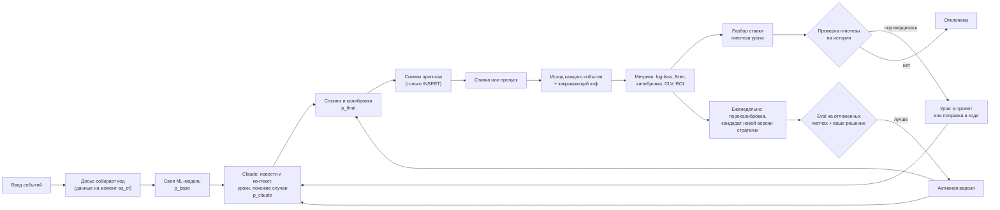
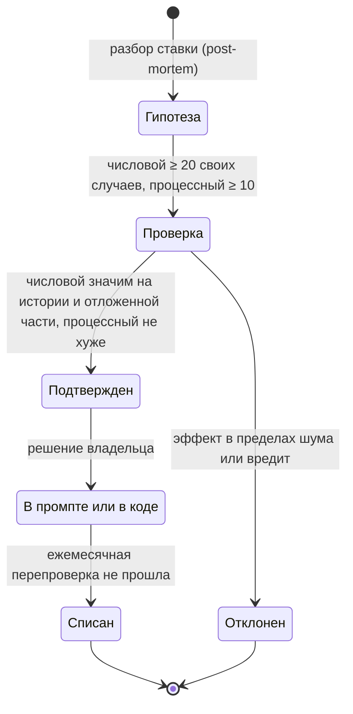

# Как модель учится на ставках (и как этому научиться самому)

Документ для владельца проекта. В нем два вопроса: как сделать, чтобы AI Capper действительно учился на своих прогнозах и ставках, и как на данных этого проекта самому освоить обучение моделей, вплоть до дообучения открытой LLM.

Связанные документы:
- [PLAN.md](PLAN.md): архитектура, схема БД, этапы работ. Таблицы определены там, здесь объясняется, зачем обучению нужны их поля ([2.2](#22-поля-для-обучения-в-схеме-planmd)).
- [TOKEN_ECONOMY.md](TOKEN_ECONOMY.md): как не переплачивать за токены. Здесь стоимость упоминается только там, где она влияет на выбор.
- [Макет](../mockup/README.md), экран «Обучение модели» (`#learning`).

## Коротко

1. **Веса Claude изменить нельзя.** Через стандартный Claude API дообучение (fine-tuning) моделей Claude недоступно. Поэтому «Claude учится» означает только одно: меняется то, что попадает ему в контекст (уроки, похожие случаи, версия промпта и стратегии). Настоящее обучение весов возможно только для **своих** моделей: классической ML-модели и открытой LLM.
2. **Без измерений обучение превращается в самообман.** Сначала нужны неизменяемые снимки каждого прогноза (вероятность, входные данные, версии), исход каждого события и закрывающие кэфы. Пока их нет, учиться не на чем.
3. **Эталон — рынок, а не винрейт.** Сравнивать модель надо с вероятностями закрывающей линии, очищенными от маржи. Рынок ставок эффективен, маржа букмекера 5–8%, и большинство моделей, включая хорошие, рынку проигрывают.
4. **ROI на сотнях ставок — почти чистый шум.** Чтобы отличить реальный перевес в +3% от нуля, нужны тысячи ставок (расчет в [разделе 3.3](#33-сколько-нужно-ставок-реальность-выборки)). Ранние честные сигналы — CLV (выигрыш у закрывающей линии) и калибровка.
5. **Дообучение открытой LLM — учебный трек, а не путь к прибыли.** Оно полезно, чтобы разобраться в SFT, LoRA и RL. В основной продукт такая модель попадет, только если на отложенном тесте обгонит связку «своя ML-модель + Claude».

## 0. Как система «учится» сейчас

Старый бот перенесен в `legacy/telegram-bot/` (Р20): пути к файлам бота ниже — относительно этой папки.

| Механизм | Где | Почему это не обучение |
|---|---|---|
| В промпт подаются последние 10 ставок | `bot.py:288` | Модель видит 10 последних записей целиком, включая свои вероятности по событиям, но исход есть только у экспресса целиком (`Инструкция-Авто.md:122`). Сопоставить вероятность с исходом события нельзя, а по 10 экспрессам ничего не выучить |
| Правила адаптации суммы («3 проигрыша подряд — сумма −40%») | `Tennis-Analytics/Стратегия-ставок.md:232` | Правило реагирует на серии, а серии при честных вероятностях случайны (см. [ловушки](#4-ловушки)) |
| «Аудит каждые 10 ставок» с выводами вида «П(-1.5) — 1 из 4, снизить приоритет» | `Tennis-Analytics/Инструкция-Авто.md:157` | Выводы делаются по 4–5 случаям, то есть подгоняются под шум |
| В истории есть вероятность выбранного рынка по каждому событию | `Tennis-Analytics/Инструкция-Авто.md:104` | Это полезно. Но результат хранится только по экспрессу целиком (`Инструкция-Авто.md:122`), поэтому калибровку по событиям посчитать нельзя. Закрывающих кэфов нет |

Вывод: в новой версии сначала строим фундамент данных ([раздел 2](#2-данные-для-обучения)), и только потом обучение.

## 1. Что значит «учится»: пять уровней



| Уровень | Что меняется | Где живет | Стоимость | Когда имеет смысл |
|---|---|---|---|---|
| 1. Память и уроки | Текст в контексте Claude: проверенные уроки из разборов ставок | Таблица `lessons`, блок уроков в кэшируемом системном промпте | Разбор одной ставки на Sonnet 5.5 стоит центы, блок уроков из 10–15 пунктов почти бесплатен при кэше | С этапа 5 («Петля обучения» в [PLAN.md](PLAN.md)), но урок включается только после проверки |
| 2. Поиск похожих случаев | Какие прошлые прогнозы (с исходом и ошибкой) подаются Claude как примеры | SQL-выборка по признакам, позже при необходимости pgvector | +1–3 тыс. токенов на анализ | Когда накопится 300–500 прогнозов с исходами |
| 3. Оптимизация промпта и стратегии | Текст инструкций, пороги стратегии, набор уроков. Это «параметры» Claude | Таблица `strategy_versions`, экран «Версии стратегии» | Один проход 300 событий ≈ $5–10 через Batches ($10–19 без), с 2–3 повторами ≈ $10–30 через Batches (оценка в [1.3](#13-уровень-3-промпт-как-параметры-оптимизация-против-eval-набора)) | Когда есть eval-набор хотя бы из 200–300 событий: свои замороженные снимки и матчи после даты окончания обучающих данных модели |
| 4. Своя классическая ML-модель | Настоящие веса: Эло по покрытиям, логистическая регрессия, градиентный бустинг, калибратор, стэкинг | Python в воркере, таблица `ml_models` | Бесплатно (CPU, минуты) | На этапе 2 («Данные и базовая модель» в [PLAN.md](PLAN.md)). Это фундамент; учебный трек, шаги 1–4, можно начать сразу |
| 5. Дообучение открытой LLM | Веса открытой модели: LoRA-адаптер, SFT и RL | Отдельный учебный каталог или ноутбук, арендованный GPU | Часы GPU и много вашего времени | Как учебный проект. В продукт только при победе на тесте |

**Уровни 1–3 применимы к Claude** (меняется контекст, веса не трогаем). **Уровни 4–5 — наши собственные модели**, у них обучаются веса.

### 1.1. Уровень 1: память и уроки

Жизненный цикл урока:



Как это работает:

1. **Разбор.** После расчета ставки Sonnet 5.5 получает снимок прогноза, исход и закрывающий кэф и возвращает структурированный ответ (structured outputs: `output_config.format` с JSON-схемой) с полями «что пошло не так», «гипотеза», **«условие применимости»**. Условие — не SQL, а JSON из ограниченного словаря: в JSON-схеме имя признака — `enum` из белого списка, оператор — тоже `enum`. Пример: `{"all": [{"f": "surface", "op": "=", "v": "hard"}, {"f": "market", "op": "=", "v": "HCP_-1.5"}, {"f": "opp_lefty", "op": "=", "v": true}]}`. Код проверяет условие по схеме, собирает из него параметризованный SQL и выполняет его от роли только для чтения. Модель, которая читает веб-страницы, не должна писать SQL, который потом выполняет бэкенд: это путь для инъекций и утечки данных. Условие хранится в `lessons` как JSON (предложение к схеме — в [2.2](#22-поля-для-обучения-в-схеме-planmd)).
2. **Проверка на истории, а не на своих ставках.** Код выбирает по условию все прошлые прогнозы и исторические матчи, где признаки посчитаны (Sackmann плюс даты tennis-data.co.uk, см. [подводные камни данных](#52-данные-подводные-камни)). Для найденных случаев считаем средний остаток `mean(y − p)` и его доверительный интервал. Для исторических матчей p — только out-of-sample прогноз walk-forward модели уровня 4 (или рынок без маржи), иначе остаток смещен. Так проверяется, несет ли условие сигнал сверх `p_base`. Смещение самого Claude меряется только на его прогнозах: свои события и eval-прогоны.
3. **Пороги.** Уроки бывают двух видов, и пороги у них разные.
   - **Числовой урок** меняет вероятность. Проверка начинается, когда набралось ≥ 20 своих подходящих случаев, а подтверждается он на истории с ДИ (п. 2) и на отложенной более поздней части (п. 6). Свои случаи показывают, что эффект не исчезает после поправки Claude. 20 случаев — минимум, а не доказательство. Пример: при вероятностях около 0,75 нужно около 200 случаев, чтобы ДИ сузился до ±6 п.п. (мощность ~50%): n ≈ (1,96 · √(0,75·0,25) / 0,06)² ≈ 200. Для мощности 80% нужно около 410. На 17 случаях доверительный интервал такого смещения около ±21 п.п. Поэтому числовые уроки почти всегда подтверждают на большой исторической базе. Если условие на истории не вычисляется (нет нужных данных), урок остается гипотезой, пока своих случаев не наберутся сотни.
   - **Процессный урок** меняет сбор данных или порядок анализа, а не вероятность («слухам из соцсетей не верить»). Его принимают, если качество прогнозов не хуже хотя бы на 10 случаях и есть выигрыш, например меньше поисков.
4. **Сжатие эффекта.** Даже подтвержденную поправку применяем с усадкой к нулю: `effect × n / (n + k)`, где k ≈ 100–200. Маленькая выборка дает маленькую поправку.
5. **Куда урок попадает.** Если у урока числовой эффект («фаворит после пятисетовика за 48 часов переоценен на 6 п.п.»), правильнее применять его **кодом** как поправку к `p_base`, а Claude только объясняет ее в тексте. Если урок процессный («слухам из соцсетей без подтверждения турнира не верить»), он идет текстом в промпт. Активных уроков не больше 10–15: так они не противоречат друг другу и не раздувают промпт.
6. **Множественные проверки.** Если за месяц проверено 40 гипотез, то при пороге значимости 5% около двух подтвердятся случайно. Поэтому нужна отложенная часть данных (подтверждение на более поздних матчах) и ежемесячная перепроверка.

Блок уроков меняется редко, поэтому его ставят в системный промпт после стабильной части стратегии. Тогда он попадает в кэш, детали в [TOKEN_ECONOMY.md](TOKEN_ECONOMY.md).

### 1.2. Уровень 2: поиск похожих случаев

Вместо «последних 10 ставок» (`bot.py:288`) Claude получает 3–5 **похожих** прошлых прогнозов с вероятностью, исходом и коротким разбором ошибки.

- Похожесть сначала задаем признаками, без эмбеддингов: то же покрытие и рынок, близкая разница рейтингов Эло (±50), тот же диапазон кэфов, похожий флаг усталости. Это один SQL-запрос, понятный и дешевый. pgvector нужен, только если понадобится похожесть по тексту новостей.
- Берем только случаи **до** даты текущего матча, иначе возникает утечка будущего.
- Подбираем примеры сбалансированно (и попадания, и промахи), иначе Claude начнет «якориться» на исходах.
- Эффект обязательно проверяем на eval-наборе ([1.3](#13-уровень-3-промпт-как-параметры-оптимизация-против-eval-набора)). Если log-loss не улучшается, блок отключаем: токены он тратит в любом случае.

### 1.3. Уровень 3: промпт как параметры, оптимизация против eval-набора

Промпт, пороги стратегии (вероятность от 65%, кэф 1.13–1.80, не больше 3 событий) и набор уроков — это «параметры» системы с Claude. Их можно оптимизировать так же, как веса, только вручную или полуавтоматически.

**Eval-набор.** Это события с замороженными досье (данные на момент до матча) и известным исходом. Обязательные условия:
- матчи **после даты окончания обучающих данных** модели плюс запас в 1 месяц, иначе Claude может «помнить» результат. Эта дата (training data cutoff в таблице моделей Anthropic) может быть позже заявленного среза знаний: у Opus 5.5 срез знаний — июнь 2026, дату обучающих данных сверьте на странице Models overview. Второй рубеж защиты — контрольный вопрос «кто выиграл?» ([ловушки](#4-ловушки));
- **без веб-поиска** в eval-режиме: поиск по прошедшему матчу найдет его результат;
- деление **по времени**: train (читаем ошибки и придумываем правки), validation (выбираем лучший вариант), test (проверяем один раз перед включением версии). Через несколько месяцев после этой даты матчей основного тура ATP и WTA уже сотни.

**Основа eval-набора — свои боевые прогнозы.** Их досье замораживается в момент `as_of` вместе с собранными тогда новостями (таблица `dossiers`), и в eval Claude получает ровно этот снимок. В продукте Claude отвечает за новости и контекст, а проверить это можно только на таких снимках. Исторические матчи после этой даты, для которых новостей на момент до матча нет, — отдельный срез с подписью «Claude без новостей». По нему коэффициент c ([1.4](#14-уровень-4-своя-классическая-ml-модель)) не подбирают: он занизит вклад Claude.

**Цикл улучшения (hill-climbing).**
1. Прогнать активную версию, записать log-loss, Brier, ECE и стоимость на validation.
2. Прочитать худшие промахи на train. Claude может сам предложить правку промпта, решение принимаете вы.
3. Вносить **одно** изменение за раз. Новая версия становится кандидатом (`v4 · промпт на английском, сжатое досье` на макете).
4. Сравнить с активной версией на тех же событиях парным бутстрэпом ([3.4](#34-как-сравнивать-две-версии)).
5. На test кандидат включается, только если улучшение выходит за пределы шума и стоимость анализа не выросла сверх оговоренного. Кандидат ради экономии проходит другое правило, «не хуже с допуском» ([3.4](#34-как-сравнивать-две-версии)).

**Что фиксировать в версии:** хэш промпта, список уроков, модель (`claude-opus-5-5`), `effort`, версию набора признаков, метрики на каждом срезе, стоимость. Ответы Claude недетерминированы, поэтому для честного сравнения каждое событие прогоняют 2–3 раза или хотя бы сравнивают на одинаковом числе повторов.

**Стоимость прогона** (оценка, проверьте токены своих досье через `messages.count_tokens`): компактное досье на одно событие около 6 тыс. входных и около 2 тыс. выходных токенов (вместе с размышлениями).
- Sonnet 5.5 ($2/$10 за 1 млн токенов): около $0,03 за событие, 300 событий ≈ $10.
- Opus 5.5 ($4/$20): около $0,06 за событие, 300 событий ≈ $19.
- Через Message Batches API (асинхронно, −50%) это примерно $5 и $10. Повторы умножают сумму: с 2–3 повторами выходит ≈ $10–30 за версию через Batches.

**Пороги стратегии на ROI не подбираем.** ROI слишком шумный ([3.3](#33-сколько-нужно-ставок-реальность-выборки)): подбор порогов под ROI на 200 ставках гарантированно переобучится. Оптимизируем качество вероятностей (log-loss, калибровку, CLV), а решения о ставке выводим из откалиброванной вероятности.

### 1.4. Уровень 4: своя классическая ML-модель

Здесь работает принцип «цифры считает код, контекст дает Claude».

| Шаг | Что делаем | Детали |
|---|---|---|
| 1 | Эло по покрытиям | Общий рейтинг и рейтинг по покрытию, прогноз по их смеси. K убывает с числом матчей игрока, например K = 250 / (m + 5)^0,4: этот подход FiveThirtyEight описан у Kovalchik (2016). Данные: Jeff Sackmann `tennis_atp` и `tennis_wta` |
| 2 | Признаки на момент матча | Разница Эло (общий и по покрытию), логарифм отношения рейтингов, дни отдыха, минуты и сеты за последние 3 и 7 дней, возраст, формат (до 2 или 3 побед в сетах), уровень турнира, скользящая статистика подачи и приема. Даты матчей — из tennis-data.co.uk (колонка Date): у Sackmann только дата начала турнира ([5.2](#52-данные-подводные-камни)) |
| 3 | Модель | Логистическая регрессия как опорная. Затем градиентный бустинг (LightGBM, XGBoost или CatBoost), если он реально лучше на тесте |
| 4 | Walk-forward валидация | Обучение на годах ≤ Y, тест на Y+1, затем сдвиг. Случайное перемешивание матчей недопустимо |
| 5 | Калибровка | Platt scaling (логистическая регрессия поверх логита) при малых данных, isotonic regression при тысячах примеров. Калибровку бустинга всегда проверяйте на отложенных данных: с целевой функцией log-loss он обычно близок к калиброванному, но регуляризация и ранняя остановка могут ее сдвинуть. Platt или isotonic применяйте, если ECE заметно выше, чем у логистической регрессии |
| 6 | Стэкинг с Claude и рынком | `logit(p_final) = a + b·logit(p_base) + c·[logit(p_claude) − logit(p_base)] + d·logit(q_market)`. Коэффициенты подбираются на validation |

Смысл коэффициента **c**: система сама учится, насколько доверять поправкам Claude. При c ≈ 0 поправки Claude не несут информации, при c ≈ 1 их стоит брать как есть, при c > 1 Claude слишком осторожен. Это самый честный способ «учиться» на работе Claude.

Если поправка Claude ограничена ±10 п.п. (предложение [PLAN.md](PLAN.md), вопрос 16), в `predictions.p_claude` храним **исходную** вероятность Claude, до ограничения. Ограниченная получается из нее, `p_base` и предела из параметров версии стратегии. Тогда c можно подобрать и по исходной, и по ограниченной поправке и на eval проверить, не теряет ли ограничение информацию. Если хранить только ограниченную, c учится на обрезанном сигнале, и эффект предела измерить уже нельзя. Как предел, порог подсветки и c сочетаются на старте и потом, — в [6.1](#61-как-сочетаются-модель-claude-и-рынок).

**Рынки на сеты.** Рынки П(−1.5) и П(+1.5) можно грубо вывести из вероятности победы в матче p. Для матча до двух побед в сетах при независимых сетах с вероятностью s выигрыша сета p = s²(3 − 2s), а P(2:0) = s². Пример: p = 0,75 дает s ≈ 0,674 и P(2:0) ≈ 0,45. Правило стратегии «для П(−1.5) вероятность сухой победы ≥ 55%» в такой модели требует p ≈ 0,83. На деле сеты не независимы, поэтому эту оценку калибруют на истории со счетами из данных Sackmann.

### 1.5. Уровень 5: дообучение открытой LLM

Делаем это на открытой модели размером 0,5–8 млрд параметров (актуальные версии семейств Qwen, Llama, Gemma или Mistral; перед использованием проверьте лицензию). Claude здесь не участвует.

**SFT с LoRA или QLoRA (обучение с учителем).**
- Вход: досье в фиксированном формате. Выход: короткое обоснование и JSON вида `{"p": 0.71}`.
- LoRA обучает небольшие добавочные матрицы, а не все веса модели. QLoRA делает то же поверх модели, квантованной в 4 бита. Поэтому хватает одной видеокарты.
- **Откуда брать ответы-образцы.** Вариант «дистиллировать анализы Claude» упирается в условия использования Anthropic: они ограничивают использование ответов для разработки конкурирующих моделей. Перед таким шагом прочитайте актуальную редакцию. Безопасный учебный вариант: целевая вероятность берется из своей откалиброванной модели уровня 4 или из рынка, очищенного от маржи, а обоснование собирается шаблоном из признаков.
- Чему SFT научит: формату, стилю и подражанию учителю. Перевес над рынком SFT не дает. Нельзя ставить целью сам исход (0 или 1): модель научится выдавать крайние вероятности.

**RL с проверяемой наградой (GRPO или PPO).**
- Промпт: обезличенное досье на момент до матча. Модель генерирует рассуждение и вероятность p.
- Награда — логарифмическая оценка: `r = y·ln(p) + (1 − y)·ln(1 − p)`, p ограничиваем диапазоном [0,02; 0,98]. Худшая допустимая награда тогда ln(0,02) ≈ −3,9. Штраф за нечитаемый ответ должен быть ниже нее, например ln(p_min) − 1 ≈ −4,9. Если штраф выше (скажем, −3), сломанный ответ получает больше уверенного промаха, и модель учится ломать формат.
- Почему именно она: log-score — **строго собственное правило оценки** (proper scoring rule). Его математическое ожидание максимально, когда модель называет свою настоящую уверенность. Поэтому модели невыгодно ни преувеличивать уверенность, ни прятаться за 0,5.
- Почему подходит GRPO: на матч генерируется группа из 4–16 ответов, преимущество считается относительно среднего по группе, отдельная модель-критик не нужна. Групповая база убирает общий сдвиг награды, но не шум исхода: знак преимущества задает один исход y, поэтому сигнал с одного матча очень шумный и нужны тысячи матчей. В среднем log-score все равно тянет к честной вероятности.
- Данные: исторические матчи ATP и WTA за десятилетия (порядка 2,5–3 тыс. матчей основного тура ATP в год). Имена, турниры и даты обезличиваем. Тест проводим на матчах после даты окончания обучающих данных базовой модели плюс 1 месяц. Код награды и настройки LoRA — в [5.3](#53-минимальный-код-для-шагов-78).

**Инструменты и железо (ориентиры, не обещания).**

| Задача | Инструменты | Железо |
|---|---|---|
| Данные, метрики, уровень 4 | pandas, scikit-learn, LightGBM | Ноутбук, CPU |
| SFT с LoRA на модели 0,5–3B | Hugging Face Transformers, TRL (`SFTTrainer`), PEFT, bitsandbytes или Unsloth | Colab с GPU T4 (16 ГБ) или аналог |
| QLoRA на модели 7–8B | То же | Одна арендованная видеокарта на 16–24 ГБ |
| GRPO | TRL (`GRPOTrainer`) или Unsloth, vLLM для быстрой генерации | В разы дороже SFT: на каждый пример генерируется группа ответов |

Честный критерий успеха уровня 5 состоит из трех ступеней. Обязательно: обойти по log-loss ту же модель без дообучения. Хорошо: приблизиться к модели уровня 4. Маловероятно: обойти закрывающую линию.

## 2. Данные для обучения

### 2.1. Принципы

1. **Снимок прогноза неизменяем.** Строку в `predictions` только добавляем (INSERT). Исправленный прогноз — это новая строка со ссылкой на старую. Если прогноз переписать задним числом, все метрики станут ложными.
2. **Данные на момент прогноза (point-in-time).** У каждого снимка есть `as_of`: признаки и досье собраны только из данных старше этого момента.
3. **Храним все проанализированные события, а не только поставленные.** Иначе система никогда не узнает, правильно ли она отказывалась от ставок.
4. **Исход каждого события отдельно**, а не только экспресса. Для фор нужен счет по сетам.
5. **Кэфы обеих сторон:** у пользователя, на открытии и на закрытии. По двум сторонам можно честно убрать маржу.
6. **Версии всего:** стратегии и промпта, модели Claude и `effort`, набора признаков, своей ML-модели, примененных уроков.

### 2.2. Поля для обучения в схеме PLAN.md

Схема БД в проекте одна — в [PLAN.md](PLAN.md#таблицы), раздел 5. Здесь таблицы не переопределяются, а объясняется, зачем обучению каждое поле. Имена колонок совпадают с PLAN.md §5; таблицы, которые появились ради обучения: `dossiers`, `ml_models`, `eval_runs`.

| Таблица | Поля | Зачем обучению |
|---|---|---|
| `predictions` (только INSERT) | `as_of`, `dossier_id`, `features`, `feature_set` | Данные на момент прогноза (принцип 2). По ним eval прогоняет новую версию на тех же входных данных |
| `predictions` | `strategy_version_id`, `prompt_version`, `llm_model`, `effort`, `ml_model_id`, `lessons_applied` | Сравнение версий: что именно дало прогноз и какие уроки в нем участвовали |
| `predictions` | `p_base`, `p_claude`, `p_final`, `q_market_at_pred` | Стэкинг и коэффициент c ([1.4](#14-уровень-4-своя-классическая-ml-модель)), сравнение с рынком. В `p_claude` — исходная вероятность Claude, до ограничения ±10 п.п. |
| `predictions` | `supersedes`, `is_eval`, `eval_run_id` | Исправление без переписывания (принцип 1). Eval и бэктест отдельно от боевых прогнозов |
| `dossiers` | `content`, `sha256`, `as_of`, `news_version` | Замороженный снимок входа вместе с новостями на тот момент. Основа eval-набора ([1.3](#13-уровень-3-промпт-как-параметры-оптимизация-против-eval-набора)) |
| `lessons` | `code`, `text`, условие применимости, `kind` (numeric, process), `status` (hypothesis, confirmed, rejected, retired), `n_cases`, `effect`, `effect_ci`, `source_bet_ids`, `validated_at`, `in_prompt` | Жизненный цикл урока ([1.1](#11-уровень-1-память-и-уроки)) |
| `strategy_versions` | `code`, `prompt_version` (sha256 промпта), `lessons[]`, `params`, `status`, `metrics`, `approved_by`, `approved_at` | Версия — это «параметры» Claude ([1.3](#13-уровень-3-промпт-как-параметры-оптимизация-против-eval-набора)). Включается только вашим решением |
| `ml_models` | `kind`, `train_from`, `train_to`, `feature_set`, `params` (в том числе коэффициенты стэкинга a, b, c, d), `metrics` (walk-forward), `artifact_path` | Своя модель уровня 4 и ее история |
| `eval_runs` | `version_id`, `eval_set`, `split`, `n_events`, `metrics` (с ДИ), `cost_usd` | Сравнение версий ([3.4](#34-как-сравнивать-две-версии)) и цена каждой проверки |

**Предложение к схеме PLAN.md.** Условие урока — JSON из белого списка признаков ([1.1](#11-уровень-1-память-и-уроки)), а не SQL-текст. Поэтому `lessons.scope_sql text` стоит заменить на `scope jsonb` при создании миграций. До этого верна схема PLAN.md, но SQL от модели в поле не кладем.

Исход и закрывающий кэф берутся из `matches` (результат и счет по сетам) и `odds_snapshots` (`kind = 'closing'`). Обучающие строки собирает представление `v_training_rows`, которое соединяет три таблицы.

### 2.3. Экспорт в JSONL

Одна строка — один прогноз. Ниже вымышленный пример уже рассчитанного прогноза; строка отформатирована для чтения, в файле она в одну строку.

```json
{"prediction_id": "8f1c…", "as_of": "2026-10-07T07:40:00Z", "match_id": 418233,
 "tour": "ATP", "level": "M1000", "surface": "hard", "best_of": 3,
 "market": "ML", "selection": 1,
 "features": {"elo_diff": 182, "elo_surface_diff": 205, "rest_days_1": 2, "rest_days_2": 1,
              "minutes_last_3d_1": 95, "minutes_last_3d_2": 188, "lefty_2": false},
 "dossier_sha256": "c41e…", "strategy_version": "v3", "llm_model": "claude-opus-5-5", "effort": "medium",
 "lessons_applied": ["L-014", "L-017"],
 "p_base": 0.79, "p_claude": 0.81, "p_final": 0.80,
 "odds_taken": 1.17, "odds_close": [1.15, 5.60], "q_close_novig": 0.830,
 "outcome": 1, "settled_at": "2026-10-07T12:02:00Z"}
```

Из нее скриптом собираются учебные форматы:
- **SFT** (`messages`): `user` — досье, `assistant` — обоснование и `{"p": …}`. Цель `p` берется из модели уровня 4 или из рынка, см. [1.5](#15-уровень-5-дообучение-открытой-llm).
- **RL**: `prompt` — обезличенное досье. Отдельно, невидимо для модели, хранятся `outcome` и `q_close_novig` для расчета награды и сравнения с рынком.

### 2.4. Перенос текущей истории

`История-ставок.json` переносится скриптом импорта этапа 1 («Фундамент» в [PLAN.md](PLAN.md)):
- вероятность выбранного рынка по каждому событию сохраняется как `p_claude`, а `strategy_version` получает значение `legacy`;
- исходы отдельных событий в проигранных экспрессах неизвестны. Их восстанавливаем по результатам матчей (Sackmann или tennis-data.co.uk, сопоставление по именам и дате), а что не найдется, вносим вручную;
- закрывающих кэфов и `as_of` нет, поэтому эти строки идут в метрики калибровки, но не в eval-наборы и не в CLV.

## 3. Метрики и честная оценка

### 3.1. Метрики

| Метрика | Формула | Что показывает | Ориентир |
|---|---|---|---|
| Log-loss | −(1/N)·Σ[y·ln p + (1−y)·ln(1−p)] | Главная метрика качества вероятностей. Сильно штрафует уверенные промахи | Монетка 0,693. Ниже — лучше |
| Brier | (1/N)·Σ(p − y)² | То же, мягче к крайним ошибкам, легче объяснять | Монетка 0,25. Ниже определенного уровня не опуститься даже идеальному прогнозу: исход матча случаен. Этот уровень зависит от доли явных фаворитов; у закрывающей линии ATP Brier обычно около 0,19–0,21 |
| Калибровка и ECE | ECE = Σ_b (n_b/N)·\|p̄_b − ȳ_b\| по корзинам 5 п.п. | Сбывается ли «70%» в 70% случаев | В корзине нужно от 30–50 событий, иначе это шум. Показываем ДИ Уилсона |
| Brier skill score к рынку | 1 − Brier_модели / Brier_рынка | Лучше ли модель закрывающей линии | Больше 0 — лучше рынка. Обычно меньше 0 |
| CLV (EV относительно закрытия) | odds_taken · q_close − 1, для экспресса Π odds_i · Π q_i − 1 | Взята ли цена лучше итоговой рыночной | Устойчиво больше 0 — главный ранний признак перевеса |
| ROI с бутстрэп-ДИ | прибыль / оборот. ДИ: 10 000 пересэмплирований ставок, перцентили 2,5–97,5 | Итог в деньгах | Без ДИ не показывать |

Единица для ROI — ставка (экспресс). Для log-loss, Brier и калибровки — отдельное событие.

### 3.2. Эталон: закрывающая линия без маржи

Закрывающий кэф вобрал в себя всю информацию рынка к началу матча. Поэтому модель сравниваем именно с ним.

Пример (кэфы матча Синнер — Руне с макета, 1.17 и 5.10; с закрывающими кэфами считается так же):
- 1/1,17 = 0,8547 и 1/5,10 = 0,1961, в сумме 1,0508, то есть маржа 5,1%;
- без маржи (пропорциональный метод): q₁ = 0,8547 / 1,0508 ≈ 0,813, q₂ ≈ 0,187.

У фаворитов и аутсайдеров маржа заложена неравномерно (favorite–longshot bias). Метод Шина и степенной метод это учитывают. Выберите один метод и используйте его везде.

Закрывающая линия «острого» букмекера с низкой маржой — лучший эталон, чем линия вашего букмекера. Исторические кэфы есть в tennis-data.co.uk; на какой момент сняты кэфы, проверьте в описании колонок. Для текущих матчей закрывающий кэф вносится вручную на экране «Ставки» или берется из платного API (вопрос из [PLAN.md](PLAN.md)).

На макете рынок для графиков считается как `1 / closing × 0.955` (`mockup/js/data.js:122`). Для демо это допустимо, в продукте маржу снимаем по кэфам обеих сторон.

### 3.3. Сколько нужно ставок: реальность выборки

Результат одной ставки с кэфом o и вероятностью p ≈ 1/o имеет разброс σ ≈ o·√(p(1−p)). Нужное число ставок оценивается как n ≈ (z·σ / ROI)².

| Средний кэф | σ одной ставки | ±95% ДИ ROI после 100 | после 500 | после 1000 | Ставок, чтобы ROI +3% отличился от нуля (50% / 80% мощности) | То же для +2% |
|---|---|---|---|---|---|---|
| 1.50 (одно событие) | 0,71 | ±13,9% | ±6,2% | ±4,4% | ~2 100 / ~4 400 | ~4 800 / ~9 800 |
| 2.20 (типичный экспресс) | 1,10 | ±21,5% | ±9,6% | ±6,8% | ~5 100 / ~10 500 | ~11 500 / ~23 500 |
| 3.00 | 1,41 | ±27,7% | ±12,4% | ±8,8% | ~8 500 / ~17 400 | ~19 200 / ~39 200 |

Что из этого следует:
- При одном экспрессе в день (около 365 в год) статистически доказать ROI +3% по прибыли можно лет за 14. ROI +15% на 100 ставках совместим и с убыточной стратегией.
- **CLV шумит гораздо меньше.** Отклонение цены от закрытия зависит от движения линии, а не от того, кто выиграл. Если, например, разброс CLV одной ставки 5–8%, средний CLV +2% отличается от нуля уже на десятках ставок. Поэтому 100–200 прогнозов с устойчиво положительным CLV — разумный минимум, прежде чем поднимать суммы. Реальный разброс измерьте на своих данных.
- **Сравнение моделей по Brier тоже требует большой выборки.** Наша симуляция: если две версии дают похожие прогнозы на одних и тех же 220 событиях, стандартная ошибка разницы Brier составляет 0,002–0,004. Разница меньше примерно 0,005 — это шум. Чтобы показать, что модель лучше рынка (ошибки которого с ней почти не связаны), нужны тысячи событий.

### 3.4. Как сравнивать две версии

1. Одни и те же события, одинаковое число повторов.
2. A — текущая версия, B — новая. Для каждого события считаем разницу потерь dᵢ = loss_B − loss_A (новая минус текущая, как в PLAN.md, вопрос 15).
3. Делаем бутстрэп по событиям (10 000 раз) и берем 95% ДИ среднего d.
4. Решение: ДИ целиком ниже нуля — B лучше. Если B дешевле и цель — экономия, B включаем только по правилу «не хуже с допуском» из [TOKEN_ECONOMY.md](TOKEN_ECONOMY.md), раздел 2.4 (верхняя граница ДИ не выше допуска). Если ДИ просто пересекает ноль и широк — данных мало, решение не принимаем.

### 3.5. Правила решения

- Пока CLV и калибровка не подтверждены на 100–200 прогнозах, ставим минимальные фиксированные суммы, независимо от серий.
- Правила вида «3 проигрыша — сумма −40%» (`Стратегия-ставок.md:236`) заменяем лимитами по просадке банка. Серии не несут информации, если вероятности откалиброваны.
- Когда вероятности откалиброваны, сумму можно считать долей Келли: f* = (p·o − 1) / (o − 1). Берем 1/4 этой доли и не больше потолка из стратегии. Келли очень чувствителен к завышенной p, поэтому без подтвержденной калибровки его использовать нельзя.

## 4. Ловушки

| Ловушка | Как проявится в AI Capper | Защита |
|---|---|---|
| Утечка будущего (look-ahead) | Эло пересчитано с учетом самого матча, «текущая форма» обновлена после турнира, веб-поиск в бэктесте находит результат | `as_of` у каждого признака, запросы вида `WHERE date < match.start`, в eval выключены web_search и web_fetch. В данных Sackmann колонки `winner_*`/`loser_*`: перед обучением случайно назначайте игрока 1 и 2, иначе y всегда 1. Тест-приманка: заменить исходы случайно перемешанными **до** расчета Эло и признаков и заново прогнать весь конвейер, включая обучение. Log-loss на тесте не должен быть лучше энтропии базовой доли −[ȳ·ln ȳ + (1−ȳ)·ln(1−ȳ)] (0,693, если игрок 1 и 2 назначается случайно). Если лучше — признаки видят исход своего же матча. Внешние утечки (например, рейтинг из другого источника, обновленный после турнира) приманка не ловит, от них защищают `as_of` и проверка дат |
| Память LLM о результатах | Claude или открытая модель «знает», кто выиграл исторический матч, и метрики выглядят прекрасно | Eval только на матчах после даты окончания обучающих данных + 1 месяц (у Opus 5.5 срез знаний июнь 2026, дату обучающих данных сверить, [1.3](#13-уровень-3-промпт-как-параметры-оптимизация-против-eval-набора)). Обезличивание игроков и турниров. Контрольный вопрос модели «кто выиграл?»: если знает, исключить матч |
| Подгонка уроков под шум | «П2(+1.5) на грунте — 4 из 5» (`Инструкция-Авто.md:168`). При истинной вероятности 0,6 исход «4 и больше из 5» случается в 34% случаев, «1 или меньше из 4» — в 18% | ≥ 20 своих случаев (у процессных уроков ≥ 10) только для начала проверки, подтверждение на истории и отложенной части, усадка эффекта, ежемесячная перепроверка |
| Ошибка игрока (серии) | «3 проигрыша подряд» при вероятности проигрыша около 0,5 почти гарантированно случится: за 50 ставок с вероятностью около 98% | Управлять риском через просадку и откалиброванную вероятность, а не через серии |
| Ошибка выжившего и отбора | Анализируются только поставленные события. В базе в основном топ-игроки. Отказы и снятия считаются по-разному | Хранить прогнозы по всем событиям, единое правило для отказов (void), метрики отдельно по уровням турниров |
| Нестационарность | Игроки меняются, рынок становится точнее, сезон и покрытие сдвигают картину | Скользящие окна, затухание весов старых матчей, еженедельная перекалибровка, график «скользящий Brier против рынка» |
| Подглядывание в тест | Правки промпта придумываются по тем же событиям, на которых потом меряются | Train, validation, test по времени. Test открывается один раз на версию |
| Взлом награды в RL | Модель выдает крайние p, ломает формат, сокращает рассуждение до нуля или угадывает матч по датам и статистике | Обрезка p, строгая JSON-схема, штраф за формат ниже худшей допустимой награды ([1.5](#15-уровень-5-дообучение-открытой-llm)), KL-штраф к исходной модели, ручное чтение примеров, обезличивание, тест после даты окончания обучающих данных |
| Якорь на рынок | Claude видит кэф и подстраивает вероятность под него. Получается копия рынка без перевеса | Эксперимент на eval: досье с кэфами и без. Рынок учитывается явно в стэкинге (`d·logit(q)`), а не в голове модели |
| Эффективность рынка | Маржа 5–8% означает, что надо быть точнее рынка больше чем на маржу. Выигрывающие счета букмекеры ограничивают | Ожидать скромных результатов. Перевес чаще бывает в менее ликвидных турнирах, но данные там хуже |

## 5. Учебный трек

Каждый шаг — упражнение на данных этого проекта. Шаги 1–4 одновременно строят уровень 4 продукта, то есть учеба и разработка идут вместе.

| # | Шаг | Упражнение | Что должно получиться | Что вы освоите |
|---|---|---|---|---|
| 1 | Метрики своей истории | Загрузить `История-ставок.json` в pandas, восстановить исходы событий, посчитать Brier, log-loss, калибровку по событиям, ROI с бутстрэп-ДИ | Таблица метрик и диаграмма калибровки. Вы увидите, насколько широк ДИ ROI на вашем числе ставок | pandas, `sklearn.metrics` (`brier_score_loss`, `log_loss`), `calibration_curve`, бутстрэп |
| 2 | Эло по покрытиям | Посчитать Эло по `atp_matches_*.csv` (Sackmann) за 2000–2025 годы, общее и по покрытию, затем log-loss на 2024–2025. Игрока 1 и 2 назначать случайно ([5.2](#52-данные-подводные-камни)) | Эло заметно лучше монетки и хуже закрывающей линии. Если Эло «обыграл» рынок, ищите утечку | Рейтинговые системы, временные ряды без утечки |
| 3 | Логистическая регрессия, бустинг, калибровка | Добавить признаки усталости и отдыха (даты матчей — из tennis-data.co.uk, [5.2](#52-данные-подводные-камни)), сделать walk-forward по годам, сравнить Platt и isotonic | Небольшой выигрыш у одного Эло. У бустинга без калибровки хуже ECE | Признаки, walk-forward, калибровка |
| 4 | Сравнение с рынком | Взять кэфы tennis-data.co.uk, убрать маржу, посчитать skill score и бэктест «ставим, если p > q» с бутстрэпом | Скорее всего, ROI после маржи около нуля или ниже. Любой «плюс» перепроверить на следующем годе | Эффективность рынка, честный бэктест |
| 5 | Eval-набор для Claude | 300 событий: свои замороженные снимки с новостями + исторические матчи после даты окончания обучающих данных + 1 месяц (отдельный срез «Claude без новостей», [1.3](#13-уровень-3-промпт-как-параметры-оптимизация-против-eval-набора)). Без веб-поиска, Batches API. Сравнить `p_base` и `p_claude` и подобрать коэффициент c в стэкинге по своим снимкам | Ответ на вопрос, добавляет ли Claude информацию к модели, и сколько это стоит | Eval-методика, structured outputs, контроль стоимости |
| 5b | Hill-climb промпта | Одно изменение промпта за раз → smoke на 40 событиях → validation → test один раз на версию ([1.3](#13-уровень-3-промпт-как-параметры-оптимизация-против-eval-набора)). Решение по правилу [3.4](#34-как-сравнивать-две-версии), для экономии — по правилу «не хуже» из [TOKEN_ECONOMY.md](TOKEN_ECONOMY.md), раздел 2.4 | Журнал итераций, как в лаборатории на макете. Большинство правок окажутся в пределах шума | Оптимизация промпта как параметров, подглядывание в тест и как его избежать |
| 6 | Уроки с проверкой | Конвейер «разбор → условие в JSON → параметризованный SQL → проверка на истории → отложенная часть». Проверить L-017 с макета на Sackmann + датах tennis-data.co.uk. Скорости подачи нет ни у Sackmann, ни у tennis-data, поэтому L-014 проверяется только на своих снимках или через прокси ([5.2](#52-данные-подводные-камни)) | Большинство гипотез не подтвердится. Это нормальный результат | Проверка гипотез, множественные сравнения, усадка |
| 7 | LoRA SFT маленькой модели | Модель 0,5–3B, формат «досье → обоснование и `{"p": …}`», цель — откалиброванная `p_base` уровня 4 (не `p_final`: в ней есть поправка Claude, см. [1.5](#15-уровень-5-дообучение-открытой-llm)). Colab с T4 | Почти 100% валидного JSON. Log-loss близок к учителю, но не лучше | TRL `SFTTrainer`, PEFT и LoRA, QLoRA |
| 8 | GRPO с лог-оценкой | Обезличенные матчи: обучение на 2000–2023, валидация на 2024–2025, тест после даты окончания обучающих данных базовой модели + 1 месяц. Награда — log-score ([5.3](#53-минимальный-код-для-шагов-78)) | Улучшение относительно той же модели без RL. Обогнать уровень 4 и рынок вряд ли удастся | RL с проверяемой наградой, proper scoring rules, взлом награды |

**Итоговая проверка:** одна таблица на одном тестовом наборе. Строки: монетка, Эло, логистическая регрессия или бустинг, связка с Claude, SFT-модель, GRPO-модель, закрывающая линия. Колонки: log-loss, Brier, ECE, стоимость прогноза.

### 5.1. Когда начинать, сколько времени и денег

Ориентиры для одного человека по вечерам и выходным. Шаги 1–2 можно начать сегодня, до любой разработки: нужны только `История-ставок.json` и CSV Sackmann.

| # | Можно начать | Время | $ |
|---|---|---|---|
| 1 | Сейчас | 1–2 вечера | $0 |
| 2 | Сейчас | 1–2 выходных | $0 |
| 3 | После шага 2, вместе с этапом 2 ([PLAN.md](PLAN.md)) | 1–2 недели вечерами | $0 |
| 4 | После шага 3 | 1 выходные | $0 |
| 5 | После этапа 3, когда наберется ≥ 300 событий (свои снимки копятся с этапа 3, исторические — после даты обучающих данных + 1 месяц) | 1–2 выходных | ≈ $5–10 за проход через Batch, с 2–3 повторами ≈ $10–30 |
| 5b | После шага 5 | итерация за ночь, решение по выходным | smoke ≈ $1–2, проход validation ≈ $5–10 за вариант |
| 6 | После шага 4; гипотезы — из разборов ставок (этап 5) | 1–2 недели | ≈ $0,02 за разбор ставки. Проверка числового урока на истории — код, бесплатно; текстового урока в промпте — прогон eval с уроком и без, ≈ $2–10 через Batch |
| 7 | После шага 3 (нужна цель из уровня 4) | выходные | $0 (Colab T4) — ≈ $10 (Colab Pro) |
| 8 | После шага 7 | 1–2 выходных | ≈ $30–100 аренды GPU для модели 0,5–3B (бюджет — вопрос 14 в [PLAN.md](PLAN.md)); для 7–8B больше (на макете $80–150) |

### 5.2. Данные: подводные камни

- **Дата матча.** В `atp_matches_*.csv` Sackmann есть только `tourney_date` — дата начала турнира. Дни отдыха, минуты за 3 и 7 дней и условие L-017 «за 48 часов» по ней не посчитать. Даты матчей берем из колонки Date tennis-data.co.uk. Соединяем по дате (с допуском в несколько дней), турниру и фамилиям: у tennis-data имена вида «Sinner J.», у Sackmann — «Jannik Sinner». Что не сопоставилось, идет в отчет, а не угадывается. Грубая замена — порядок раундов (`round`, `match_num`) внутри турнира.
- **Порядок игроков.** Строки Sackmann записаны как `winner_*` и `loser_*`. Без случайного назначения игрока 1 и 2 исход y всегда 1, и любая модель «идеальна».
- **Скорости подачи нет** ни у Sackmann, ни у tennis-data.co.uk. Условие L-014 «подача 210+ км/ч» на истории не проверить. Прокси по прошлым матчам: доля эйсов (`w_ace / w_svpt`) и доля выигранных очков на первой подаче (`w_1stWon / w_1stIn`), для проигравшего — те же колонки `l_*`. Само условие со скоростью проверяется только на своих снимках.
- **Статистика самого матча** (эйсы, минуты, счет) известна только после него. В признаки идут только скользящие значения по прошлым матчам.
- **Кэфы tennis-data.co.uk.** В какой момент они сняты (закрытие или нет), проверьте в `notes.txt` на сайте до того, как называть их «закрывающей линией». Колонки Pinnacle ближе всего к «острому» рынку.
- **Лицензии.** Данные Sackmann — CC BY-NC-SA 4.0 (сверить в репозитории): личный учебный проект — можно, платный сервис — нет. Производный датасет распространять только на тех же условиях; обученные на нем модели и адаптеры безопаснее не публиковать или публиковать на тех же условиях. Условия tennis-data.co.uk проверьте на сайте до использования.

### 5.3. Минимальный код для шагов 7–8

Конфигурация LoRA (PEFT) и награда для GRPO (TRL). Имена параметров сверяйте с документацией своей версии TRL и PEFT: они меняются между версиями.

```python
import json, math, re
from peft import LoraConfig

lora = LoraConfig(r=16, lora_alpha=32, lora_dropout=0.05,
                  target_modules="all-linear", task_type="CAUSAL_LM")

P_MIN, P_MAX = 0.02, 0.98
BAD = math.log(P_MIN) - 1          # ≈ −4,9: ниже любой допустимой награды (1.5)

def parse_p(text):
    """Последний JSON-объект вида {"p": 0.71} в ответе или None."""
    for chunk in reversed(re.findall(r"\{[^{}]*\}", text)):
        try:
            p = float(json.loads(chunk)["p"])
        except (ValueError, KeyError, TypeError):
            continue
        if 0.0 <= p <= 1.0:
            return p
    return None

def logscore_reward(completions, outcome, **kwargs):
    """Награда для GRPOTrainer: колонки датасета (здесь outcome, 0 или 1) приходят как kwargs."""
    rewards = []
    for completion, y in zip(completions, outcome):
        text = completion[0]["content"] if isinstance(completion, list) else completion
        p = parse_p(text)
        if p is None:
            rewards.append(BAD)
            continue
        p = min(max(p, P_MIN), P_MAX)
        rewards.append(math.log(p) if y == 1 else math.log(1 - p))
    return rewards

# SFT:  SFTTrainer(model=..., train_dataset=ds_messages, peft_config=lora, args=SFTConfig(...))
# GRPO: GRPOTrainer(model=..., reward_funcs=logscore_reward, train_dataset=ds_prompt_outcome,
#                   peft_config=lora, args=GRPOConfig(num_generations=8, beta=...))
#       beta — вес KL-штрафа к исходной модели; умолчание зависит от версии TRL, задайте явно.
```

**Правило оценки на тесте.** Декодирование жадное (`do_sample=False`), чтобы результат воспроизводился. Нечитаемые ответы считаем отдельно и показываем рядом с log-loss; молча заменять их на 0,5 нельзя, это прячет брак. Модели сравниваем на одних и тех же событиях.

### 5.4. Что почитать и посмотреть

- Основы ML: Aurélien Géron, «Hands-On Machine Learning with Scikit-Learn, Keras & TensorFlow»; курс fast.ai «Practical Deep Learning for Coders».
- Как устроены LLM: Andrej Karpathy, «Neural Networks: Zero to Hero»; Sebastian Raschka, «Build a Large Language Model (From Scratch)»; Hugging Face LLM Course; документация TRL и PEFT.
- Статьи: LoRA (Hu et al., 2021), QLoRA (Dettmers et al., 2023), GRPO в DeepSeekMath (Shao et al., 2024), DeepSeek-R1 (2025).
- Вероятности и оценка: Gneiting & Raftery, «Strictly Proper Scoring Rules, Prediction, and Estimation» (2007); Niculescu-Mizil & Caruana, «Predicting Good Probabilities with Supervised Learning» (2005).
- RL: Sutton & Barto, «Reinforcement Learning: An Introduction».
- Теннис и ставки: Kovalchik, «Searching for the GOAT of tennis win prediction» (2016); блог Tennis Abstract (Jeff Sackmann); Joseph Buchdahl, «Squares & Sharps, Suckers & Sharks».
- Claude: документация Anthropic по eval-методике, prompt caching и Message Batches; Anthropic Cookbook.

## 6. Как это выглядит в продукте

Экран «Обучение модели» (`#learning`): код в `mockup/js/screens/learning.js`, общие демо-данные уроков и версий в `mockup/js/data.js:188` и `:196`. Наверху карточка цикла и четыре плитки, ниже четыре вкладки.

| Элемент экрана | Что показывает | Раздел | Уровень | Откуда данные в продукте |
|---|---|---|---|---|
| Карточка «Как модель учится» | Цикл из 6 шагов: ставка → результат и закрывающий кэф → разбор ошибки (Claude) → гипотеза-урок → проверка на истории → в промпт или в признаки (решаете вы) | 1, 1.1 | 1, 4 | Схема, данных не требует |
| Плитка «Память уроков» | Уроков в анализе, гипотез, отклоненных | 1.1 | 1 | `lessons` |
| Плитка «Версия стратегии» | Активная версия и кандидат, который ждет решения | 1.3 | 3 | `strategy_versions` |
| Плитка «Своя ML-модель» | Brier на валидации, время последнего обучения | 1.4 | 4 | `ml_models` |
| Плитка «Лаборатория LLM» | Число снимков матчей, идущие эксперименты | 2.3, 5 | 3, 5 | `predictions`, `dossiers`, `eval_runs` |
| Вкладка «Уроки» | Текст, условие, статус, своих и исторических случаев, эффект, переключатель «Использовать в анализе», форма «Предложить урок» | 1.1 | 1 | `lessons` |
| Вкладка «Версии стратегии» | v1…v4: лог-лосс, Brier, ROI, CLV, N; график против рынка; правило приема; сравнение двух версий с ДИ | 1.3, 3.4 | 3 | `strategy_versions`, `eval_runs` |
| Вкладка «Своя ML-модель» | Статус и кнопка переобучения, вклад признаков, walk-forward Brier по месяцам против рынка, подсветка расхождения с Claude больше 8 п.п. | 1.4, 6.1 | 4 | `ml_models`, `eval_runs` |
| Вкладка «Датасет и LLM · лаборатория»: датасет | Исторические и свои снимки, деление по времени, переключатель анонимизации, пример записи, экспорт JSONL | 2.3, 4 | данные для 3–5 | `predictions`, `dossiers`, `v_training_rows` |
| Там же: эксперимент «Prompt-оптимизация» | Итерации правок промпта на eval-наборе, лог-лосс и токены; лучший вариант становится кандидатом (v4) | 1.3, шаг 5b | 3 | `eval_runs`, `strategy_versions` |
| Там же: эксперименты «SFT + LoRA» и «RL (GRPO)» | Цель, метрика успеха, бюджет, план. Учебный раздел, на прогнозы не влияет | 1.5, шаги 7–8 | 5 | Записи о запусках и метрики из `lab/` |

Связанные места макета:
- Главная: карточка «Модель учится» с последним принятым уроком (`mockup/js/screens/dashboard.js:464`) и пункт «Нужно решение: кандидат стратегии v4» (`dashboard.js:431`).
- Аналитика: калибровка и «Brier против рынка».
- ИИ и расходы: разборы ставок на Sonnet 5.5.

### 6.1. Как сочетаются модель, Claude и рынок

В документах и на экранах встречаются три числа: предел поправки Claude ±10 п.п. ([PLAN.md](PLAN.md), вопрос 16), порог подсветки 8 п.п. (вкладка «Своя ML-модель») и обучаемый вес c ([1.4](#14-уровень-4-своя-классическая-ml-модель)). Это не три разные схемы, а этапы одной.

1. **Старт, пока событий с исходами меньше ~300.** `p_final` — это откалиброванная `p_base` плюс поправка Claude, ограниченная ±10 п.п. Рынок в `p_final` не входит, с ним сравниваем.
2. **Подсветка при расхождении больше 8 п.п.** Это порог внимания, а не предел. Если |`p_claude` − `p_base`| > 8 п.п., анализ показывает расхождение и требует от Claude объяснения. Поправка до 10 п.п. проходит, но ее видно. Порог считается по исходной `p_claude`.
3. **После 300+ событий с исходами.** Стэкинг из 1.4: a, b, c и d подбираются на validation по своим снимкам. Предел ±10 п.п. снимается, только если стэкинг без него лучше на отложенных данных (вопрос 16 в PLAN.md).

**Показывать ли c на вкладке «Своя ML-модель».** Да: c с ДИ — прямой ответ на вопрос «помогает ли Claude модели». Пока событий меньше 300, там нужна подпись «c еще не подобран: нужно ≥ 300 событий с исходами». В макете c пока нет, его стоит добавить.

**Автоматическое обновление ML-модели.** На макете после переобучения написано «Новая версия включена автоматически — она не хуже прежней», а по PLAN.md (этап 5, вопрос 15) без вашего подтверждения не включается ничего. Предлагаемое правило:
- **без подтверждения** — только плановое переобучение той же модели на новых матчах (те же признаки, тип и гиперпараметры) и перекалибровка. Новая модель включается, если на валидации не хуже по правилу из [TOKEN_ECONOMY.md](TOKEN_ECONOMY.md), раздел 2.4: верхняя граница ДИ разницы Brier не выше +0,005, лог-лосса не выше +0,01. Каждое переключение записывается, приходит уведомление, откат в один клик;
- **только с вашим подтверждением**, как новая версия стратегии, — новые признаки (в том числе из уроков), другой тип модели, коэффициенты стэкинга, включая c, и предел поправки Claude.

Если и плановое переобучение должно включаться только кнопкой, это решается в вопросе 15 PLAN.md.

### 6.2. Сверка макета с документом

После ревью экран «Обучение модели» выровнен по этому документу:

- **Правило приема версии.** Кандидат на качество принимается, если 95% ДИ разницы лог-лосса (новая − текущая) целиком ниже нуля ([3.4](#34-как-сравнивать-две-версии)). Кандидат на экономию (v4 тратит примерно на 30% меньше токенов) — по правилу «не хуже с допуском» из TOKEN_ECONOMY.md, раздел 2.4. ROI и CLV показаны только для наблюдения: ROI на 220 событиях — шум ([3.3](#33-сколько-нужно-ставок-реальность-выборки)).
- **Сравнение с рынком.** У разницы с закрывающей линией указан ДИ и подпись «в пределах шума»; перевес над рынком экран не обещает.
- **Уроки.** У каждого эффекта есть 95% ДИ и поправка на усадку. Числовые уроки — от 20 своих случаев плюс история (L-017: 21 свой + 412 исторических), процессный L-019 — «не хуже на ≥ 10 случаях», как в 1.1. Для L-014 скорости подачи в архивах нет ([5.2](#52-данные-подводные-камни)), поэтому история проверяется через замену — долю эйсов и очки на первой подаче, а точное условие «от 210 км/ч» — только на своих случаях.
- **Лаборатория.** SFT — шаг 7 трека: открытая модель 0,5–3B, учитель — своя ML-модель или рынок без маржи, выводы Claude для обучения не используются; хватает Colab T4.
- **Датасет.** Подписан отбор (основной тур ATP 2019 – 6 окт 2026 с кэфами tennis-data.co.uk), тест ML-модели — с 1 июня 2026, тест LLM — с 1 августа 2026 (срез + 1 месяц, [1.3](#13-уровень-3-промпт-как-параметры-оптимизация-против-eval-набора)); `serve_kmh` из примера записи убран.

Остается демонстрационным: все числа экрана (метрики версий, коэффициент доверия c ≈ 0,42, размеры выборок) придуманы для макета и будут заменены расчетом на этапах 2–5.

### 6.3. Место в этапах PLAN.md

Этап 1 — схема и импорт истории; этап 2 — данные, Эло и уровень 4; этап 3 — снимки прогнозов по всем рынкам (`predictions`, `dossiers`) и smoke-eval; этап 4 — метрики на дашборде; этап 5 — уровни 1 и 3 (уроки, eval-набор, версии стратегии), уровень 2 — когда накопится 300–500 прогнозов. Уровень 5 — параллельный учебный трек вне критического пути, сроки шагов в [5.1](#51-когда-начинать-сколько-времени-и-денег).
