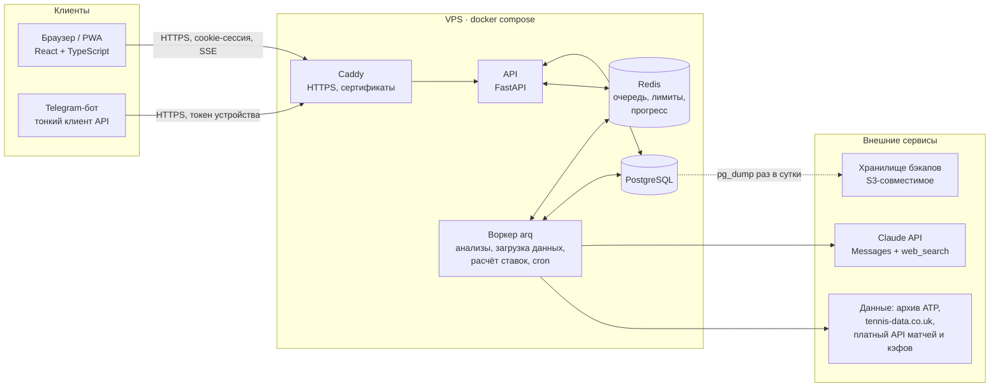
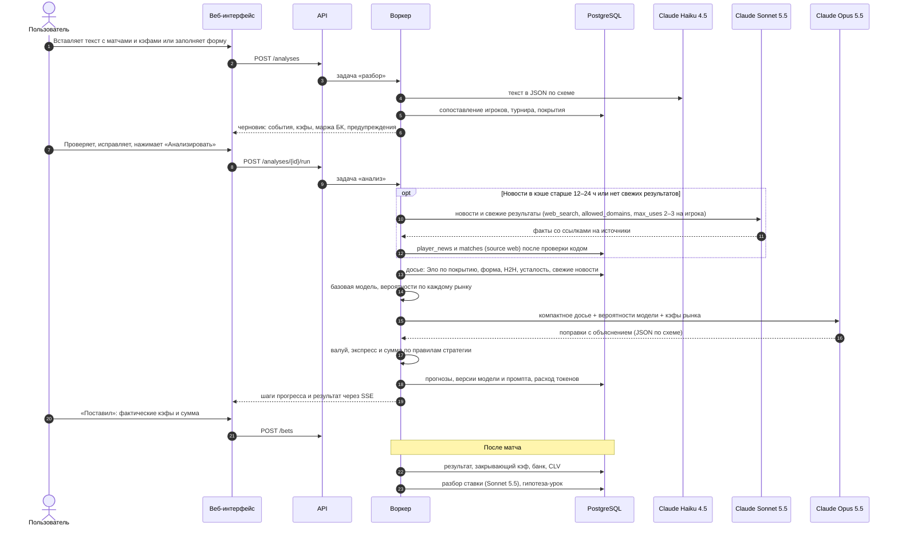
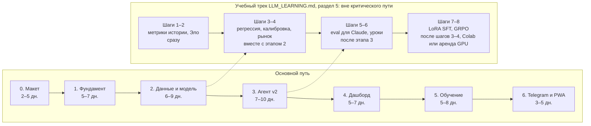

# AI Capper: план веб-приложения

Документ описывает, во что превращаем Telegram-бота: что в нём есть сейчас и что сломано, как будет устроено веб-приложение, на чём его пишем, где храним данные, как защищаем вход, сколько это стоит по времени и деньгам и в каком порядке делаем. Разработка начинается после согласования макета (этап 0).

Связанные документы:

- [TOKEN_ECONOMY.md](TOKEN_ECONOMY.md): как тратить меньше токенов Claude без потери качества. Здесь только итоговые цифры, подробности там.
- [LLM_LEARNING.md](LLM_LEARNING.md): как система учится на ставках и учебный трек по обучению LLM. Здесь только место обучения в архитектуре.
- [../mockup/README.md](../mockup/README.md): кликабельный макет, как его открыть и какие в нём экраны.

## Коротко

1. **Текущий бот в нынешнем виде не работает и небезопасен.** С зафиксированной версией `python-telegram-bot==21.5` он падает при запуске из-за команд на кириллице. Писать ему может любой пользователь Telegram. Через инструмент `read_file` можно прочитать ключи API. Подробности в [разделе 2](#2-аудит-текущей-версии).
2. **Данные о матчах фактически не собираются.** «Веб-поиск» бота возвращает короткие справки из энциклопедий, а не статистику. Цифры вроде процента первой подачи взять неоткуда: Claude либо оставляет null и останавливается, либо может заполнить их по памяти. Проверить это нельзя, потому что источник цифры не сохраняется.
3. **Главный принцип новой версии: числа считает код, контекст добавляет Claude.** Статистика загружается по расписанию в PostgreSQL. Вероятности считает модель в коде. Claude разбирает ввод, ищет новости, поправляет вероятности с объяснением и пишет разбор.
4. **Стек:** React + TypeScript (PWA) на фронтенде, FastAPI + PostgreSQL + Redis/arq на бэкенде, Docker Compose на одном VPS.
5. **Деньги.** Сейчас один анализ стоит по оценке $1–3 (в [TOKEN_ECONOMY.md](TOKEN_ECONOMY.md) разброс $1–4,5). Цель: в среднем не больше $0,30 за анализ. Это около $14–15 в месяц при ~40 анализах (1–2 в день), а при двух анализах каждый день около $19–22 (расчёт в TOKEN_ECONOMY.md, раздел 5).
6. **Сроки.** Примерно 7–10 недель работы одного разработчика с Claude Code (этапы 0–6). Ещё нужны недели реальных ставок, чтобы честно оценить качество прогнозов.
7. **От вас нужно** согласовать макет и ответить на вопросы из [раздела 11](#11-решения-которые-нужны-от-пользователя).

> **Ограничения, о которых нельзя забывать.** Букмекерский рынок эффективен: маржа 5–8 % на событие, а в экспрессе маржи перемножаются. Веса Claude изменить нельзя: через стандартный Claude API дообучение недоступно. Система «учится» через данные, свою модель и уроки в промпте (см. [LLM_LEARNING.md](LLM_LEARNING.md)). Результат на 100 ставках почти ничего не доказывает: стандартная ошибка ROI на такой выборке около ±9–12 п.п. (расчёт в [разделе 5](#как-проверить-что-всё-это-работает)). Приложение даёт аналитику и вероятности, а не гарантию выигрыша.

## Содержание

1. [Цель и что уже есть](#1-цель-и-что-уже-есть)
2. [Аудит текущей версии](#2-аудит-текущей-версии)
3. [Целевая архитектура](#3-целевая-архитектура)
4. [Стек и почему](#4-стек-и-почему)
5. [Хранение данных](#5-хранение-данных)
6. [Источники данных](#6-источники-данных)
7. [Безопасность и личный кабинет](#7-безопасность-и-личный-кабинет)
8. [Производительность](#8-производительность)
9. [Масштабирование](#9-масштабирование)
10. [Дорожная карта](#10-дорожная-карта)
11. [Решения, которые нужны от пользователя](#11-решения-которые-нужны-от-пользователя)

---

## 1. Цель и что уже есть

### Цель

Личный аналитик теннисных ставок в браузере на телефоне и компьютере. Он должен:

- принимать события в привычном формате (текстом, как в боте) или через форму;
- собирать и хранить данные об игроках и матчах;
- считать вероятности по рынкам П1/П2 и форам по сетам, сравнивать их с кэфами и собирать экспресс по вашей стратегии;
- вести банк и историю ставок, считать прибыльность в разрезах (покрытия, кэфы, рынки), калибровку и CLV (насколько ваш кэф лучше закрывающего);
- разбирать каждую ставку после матча и проверять на истории, стали ли прогнозы лучше;
- показывать, сколько стоит ИИ, и держать расход в рамках бюджета;
- пускать только вас (и тех, кого пригласите), со вторым фактором при входе.

### Как работает бот сейчас

| Часть | Где | Что делает |
|---|---|---|
| Настройки | `bot.py:27-34` | Модель `claude-sonnet-4-6`, до 20 итераций агента (`MAX_TOOL_LOOPS`), данные в `Tennis-Analytics/` |
| Системный промпт | `bot.py:50-66` | При запуске склеивает 6 markdown-файлов из `Tennis-Analytics/`: 35,9 КБ, 22 тыс. символов, почти всё на русском |
| Инструменты Claude | `bot.py:73-152` | `web_search`, `read_file`, `write_file`, `list_files`, `read_template` |
| Реализация инструментов | `bot.py:158-268` | Поиск через DuckDuckGo, чтение и запись файлов относительно `Tennis-Analytics/` |
| Цикл агента | `bot.py:274-357` | Добавляет к запросу последние 10 ставок (`bot.py:284-293`), вызывает Claude с `max_tokens=4000` (`bot.py:298-304`), выполняет инструменты, пока Claude не закончит или не кончатся 20 итераций |
| История ставок | `bot.py:363-423` | Чтение `История-ставок.json`, расчёт результата и банка (`save_result`), поиск последней открытой ставки |
| Telegram | `bot.py:429-585` | `/start`, `/статистика`, `/игроки`, `/результат`, кнопки «Победа / Поражение / Возврат», любой текст запускает анализ |
| Стратегия | `Tennis-Analytics/Стратегия-ставок.md` | Экспресс из 2–3 событий, кэф плеча 1.13–1.80, вероятность ≥ 65 %, таблица суммы 1,5–3 % банка, поправки по серии, аудит каждые 10 ставок |
| Сценарий агента | `Tennis-Analytics/CLAUDE.md`, `Инструкция-Авто.md`, `Инструкция-1..3` | Прочитать историю, заполнить или обновить игроков (до 4 и до 6 поисков на игрока), анализ, запись ставки в JSON |
| Профиль игрока | `Tennis-Analytics/_Шаблоны/01..06-*.json` | 6 JSON-файлов на игрока: личные данные, профиль, физика, психология, текущее состояние, матчи с полной статистикой |
| Развёртывание | `Dockerfile`, `docker-compose.yml`, `.github/workflows/deploy.yml` | Один контейнер, папки игроков и ставок смонтированы с диска, деплой по SSH при push |

**Что берём в новую версию:**

- правила стратегии (`Стратегия-ставок.md:175-242`): становятся параметрами версии стратегии в БД, а не текстом для LLM;
- формат ввода событий (`CLAUDE.md:42-50`): его понимает экран «Новый анализ»;
- структура профиля из `_Шаблоны/`: поле `JSONB` для качественных данных (стиль, психология), а числа переезжают в таблицы;
- Telegram: остаётся как тонкий клиент и канал уведомлений;
- деплой через GitHub Actions по SSH: остаётся, но с исправлениями из раздела 2.

---

## 2. Аудит текущей версии

Все пункты перепроверены по коду. Номера строк уточнены по сравнению с прошлым сообщением в чате. «Критично» значит «сломано или опасно уже сейчас».

| # | Проблема | Где | Чем грозит | Важность |
|---|---|---|---|---|
| 1 | **Бот не запускается.** Telegram и `python-telegram-bot` принимают в именах команд только латиницу, цифры и `_`. `CommandHandler("статистика", …)` в версии 21.5 бросает `ValueError: Command 'статистика' is not a valid bot command` (проверено на 21.5) | `bot.py:573-575`, `requirements.txt:1` | `main()` падает до `run_polling()` | Критично |
| 2 | **Нет проверки, кто пишет боту.** Любой, кто найдёт бота, запускает анализы за ваш счёт, видит банк и вносит результаты | `bot.py:524-563`, `bot.py:444-517` | Расход денег на API, порча истории | Критично |
| 3 | **Выход за пределы папки (path traversal).** Путь от Claude приклеивается к `BASE_DIR` без проверки: `BASE_DIR / path`. Абсолютный путь вообще заменяет базовую папку (`Path('/a') / '/proc/self/environ'` даёт `/proc/self/environ`). В Docker `read_file("/proc/self/environ")` отдаёт переменные окружения с `ANTHROPIC_API_KEY` и `TELEGRAM_TOKEN`, а локально то же делает `../.env`. `write_file("../bot.py", …)` перезапишет код. `list_files` показывает содержимое любых папок. `read_template` тоже выходит за пределы папки, но читает только файлы `*.json`: расширение он дописывает сам | `bot.py:199`, `bot.py:212-218`, `bot.py:229`, `bot.py:247` | Вместе с п. 2 утечка ключей становится вопросом одного сообщения. Ещё одна дыра: внедрение команд (prompt injection) через текст, найденный поиском | Критично |
| 4 | **Сбор данных не работает.** `tool_web_search` обращается к DuckDuckGo Instant Answer API. Он возвращает только короткие справки и связанные темы (по сути, выдержки из энциклопедий), а не результаты поиска и не статистику матчей. При этом шаблон `06-матчи.json` требует эйсы, процент первой подачи, скорость подачи по каждому матчу | `bot.py:158-194` (запрос на `bot.py:162-171`), `_Шаблоны/06-матчи.json` | Claude либо останавливается («⛔ Анализ невозможен»), либо заполняет цифры по памяти, то есть выдумывает. Сайты из инструкций (flashscore, sofascore, `CLAUDE.md:82-87`) через этот API не читаются, а их правила запрещают автоматический сбор | Критично |
| 5 | **Числа считает LLM, и их никто не проверяет.** Вероятности, валуй, итоговый кэф и сумму пишет Claude текстом. Пример в инструкции противоречит сам себе: вероятность 68 % при кэфе 2.50 даёт валуй +70 %, а в записи стоит 12,5 % | `Инструкция-Авто.md:102-105`, `Стратегия-ставок.md:142-171` | Арифметические ошибки уходят прямо в ставку | Высокая |
| 6 | **Обучения как такового нет.** Есть только фиксированные правила (3 проигрыша подряд → сумма −40 % и т. п.) и «аудит каждые 10 ставок, применяется автоматически без подтверждения». Вероятность каждого исхода сохраняется (`вероятность_процент`), но с исходом её никто не сравнивает. Закрывающие кэфы не сохраняются | `Стратегия-ставок.md:232-242`, `Стратегия-ставок.md:295-307` | 10 ставок дают чистый шум, а стратегия меняется под случайность | Высокая |
| 7 | **В правилах стратегии заложен вероятный минус.** Правило «нет валуя, но события надёжные → ставка минимум 1,5 % банка» разрешает ставку при оценённом перевесе ниже 5 % или даже отрицательном (шкала `Стратегия-ставок.md:225-230`). При марже 5–8 % и неточной вероятности такая ставка, скорее всего, в минусе на дистанции. В экспрессе маржи плеч перемножаются: при марже 5 % на плечо у экспресса из 2 событий она около 10 % (1,05² ≈ 1,10), из 3 событий около 16 % | `Стратегия-ставок.md:208`, `Стратегия-ставок.md:179-181` | Систематический убыток, если перевес прогноза меньше суммарной маржи экспресса | Высокая (решение за вами, см. раздел 11) |
| 8 | **Ошибки расчёта результата.** (а) Нет защиты от повторного нажатия: каждое нажатие на «Победа» снова прибавляет выигрыш к банку. (б) Сумма ставки не списывается в момент ставки. Поэтому следующая ставка считается в % от банка, в котором ещё лежат деньги открытых ставок, а «банк после» у ставки зависит от порядка нажатий. (в) Если банк в файле пуст, он считается равным 0. (г) Возвраты считаются поражениями: `поражения = завершённые − победы`. (д) `/результат` показывает только последнюю открытую ставку, более ранние кнопкой не закрыть. (е) Поле `серия_текущая` код не обновляет | `bot.py:379-416` ((а)-(в): `bot.py:383-401`, (г): `bot.py:409`), `bot.py:418-423` | Неверный банк и неверная статистика | Высокая |
| 9 | **Целостность истории зависит от LLM.** Ставку в `История-ставок.json` записывает сам Claude через `write_file`, переписывая файл целиком. В контексте у него при этом только последние 10 ставок. Проверяется только синтаксис JSON | `Инструкция-Авто.md:66-73`, `bot.py:288`, `bot.py:215-217` | Потеря или искажение старых записей | Высокая |
| 10 | **Конкурентный доступ.** Сейчас обновления Telegram обрабатываются по одному (так в `python-telegram-bot` по умолчанию), поэтому гонок при записи почти нет. Цена этого: на время анализа (минуты) бот не отвечает ни на что, в том числе на `/результат`. В веб-версии с несколькими воркерами схема «прочитал JSON, изменил, записал» начнёт терять данные | `bot.py:569-585`, `bot.py:363-416` | Зависание бота сейчас, потеря данных потом | Средняя |
| 11 | **Токены и деньги.** Системный промпт (35,9 КБ) и последние 10 ставок (JSON с отступами) отправляются заново на каждой итерации, а их до 20. Кэширования промпта нет. Оценка: $1–3 за анализ (раздел 8), в [TOKEN_ECONOMY.md](TOKEN_ECONOMY.md) с более полными допущениями $1–4,5 | `bot.py:66`, `bot.py:291`, `bot.py:297-304` | Основная статья расходов | Высокая, см. [TOKEN_ECONOMY.md](TOKEN_ECONOMY.md) |
| 12 | **Модель и SDK устарели.** `claude-sonnet-4-6` — модель предыдущего поколения, $3/$15 за 1 млн токенов, а текущая Sonnet 5.5 стоит $2/$10. `anthropic==0.34.0` вышел в августе 2024 года (сейчас актуальна ветка 1.x). Если ответ упирается в `max_tokens=4000`, обрезанный текст молча уходит пользователю как будто это полный ответ | `bot.py:29`, `requirements.txt:2`, `bot.py:300`, `bot.py:352-355` | Переплата, обрезанные ответы | Средняя |
| 13 | **Инструкции противоречат друг другу.** Стратегия требует «файл матча (.md)» как критичный и велит брать кэфы «только из файла матча», а сценарий говорит, что файла матча нет. Стратегия запрещает интернет, а сценарий требует искать | `Стратегия-ставок.md:34`, `Стратегия-ставок.md:316` против `Инструкция-Авто.md:11`, `Инструкция-3-анализ.md:5`; `Стратегия-ставок.md:15` | Claude останавливается или импровизирует | Средняя |
| 14 | **Экспресс определяется по ключевым словам.** Кнопка «Внести результат» появляется, если в ответе есть слово «ЭКСПРЕСС». Шаблон ответа содержит это слово даже в варианте «ставок нет» | `bot.py:553`, `Стратегия-ставок.md:276-290` | Ложные кнопки, ставка не сохраняется как структура | Низкая |
| 15 | **Деплой не совпадает с инструкцией.** В README ветка `master` и папка `~/ai_agent_capper`, а workflow срабатывает на `main` и делает `cd ~/tennis-bot`. README советует положить в секреты GitHub личный ключ `~/.ssh/id_rsa` | `README.md:59-61`, `README.md:112`, `README.md:129`, `README.md:153`, `.github/workflows/deploy.yml:5`, `.github/workflows/deploy.yml:22` | Автодеплой не сработает. Утечка секрета даёт доступ ко всему, куда пускает ваш личный ключ | Средняя |
| 16 | **Промпт читается один раз при старте** и не имеет версии | `bot.py:66` | Правка стратегии требует перезапуска, а версии нельзя сравнить между собой | Низкая |

### Если бот нужен до запуска веб-версии

Это 1–2 часа работы, и их стоит сделать сразу, не дожидаясь этапа 1:

```python
# 1) Только разрешённые пользователи. В .env: ALLOWED_TELEGRAM_IDS=123456789
ALLOWED_IDS = {int(x) for x in os.environ["ALLOWED_TELEGRAM_IDS"].split(",")}

def allowed(update: Update) -> bool:
    return update.effective_user is not None and update.effective_user.id in ALLOWED_IDS
# первой строкой в каждом обработчике: if not allowed(update): return

# 2) Пути только внутри Tennis-Analytics
BASE_REAL = BASE_DIR.resolve()

def safe_path(rel: str) -> Path:
    p = (BASE_DIR / rel).resolve()
    if not p.is_relative_to(BASE_REAL):
        raise ValueError("путь вне Tennis-Analytics")
    return p
# использовать в tool_read_file, tool_write_file, tool_list_files, tool_read_template
```

Ещё три правки:

3. Переименовать команды в латиницу: `/stats`, `/players`, `/result` (`bot.py:573-575`), обновить текст `/start` (`bot.py:439-441`) и список команд в BotFather.
4. В `save_result` (`bot.py:383`) не пересчитывать ставку, у которой статус уже заполнен.
5. Поставить месячный лимит расходов в консоли Anthropic.

---

## 3. Целевая архитектура

### Компоненты



- **API** быстро отвечает на запросы интерфейса. Всё долгое (анализ, загрузка данных) он ставит в очередь и сразу возвращает идентификатор задачи.
- **Воркер** выполняет задачи из очереди и по расписанию (cron в arq): ночная загрузка результатов и статистики, пересчёт Эло, расчёт ставок, разборы.
- **Прогресс анализа** воркер публикует в Redis. API передаёт его в браузер через SSE (Server-Sent Events, односторонний поток событий поверх обычного HTTP).
- **Claude вызывает только воркер.** Браузер и Telegram к Claude напрямую не обращаются, ключ API живёт только на сервере.
- **Telegram-бот** — обычный клиент того же API: пересылает текст в `POST /analyses`, присылает результат и уведомления. Своей логики и своих файлов у него нет.

### Кто что делает: код против Claude

| Задача | Кто | Почему |
|---|---|---|
| Разбор свободного текста ввода в структуру | Claude Haiku 4.5, ответ по JSON-схеме (structured outputs). Код проверяет схему, вы подтверждаете на экране | Язык свободный, а ошибку разбора лучше увидеть до анализа |
| Статистика матчей, рейтинги, результаты | Код, плановая загрузка в БД. Свежие результаты, пока нет платного API, см. [раздел 6](#свежесть-результатов-без-платного-api) | Числа должны быть точными и проверяемыми |
| Эло по покрытиям, форма, усталость (матчи и сеты за 14 дней), H2H | Код: SQL и Python | Детерминированно, бесплатно, покрывается тестами |
| Базовые вероятности по рынкам | Код: модель (сначала Эло, потом логистическая регрессия или бустинг) | Калибруется на тысячах исторических матчей |
| Новости: травмы, снятия, мотивация | Claude Sonnet 5.5 (effort `low`) с серверным `web_search` (`allowed_domains`, `max_uses`). Это отдельный шаг до анализа, и он запускается, только если новости в кэше устарели. Каждая новость сохраняется с источником и датой | Это неструктурированный текст, с ним LLM справляется лучше кода. Извлечь факты может модель дешевле Opus |
| Поправка к вероятности | Claude Opus 5.5, без веб-поиска: новости уже в досье. Предлагаю ограничить поправку ±10 п.п. и требовать объяснение. Обе вероятности, модели (`p_base`) и Claude (`p_claude`), сохраняются | Позже станет видно, добавляет ли поправка точности ([LLM_LEARNING.md](LLM_LEARNING.md)). Вопрос 16 в [разделе 11](#11-решения-которые-нужны-от-пользователя) |
| Маржа БК, валуй, отбор в экспресс, сумма | Код по параметрам активной версии стратегии | Арифметика не должна зависеть от LLM |
| Объяснение для человека | Claude | Для этого LLM и нужна |
| Разбор после матча | Claude Sonnet 5.5 формулирует гипотезу-урок, код проверяет её на истории | Урок попадает в промпт только после проверки |

### Поток одного анализа



Статусы анализа: `queued → parsing → needs_confirmation → building_dossier → modelling → llm_review → composing → done`. Отдельно есть статусы `failed` и `cancelled`. Каждый переход пишется в БД. Если воркер упал, задачу можно перезапустить с последнего шага, не повторяя дорогие вызовы.

На экране «Анализ» в макете статусы показаны так: `parsing` — «Разбор событий»; `needs_confirmation` — подтверждение на экране «Новый анализ»; `building_dossier` — «Проверка базы игроков», «Сбор профиля» и «Обновление формы: свежие матчи и новости»; `modelling` — «Расчёт модели»; `llm_review` — «Анализ Claude»; `composing` — «Подбор экспресса».

**Поиск и ответ по схеме разведены по разным вызовам.** У Opus 5.5 в анализе поиска нет, а ответ приходит по JSON-схеме (structured outputs). Не проверено, можно ли совместить `web_search` и ответ по схеме (`output_config.format`) в одном запросе: structured outputs несовместимы с цитатами (ошибка 400), а у `web_search` цитаты есть всегда. Проверить на живом API в начале этапа 3. Если совместить нельзя, шаг новостей отдаёт факты текстом с цитатами, а в JSON их переводит код или короткий вызов Haiku 4.5 без поиска.

Прогнозы сохраняются по **всем** разобранным матчам и рынкам, а не только по тем, что попали в экспресс. Метрики считаются по матчам: одна оценка П1 и одна оценка «2:0» на матч, интервалы — бутстрэпом по матчам. Рынки одного матча зависимы (П2 = 1 − П1, П2(+1.5) = 1 − П1(−1.5)), поэтому выигрыш в скорости оценки даёт число разобранных матчей, а не рынков.

### Основные адреса API

| Адрес | Назначение |
|---|---|
| `POST /auth/login`, `POST /auth/2fa`, `POST /auth/logout` | Вход в два шага, выход |
| `GET /me/sessions`, `DELETE /me/sessions/{id}` | Активные сеансы, завершение сеанса |
| `POST /analyses`, `POST /analyses/{id}/run`, `GET /analyses/{id}` | Создать, запустить, получить анализ |
| `GET /analyses/{id}/events` | Прогресс анализа (SSE) |
| `GET /bets`, `POST /bets`, `POST /bets/{id}/settle` | Ставки и расчёт результата |
| `GET /players?q=…`, `GET /players/{id}` | База игроков, карточка игрока |
| `GET /analytics/roi?group_by=surface` (также `market`, `odds`), `GET /analytics/calibration` | Аналитика |
| `GET /ai/runs`, `GET /ai/budget` | Расходы на ИИ |
| `GET /strategy/versions`, `GET /lessons`, `PATCH /lessons/{id}` | Стратегия и уроки |

Схема API генерируется FastAPI автоматически (OpenAPI), а из неё генерируются типы для фронтенда. Так фронтенд и бэкенд не расходятся в формате данных.

### Структура репозитория

```
ai_agent_capper/
├── backend/
│   ├── app/
│   │   ├── api/          # маршруты FastAPI
│   │   ├── core/         # настройки, безопасность, сессии
│   │   ├── db/           # модели SQLAlchemy, запросы
│   │   ├── agent/        # вызовы Claude, схемы ответов, инструменты для чтения БД
│   │   ├── prompts/      # промпты в markdown с номером версии
│   │   ├── ml/           # Эло, базовая модель, калибровка, бэктест
│   │   ├── ingest/       # загрузчики данных
│   │   └── worker.py     # задачи arq и расписание
│   ├── alembic/          # миграции схемы БД
│   └── tests/
├── frontend/             # React + TypeScript + Vite
├── deploy/               # docker-compose.yml, Caddyfile, скрипты бэкапа
├── lab/                  # учебный трек (LLM_LEARNING.md, раздел 5): ноутбуки, экспорт JSONL, конфиги LoRA и GRPO; на прод не влияет
├── legacy/               # текущий bot.py до отключения
├── docs/  mockup/
```

---

## 4. Стек и почему

| Слой | Выбор | Почему | Что рассматривали |
|---|---|---|---|
| Фронтенд | React + TypeScript + Vite | Приложение целиком за логином, SEO и серверный рендеринг не нужны. Vite проще и быстрее Next.js для такого случая | Next.js (лишняя серверная часть), Vue (меньше готовых компонентов под задачу) |
| Интерфейс | Tailwind CSS + shadcn/ui (на Radix) | Компоненты лежат в коде проекта, доступны с клавиатуры и для экранных дикторов, на них легко перенести токены цветов из макета | MUI, Ant Design (тяжелее, сложнее перекрашивать) |
| Данные на клиенте | TanStack Query, TanStack Table | Кэш запросов, повторы, фоновые обновления. Таблица ставок с сортировкой и фильтрами | Redux Toolkit Query, SWR |
| Формы | React Hook Form + Zod | Валидация ввода событий (кэф ≥ 1.01, сумма > 0) прямо в форме | Formik |
| Графики | Recharts, а для тяжёлых графиков ECharts | Банк, ROI по срезам, калибровка | Chart.js, D3 (много ручной работы) |
| Телефон | PWA: манифест + service worker | Ставится на главный экран, одна кодовая база. Push-уведомления позже | React Native (вторая кодовая база), отдельное приложение в сторах |
| Бэкенд | Python 3.12 + FastAPI + Pydantic v2 | Python — это pandas, scikit-learn и LightGBM для модели. FastAPI асинхронный и сам строит OpenAPI. Pydantic проверяет и вход API, и ответы Claude | Django (тяжелее, асинхронность слабее), Node.js (хуже для ML) |
| ORM и миграции | SQLAlchemy 2 (async) + asyncpg, Alembic | Стандарт де-факто, миграции под версионированием | SQLModel, Tortoise |
| База | PostgreSQL 16+ | Транзакции, ограничения, оконные функции для аналитики, `JSONB` для профилей, `pg_trgm` для поиска игроков по имени. При необходимости `pgvector` | SQLite (один писатель), MongoDB (нет связей и транзакций в нужном виде) |
| Фоновые задачи | Redis + arq | Асинхронный, как и FastAPI, расписание (cron) встроено, мало кода | Celery (тяжелее, синхронный по природе), RQ, Dramatiq |
| Прогресс | SSE | Поток в одну сторону поверх HTTP, проще WebSocket, работает через Caddy без настроек | WebSocket, опрос раз в секунду |
| LLM | Официальный Python SDK `anthropic` (ветка 1.x) напрямую | Полный контроль над кэшированием, схемами ответов, effort и расходом. Меньше слоёв, которые могут сломаться | LangChain / LlamaIndex (лишние абстракции, хуже контроль над кэшем) |
| ML | pandas или polars, scikit-learn, позже LightGBM | Эло, логистическая регрессия, калибровка, бэктест | Готовые «предсказатели» без прозрачности |
| Вход | Свой модуль на проверенных библиотеках: `argon2-cffi`, `pyotp`, сессии в БД | Схема простая (один-несколько пользователей), полный контроль, совпадает с макетом. Сами алгоритмы не изобретаем, только связываем библиотеки | Auth0 / Clerk (внешняя зависимость), Keycloak (тяжело для одного пользователя), fastapi-users |
| Инфраструктура | Docker Compose на одном VPS, Caddy | Пять контейнеров, HTTPS-сертификаты Caddy получает и продлевает сам | Kubernetes (избыточно), Nginx + certbot (больше ручной настройки) |
| CI/CD | GitHub Actions: тесты, сборка, деплой по SSH | Уже есть, нужно починить (раздел 2, п. 15) | — |
| Наблюдаемость | Структурные логи (structlog), таблица `agent_runs`, проверка доступности. Sentry по желанию | Расход и ошибки ИИ видны на экране «ИИ и расходы» | Prometheus + Grafana (позже, если понадобится) |
| Тесты | pytest, Playwright для сквозных сценариев (вход с 2FA, новый анализ, расчёт ставки) | Главные сценарии проверяются автоматически перед деплоем | — |

---

## 5. Хранение данных

### Решение: PostgreSQL, а не markdown и JSON

| Критерий | Файлы markdown/JSON (сейчас) | PostgreSQL |
|---|---|---|
| ROI по покрытиям, калибровка, CLV | Код должен прочитать все файлы и посчитать сам | Один SQL-запрос с `GROUP BY` за миллисекунды |
| Одновременная запись (веб, воркер, Telegram) | Схема «прочитал, изменил, записал» теряет данные | Транзакции и блокировки строк |
| Целостность | Любой JSON проходит. LLM может переписать историю | Внешние ключи, `CHECK`, уникальность. Например, невозможно рассчитать одну ставку дважды |
| Стоимость для LLM | Claude читает файлы через инструменты, и это токены | Код собирает компактное досье: только нужные поля |
| Бэкап и восстановление | Копирование папки, без согласованности | `pg_dump` и проверенное восстановление |
| Версионирование промптов и стратегии | Git, удобно | В таблицах неудобно читать глазами |

Вывод: **данные хранятся в PostgreSQL, а тексты промптов в markdown в репозитории** (`backend/app/prompts/*.md`, каждый с номером версии). Числовые параметры стратегии (минимальная вероятность 65 %, диапазон кэфов 1.13–1.80, таблица суммы) переезжают из `Стратегия-ставок.md` в `strategy_versions.params`. Код их применяет, экран «Личный кабинет → Банк и стратегия» их показывает. С каждым прогнозом сохраняются версия промпта (хеш файла) и версия стратегии. Так версии можно сравнивать между собой (экран «Обучение модели → Версии стратегии»).

### Таблицы

Общие для всех пользователей: игроки, турниры, матчи, статистика, рейтинги, новости, кэфы рынка, досье, свои ML-модели, цены моделей. Личные (с `user_id` с первого дня): анализы, прогнозы, ставки, банк, стратегия, уроки, секреты, сеансы.

Это единая схема проекта. [LLM_LEARNING.md](LLM_LEARNING.md) и [TOKEN_ECONOMY.md](TOKEN_ECONOMY.md) объясняют, зачем нужны поля для обучения и учёта расходов, но таблиц не переопределяют. Если документы расходятся, верна таблица ниже.

| Таблица | Назначение | Ключевые поля | Индексы и ограничения |
|---|---|---|---|
| `users` | Пользователи | `email`, `password_hash` (Argon2id), `totp_secret_enc`, `totp_enabled`, `role`, `tz`, `currency`. Счётчики неудачных попыток входа лежат в Redis ([раздел 7](#вход-и-личный-кабинет-как-в-макете)) | `UNIQUE(lower(email))` |
| `sessions` | Сеансы входа | `id_hash` (хеш случайного токена), `user_id`, `created_at`, `last_seen_at`, `expires_at`, `ip`, `user_agent`, `device_label`, `revoked_at` | `(user_id)`, `(expires_at)` |
| `trusted_devices` | «Запомнить устройство на 30 дней» | `token_hash`, `user_id`, `expires_at`, `revoked_at` | `(user_id)` |
| `recovery_codes` | Резервные коды 2FA | `user_id`, `code_hash`, `used_at` | `(user_id)` |
| `login_events` | Журнал входов | `user_id`, `at`, `ip`, `user_agent`, `result` (ok, bad_password, bad_totp, rate_limited) | `(user_id, at DESC)` |
| `invites` | Приглашения | `code_hash`, `email`, `expires_at`, `used_at` | `UNIQUE(code_hash)` |
| `user_secrets` | Ключи (например, свой ключ Anthropic, привязка Telegram) | `user_id`, `kind`, `ciphertext`, `key_version`, `last4` | `UNIQUE(user_id, kind)` |
| `players` | Игроки | `name`, `name_ru`, `aliases[]`, `country`, `hand`, `backhand`, `birth_date`, внешние id (`sackmann_id`, `provider_id`) | GIN-индекс `pg_trgm` по именам, `UNIQUE(sackmann_id)` |
| `player_profiles` | Качественный профиль (структура из `_Шаблоны/01-04`) | `player_id`, `profile JSONB`, `source`, `updated_at` | `PK(player_id)` |
| `player_ratings` | Эло по покрытиям | `player_id`, `surface`, `elo`, `matches`, `as_of` | `PK(player_id, surface, as_of)` |
| `player_news` | Новости | `player_id`, `published_at`, `kind` (травма, снятие, мотивация), `summary`, `source_url`, `source_name`, `fetched_at` | `(player_id, published_at DESC)`, `UNIQUE(player_id, source_url)` |
| `tournaments` | Турниры | `name`, `category`, `surface`, `indoor`, `best_of`, `start_date`, `city` | `(start_date)` |
| `matches` | Матчи | `tournament_id`, `round`, `scheduled_at`, `player1_id`, `player2_id`, `winner_id`, `score`, `status` (scheduled, finished, retired, walkover), `best_of`, `source` (sackmann, tennis_data, api, web) | `(scheduled_at)`, `(player1_id)`, `(player2_id)`, `UNIQUE(tournament_id, round, player1_id, player2_id)` |
| `match_stats` | Статистика матча по игроку | `match_id`, `player_id`, `aces`, `double_faults`, `first_in`, `first_won`, `second_won`, `bp_saved`, `bp_faced`, `serve_games`, `source` | `PK(match_id, player_id)` |
| `odds_snapshots` | Кэфы | `match_id`, `market` ('ML', 'HCP_-1.5', 'HCP_+1.5' …), `selection` (1 или 2), `bookmaker`, `odds`, `kind` (user, opening, closing, api), `taken_at` | `(match_id, market, taken_at)` |
| `dossiers` | Досье на момент анализа (снимок входа для Claude) | `match_id`, `as_of`, `content JSONB` (полный текст досье), `sha256`, `feature_set`, `news_version`. Кэфов и банка пользователя в досье нет, поэтому оно общее | `UNIQUE(sha256)`, `(match_id, as_of)` |
| `analyses` | Запросы на анализ | `user_id`, `input_text`, `parsed JSONB`, `status`, `strategy_version_id`, `prompt_version`, `created_at`, `finished_at` | `(user_id, created_at DESC)` |
| `predictions` | Прогнозы (только INSERT) | `user_id`, `analysis_id`, `match_id`, `market`, `selection`, `created_at`, `as_of` (данные не новее этого момента), `dossier_id`, `features JSONB` (признаки на момент `as_of`), `feature_set`, `strategy_version_id`, `ml_model_id`, `llm_model`, `effort`, `prompt_version`, `lessons_applied[]`, `p_base` (своя модель), `p_claude` (после поправки Claude), `p_final` (после стэкинга и калибровки), `q_market_at_pred` (рынок без маржи в момент прогноза), `rationale`, `agent_run_id`, `supersedes` (какой прогноз исправляет), `is_eval` и `eval_run_id` (бэктест или eval, а не боевой прогноз) | `UNIQUE(analysis_id, match_id, market, selection) WHERE supersedes IS NULL`, `UNIQUE(eval_run_id, match_id, market, selection)`, `UNIQUE(supersedes)`, `(match_id)`, `(strategy_version_id, created_at)` |
| `bets` | Ставки | `user_id`, `analysis_id`, `placed_at`, `bookmaker`, `stake`, `total_odds`, `status` (open, won, lost, void), `profit`, `settled_at` | `(user_id, placed_at DESC)`, `(user_id, status)` |
| `bet_legs` | События экспресса | `bet_id`, `match_id`, `market`, `selection`, `odds_taken`, `closing_odds`, `prediction_id`, `result` (win, loss, void), `clv` | `(bet_id)`, `(match_id)` |
| `bankroll_ledger` | Журнал движения банка | `user_id`, `at`, `kind` (deposit, withdrawal, stake, payout, refund, reversal, correction), `amount`, `bet_id`, `reversed_by` (ссылка на запись-сторно) | `(user_id, at)`, `UNIQUE(bet_id) WHERE kind = 'stake'`, `UNIQUE(bet_id) WHERE kind IN ('payout', 'refund') AND reversed_by IS NULL` |
| `strategy_versions` | Версии стратегии | `user_id`, `code` ('v3'), `name`, `params JSONB` (пороги стратегии), `prompt_version` (sha256 текста промпта), `lessons[]` (коды уроков в промпте), `status` (candidate, active, archived), `metrics JSONB` (сводка последнего eval), `approved_by`, `approved_at` | `UNIQUE(user_id, code)`, `UNIQUE(user_id) WHERE status = 'active'` |
| `lessons` | Уроки из разборов | `user_id`, `code` ('L-017'), `text`, `scope_sql` (условие применимости, которое проверяет код), `kind` (numeric, process), `status` (hypothesis, confirmed, rejected, retired), `n_cases`, `effect` (средний остаток y − p), `effect_ci`, `source_bet_ids[]`, `validated_at`, `in_prompt` | `UNIQUE(user_id, code)`, `(user_id, status)` |
| `ml_models` | Свои ML-модели: Эло, регрессия, бустинг, стэкинг | `id` ('elo-2026-10'), `kind`, `train_from`, `train_to`, `feature_set`, `params JSONB` (в том числе коэффициенты стэкинга, включая вес поправки Claude c), `metrics JSONB` (walk-forward), `artifact_path`, `created_at` | `(kind, created_at DESC)` |
| `eval_runs` | Прогоны eval-набора и бэктеста | `version_id` (версия стратегии или ML-модели), `eval_set` (версия замороженного набора), `split` (train, validation, test), `n_events`, `metrics JSONB` (лог-лосс, Brier, ECE, CLV, ROI с ДИ), `cost_usd`, `created_at` | `(version_id, created_at DESC)` |
| `agent_runs` | Каждый вызов Claude | `user_id` (пусто у общих задач), `analysis_id`, `eval_run_id`, `kind` (parse, news, analysis, refresh, postmortem, eval, shadow), `step`, `model`, `effort`, `prompt_version`, `schema_version`, `input_tokens`, `cache_write_tokens`, `cache_read_tokens`, `output_tokens`, `thinking_tokens`, `web_searches`, `batch`, `cost_usd`, `duration_ms`, `stop_reason`, `error`, `request_id`, `created_at`. `input_tokens` — вход без кэша, как `usage.input_tokens` в API. Откуда берётся каждое поле, описано в [TOKEN_ECONOMY.md](TOKEN_ECONOMY.md), раздел 1.1 | `(created_at)`, `(kind, created_at)`, `(analysis_id)` |
| `model_prices` | Цены моделей для расчёта `cost_usd` | `model`, `valid_from`, `input`, `output`, `cache_read`, `cache_write_5m`, `cache_write_1h` (за 1 млн токенов), `search_price` (за один поиск) | `PK(model, valid_from)` |
| `ingestion_runs` | Загрузки данных | `source`, `started_at`, `finished_at`, `rows`, `status`, `error` | `(source, started_at DESC)` |

Правила, которые закрывают ошибки из аудита:

- **Банк не хранится одним числом.** Он считается как сумма `bankroll_ledger`. Ставка списывается записью `stake` в момент ставки, а банк для расчёта суммы — это сумма журнала на `placed_at` (п. 8б аудита). Частичные уникальные индексы не дают списать или выплатить одну ставку дважды (п. 8а). Исправление результата — запись-сторно (`reversal`) плюс новая выплата. Строки журнала не удаляются и не меняются, кроме однократной отметки `reversed_by`.
- **Деньги** хранятся как `NUMERIC(12,2)`, кэфы как `NUMERIC(6,3)`. Тип `float` для денег не используем. Время хранится в `timestamptz` (UTC), показывается в поясе пользователя (Europe/Moscow).
- **Прогноз неизменяем.** После создания его не редактируют. Исправленный прогноз — новая строка со ссылкой `supersedes` на старую. Иначе честная оценка невозможна ([LLM_LEARNING.md](LLM_LEARNING.md)).
- **Возврат** — отдельный статус и в ставке, и в событии. Плечо с возвратом считается с кэфом 1.00.

### Перенос текущих данных

Скрипт импорта на этапе 1:

1. `Ставки/История-ставок.json` переносится в `bets`, `bet_legs`, `predictions` (`вероятность_процент` идёт в `p_claude`, версия стратегии `legacy`) и `bankroll_ledger`. Банк пересчитывается из журнала и сверяется с `meta.текущий_банк`, расхождения выводятся в отчёт.
2. `Игроки/*/01-04` переносятся в `player_profiles.profile` с `source='legacy_llm'`.
3. Файлы `05` и `06` с цифрами **в модель не идут**: они могли быть заполнены по памяти (п. 4 аудита). Статистика заново загружается из источников (раздел 6).

### Бэкапы

- `pg_dump -Fc` каждую ночь. Файл шифруется (age или gpg) и уходит во внешнее S3-совместимое хранилище, не на тот же сервер.
- Хранение: 7 ежедневных, 4 еженедельных, 6 ежемесячных копий.
- Раз в месяц восстановление в отдельный контейнер со сверкой числа ставок и банка. Бэкап, который ни разу не восстанавливали, считается непроверенным.
- Позже, при нескольких пользователях: архивирование WAL (pgBackRest или wal-g), чтобы восстанавливать базу на любой момент времени.

### Как проверить, что всё это работает

Почему метрики важнее «плюса за месяц». Возьмём одну ставку с кэфом *k* и вероятностью выигрыша *p*. Её результат на рубль ставки имеет разброс (стандартное отклонение) *k·√(p(1−p))*. При кэфе 1.8 и *p* = 0,55 это около 0,9, при кэфе 2.5 и *p* = 0,4 около 1,2. После 100 ставок стандартная ошибка ROI получается ±9–12 п.п., а 95-процентный интервал около ±18–24 п.п. Значит, ROI +5 % на 100 ставках ничем не отличается от −5 %. Поэтому дашборд показывает не только ROI, но и Brier / лог-лосс против рынка и CLV: они сходятся гораздо быстрее. Подробно, с размерами выборок, в [LLM_LEARNING.md](LLM_LEARNING.md).

---

## 6. Источники данных

| Источник | Что даёт | Обновление | Цена | Лицензия и условия | Как используем |
|---|---|---|---|---|---|
| Архив Джеффа Сакманна `tennis_atp` (GitHub) | Матчи ATP за десятилетия, статистика подачи по матчам основного тура, рейтинги, справочник игроков (CSV) | Нерегулярно, бывают задержки. **Проверить, насколько свежи данные за 2025–2026** | Бесплатно | CC BY-NC-SA 4.0 (некоммерческое использование, с указанием автора, производные под той же лицензией). **Проверить текст лицензии в репозитории**. Для личного проекта подходит, для платного сервиса нет | История для Эло и модели, бэктест, статистика подачи и приёма |
| tennis-data.co.uk | Результаты матчей ATP/WTA с кэфами нескольких букмекеров, включая Pinnacle, плюс максимальный и средний кэф по рынку (Excel-файлы по годам, наличие CSV проверить) | После матчей, с задержкой (**частоту обновления проверить**) | Бесплатно | **Проверить условия сайта** и то, в какой момент сняты кэфы (закрытие или другой момент). От этого зависит, годятся ли они как «закрывающая линия» | Бэктест и сравнение модели с рынком |
| Платный API матчей и кэфов (варианты: api-tennis.com, The Odds API, Sportradar и др.) | Расписание, результаты в течение дня, кэфы, иногда статистика | Почти в реальном времени | От десятков долларов в месяц у небольших провайдеров до договоров у Sportradar. **Цены, покрытие турниров и наличие ваших букмекеров проверить** | Условия конкретного провайдера | Свежие матчи и результаты для автоматического расчёта ставок, закрывающие кэфы. Решение после этапа 2 (раздел 11) |
| Ваш ввод | Кэфы вашего букмекера на момент ставки. При желании кэф перед началом матча | В момент ставки | Бесплатно | — | Главный источник кэфов. Fonbet, Лига Ставок и Winline публичные API, скорее всего, не покрывают |
| Claude `web_search` (серверный инструмент, `web_search_20260209`) | Новости: травмы, снятия, смена тренера, мотивация. Свежие результаты, пока нет платного API (см. ниже) | Перед анализом, если кэш устарел, или при ночном обновлении | $10 за 1000 поисков ($0,01 за поиск) плюс токены результатов во входе. Сверить со страницей цен перед запуском | Источник сохраняется в `player_news.source_url` | Отдельный шаг Sonnet 5.5 (effort `low`) до анализа. `allowed_domains`: atptour.com, сайты турниров, крупные спортивные СМИ. `max_uses` 2–3 на игрока, не больше 6 на анализ и 15 в день ([TOKEN_ECONOMY.md](TOKEN_ECONOMY.md), раздел 6). Результаты кэшируются в БД и общие для всех пользователей |
| atptour.com, wtatennis.com | Официальные рейтинги, расписания, профили | — | Бесплатно | **Проверить условия использования и robots.txt.** Массовый сбор не планируем | Точечно, через поиск. `web_fetch` открывает только адреса, которые уже есть в запросе или в результатах поиска |
| Flashscore, Sofascore | Подробная статистика, лайв | — | — | Правила сайтов запрещают автоматический сбор | **Не парсим.** Читать глазами можно |

Порядок подключения: на этапе 2 Сакманн и tennis-data.co.uk дают историю и бэктест бесплатно. Платный API подключаем, если бэктест покажет смысл и вы готовы платить (раздел 11). WTA добавляется тем же способом (`tennis_wta`), если понадобится. Сейчас стратегия только про мужской одиночный разряд (`Стратегия-ставок.md:5`).

Отдельная деталь: на турнирах Большого шлема мужчины играют до трёх выигранных сетов, и форы там другие (−1.5 / −2.5 по сетам). В текущей стратегии это не учтено, поэтому в `matches` и `tournaments` хранится `best_of`.

### Свежесть результатов без платного API

Для досье нужны форма и усталость за последние 14 дней, то есть результаты текущих турниров. Архив Сакманна и tennis-data.co.uk отстают на дни или недели (частоту обновления проверить), поэтому без платного API вчерашних матчей в базе не будет, и модель молча посчитает форму по устаревшим данным. Пока платного API нет:

- результаты последних 7 дней ищет тот же шаг Sonnet 5.5 с `web_search`, что и новости (atptour.com: сетки и результаты турнира). Поиски входят в те же лимиты;
- ответ приводится к JSON-схеме (как именно, зависит от проверки совместимости в [разделе 3](#поток-одного-анализа)) и проверяется кодом: игроки есть в БД, турнир известен, счёт допустим для `best_of`;
- матч сохраняется в `matches` с `source='web'`, а при ночной загрузке архива заменяется его данными. Статистики подачи у таких матчей нет, только счёт;
- в досье и на экране «Анализ» показывается дата последнего известного матча каждого игрока, чтобы пробел в данных был виден.

Это дороже и менее надёжно, чем платный API (вопрос 3 в [разделе 11](#11-решения-которые-нужны-от-пользователя)).

---

## 7. Безопасность и личный кабинет

### Что защищаем и от кого

| Что ценно | Угроза | Главная мера |
|---|---|---|
| Ключ Anthropic (это деньги) | Утечка через сервер, логи, LLM | Ключ только в окружении сервера или в зашифрованном виде в БД. Агент не имеет доступа к файлам. Месячный лимит в консоли Anthropic |
| Аккаунт и история ставок | Подбор пароля, утечка пароля с другого сайта | Argon2id, 2FA, лимит попыток, проверка по базам утечек |
| Сессия | Кража cookie, CSRF | httpOnly + Secure + SameSite, CSRF-токен, отзыв сеансов |
| Данные и банк | Ошибки, сбои диска | Ограничения БД, журнал банка, бэкапы с проверкой восстановления |
| Поведение агента | Prompt injection через найденные страницы | Агент только читает БД через типизированные инструменты. Всё, что пишется в БД, пишет код по проверенной схеме |

### Вход и личный кабинет (как в макете)

| Мера | Реализация | Где в макете |
|---|---|---|
| Регистрация только по приглашению | Одноразовый код `CAP-XXXX-XXXX`, срок 7 дней, в БД лежит хеш. Первый владелец создаётся командой в консоли сервера | `#login` → «Регистрация» |
| Пароль | Не короче 12 символов. Проверка по Have I Been Pwned через k-анонимность: наружу уходят только первые 5 символов SHA-1-хеша | Регистрация, смена пароля |
| Хранение пароля | Argon2id (`argon2-cffi`), параметры не ниже рекомендаций OWASP. При входе хеш пересчитывается, если параметры усилили | «Как защищён вход» |
| 2FA | TOTP (RFC 6238): 6 цифр, 30 секунд, допуск ±1 шаг. Повторное использование того же кода запрещено. Секрет зашифрован в БД | Шаг 2 входа |
| Резервные коды | 8 одноразовых кодов, в БД только хеши, можно перевыпустить | «Резервный код», «Личный кабинет → Безопасность» |
| «Запомнить устройство на 30 дней» | Отдельная подписанная cookie устройства (`trusted_devices`), отзывается из кабинета | Чекбокс на входе |
| Сессия | Случайный токен 256 бит в cookie `__Host-session`: `HttpOnly`, `Secure`, `SameSite=Lax`, `Path=/`. В БД лежит хеш токена. Токен меняется после входа и смены пароля. Бездействие до 14 дней, абсолютный срок 30 дней | — |
| CSRF | SameSite плюс токен в заголовке `X-CSRF-Token` для всех изменяющих запросов, проверка `Origin` | — |
| Защита от подбора | Счётчик неудач ведётся в Redis по паре (аккаунт, IP), плюс общий лимит на IP (например, 20 попыток в минуту). После 5 неудач с одного IP этот IP получает паузу 15 минут, а с других устройств вход по паролю и 2FA работает: зная только ваш email, нельзя держать вас снаружи. Ответ всегда «Неверный email или пароль», без подсказки, существует ли аккаунт. Экран «Вход временно закрыт» показывается и для несуществующих email. Уведомление в Telegram после 5 неудач | «Вход временно закрыт» |
| Сброс пароля | Одноразовая ссылка на 30–60 минут, в БД хеш. После сброса все сеансы завершаются, код 2FA всё равно нужен | «Сброс пароля» |
| Потеря 2FA и резервных кодов | Только команда в консоли сервера: сбрасывает 2FA и завершает все сеансы | «Нет ни телефона, ни кодов?» |
| Сеансы | Список устройств с кнопками «Завершить» и «Выйти на всех устройствах». Telegram-бот виден как отдельное устройство со своим отзываемым токеном | «Личный кабинет → Безопасность» |
| Журнал входов и уведомления | `login_events` с IP, устройством и результатом. Уведомление в Telegram о входе с нового устройства | «Журнал входов» |
| Ключ доступа (passkey) | По желанию позже, через WebAuthn | «Личный кабинет → Безопасность» |
| Заголовки | HSTS, CSP (`script-src 'self'`), `frame-ancestors 'none'`, `X-Content-Type-Options`, `Referrer-Policy` | — |

### Секреты

- **Один пользователь:** ключ Anthropic лежит в `.env` на сервере (права `600`, файл не в git) и передаётся только контейнерам `api` и `worker`.
- **Несколько пользователей со своими ключами:** ключ шифруется в `user_secrets` (AES-GCM из библиотеки `cryptography`). Мастер-ключ хранится в окружении, не в БД. После сохранения ключ на фронтенд не возвращается, показываются только последние 4 символа.
- Ключи и пароли не пишутся в логи: фильтр в structlog плюс тест.
- Для деплоя нужен отдельный ключ ed25519 только для деплоя, а не личный `~/.ssh/id_rsa`. Сам деплой выполняет отдельный системный пользователь без sudo.

### Минимальные права для агента

- **У агента нет файловой системы.** Инструментов `read_file` и `write_file` больше нет, поэтому п. 3 аудита закрывается по построению.
- Инструменты агента типизированы и только читают: `get_player_dossier(player_id)`, `get_h2h(p1, p2)`, `get_recent_news(player_id, days)`. Аргументы проверяет Pydantic, запросы идут от роли БД с правами только на чтение.
- Серверный `web_search` с `allowed_domains` и `max_uses` есть только у шага новостей (Sonnet 5.5). У Opus 5.5 в анализе поиска нет. Ошибки поиска приходят блоками результата, а не исключениями: код их обрабатывает и показывает в прогрессе.
- **Агент ничего не записывает сам.** Ответ Claude приходит по JSON-схеме (structured outputs), код проверяет его и сам сохраняет прогноз. Создавать ставки, менять банк и стратегию агент не может.
- Текст со страниц из поиска для модели — данные, а не инструкции. Об этом сказано в системном промпте, а ответ всё равно проходит через схему.

### Сервер

- Вход по SSH только по ключу, root запрещён. Файрвол открывает только 22, 80 и 443. PostgreSQL и Redis доступны только внутри сети Docker.
- Включены автоматические обновления безопасности ОС, Dependabot, `pip-audit` и `npm audit` в CI.
- Права: личные данные о ставках хранятся только у вас. При регистрации вы подтверждаете, что сервис даёт аналитику, а не гарантию, и решение о ставке остаётся за вами (как в макете).

---

## 8. Производительность

Узкое место — Claude, а не FastAPI и не PostgreSQL. Обычный запрос к API занимает миллисекунды, а вызов Claude занимает секунды или минуты и стоит денег.

### Куда уходят время и деньги

| Шаг | Время | Деньги |
|---|---|---|
| Запросы интерфейса (ставки, аналитика, игроки) | Миллисекунды | 0 |
| Разбор текста ввода (Haiku 4.5) | 2–5 с | Меньше $0,01 |
| Досье и базовая модель (SQL + Python) | Меньше 1 с | 0 |
| Новости и свежие результаты (Sonnet 5.5, effort `low`, `web_search`; только если кэш новостей устарел) | 10–40 с | Около $0,05–0,10 (3 поиска по $0,01 плюс 8–30 тыс. токенов результатов во входе) |
| Анализ Claude (Opus 5.5, 2–4 обращения, без веб-поиска: новости уже в досье) | 1–2 мин | Около $0,17–0,25 (расчёт в [TOKEN_ECONOMY.md](TOKEN_ECONOMY.md), раздел 5) |
| Разбор ставки после матча (Sonnet 5.5 через Message Batches API, −50 %) | До 24 ч, обычно меньше часа, никто не ждёт | Около $0,01 (без Batch около $0,02) |
| Ночное обновление профилей (Sonnet 5.5 через Message Batches API, −50 %) | Минуты, никто не ждёт | Зависит от числа игроков |
| Загрузка данных (CSV, API) | Минуты, ночью | 0 или стоимость API |

### Сколько стоит анализ сейчас (оценка)

Точных логов расхода у бота нет, поэтому это оценка с явными допущениями. Её надо заменить измерением: сохранять `response.usage` и считать промпт через `messages.count_tokens`.

- Постоянная часть (системный промпт 35,9 КБ на русском, 5 схем инструментов, последние 10 ставок в JSON) ≈ 15 тыс. токенов на каждое обращение.
- Анализ 2 матчей занимает около 12 итераций. Каждая добавляет к истории около 3 тыс. токенов результатов инструментов (JSON-файлы игроков).
- Вход: 12 × 15 тыс. + 3 тыс. × (0 + 1 + … + 11) ≈ 380 тыс. токенов. При $3 за 1 млн токенов (Sonnet 4.6) это ≈ $1,1.
- Выход: ≈ 13 тыс. токенов × $15 за 1 млн ≈ $0,2.
- **Итого ≈ $1,3 за анализ. При 20 итерациях ≈ $2,5–3.**

В [TOKEN_ECONOMY.md](TOKEN_ECONOMY.md) (раздел 3.2) та же оценка дополнительно учитывает запись файлов через `write_file` и чтение истории ставок и даёт ≈ $2 (разброс $1–4,5). Обе цифры одного порядка, точную покажут логи.

Почему в новой версии дешевле (подробно в [TOKEN_ECONOMY.md](TOKEN_ECONOMY.md)):

1. Досье собирает код, а не Claude инструментами: 2–4 обращения вместо 12–20.
2. Постоянный префикс (инструменты и системный промпт) кэшируется. Чтение из кэша у Opus 5.5 стоит $0,20 за 1 млн токенов против $4 за обычный вход. В префиксе нет меток времени и меняющихся данных.
3. Модель выбирается под задачу: Haiku 4.5 разбирает ввод, Sonnet 5.5 ищет новости и пишет разборы, Opus 5.5 делает анализ. Окончательный выбор делается по тестовому набору, а не на глаз.
4. Задачи, которые могут подождать (ночное обновление профилей, разборы ставок, eval-прогоны), идут через Message Batches API: −50 % на все токены, включая кэш, результат в пределах 24 часов (обычно быстрее). Анализ, которого ждёт пользователь, остаётся синхронным. Настраиваются `effort` и `max_uses` у поиска. Новости кэшируются в БД.
5. Каждый вызов пишется в `agent_runs`. Перед запуском действуют лимиты: на анализ и на месяц.

### Целевые показатели

| Метрика | Цель | Как измеряем |
|---|---|---|
| p95 обычного запроса к API | < 200 мс | Логи времени ответа, отчёт в CI на тестовых данных |
| Загрузка экрана на телефоне (LCP, 4G, средний телефон) | < 2,5 с | Lighthouse в CI |
| JS начальной загрузки | < 250 КБ (gzip) | Отчёт сборки Vite, экраны грузятся по требованию |
| Разбор текста ввода | < 5 с | `agent_runs.duration_ms` |
| Анализ 2–3 матчей | 1–3 мин, p90 ≤ 3 мин | `analyses.finished_at − created_at` |
| Стоимость анализа | В среднем ≤ $0,30, жёсткий потолок $1 (анализ останавливается) | `agent_runs.cost_usd` |
| Доля входных токенов из кэша в анализе | ≥ 60 % | `cache_read_tokens / (input_tokens + cache_write_tokens + cache_read_tokens)` по вызовам Opus одного анализа (`kind = 'analysis'`). `input_tokens` в API — только вход без кэша |
| Расход ИИ в месяц | В пределах бюджета (в макете $15) | Экран «ИИ и расходы» |

Прочее:

- Аналитические запросы на 10 тыс. ставок укладываются в 100 мс на правильных индексах. Если не уложатся, помогут материализованные представления, обновляемые после расчёта ставки.
- Загрузка архива ATP идёт через `COPY`, а не построчными `INSERT`.
- Воркер выполняет 2–4 задачи параллельно. На ответы 429 и 529 от API Claude он повторяет запрос с экспоненциальной задержкой. У каждого шага свой тайм-аут.
- Таблица ставок постранично подгружается с сервера, если ставок больше тысячи.

---

## 9. Масштабирование

| | 1 пользователь (старт) | До ~30 пользователей | Сотни пользователей |
|---|---|---|---|
| Сервер | 1 VPS, 2 vCPU / 4 ГБ (≈ $5–15 в месяц, проверить у провайдера) | Тот же или 4 vCPU / 8 ГБ | API в 2+ экземплярах за балансировщиком, воркеры на отдельных машинах |
| БД | PostgreSQL в контейнере, ночной `pg_dump` | То же плюс ежемесячная проверка восстановления | Управляемый PostgreSQL с восстановлением на момент времени |
| Воркеры | 1 процесс, 2–4 задачи | 2–4 процесса | Масштабирование по длине очереди, справедливая очередь между пользователями |
| Claude | Личный ключ, лимит в консоли | Квоты на пользователя (анализов в день, $ в месяц), общий кэш новостей и профилей | Повышение уровня лимитов Anthropic, приоритеты задач, Batch API для всего фонового |
| Данные | Бесплатные плюс ручные кэфы | Один платный API на всех: стоимость данных не растёт с числом пользователей | Лицензированные данные с коммерческой лицензией |
| Право | Личное использование | Закрытый круг по приглашениям | Коммерческое использование: CC BY-NC-SA его запрещает. Плюс регулирование советов по ставкам — юридическая консультация |

Что делаем с первого дня, чтобы потом не переписывать:

- `user_id` у анализов, ставок, банка, стратегии и уроков;
- API без состояния в памяти: сессии лежат в БД и Redis, поэтому экземпляров может быть несколько;
- общая база игроков и новостей.

Чего не делаем: микросервисы, Kubernetes, Kafka, отдельная векторная БД. Если понадобится поиск похожих случаев, хватит `pgvector` в том же PostgreSQL.

Настоящий потолок не в сервере, а в лимитах Anthropic (токены и запросы в минуту по уровню аккаунта) и в бюджете. Поэтому квоты на пользователя закладываются сразу, а кэширование общего префикса и общих досье повышает пропускную способность.

---

## 10. Дорожная карта

Нумерация сдвинута на один этап относительно сообщения в чате: этап 0 теперь — согласование макета, а «фундамент» стал этапом 1. Оценки грубые, в рабочих днях одного разработчика с Claude Code.



Итого примерно 33–51 рабочий день, то есть 7–10 недель. Этапы 4 и 5 частично идут параллельно. Учебный трек по обучению LLM в эту оценку не входит: он идёт параллельно, в папке `lab/`, и на прогнозы приложения не влияет. Шаги 1–4 одновременно строят свою ML-модель продукта, поэтому учёба и разработка там совпадают. Шагам 7–8 нужен GPU: для маленькой модели хватает Colab, для GRPO и моделей крупнее нужна аренда (бюджет — вопрос 14 в [разделе 11](#11-решения-которые-нужны-от-пользователя)). После этапа 3 начинают копиться прогнозы. Для первых честных выводов о качестве нужно 100–200 прогнозов с закрывающими кэфами, а это несколько недель реального использования ([LLM_LEARNING.md](LLM_LEARNING.md)).

### Этап 0. Согласование макета

**Как открыть макет:** по ссылке на опубликованную версию (она есть в чате) или локально командой `npx http-server mockup -p 8080` из корня репозитория, затем `http://localhost:8080`. Прямая ссылка на экран вида `index.html#bets` открывает его без входа. Подробно в [mockup/README.md](../mockup/README.md). Данные в макете вымышлены.

| Экран | Адрес | Что согласовать |
|---|---|---|
| Вход | `#login` | Шаги входа (пароль, затем 2FA). Резервные коды, сброс пароля, регистрация по приглашению. Пауза после 5 неудачных попыток с одного IP. Уведомление в Telegram |
| Главная | `#dashboard` | Какие цифры наверху (банк, ROI, CLV, Brier). Открытые ставки, матчи дня, блок «требует внимания», карточки «модель учится» и «расходы» |
| Новый анализ | `#new` | **Самый важный экран.** Ввод текстом в формате бота или формой. Что показывать после разбора (игроки, кэфы, маржа БК, предупреждения). Что можно править |
| Анализ | `#analysis` | Шаги прогресса. Сравнение игроков. Вероятности модели, Claude и рынка рядом. Валуй, экспресс и сумма. Насколько подробное объяснение |
| Ставки | `#bets` | Колонки и фильтры. Как вносить результат и закрывающий кэф. Вид на телефоне |
| Игроки | `#players`, `#player-sinner` | Какие данные в карточке игрока. Свежесть данных. Источники |
| Аналитика | `#analytics` | Набор графиков: банк, ROI по покрытиям, кэфам и рынкам, калибровка, Brier против рынка, CLV. Понятны ли пояснения «как читать» |
| Обучение модели | `#learning` | Уроки и их проверка. Версии стратегии. Своя ML-модель. Лаборатория дообучения |
| ИИ и расходы | `#costs` | Бюджет, стоимость запусков, выбор модели под задачу, настройки экономии |
| Личный кабинет | `#profile` | Профиль. Безопасность (пароль, 2FA, сеансы, журнал). Банк и стратегия. Ключи. Уведомления |

Общие вопросы:

- навигация: боковая панель на компьютере и нижние вкладки на телефоне;
- светлая и тёмная темы;
- термины (П1/П2, Ф(−1.5), CLV, Brier);
- чего не хватает, что лишнее.

- **Результат:** список правок, внесённых в макет; утверждённые экраны «Новый анализ» и «Анализ».
- **Готово, когда:** вы прошли все экраны на телефоне и на компьютере, все правки закрыты, ответы на вопросы раздела 11 получены.

### Этап 1. Фундамент (5–7 дней)

- **Результат:**
  - монорепозиторий `backend/` + `frontend/`;
  - `docker compose` (caddy, api, worker, postgres, redis);
  - схема БД и миграции Alembic;
  - вход с Argon2id, TOTP, резервными кодами, сеансами, журналом и лимитом попыток;
  - каркас фронтенда с навигацией из макета;
  - импорт `История-ставок.json` и профилей;
  - исправленный CI/CD (ветка, путь, ключ деплоя, миграции перед запуском, проверка здоровья после);
  - ночной бэкап.
- **Готово, когда:**
  - `docker compose up` поднимает всё с нуля;
  - сквозной тест «вход с 2FA» проходит;
  - шестая неверная попытка подряд с одного IP получает паузу, а вход с другого IP при этом работает;
  - импорт сходится по числу ставок, а банк сходится с JSON или расхождение объяснено;
  - восстановление из бэкапа проверено;
  - push в основную ветку разворачивает приложение на сервере.

### Этап 2. Данные и базовая модель (6–9 дней)

- **Результат:**
  - загрузчики архива Сакманна и tennis-data.co.uk (повторный запуск не создаёт дублей);
  - сопоставление имён игроков (латиница и кириллица, `pg_trgm`, ручная правка);
  - Эло по покрытиям;
  - бэктест: лог-лосс и Brier модели против вероятностей рынка без маржи на отложенных 2024–2025 годах, ROI при ставках по правилам стратегии.
- **Готово, когда:**
  - данные загружены, `ingestion_runs` без ошибок;
  - отчёт бэктеста готов и честно показывает разрыв с рынком (скорее всего, рынок окажется точнее, и это нормальная отправная точка);
  - принято решение по платному API.

### Этап 3. Агент v2 и ввод событий (7–10 дней)

- **Результат:**
  - экран «Новый анализ»: текст или форма, разбор через Haiku, подтверждение;
  - фоновый анализ с прогрессом через SSE;
  - досье из БД;
  - новости и свежие результаты — отдельный шаг Sonnet 5.5 с `web_search` и ограничениями; в начале этапа проверить, совместим ли `web_search` с `output_config.format` в одном запросе (раздел 3);
  - Opus 5.5 со structured outputs и кэшированием, без веб-поиска;
  - сжатая стратегия вместо шести файлов, модель и effort заданы для каждого шага ([TOKEN_ECONOMY.md](TOKEN_ECONOMY.md), раздел 7);
  - валуй, экспресс и сумма считаются кодом;
  - сохранение прогнозов по всем рынкам;
  - запись в `agent_runs`, лимиты на анализ и на месяц;
  - экран «Анализ» и «Поставил» → ставка.
- **Готово, когда:**
  - на 20 тестовых прогонах p90 длительности ≤ 3 мин, средняя стоимость ≤ $0,30, доля кэша ≥ 60 % (формула в разделе 8);
  - smoke-eval на 40 событиях после июня 2026 (после даты среза знаний Opus 5.5): ошибок формата и остановок по `max_tokens` 0, средний лог-лосс `p_claude` не хуже `p_base` больше чем на 0,01. На 40 событиях это проверка на грубые поломки, а не доказательство качества: полное правило из [TOKEN_ECONOMY.md](TOKEN_ECONOMY.md) (раздел 2.4) работает на наборе этапа 5;
  - разбор текста на 50–150 эталонных сообщениях ([TOKEN_ECONOMY.md](TOKEN_ECONOMY.md), раздел 2.7): игроки, рынки и кэфы извлечены верно в 100 % случаев;
  - каждое число в ответе прослеживается до строки в БД или ссылки на источник;
  - у агента нет доступа к файлам;
  - сбой на любом шаге виден в интерфейсе, анализ можно перезапустить.

### Этап 4. Дашборд и аналитика (5–7 дней)

- **Результат:**
  - главная;
  - ставки (таблица на компьютере, карточки на телефоне, внесение результата и закрывающего кэфа);
  - аналитика (банк, ROI по срезам, калибровка, Brier против рынка, CLV с доверительными интервалами);
  - игроки и карточка игрока;
  - «ИИ и расходы»;
  - личный кабинет.
- **Готово, когда:**
  - цифры на экранах совпадают с эталонными SQL-запросами в тестах;
  - всё работает на ширине 360 px;
  - p95 API < 200 мс.

### Этап 5. Петля обучения (5–8 дней)

- **Результат:**
  - автоматический расчёт ставок по результатам матчей (с ручной правкой);
  - закрывающие кэфы и CLV;
  - разбор каждой рассчитанной ставки (Sonnet 5.5, Batch);
  - уроки по циклу «гипотеза → проверка на истории → в промпт только после подтверждения»;
  - еженедельный отчёт о калибровке и перекалибровка базовой модели;
  - eval-набор и прогон версий через Batch с отчётом: парный бутстрэп, калибровка, совпадение решений, стоимость;
  - версии стратегии с метриками.
- **Готово, когда:**
  - ≥ 90 % событий рассчитываются без ручного ввода (если подключён API результатов);
  - eval-набор из 200–300 событий после даты среза знаний модели заморожен и версионирован (`eval_runs.eval_set`);
  - правила «улучшение» ([LLM_LEARNING.md](LLM_LEARNING.md), раздел 3.4) и «экономия не хуже» ([TOKEN_ECONOMY.md](TOKEN_ECONOMY.md), раздел 2.4) считаются автоматически, и результат виден на экране «Обучение модели → Версии стратегии»;
  - ни одна версия и ни одно изменение стратегии не включаются без вашего подтверждения (в отличие от `Стратегия-ставок.md:307`);
  - еженедельный отчёт приходит.

Подробности в [LLM_LEARNING.md](LLM_LEARNING.md).

### Этап 6. Telegram-клиент и PWA (3–5 дней)

- **Результат:**
  - новый бот как клиент API: ввод событий, результат анализа, уведомления о расчёте ставок и о входе с нового устройства. Бот привязывается одноразовым кодом из личного кабинета;
  - PWA: манифест, иконки, офлайн-заглушка, установка на телефон;
  - старый `bot.py` отключается и уходит в `legacy/`.
- **Готово, когда:**
  - бот отвечает только привязанному аккаунту, его токен отзывается из «Сеансов»;
  - манифест и service worker проходят проверку установки в Chrome DevTools (Application → Manifest, ошибок нет);
  - приложение вручную ставится на главный экран в Safari (iOS) и Chrome (Android);
  - офлайн-заглушка открывается в режиме самолёта;
  - Lighthouse используется только для производительности и доступности (LCP < 2,5 с): категорию PWA из Lighthouse убрали в версии 12.

---

## 11. Решения, которые нужны от пользователя

| # | Вопрос | Варианты | Что предлагаю по умолчанию |
|---|---|---|---|
| 1 | Один пользователь или несколько? | Только вы / закрытый круг по приглашениям / открытый сервис | Вы плюс приглашения позже. `user_id` закладываем сразу. Открытый сервис требует другой лицензии на данные и юридической проверки |
| 2 | Месячный бюджет на рабочие задачи Claude (анализы, новости, разборы)? | $10 / $15–30 / больше | $15–30. Лимит ставим и в консоли Anthropic, и в приложении. Потолок на один анализ $1. Эксперименты — отдельно, вопрос 13 |
| 3 | Платить за API матчей и кэфов или жить на бесплатных исторических данных и ручных кэфах? | Бесплатно и вручную / платный API с этапа 2 | Начать бесплатно. Решить после бэктеста на этапе 2. Без API свежие результаты идут через веб-поиск ([раздел 6](#свежесть-результатов-без-платного-api)): это дороже и менее надёжно |
| 4 | Замечания по макету | По экранам из таблицы этапа 0 | Пройти макет с телефона и с компьютера, прислать список |
| 5 | Только экспрессы или ещё ординары? | Как сейчас (ординары запрещены, `Стратегия-ставок.md:180`) / разрешить ординары / ординары считать «виртуально» для сравнения | Хотя бы виртуально учитывать ординары по тем же прогнозам: так видно, сколько съедает перемножение маржи в экспрессе |
| 6 | Правило «нет валуя, но надёжно, всё равно ставим» (`Стратегия-ставок.md:208`) | Оставить / убрать | Убрать. Без подтверждённого перевеса ставка на дистанции, скорее всего, убыточна |
| 7 | Какие турниры? | Только ATP основного тура / плюс челленджеры / плюс WTA | ATP основного тура. Для челленджеров статистики меньше и она хуже |
| 8 | Букмекеры и валюта | Fonbet, Лига Ставок, Winline, ₽ (как в макете) | Как в макете, плюс кэф Pinnacle из данных как эталон рынка |
| 9 | Сервер и домен | Текущий VPS / новый / домен есть или нет | Текущий VPS, если на нём ≥ 2 vCPU / 4 ГБ, плюс домен или поддомен для HTTPS |
| 10 | Чей ключ Anthropic? | Один ваш в `.env` / у каждого пользователя свой в кабинете | Один ваш в `.env`, пока пользователь один |
| 11 | Нужен ли бот до запуска веб-версии? | Да / нет | Если да, сначала заплатки из раздела 2 (1–2 часа). Без них бот лучше не запускать |
| 12 | Правила по сериям: «3 проигрыша подряд → сумма −40 %», «3 выигрыша → +20 %» (`Стратегия-ставок.md:232-242`, в макете на экранах «Главная» и «Личный кабинет») | Оставить / заменить лимитами просадки банка | Заменить лимитами просадки ([LLM_LEARNING.md](LLM_LEARNING.md), раздел 3.5). Если вероятности откалиброваны, серии не несут информации |
| 13 | Бюджет на эксперименты (eval-прогоны, теневые прогоны) | $0 / $20–30 в месяц / больше | $20–30 в месяц и отдельный API-ключ ([TOKEN_ECONOMY.md](TOKEN_ECONOMY.md), раздел 6). При $0 новые версии и экономию нечем проверять |
| 14 | Учебный трек по обучению LLM | Нет / да, модель 0,5–3B с целью из своей ML-модели / да, с дистилляцией ответов Claude (как в макете) | Вариант 2, GPU не больше $50 в месяц (в макете SFT ≈ $30, GRPO $80–150 — отдельным решением). Дистилляция — только после чтения актуальных условий Anthropic: они ограничивают использование ответов для разработки конкурирующих моделей |
| 15 | Правило принятия новых версий | Как в [TOKEN_ECONOMY.md](TOKEN_ECONOMY.md) (раздел 2.4) и [LLM_LEARNING.md](LLM_LEARNING.md) (раздел 3.4) / своё | Как в документах: считается разница лог-лосса «новая версия минус текущая» на одних и тех же событиях с 95-процентным бутстрэп-интервалом. Улучшение — интервал целиком ниже нуля. Экономия — верхняя граница интервала не выше +0,01. Включаете только вы, автоматически ничего не включается |
| 16 | Поправка Claude к вероятности модели | Жёсткий предел ±10 п.п. / обучаемый вес поправки c в стэкинге ([LLM_LEARNING.md](LLM_LEARNING.md), раздел 1.4) / без ограничений | Предел ±10 п.п. на старте. Вес c подбирается после 300+ событий с исходами, и предел снимается, только если стэкинг лучше на отложенных данных |
| 17 | Кто вносит закрывающие кэфы? Без них не посчитать CLV, главный ранний сигнал качества | Вручную на экране «Ставки» перед началом матча (≈ 1 мин на ставку) / из tennis-data.co.uk после обновления файла (бесплатно, с задержкой) / платный API | Вручную по событиям ставок, пока нет API. Для остальных разобранных событий — из tennis-data.co.uk, если подтвердится, что там закрывающие кэфы |
| 18 | Пороги для уроков | Один порог ≥ 20 случаев / ≥ 20 для числовых уроков и ≥ 10 для процессных | ≥ 20 случаев плюс проверка на истории для числовых уроков (о вероятностях), ≥ 10 для процессных (о порядке анализа, например «проверять новости о снятиях»). В макете L-017 и L-019 подтверждены на 17 и 11 случаях |
