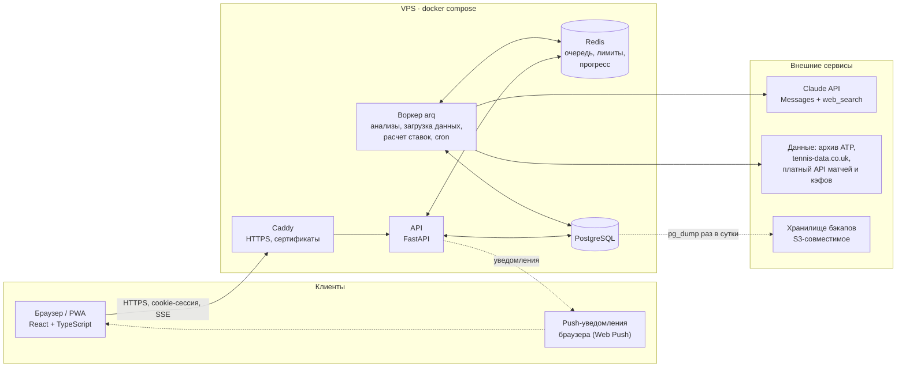
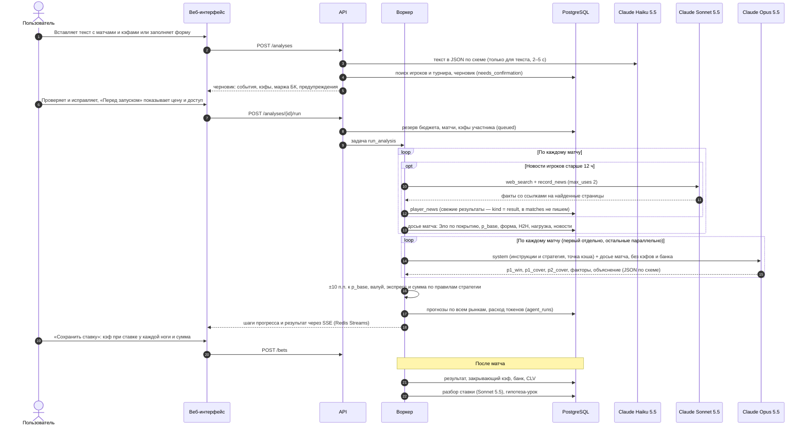
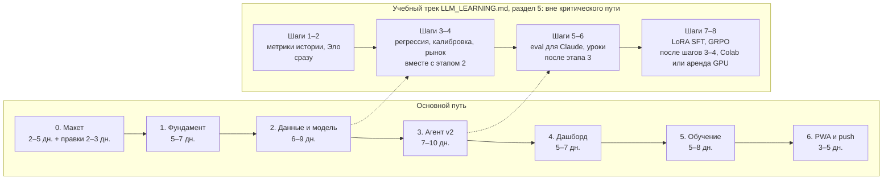

# AI Capper: план веб-приложения

Документ описывает, во что превращаем Telegram-бота: что в нем есть сейчас и что сломано, как будет устроено веб-приложение, на чем его пишем, где храним данные, как защищаем вход, сколько это стоит по времени и деньгам и в каком порядке делаем. Макет согласован 8 октября 2026 (этап 0 закрыт), этап 1 закрыт 8 октября, код этапа 2 закрыт 11 октября после прогона на настоящих данных ([раздел 10](#этап-2-данные-и-базовая-модель-69-дней)), код этапа 3 — 12 октября (ждет приемки на живом ключе), код этапа 4 — 14 октября ([раздел 10](#этап-4-дашборд-и-аналитика-57-дней)).

Связанные документы:

- [TOKEN_ECONOMY.md](TOKEN_ECONOMY.md): как тратить меньше токенов Claude без потери качества. Здесь только итоговые цифры, подробности там.
- [LLM_LEARNING.md](LLM_LEARNING.md): как система учится на ставках и учебный трек по обучению LLM. Здесь только место обучения в архитектуре.
- [../mockup/README.md](../mockup/README.md): кликабельный макет, как его открыть и какие в нем экраны.
- [CLAUDE_API_KEY.md](CLAUDE_API_KEY.md): инструкция для пользователя, как получить свой ключ Claude API и подключить его.

## Коротко

1. **Текущий бот в нынешнем виде не работает и небезопасен.** С зафиксированной версией `python-telegram-bot==21.5` он падает при запуске из-за команд на кириллице. Писать ему может любой пользователь Telegram. Через инструмент `read_file` можно прочитать ключи API. Подробности в [разделе 2](#2-аудит-текущей-версии).
2. **Данные о матчах фактически не собираются.** «Веб-поиск» бота возвращает короткие справки из энциклопедий, а не статистику. Цифры вроде процента первой подачи взять неоткуда: Claude либо оставляет null и останавливается, либо может заполнить их по памяти. Проверить это нельзя, потому что источник цифры не сохраняется.
3. **Главный принцип новой версии: числа считает код, контекст добавляет Claude.** Статистика загружается по расписанию в PostgreSQL. Вероятности считает модель в коде. Claude разбирает ввод, ищет новости, поправляет вероятности с объяснением и пишет разбор.
4. **Стек:** React + TypeScript (PWA) на фронтенде, FastAPI + PostgreSQL + Redis/arq на бэкенде, Docker Compose на одном VPS.
5. **Деньги.** Сейчас один анализ стоит по оценке $1–3 (в [TOKEN_ECONOMY.md](TOKEN_ECONOMY.md) разброс $1–4,5). Цель: в среднем не больше $0,30 за анализ. По живым ценам на 12 октября 2026 это около $15,8 в месяц при ~40 анализах, 1–2 в день (расчет в TOKEN_ECONOMY.md, раздел 5).
6. **Сроки.** Примерно 7–10 недель работы одного разработчика с Claude Code (этапы 0–6). Еще нужны недели реальных ставок, чтобы честно оценить качество прогнозов.
7. **Решения владельца от 7 октября 2026** собраны в [разделе 0](#0-решения-владельца-7-октября-2026): несколько пользователей по приглашению, без Telegram-бота, уведомления на сайте, сброс пароля кодом от администратора, кабинет администратора, два режима ключа Claude, старт на бесплатных данных с ручным вводом кэфов. Открытые вопросы — в [разделе 11](#11-решения-которые-нужны-от-пользователя), главный из них про страну, откуда работает сервис (условия Anthropic).

> **Ограничения, о которых нельзя забывать.** Букмекерский рынок эффективен: маржа 5–8 % на событие, а в экспрессе маржи перемножаются. Веса Claude изменить нельзя: через стандартный Claude API дообучение недоступно. Система «учится» через данные, свою модель и уроки в промпте (см. [LLM_LEARNING.md](LLM_LEARNING.md)). Результат на 100 ставках почти ничего не доказывает: стандартная ошибка ROI на такой выборке около ±9–12 п.п. (расчет в [разделе 5](#как-проверить-что-все-это-работает)). Приложение дает аналитику и вероятности, а не гарантию выигрыша.

## Содержание

0. [Решения владельца (7 октября 2026)](#0-решения-владельца-7-октября-2026)
1. [Цель и что уже есть](#1-цель-и-что-уже-есть)
2. [Аудит текущей версии](#2-аудит-текущей-версии)
3. [Целевая архитектура](#3-целевая-архитектура)
4. [Стек и почему](#4-стек-и-почему)
5. [Хранение данных](#5-хранение-данных)
6. [Источники данных](#6-источники-данных)
7. [Безопасность и личный кабинет](#7-безопасность-и-личный-кабинет)
8. [Производительность](#8-производительность)
9. [Масштабирование](#9-масштабирование)
10. [Дорожная карта](#10-дорожная-карта)
11. [Решения, которые нужны от пользователя](#11-решения-которые-нужны-от-пользователя)

---

## 0. Решения владельца (7 октября 2026)

Этот раздел главнее остального текста: если где-то ниже написано иначе, верно то, что здесь. Решения Р17–Р20 добавлены 8 октября 2026, Р21 — 9 октября, Р22 и Р23 — 11 октября, Р24 — 13 октября, Р25 — 15 октября, Р26 — 16 октября, Р27 и Р28 — 17 октября.

| # | Тема | Решение |
|---|---|---|
| Р1 | Кто пользуется | Несколько человек, закрытый круг. Роли: **администратор** (владелец, вы) и **участник**. У каждого участника свой банк, ставки, стратегия, уроки и аналитика. База игроков, матчей и новостей общая |
| Р2 | Telegram-бот | **Не делаем.** Старый бот выключен и перенесен в `legacy/telegram-bot/` (8 октября 2026) |
| Р3 | Уведомления | **Только через сайт:** центр уведомлений в приложении (значок колокольчика) и push-уведомления браузера (Web Push) после установки сайта на телефон как приложения (PWA). Почта не нужна |
| Р4 | Регистрация | **Только по приглашению.** Администратор создает в кабинете администратора одноразовый код (срок 7 дней) и передает его человеку. Открытой регистрации нет |
| Р5 | Забытый пароль участника | Участник пишет администратору. Администратор в своем кабинете выдает **одноразовый код сброса** (как приглашение, срок 24 часа). Участник вводит код на экране «Забыли пароль?» и задает новый пароль. Код из приложения-аутентификатора (2FA) при входе все равно нужен; если потерян и он, администратор сбрасывает 2FA кнопкой, и участник настраивает его заново |
| Р6 | Забытый пароль администратора | Только с сервера, где установлено приложение, командой в терминале — как `createsuperuser` в Django (см. [раздел 7](#команды-администратора-в-терминале)) |
| Р7 | Ключ Claude API | **Два режима на выбор участника:** (а) **ключ администратора** — участник ничего не вводит, видит «Подключено к ключу администратора · ваш лимит $X в месяц · израсходовано $Y»; лимиты выставляет администратор; (б) **свой ключ** — участник вставляет свой ключ Anthropic, расходы идут с его счета, инструкция [CLAUDE_API_KEY.md](CLAUDE_API_KEY.md) встроена в приложение. Сам ключ никогда не показывается и не передается в браузер |
| Р8 | Кабинет администратора | Нужен: пользователи (пригласить, заблокировать, удалить), коды сброса и сброс 2FA, ключ администратора, бюджет и лимиты, расход ИИ по людям, журнал действий. Состав — в [разделе 7](#кабинет-администратора) |
| Р9 | Бюджет на Claude | Задается в настройках администратора: общий месячный лимит и лимит на каждого участника. Плюс лимит трат в консоли Anthropic как вторая страховка. Ориентир: около $0,30 за анализ, $10–20 в месяц на активного участника, $40–100 в месяц на 3–5 человек |
| Р10 | Данные о матчах | **Начинаем бесплатно:** архивы Сакманна и tennis-data.co.uk, свежие результаты и новости — веб-поиском Claude, кэфы вводятся вручную. Платный API матчей и кэфов — позже, когда статистика (CLV на 100–200 ставках) покажет, что система находит перевес. **11 октября 2026, после бэктеста этапа 2:** платный API пока не берем — базовая модель рынок не обыгрывает (раздел 10, этап 2) |
| Р11 | Страны | Вы и участники работаете из **США, Финляндии и Германии**. Все три страны есть в списке Anthropic, поэтому схема «ваш ключ — для участников» и режим «свой ключ» допустимы ([условия ниже](#условия-anthropic-для-схемы-мой-ключ--для-других-людей)) |
| Р12 | Переключение режима ключа | На свой ключ участник переходит сам в любой момент; обратно на ключ администратора — только с разрешения администратора |
| Р13 | Лимит по умолчанию | Новый участник на ключе администратора получает $10 в месяц, 3 анализа в день, не больше $1 за анализ. Администратор меняет лимит каждому отдельно |
| Р14 | Что видит администратор | Только расход участника на ИИ и его активность (входы, число анализов). Ставки, банк и стратегия участника — личные данные, администратор их не видит. **Заменено решением Р27 (17 октября 2026)** |
| Р15 | Удаление участника | Ставки, банк, стратегия, уроки, ключ и сеансы удаляются. Прогнозы остаются обезличенными (без `user_id`) для обучения общей модели, только если участник дал на это согласие при регистрации; без согласия удаляются и они |
| Р16 | Администраторы | Может быть больше одного. Первый создается только командой в терминале, следующих назначает администратор (в кабинете или командой `set-role`) |
| Р17 | Валюта и букмекеры | **Одна валюта на всю программу:** рубли, доллары или евро, выбирается в настройках администратора. В ней ведутся банки, суммы ставок, прибыль и аналитика у всех участников. При смене валюты суммы пересчитываются по курсу, который вводит администратор ([раздел 5](#таблицы)). Расходы на Claude всегда в долларах: так считает Anthropic. Список букмекеров каждый участник ведет сам; эталон рынка для всех — кэф Pinnacle (как предлагалось, можно поменять). **Уточнение 11 октября 2026:** в tennis-data.co.uk за 2026 год кэфы Pinnacle есть только у 3% матчей, поэтому эталон выбирается по порядку: Pinnacle → биржа Betfair → средний кэф рынка; отчет бэктеста показывает, по какому эталону оценено каждое событие |
| Р18 | Язык | **Русский на старте.** Все тексты интерфейса и сообщений сервера — в файлах переводов (`frontend/src/i18n/locales/ru.json`, `backend/app/locales/ru.json`). Английский добавляется новым файлом без правки кода |
| Р19 | Сервер | **Финляндия.** VPS и бэкапы — в Финляндии, например Hetzner Cloud в Хельсинки. Это удобно для GDPR, а задержка для участников из США некритична. **Пока сервера нет (8 октября 2026):** владелец запускает и проверяет приложение на своем компьютере (`bash deploy/local.sh up`, [deploy/README.md](../deploy/README.md)). Аренда VPS и домен — позже; автодеплой до этого пропускается |
| Р20 | Репозиторий и авторство | Монорепозиторий: `backend/`, `frontend/`, `deploy/`, `lab/`, `docs/`, `mockup/`, старый бот — в `legacy/telegram-bot/` ([раздел 3](#структура-репозитория)). Правила кода — в [CLAUDE.md](../CLAUDE.md): автор всех коммитов — владелец (Roman Burov), Claude нигде не указывается как автор, буква «е с двумя точками» не используется. Правила проверяют хуки git и CI |
| Р21 | Ставки и турниры (9 октября 2026) | **Только основной тур ATP:** без челленджеров, квалификаций и WTA. **Ординары — только «для сравнения»:** ставим экспрессы, а одиночные ставки по тем же прогнозам считаются виртуально, чтобы видеть, сколько съедает маржа в экспрессе. **Правило «нет валуя, но события надежные — все равно ставим» убрано:** в бэктесте этапа 2 результат показывается с ним и без него. Это ответы на вопросы 5–7 [раздела 11](#11-решения-которые-нужны-от-пользователя) |
| Р22 | Анализ и сумма ставки (11 октября 2026) | **Поправка Claude к вероятности модели — не больше ±10 п.п.**; при расхождении больше 8 п.п. анализ подсвечивает его и требует объяснения; предел снимается только после 300+ событий с исходами, если стэкинг без него лучше ([LLM_LEARNING.md](LLM_LEARNING.md), 6.1). **Правила серий («3 проигрыша — сумма −40%», «3 выигрыша — +20%») заменены лимитами просадки банка**: банк ниже пика на 10% — ставка не больше 2,5% банка, на 20% — не больше 1,5% и только экспресс из 2 событий с кэфами до 1.50. **Закрывающие кэфы:** по своим ставкам участник вносит их на экране «Ставки», для остальных разобранных матчей — из tennis-data.co.uk. **Бюджет на проверочные прогоны (eval, теневые прогоны) — $20–30 в месяц**, отдельно от анализов. Это ответы на вопросы 12, 13, 16, 17 [раздела 11](#11-решения-которые-нужны-от-пользователя) |
| Р23 | Этап 3: макет и анализ (11 октября 2026) | **Правки макета этапа 3 согласованы:** отмена анализа, сбой шага и перезапуск с этого шага (выполненные шаги повторно не оплачиваются), остановка по лимиту и потолку, неработающий ключ, повтор оценки матча без затрат, кэф при ставке у каждого события, правила суммы без серий. **Режим анализа пока один — «Точный» (Opus 5.5)**; «Сбалансированный» и «Экономный» включаются после проверки качества на истории. **Новости в анализе участника на своем ключе оплачивает его ключ**; найденное попадает в общую базу новостей. **Где искать новости:** atptour.com, сайты четырех турниров Большого шлема, tennis.com, tennismajors.com, espn.com (список меняется командой `agent-config`). bbc.com, reuters.com и apnews.com убраны 12 октября: они закрыты для робота Anthropic, и запрос поиска с ними отклоняется целиком; если закрытым окажется другой сайт списка, программа сама исключит его и повторит запрос |
| Р24 | Этап 4: макет и решения (13 октября 2026) | **Правки макета этапа 4 согласованы** (список — в `mockup/README.md`, раздел «Правки этапа 4»; решения В1–В16 — как там записано). Главное: **адаптации «рост банка +15% → потолок 4%» и «прибыльная неделя → +0,5 п.п.» выключены по умолчанию** — остаются защита банка при просадке −10%/−20% (Р22) и «убыточная неделя → не больше 2%»; **закрывающий кэф вносит участник** после матча и выбирает, чей он (эталон рынка по Р17 или свой букмекер), вторая сторона — по желанию; CLV = кэф / закрытие − 1, при двух сторонах еще CLV без маржи; **«Ответственная игра» на этапе 4:** лимиты числа и суммы ставок в день и пауза 1/7/30/90 дней, во время паузы нельзя сохранить ставку и запустить анализ, повысить лимит — через 24 часа; «Мои матчи сегодня» вместо матчей дня; на «Игроках» только данные архива и новостей, без сбора профилей; удаление аккаунта самим участником — с паролем и 2FA, 7 дней на отмену |
| Р25 | Этап 5: макет и решения (15 октября 2026) | **Правки макета этапа 5 согласованы** (список — в `mockup/README.md`, раздел «Правки этапа 5»; решения В1–В10 — как там записано). Главное: **результаты матчей — файл tennis-data `2026.xlsx` раз в неделю**, администратор загружает его кнопкой на сайте; пока файла нет, исход вносится вручную, программа подсказывает его по новостям; задержка расчета — до недели; **бюджет проверок (eval) — $30 в первый месяц, дальше $25** («первый месяц» — календарный месяц по UTC, в котором заморожен первый набор матчей для проверки версий: в нем бюджет не меньше $30, с 1-го числа следующего месяца — настройка администратора, $25; пока набора нет, действует настройка); **разбор каждой рассчитанной ставки ИИ** (Sonnet 5.5 через Batch, около $0,01 за ставку, один разбор на матч) — включен, из общего бюджета ключа администратора; **уроки попадают в анализ только по кнопке администратора** после быстрой проверки (около $0,60), поправка к вероятности числом — после 300 событий; **уроки и инструкции анализа общие для всех участников, правила суммы ставки — у каждого свои** (уточнение Р1); перекалибровка базовой модели по понедельникам включается сама, если не хуже прежней, с уведомлением и откатом; еженедельный отчет — понедельник 07:00 по поясу участника, в центре уведомлений; на графике банка пополнение отмечено ступенькой «вложено», главное число периода — прибыль ставок и ROI; вкладки «Лаборатория» в приложении нет; этап делается полностью |
| Р26 | Этап 6: макет и решения (16 октября 2026) | **Правки макета этапа 6 согласованы** (список — в `mockup/README.md`, раздел «Правки этапа 6»; решения В1–В9 — как там записано). Главное: **в push нет сумм** — только событие («Ставка №75 рассчитана — откройте, чтобы посмотреть результат»), банк и суммы видно только внутри приложения; **push по умолчанию включен** у всех видов, кроме «Обучение модели» и «Сигналы расхода ИИ» у администратора; **тихие часы по умолчанию 23:00–08:00** по поясу участника, push за это время не досылаются утром — они остаются в колокольчике, вход с нового устройства и неудачные попытки входа приходят всегда; настройки push общие для аккаунта, push приходит на все устройства с подпиской, выход из аккаунта отключает push на устройстве; на iPhone push только из установленного приложения (iOS 16.4+); без связи — только заглушка «Нет связи», ставки и банк не кэшируются; сообщение администратора уходит и push (флажок, по умолчанию включен), администратор видит только число участников с push (Р14). Сервер с HTTPS нужен только для проверки push на телефоне: код делается и проверяется на `localhost` |
| Р27 | Что видит администратор (17 октября 2026, заменяет Р14) | **Администратор видит ставки, банк, стратегию и анализы каждого участника** — только просмотр, по каждому участнику и сводкой по всем. Участники знают об этом из условий при регистрации и раздела «Кто видит мои данные» в личном кабинете; отдельного уведомления тем, кто зарегистрировался раньше, нет (решение владельца). Каждый просмотр и выгрузка CSV чужих данных администратором пишутся в журнал администратора; участнику дата просмотра не показывается. Выгрузка CSV ставок участника администратору разрешена. Пароли, коды 2FA, резервные коды и ключи Claude участников администратор не видит, как и раньше. Макет согласован 17 октября 2026 (`mockup/README.md`, раздел про Р27) |
| Р28 | Новые рынки ставок (17 октября 2026) | **Добавляем рынки:** форы по сетам (±1.5, ±2.5), тоталы сетов, форы по геймам и тоталы геймов, кроме победы П1/П2 — **одним этапом** (план — `docs/MARKETS.md` после согласования макета). **Один рынок на матч в экспрессе**, как сейчас. **Новые рынки сначала «для сравнения»:** участник может поставить и видит оценку модели, но анализ не берет их в экспресс, пока по ним не наберется 150–200 событий и CLV не покажет перевес (кэфов этих рынков в бесплатных архивах нет, проверить против рынка на истории нельзя). **Фора ±1.5 сейчас:** модель сетов, по ориентировочной проверке на 2023–2025, завышает вероятность решающего сета (≈ +9 п.п.); проверить на проектной модели и, если подтвердится, не брать ±1.5 в экспрессы до исправления. Порядок разработки: сначала макет и согласование |

### Условия Anthropic для схемы «мой ключ — для других людей»

Проверено по текстам на сайте Anthropic 7 октября 2026: [Commercial Terms of Service](https://www.anthropic.com/legal/commercial-terms) (действуют с 17 июня 2025), [Usage Policy](https://www.anthropic.com/legal/aup) (с 15 сентября 2025), [список поддерживаемых стран](https://www.anthropic.com/supported-countries). Это прочтение условий, а не юридическая консультация.

**Сама схема разрешена.** Условия прямо разрешают использовать API, чтобы «питать продукты и сервисы, которые клиент предоставляет своим клиентам и конечным пользователям» (Commercial Terms, A.1). Сайт, который работает на вашем ключе, а люди пользуются его функциями, — именно такой случай.

**Что нельзя и что из этого следует для нас:**

- **Перепродавать сам API** без согласования с Anthropic (D.4). Поэтому участники получают не доступ к Claude, а функции AI Capper. Брать с людей деньги «за токены» не планируем.
- **Раздавать сам ключ.** Вы отвечаете за все, что происходит под вашим аккаунтом (D.5). Поэтому ключ живет только на сервере, участники его не видят, а расход каждого ограничен лимитами.
- **Нарушать Usage Policy.** Ее должны соблюдать и вы, и ваши пользователи (D.2). Ставки на спорт в Usage Policy от 15.09.2025 отдельно не запрещены.
- **Скрывать, что работает ИИ.** Если результат модели показывают людям, нужно сообщить, что он сделан с помощью ИИ (Usage Policy). Еще нужно предупредить, что ответы могут быть неточными и их нужно проверять (Commercial Terms, D.3). В интерфейсе это уже есть: «Анализ ИИ, не гарантия. Ставку делаете вы».

**Главный риск — страна.** Условия требуют, чтобы и клиент, и его пользователи работали с сервисом только из поддерживаемых стран (D.2, ссылка на Supported Regions Policy). Еще действуют экспортные и санкционные ограничения США (M.8). **Россия и Беларусь в списке не значатся**, Казахстан, Армения, Грузия, Узбекистан, Кыргызстан и Сербия есть. Если вы или участники находятся в неподдерживаемой стране, использование API нарушает условия независимо от того, чей ключ. Это касается и нынешнего бота. VPN этого не меняет. В этом случае законный путь через Anthropic отсутствует, и нужно выбрать другую модель или провайдера, доступного в вашей стране. Архитектура это позволяет: вызовы модели собраны в одном модуле `agent/`. **Решено (Р11):** вы и участники в США, Финляндии и Германии — все три страны в списке, ограничение не мешает.

Для режима «свой ключ» те же правила действуют для каждого участника: он сам клиент Anthropic и сам принимает их условия.

---

## 1. Цель и что уже есть

### Цель

Личный аналитик теннисных ставок в браузере на телефоне и компьютере. Он должен:

- принимать события в привычном формате (текстом, как в боте) или через форму;
- собирать и хранить данные об игроках и матчах;
- считать вероятности по рынкам П1/П2 и форам по сетам, сравнивать их с кэфами и собирать экспресс по вашей стратегии;
- вести банк и историю ставок, считать прибыльность в разрезах (покрытия, кэфы, рынки), калибровку и CLV (насколько ваш кэф лучше закрывающего);
- разбирать каждую ставку после матча и проверять на истории, стали ли прогнозы лучше;
- показывать, сколько стоит ИИ, и держать расход в рамках бюджета;
- пускать только тех, кого пригласил администратор, со вторым фактором при входе; у каждого участника свой банк и свои ставки, а у администратора — кабинет для управления доступом и расходами.

### Как работает бот сейчас

Старый бот перенесен в `legacy/telegram-bot/` (Р20): пути к файлам бота ниже — относительно этой папки.

| Часть | Где | Что делает |
|---|---|---|
| Настройки | `bot.py:27-34` | Модель `claude-sonnet-4-6`, до 20 итераций агента (`MAX_TOOL_LOOPS`), данные в `Tennis-Analytics/` |
| Системный промпт | `bot.py:50-66` | При запуске склеивает 6 markdown-файлов из `Tennis-Analytics/`: 35,9 КБ, 22 тыс. символов, почти все на русском |
| Инструменты Claude | `bot.py:73-152` | `web_search`, `read_file`, `write_file`, `list_files`, `read_template` |
| Реализация инструментов | `bot.py:158-268` | Поиск через DuckDuckGo, чтение и запись файлов относительно `Tennis-Analytics/` |
| Цикл агента | `bot.py:274-357` | Добавляет к запросу последние 10 ставок (`bot.py:284-293`), вызывает Claude с `max_tokens=4000` (`bot.py:298-304`), выполняет инструменты, пока Claude не закончит или не кончатся 20 итераций |
| История ставок | `bot.py:363-423` | Чтение `История-ставок.json`, расчет результата и банка (`save_result`), поиск последней открытой ставки |
| Telegram | `bot.py:429-585` | `/start`, `/статистика`, `/игроки`, `/результат`, кнопки «Победа / Поражение / Возврат», любой текст запускает анализ |
| Стратегия | `Tennis-Analytics/Стратегия-ставок.md` | Экспресс из 2–3 событий, кэф плеча 1.13–1.80, вероятность ≥ 65 %, таблица суммы 1,5–3 % банка, поправки по серии, аудит каждые 10 ставок |
| Сценарий агента | `Tennis-Analytics/CLAUDE.md`, `Инструкция-Авто.md`, `Инструкция-1..3` | Прочитать историю, заполнить или обновить игроков (до 4 и до 6 поисков на игрока), анализ, запись ставки в JSON |
| Профиль игрока | `Tennis-Analytics/_Шаблоны/01..06-*.json` | 6 JSON-файлов на игрока: личные данные, профиль, физика, психология, текущее состояние, матчи с полной статистикой |
| Развертывание | `Dockerfile`, `docker-compose.yml`, `.github/workflows/deploy.yml` | Один контейнер, папки игроков и ставок смонтированы с диска, деплой по SSH при push |

**Что берем в новую версию:**

- правила стратегии (`Стратегия-ставок.md:175-242`): становятся параметрами версии стратегии в БД, а не текстом для LLM;
- формат ввода событий (`CLAUDE.md:42-50`): его понимает экран «Новый анализ»;
- структура профиля из `_Шаблоны/`: поле `JSONB` для качественных данных (стиль, психология), а числа переезжают в таблицы;
- Telegram-бот не переносим (решение Р2): уведомления живут на сайте;
- деплой через GitHub Actions по SSH: остается, но с исправлениями из раздела 2.

---

## 2. Аудит текущей версии

Все пункты перепроверены по коду. Номера строк уточнены по сравнению с прошлым сообщением в чате. «Критично» значит «сломано или опасно уже сейчас».

| # | Проблема | Где | Чем грозит | Важность |
|---|---|---|---|---|
| 1 | **Бот не запускается.** Telegram и `python-telegram-bot` принимают в именах команд только латиницу, цифры и `_`. `CommandHandler("статистика", …)` в версии 21.5 бросает `ValueError: Command 'статистика' is not a valid bot command` (проверено на 21.5) | `bot.py:573-575`, `requirements.txt:1` | `main()` падает до `run_polling()` | Критично |
| 2 | **Нет проверки, кто пишет боту.** Любой, кто найдет бота, запускает анализы за ваш счет, видит банк и вносит результаты | `bot.py:524-563`, `bot.py:444-517` | Расход денег на API, порча истории | Критично |
| 3 | **Выход за пределы папки (path traversal).** Путь от Claude приклеивается к `BASE_DIR` без проверки: `BASE_DIR / path`. Абсолютный путь вообще заменяет базовую папку (`Path('/a') / '/proc/self/environ'` дает `/proc/self/environ`). В Docker `read_file("/proc/self/environ")` отдает переменные окружения с `ANTHROPIC_API_KEY` и `TELEGRAM_TOKEN`, а локально то же делает `../.env`. `write_file("../bot.py", …)` перезапишет код. `list_files` показывает содержимое любых папок. `read_template` тоже выходит за пределы папки, но читает только файлы `*.json`: расширение он дописывает сам | `bot.py:199`, `bot.py:212-218`, `bot.py:229`, `bot.py:247` | Вместе с п. 2 утечка ключей становится вопросом одного сообщения. Еще одна дыра: внедрение команд (prompt injection) через текст, найденный поиском | Критично |
| 4 | **Сбор данных не работает.** `tool_web_search` обращается к DuckDuckGo Instant Answer API. Он возвращает только короткие справки и связанные темы (по сути, выдержки из энциклопедий), а не результаты поиска и не статистику матчей. При этом шаблон `06-матчи.json` требует эйсы, процент первой подачи, скорость подачи по каждому матчу | `bot.py:158-194` (запрос на `bot.py:162-171`), `_Шаблоны/06-матчи.json` | Claude либо останавливается («⛔ Анализ невозможен»), либо заполняет цифры по памяти, то есть выдумывает. Сайты из инструкций (flashscore, sofascore, `CLAUDE.md:82-87`) через этот API не читаются, а их правила запрещают автоматический сбор | Критично |
| 5 | **Числа считает LLM, и их никто не проверяет.** Вероятности, валуй, итоговый кэф и сумму пишет Claude текстом. Пример в инструкции противоречит сам себе: вероятность 68 % при кэфе 2.50 дает валуй +70 %, а в записи стоит 12,5 % | `Инструкция-Авто.md:102-105`, `Стратегия-ставок.md:142-171` | Арифметические ошибки уходят прямо в ставку | Высокая |
| 6 | **Обучения как такового нет.** Есть только фиксированные правила (3 проигрыша подряд → сумма −40 % и т. п.) и «аудит каждые 10 ставок, применяется автоматически без подтверждения». Вероятность каждого исхода сохраняется (`вероятность_процент`), но с исходом ее никто не сравнивает. Закрывающие кэфы не сохраняются | `Стратегия-ставок.md:232-242`, `Стратегия-ставок.md:295-307` | 10 ставок дают чистый шум, а стратегия меняется под случайность | Высокая |
| 7 | **В правилах стратегии заложен вероятный минус.** Правило «нет валуя, но события надежные → ставка минимум 1,5 % банка» разрешает ставку при оцененном перевесе ниже 5 % или даже отрицательном (шкала `Стратегия-ставок.md:225-230`). При марже 5–8 % и неточной вероятности такая ставка, скорее всего, в минусе на дистанции. В экспрессе маржи плеч перемножаются: при марже 5 % на плечо у экспресса из 2 событий она около 10 % (1,05² ≈ 1,10), из 3 событий около 16 % | `Стратегия-ставок.md:208`, `Стратегия-ставок.md:179-181` | Систематический убыток, если перевес прогноза меньше суммарной маржи экспресса | Высокая (решение за вами, см. раздел 11) |
| 8 | **Ошибки расчета результата.** (а) Нет защиты от повторного нажатия: каждое нажатие на «Победа» снова прибавляет выигрыш к банку. (б) Сумма ставки не списывается в момент ставки. Поэтому следующая ставка считается в % от банка, в котором еще лежат деньги открытых ставок, а «банк после» у ставки зависит от порядка нажатий. (в) Если банк в файле пуст, он считается равным 0. (г) Возвраты считаются поражениями: `поражения = завершенные − победы`. (д) `/результат` показывает только последнюю открытую ставку, более ранние кнопкой не закрыть. (е) Поле `серия_текущая` код не обновляет | `bot.py:379-416` ((а)-(в): `bot.py:383-401`, (г): `bot.py:409`), `bot.py:418-423` | Неверный банк и неверная статистика | Высокая |
| 9 | **Целостность истории зависит от LLM.** Ставку в `История-ставок.json` записывает сам Claude через `write_file`, переписывая файл целиком. В контексте у него при этом только последние 10 ставок. Проверяется только синтаксис JSON | `Инструкция-Авто.md:66-73`, `bot.py:288`, `bot.py:215-217` | Потеря или искажение старых записей | Высокая |
| 10 | **Конкурентный доступ.** Сейчас обновления Telegram обрабатываются по одному (так в `python-telegram-bot` по умолчанию), поэтому гонок при записи почти нет. Цена этого: на время анализа (минуты) бот не отвечает ни на что, в том числе на `/результат`. В веб-версии с несколькими воркерами схема «прочитал JSON, изменил, записал» начнет терять данные | `bot.py:569-585`, `bot.py:363-416` | Зависание бота сейчас, потеря данных потом | Средняя |
| 11 | **Токены и деньги.** Системный промпт (35,9 КБ) и последние 10 ставок (JSON с отступами) отправляются заново на каждой итерации, а их до 20. Кэширования промпта нет. Оценка: $1–3 за анализ (раздел 8), в [TOKEN_ECONOMY.md](TOKEN_ECONOMY.md) с более полными допущениями $1–4,5 | `bot.py:66`, `bot.py:291`, `bot.py:297-304` | Основная статья расходов | Высокая, см. [TOKEN_ECONOMY.md](TOKEN_ECONOMY.md) |
| 12 | **Модель и SDK устарели.** `claude-sonnet-4-6` — модель предыдущего поколения, $3/$15 за 1 млн токенов, а текущая Sonnet 5.5 стоит $2/$10. `anthropic==0.34.0` вышел в августе 2024 года (сейчас актуальна ветка 1.x). Если ответ упирается в `max_tokens=4000`, обрезанный текст молча уходит пользователю как будто это полный ответ | `bot.py:29`, `requirements.txt:2`, `bot.py:300`, `bot.py:352-355` | Переплата, обрезанные ответы | Средняя |
| 13 | **Инструкции противоречат друг другу.** Стратегия требует «файл матча (.md)» как критичный и велит брать кэфы «только из файла матча», а сценарий говорит, что файла матча нет. Стратегия запрещает интернет, а сценарий требует искать | `Стратегия-ставок.md:34`, `Стратегия-ставок.md:316` против `Инструкция-Авто.md:11`, `Инструкция-3-анализ.md:5`; `Стратегия-ставок.md:15` | Claude останавливается или импровизирует | Средняя |
| 14 | **Экспресс определяется по ключевым словам.** Кнопка «Внести результат» появляется, если в ответе есть слово «ЭКСПРЕСС». Шаблон ответа содержит это слово даже в варианте «ставок нет» | `bot.py:553`, `Стратегия-ставок.md:276-290` | Ложные кнопки, ставка не сохраняется как структура | Низкая |
| 15 | **Деплой не совпадает с инструкцией.** В README ветка `master` и папка `~/ai_agent_capper`, а workflow срабатывает на `main` и делает `cd ~/tennis-bot`. README советует положить в секреты GitHub личный ключ `~/.ssh/id_rsa` | `README.md:59-61`, `README.md:112`, `README.md:129`, `README.md:153`, `.github/workflows/deploy.yml:5`, `.github/workflows/deploy.yml:22` | Автодеплой не сработает. Утечка секрета дает доступ ко всему, куда пускает ваш личный ключ | Средняя |
| 16 | **Промпт читается один раз при старте** и не имеет версии | `bot.py:66` | Правка стратегии требует перезапуска, а версии нельзя сравнить между собой | Низкая |

### Если бот нужен до запуска веб-версии

> По решению Р2 Telegram-бот не нужен, и до запуска веб-версии его лучше не включать. Заплатки ниже оставлены на случай, если все же придется временно поднять бота.

Это 1–2 часа работы, и их стоит сделать сразу, не дожидаясь этапа 1:

```python
# 1) Только разрешенные пользователи. В .env: ALLOWED_TELEGRAM_IDS=123456789
ALLOWED_IDS = {int(x) for x in os.environ["ALLOWED_TELEGRAM_IDS"].split(",")}

def allowed(update: Update) -> bool:
    return update.effective_user is not None and update.effective_user.id in ALLOWED_IDS
# первой строкой в каждом обработчике: if not allowed(update): return

# 2) Пути только внутри Tennis-Analytics
BASE_REAL = BASE_DIR.resolve()

def safe_path(rel: str) -> Path:
    p = (BASE_DIR / rel).resolve()
    if not p.is_relative_to(BASE_REAL):
        raise ValueError("путь вне Tennis-Analytics")
    return p
# использовать в tool_read_file, tool_write_file, tool_list_files, tool_read_template
```

Еще три правки:

3. Переименовать команды в латиницу: `/stats`, `/players`, `/result` (`bot.py:573-575`), обновить текст `/start` (`bot.py:439-441`) и список команд в BotFather.
4. В `save_result` (`bot.py:383`) не пересчитывать ставку, у которой статус уже заполнен.
5. Поставить месячный лимит расходов в консоли Anthropic.

---

## 3. Целевая архитектура

### Компоненты



- **API** быстро отвечает на запросы интерфейса. Все долгое (анализ, загрузка данных) он ставит в очередь и сразу возвращает идентификатор задачи.
- **Воркер** выполняет задачи из очереди и по расписанию (cron в arq): ночная загрузка результатов и статистики, пересчет Эло, расчет ставок, разборы.
- **Прогресс анализа** воркер публикует в Redis. API передает его в браузер через SSE (Server-Sent Events, односторонний поток событий поверх обычного HTTP).
- **Claude вызывает только воркер.** Браузер к Claude напрямую не обращается, ключи API (ключ администратора и личные ключи участников) живут только на сервере. Для каждого вызова воркер выбирает ключ по режиму участника (решение Р7) и до вызова проверяет его лимит.
- **Уведомления** (расчет ставки, устаревшие данные, приближение к лимиту, вход с нового устройства) пишутся в таблицу `notifications`, показываются в центре уведомлений и уходят push-сообщением браузера тем, кто разрешил push. Telegram-бота нет (решение Р2).

### Кто что делает: код против Claude

| Задача | Кто | Почему |
|---|---|---|
| Разбор свободного текста ввода в структуру | Claude Haiku 5.5 (effort `low`), ответ по JSON-схеме (structured outputs), прямо в запросе `POST /analyses` (2–5 с). Код проверяет схему и ищет игроков в базе, вы подтверждаете на экране | Язык свободный, а ошибку разбора лучше увидеть до анализа |
| Статистика матчей, рейтинги, результаты | Код, плановая загрузка в БД. Свежие результаты, пока нет платного API, см. [раздел 6](#свежесть-результатов-без-платного-api) | Числа должны быть точными и проверяемыми |
| Эло по покрытиям, форма, усталость (матчи и сеты за 14 дней), H2H | Код: SQL и Python | Детерминированно, бесплатно, покрывается тестами |
| Базовые вероятности по рынкам | Код: модель (сначала Эло, потом логистическая регрессия или бустинг) | Калибруется на тысячах исторических матчей |
| Новости: травмы, снятия, мотивация, свежие результаты | Claude Sonnet 5.5 (effort `low`) с серверным `web_search` (`allowed_domains`, `max_uses` 2 — один поиск на игрока) и своим инструментом `record_news` в том же запросе. Это отдельный шаг до анализа, по запросу на матч, и он запускается, только если новости игрока старше 12 часов. Каждая новость сохраняется с источником и датой; адрес, которого нет в результатах поиска, отбрасывается | Это неструктурированный текст, с ним LLM справляется лучше кода. Извлечь факты может модель дешевле Opus |
| Поправка к вероятности | Claude Opus 5.5 (effort `medium`), один вызов на матч, без веб-поиска и без инструментов: новости уже в досье. Поправка не больше ±10 п.п. (Р22), при расхождении больше 8 п.п. нужно объяснение. Обе вероятности, модели (`p_base`) и Claude (`p_claude`), сохраняются | Позже станет видно, добавляет ли поправка точности ([LLM_LEARNING.md](LLM_LEARNING.md)) |
| Маржа БК, валуй, отбор в экспресс, сумма | Код по параметрам активной версии стратегии | Арифметика не должна зависеть от LLM |
| Объяснение для человека | Claude | Для этого LLM и нужна |
| Разбор после матча | Claude Sonnet 5.5 формулирует гипотезу-урок, код проверяет ее на истории | Урок попадает в промпт только после проверки |

### Поток одного анализа



Статусы анализа: `needs_confirmation → queued → building_dossier → modelling → llm_review → composing → done`, плюс `failed` и `cancelled`. Разбор текста идет в самом запросе `POST /analyses`, отдельного статуса у него нет. Каждый переход пишется в БД вместе с чекпойнтом (`analyses.checkpoint`). Сбой любого шага — `failed` с кодом ошибки (`error_code`) и шагом (`failed_step`); повторный запуск продолжает с упавшего шага, выполненные шаги повторно не оплачиваются. Отмена — статус `cancelled`, воркер проверяет его между шагами.

На экране «Анализ» шаги показаны так: «Разбор событий» (выполнен до запуска), «Проверка базы игроков», «Новости: ‹матч›» по каждому матчу (`building_dossier`), «Досье матчей», «Расчет ML-модели» (`modelling`), «Claude: ‹матч›» по каждому матчу (`llm_review`), «Экспресс и сумма» (`composing`).

**Поиск и ответ по схеме: решено на этапе 3.** У Opus 5.5 в анализе поиска нет, ответ приходит по JSON-схеме (`output_config.format`). Шаг новостей не использует `output_config.format` (он несовместим с цитатами `web_search`): Sonnet 5.5 ищет и в том же запросе вызывает свой строгий инструмент `record_news`, его вход проверяет код (способ А). На живом API это проверяет команда `agent-smoke` — ее запустит владелец, когда появится ключ.

Прогнозы сохраняются по **всем** разобранным матчам и рынкам, а не только по тем, что попали в экспресс. Метрики считаются по матчам: одна оценка П1 и одна оценка «2:0» на матч, интервалы — бутстрэпом по матчам. Рынки одного матча зависимы (П2 = 1 − П1, П2(+1.5) = 1 − П1(−1.5)), поэтому выигрыш в скорости оценки дает число разобранных матчей, а не рынков.

### Основные адреса API

| Адрес | Назначение |
|---|---|
| `POST /auth/login`, `POST /auth/2fa`, `POST /auth/logout`, `GET /auth/csrf` | Вход в два шага, выход, токен CSRF для изменяющих запросов |
| `POST /auth/register`, `POST /auth/2fa/setup`, `POST /auth/2fa/setup/confirm` | Регистрация по коду приглашения, обязательная настройка 2FA при первом входе (секрет и подтверждение кодом) |
| `GET /health` | Проверка здоровья: база и Redis, версия (для `deploy.sh` и `local.sh`) |
| `GET /me/sessions`, `DELETE /me/sessions/{id}`, `POST /me/sessions/revoke-others` | Активные сеансы, завершение сеанса, завершение всех, кроме текущего |
| `POST /me/password`, `GET` и `POST /me/recovery-codes`, `GET /me/login-events`, `GET /me/trusted-devices`, `DELETE /me/trusted-devices/{id}` | Смена пароля (остальные сеансы завершаются), резервные коды 2FA (сколько осталось, выпустить новые), журнал входов за 90 дней, доверенные устройства. Этап 1 |
| `POST /analyses` (текст или пустая форма), `GET /analyses` (свои, новые сверху), `GET /analyses/{id}` | Создать черновик (текст разбирает Haiku 5.5, не больше 30 в час), список, полный вид анализа. Этап 3; с этапа 4 разбор текста на паузе и при достигнутом лимите дня ответственной игры не идет (409 `play.*`), пустой черновик формы — можно |
| `POST /analyses/{id}/preview`, `POST /analyses/{id}/run`, `POST /analyses/{id}/cancel`, `PUT /analyses/{id}/decision` | «Перед запуском» без Claude (игроки, маржа, цена, доступ), запуск и повторный запуск после сбоя, отмена, «Не ставить». Отказ в доступе к Claude — 409 с кодом причины `ai.*`. Этап 3; с этапа 4 запуск идет под разделяемой блокировкой валюты, необязательное `currency` в теле запуска — валюта банка в форме (не та — 409 `common.currency_changed`) |
| `GET /analyses/{id}/events` | Прогресс анализа (SSE): первым событием снимок из БД, `Last-Event-ID` при переподключении. Этап 3 |
| `POST /bets`, `GET /me/bank`, `GET /me/bookmakers` | Сохранить ставку (кэф при ставке у каждой ноги, повтор с тем же `client_ref` возвращает ту же ставку), банк с пиком и просадкой, названия своих букмекеров для форм (скрытые не предлагаются). Этап 3; с этапа 4 возможная выплата больше 9 999 999 999,99 — 422, пауза и лимиты дня ответственной игры — 409 `play.paused`, `play.bets_limit`, `play.stake_limit` (`until` — до какого момента, по поясу участника), проверка — под той же блокировкой денег участника, что сама ставка; новое название букмекера из ставки или запуска анализа попадает в «Мои букмекеры» само, а скрытый букмекер ставки возвращается в список (у скрытого не бывает ставок в игре). Необязательное `currency` в теле — валюта, в которой форма показывала сумму: не валюта программы (ее сменили, пока форма была открыта) — 409 `common.currency_changed` |
| `GET /bets?period=&from=&to=&status=&market=&surface=&source=&q=&before=&limit=`, `GET /bets/summary?…`, `GET /bets/{id}`, `GET /bets/export.csv?…` | Свои ставки по фильтрам (период 7d/30d/90d/all или даты 2000–2100 годов по поясу участника, статус — в том числе `settled`: все рассчитанные, рынок, покрытия, источник app/legacy, поиск по игрокам, турниру, букмекеру и №), курсор `before`, 20 на страницу; итоги по тем же фильтрам одним запросом (возвраты не входят в оборот и прибыль, ставки бота — в деньги, но не в CLV); карточка с ногами, исходами, закрытием, CLV, вердиктом по CLV, «Банк после» (`bank_after`: капитал сразу после расчета, то же число, что «Банк после» на главной; у открытой — пусто) и у открытой ставки — исходом ноги по каждому полному счету (`score_outcomes`, для окна расчета); CSV — строка на событие, отдается частями. Этап 4 |
| `PUT /bets/{id}/result`, `POST /bets/{id}/reverse`, `PUT /bets/{id}/legs/{leg_id}/closing` | Ручной расчет: исход каждой ноги, счет и закрывающий кэф по желанию, `expected_updated_at` (хватает точности до миллисекунды) — 409 при гонке (повтор того же расчета — 200); счет исход не выбирает (В16); выплата больше 9 999 999 999,99 — 422; исправление результата сторно (ставка снова открыта); закрывающий кэф ноги — свой исход, обратный по желанию, чей кэф (эталон Р17 или свой букмекер). Результат из импорта старого бота не пересчитывается (409), открытую ставку бота участник рассчитывает сам. Этап 4 |
| `GET /bets/counts` | Счетчики для меню (этап 5): открытых ставок и из них ждущих результата (`awaiting_result` — все матчи ставки уже прошли по поясу участника). В карточке ставки с этапа 5: `archive_to` — у рассчитанной по архиву (`settled_by = auto`) последний день архива на момент расчета, `awaiting_result` (у такой ставки — `archive_matches_to`, последний день матчей в архиве сейчас, и `next_upload`, когда ждать следующий файл: понедельник после последней загрузки), у ноги `archive_result` и `archive_score` — исход и счет по архиву, когда он разошелся с расчетом (банк не меняли, Т3), у закрытия `unverified` — кэф из архива, момент снятия не проверен (Т1) |
| `GET /me/bank/history?period=`, `GET /me/bank/entries?before=&limit=&flows_only=`, `POST /me/bank/entries` | Капитал на конец дня по поясу участника; журнал банка с балансом после каждой строки; пополнение, вывод (не больше баланса) и корректировка с `expected_last_id` (повтор той же записи — 200, иначе 409). Этап 4 |
| `GET /players?q=…`, `GET /strategy/active` | Подсказки игроков для формы, параметры активной стратегии. Этап 3 |
| `GET /players/ranking?q=&surface=&data=&sort=&offset=&limit=` | Список «Игроки» по `player_elo_current`: по умолчанию игроки с матчами за 52 недели по месту по Эло, 50 на страницу; `data` — `active`, `news` (новости свежее кэша 12 ч) или `all`; поиск по всей базе по-русски и латиницей с опечатками (`fuzzy` — точных совпадений нет); колонки: место по Эло, Эло общий и на покрытии (`surface` — хард, грунт, трава), форма 10, последний матч в базе, новости проверены; `today` — игрок в своих матчах сегодня; счетчики, свежесть архива (последний день матча — по самим матчам, как в досье, а не по `player_elo_current`). Этап 4 |
| `GET /players/{id}`, `GET /players/{id}/matches?before=&limit=`, `GET /players/{id}/news?before=&limit=`, `GET /players/{id}/h2h/{opponent_id}` | Карточка игрока на сейчас (те же запросы, что у досье, без момента анализа): шапка, Эло по покрытиям, форма, подача и прием за 52 недели до последнего дня статистики архива против суммы первых 50 по месту по Эло, результаты по покрытиям за 2 сезона, ключевые матчи за 52 недели, свежесть новостей и архива, профиль из старого бота (только `legacy_llm`, Р24), «сегодня» — только из своих ставок и анализов, признак строки авторства Сакманна; матчи страницами (с неявками, итоги 2 сезонов на первой странице); новости за окно новостей страницами; все личные встречи. Нет игрока — 404 `player.not_found`. Этап 4 |
| `GET /analytics?period=&from=&to=&market=&selection=&surface=&source=` | Все блоки «Аналитики» одним ответом (Т5): показатели — те же числа, что итоги «Ставок», с 95% ДИ у ROI и CLV и изменением к прошлому периоду той же длины (только если история участника покрывает его целиком, как в макете); до трех выводов кодом (тексты — ключами локали); банк по дням (без дней до первой записи журнала) или результат отобранных ставок нарастающим итогом, старт периода с сервера (`start_day`, `start_amount`, `change_share`: банк перед периодом и прибыль к нему, а если банк появился внутри периода или выбрано «все время» — первый день банка, вложенное и рост капитала к нему; то же у главной); ROI по покрытиям, исходам и кэфу события как ординарам (Р21) и по итоговому кэфу реальных ставок, у всех ДИ и метка «мало данных» (< 20); экспрессы против тех же событий ординарами с парным ДИ разницы; калибровка (В3, Т9) с ДИ Уилсона; Brier модели против рынка при прогнозе и закрытия (второй ряд — все события с двумя сторонами закрытия, с разницей и ДИ и своим скользящим окном; `main` — главный ряд: закрытие, когда событий с закрытием больше, этап 5), «Все мои прогнозы» в калибровке (`calibration_all`, этап 5: прогнозы своих анализов с исходом по архиву или своей ноге, по паре исходов — сторона от 50%), скользящее окно 30 (на графике не больше 200 точек, в выгрузке — все окна); распределение CLV и CLV без маржи. ДИ — бутстрэп с seed, B = 10 000. Ответ кэшируется в Redis до изменения ставок, банка, матчей их ног или кода расчета (Т15); один ключ считается один раз, набор «без фильтров» прогревает воркер. Этап 4 |
| `GET /analytics/export.csv?part=bets\|events\|calibration\|brier&…`, `GET /analytics/export.zip?part=…&part=…` | Выгрузка аналитики под теми же фильтрами (В13): одна часть — CSV, несколько — ZIP с CSV каждой части. Этап 4 |
| `GET /dashboard?period=7d\|30d\|90d\|all` | Главная одним ответом: банк как `GET /me/bank`, показатели периода = «Аналитика» без фильтров = итоги «Ставок», ряд банка, последние ставки с капиталом после расчета, открытые ставки с вероятностью модели и 1/кэф, «Мои матчи сегодня» (В6), у администратора — архив, просьбы о ключе и участники у лимита (только расход на ИИ, Р14). Расходы ИИ — из `GET /ai/budget`. Этап 4 Этап 5 (В7): у ряда банка `points[].invested` — пунктир «вложено» ступенькой, `flows` — пополнения, выводы и корректировки после старта периода (отметки на линии), `flows_total`; старт за «все время» — первое пополнение; `awaiting_count` — открытые ставки, ждущие результата. Так же ряд банка в `GET /analytics`. Волна 3: `learning` — то же, что `GET /learning` (блок «Модель учится» и строки «Требует внимания»: кандидат ждет решения, урок готов к проверке) |
| `GET /ai/budget` | Режим ключа, лимит месяца, израсходовано и его доля от лимита (`limit_share`, этап 4), осталось, анализы сегодня, потолок анализа, пауза, порог уведомления, свой ключ (последние 4 символа), средняя цена анализа и причина, по которой анализ сейчас не запустится; администратору — еще общий бюджет (с этапа 4 — доля от бюджета `budget_share` и вызовы участников `members_usd`). Этап 3 |
| `GET /ai/usage?month=`, `GET /ai/runs?month=&kind=&before=&limit=` | Свой расход на Claude за месяц (UTC, `2026-10`): по дням UTC (сумма дней = расход месяца), видам вызовов (с долей вида в расходе месяца `share`), моделям, шагам анализа и версиям инструкций; доля кэша по формуле раздела 8; цена поисков и экономия кэша по `model_prices`; свои анализы (на чьем ключе) и средняя цена — за месяц и отдельно на ключе администратора (та же, что в `GET /ai/budget`); прогноз на конец месяца и «хватит на N анализов» остатка лимита по средней на ключе администратора; цены моделей и настройки агента (только показ, Р23). Администратору — свои вызовы и общие задачи без участника, прогоны приемки отдельно. Журнал — строка на вызов (`agent_runs`) с шагом, effort и разбором цены (вход, запись кэша 5 мин и 1 ч, чтение кэша, выход, поиски, вторая ступень, Batch). Проверки (eval) не входят. Этап 4. Этап 5 (волна 4): у вида — `batch_runs` (разбор ставки идет через Batch), в настройках — модель, effort и Batch разбора ставки; у версии инструкций оценки матча — `version_code` и качество `quality` (последний прогон версии общей линии на замороженном наборе: лог-лосс, Brier, разница с рынком архива с ДИ, ошибки формата); `savings` — «Где экономим» (версии с целью «экономия»: цена и токены на событие против базы, разница лог-лосса с ДИ, правило «не хуже», прогноз экономии на своих оценках матча за месяц; разбор ставки через Batch — цена разбора и без скидки, сэкономлено за месяц — только администратору; кэш — экономия чтения кэша на своих вызовах); `before_after` — «До и после»: действующая и кандидат (или прежняя и действующая) на одних событиях последнего набора, сравнение кодом только читается из `eval_comparisons` того же набора; цена обеих сторон на одной основе (`price_source`: `eval` — цена события прогонов на наборе через Batch, без новостей; `live` — свои вызовы обеих версий; иначе цены не сравниваются). Волна 5: `model_check` — цена проверки меры «Оценка матча на Sonnet 5.5» (модель — настройка `eval_alt_model`): один прогон последнего замороженного набора через Batch по живой цене ответов проверок этой модели или по ценам модели и токенам настроек, худший случай и остаток бюджета проверок; null, если оценка матча уже на этой модели |
| `GET /admin/ai/usage?month=`, `GET /admin/activity?period=1d\|7d\|30d\|90d` | «Администрирование → Расход ИИ»: расход ключа администратора по людям (только деньги и число анализов, Р14), по задачам, общие задачи без участника, участники на своих ключах и проверки (eval) по прогонам — отдельно (этап 5: вид прогона, состояние, версия, худший случай; бюджет месяца — $30 в месяц первого замороженного набора, дальше настройка, $25, `first_month`, `next_usd`, пакет прогона; общие задачи по видам — `shared.tasks`, разбор ставки с `batch_runs`); активность — входы (успешные и неудачные) и запущенные анализы по людям, без адресов и устройств. Этап 4 |
| `PUT /me/ai-key`, `DELETE /me/ai-key`, `POST /me/ai-key/check` | Свой ключ Claude участника: сохраняется только проверенный (список моделей и доступ к трем моделям из настроек), режим сразу `own`. Этап 3 |
| `PUT /me/ai-mode`, `POST` и `DELETE /me/ai-mode/return-request`, `PUT /me/ai-cap` | Переход на свой ключ; вернуться на ключ администратора — только просьбой (Р12); свой потолок анализа $0,10–20. Администратор всегда на ключе администратора: свой ключ ему не нужен (409 `ai.admin_key_only`). Этап 3 |
| `GET` и `PUT /admin/ai/key`, `GET` и `PUT /admin/ai/budget`, `GET /admin/ai/limits`, `PUT /admin/ai/limits/{user_id}`, `PUT /admin/ai/defaults`, `POST /admin/users/{id}/ai-mode` | Ключ администратора (замена — сначала код 2FA, потом проверка ключа; сохраняется только проверенный), общий бюджет ($1–5000, не меньше потраченного за месяц) и порог уведомления, лимиты участников и по умолчанию (в месяц $1–500, анализов в день 1–30, на анализ от $0,10 до месячного лимита; у администратора личного лимита нет), решение по просьбе вернуть ключ (approve с лимитом или reject; при approve свой ключ участника удаляется с сервера). Лимиты по умолчанию действуют только на новых участников; потолок анализа по умолчанию хранится в `app_settings.agent_config` (`default_per_analysis_usd`), жесткий потолок программы (`per_analysis_hard_usd`, $1, для анализов администратора) и мягкий ($0,50) они не меняют. Все действия — в журнале. Этап 3 |
| `GET /me/notifications`, `POST /me/notifications/{id}/read`, `POST /me/notifications/read-all` | Центр уведомлений: список, прочитано одно или все. У `data_stale` с этапа 4 ссылка на «Администрирование → Обзор» (`/admin`) |
| `GET /me/push-config` | Push (этап 6): публичный ключ VAPID для подписки браузера; `null` — ключей на сервере нет, push «не поддерживается сервером» |
| `POST`, `GET /me/push-subscriptions`, `DELETE /me/push-subscriptions/{id}`, `POST /me/push-subscriptions/revoke`, `POST /me/push-subscriptions/test` | Устройства с push (этап 6, В4): подписка браузера `{endpoint, keys: {p256dh, auth}}` → 201, идемпотентно по endpoint (тот же браузер после входа в другой аккаунт переходит к нему); подписка привязана к текущему сеансу: выход, «выйти на других устройствах», смена пароля, сброс администратором и истечение сеанса выключают push на том устройстве (при смене пароля свое устройство остается); endpoint — https сервиса push браузера (FCM, Mozilla, Apple, Windows; на localhost и стеке сквозных тестов — и http), иначе 422; активных не больше 10 (самая старая отзывается); без ключей VAPID — 409 `push.not_configured`. Список — активные, новые сверху: `id`, `device` («iPhone · Safari»), `created_at`, `last_sent_at`, `endpoint_hash` (первые 16 hex sha256 endpoint — «это устройство»; сам endpoint не отдается). «Отключить» — `DELETE` (чужой — 404); отзыв по endpoint — перед выходом из аккаунта и по «Выключить» (неизвестный — тоже 204). Тестовый push — 202 `{sent}`, не чаще 5 раз в час (429 `push.test_limit`), без подписок — 409 `push.no_subscriptions` |
| `GET /me`, `PATCH /me` | Профиль; с этапа 4 — согласие на обезличенные прогнозы (`consent_training`, Р15) и запрос на удаление (`deletion_requested_at`, `deletion_at`). Смена пояса не обнуляет лимиты дня ответственной игры: текущие сутки досчитываются по прежнему поясу до их конца |
| `GET` и `PUT /me/notification-prefs` | Что присылать (этап 4): виды, которые человек может получать (у администратора — еще архив матчей и сигналы расхода ИИ), «на сайте» и признак «обязательное» (вход с нового устройства, неудачные попытки входа и сообщение администратора — всегда, выключить — 422 `notification.required`), push — только показ до этапа 6; частичное обновление по видам. Центр уведомлений не пишет выключенные виды. Этап 6: у вида `push` (по умолчанию включен, кроме `learning` и `ai_alert`, В2; у обязательных видов push можно выключить), `push_available` (есть активная подписка — столбец «Push» активен, В5), `quiet_hours` `{enabled, start, end}` («ЧЧ:ММ», шаг 30 минут, по умолчанию включены 23:00–08:00 по поясу; начало равно концу — 422 `notification.quiet_same`); `PUT` принимает `items` (у вида `on_site` и/или `push`) и/или `quiet_hours`. У администратора `alert_rules` — пороги сигналов расхода ИИ (те же числа, что проверяет воркер: доля кэша, цена анализа к медиане, обрезанные ответы, поиски в день из настроек агента, серия 429) для подсказки в кабинете; у участника — `null`. Этап 5 (волна 4): у вида `new` (отметка «новое»: ждет результата и расхождение, отчет недели, обучение модели, сигналы расхода ИИ), `schedule` — числа подписей те же, что у воркера: отчет — понедельник 07:00 по поясу, следующий; «ждет результата» — через 3 дня после матча; «пора загрузить файл» — понедельник 07:00, если файла не было больше 7 дней |
| `GET /me/bookmakers/list`, `POST /me/bookmakers`, `PATCH` и `DELETE /me/bookmakers/{id}` | «Мои букмекеры» (этап 4, В9): список с числом ставок, ставками в игре и их суммой; добавить, переименовать (сохраненные ставки остаются с прежним названием), скрыть и вернуть, удалить. Название уникально без учета регистра (409 `bookmaker.name_taken`; регистр приводит PostgreSQL, и для «İ» и греческой «Σ» тоже), не больше 50 (409 `bookmaker.too_many`, параллельные добавления — по очереди), «Другой» занят (422), скрыть или удалить букмекера со ставками в игре нельзя (409 `bookmaker.open_bets`); чужой — 404 |
| `GET` и `PUT /me/play-limits`, `POST /me/pause` | Ответственная игра (этап 4, В8): ставок в день 1–20 и сумма в день в валюте программы; строже — сразу, мягче или снять — через 24 часа (`pending`, вступает само при чтении и проверке; запрос без смягчений отменяет ждущее); пауза на 1, 7, 30 или 90 дней — до полуночи по поясу участника после последнего дня, досрочно не снимается, сократить нельзя (409 `play.pause_shorter`). В ответе — поставлено за текущие сутки, пояс, по которому они идут (`tz`: после смены пояса — прежний до конца суток), и что сейчас блокирует ставку и анализ. Пауза и достигнутый лимит блокируют `POST /bets`, разбор текста, запуск и перезапуск анализа на любом ключе, администратора тоже. Необязательное `currency` в `PUT` — валюта суммы в форме (не та — 409 `common.currency_changed`) |
| `GET /me/export?format=json\|csv` | Все свои данные сразу скачиванием (этап 4, В10, GDPR): JSON — один файл, CSV — ZIP по файлу на таблицу; отдается частями. Без паролей, кодов 2FA, токенов сеансов и устройств и ключей Claude |
| `GET /me/export/summary` | Числа кабинета «Данные» (этап 4): сколько ставок (в игре, из старого бота), событий (ног) и своих вызовов Claude войдет в экспорт; статус импорта бота — период его ставок по поясу участника (`legacy_period`, пусто — ставок бота нет) и ноги рассчитанных экспрессов бота без исхода (`legacy_no_result`) |
| `POST` и `DELETE /me/deletion` | Удаление аккаунта самим участником (этап 4, В10): пароль и код 2FA (лимит попыток — как у входа), все сеансы завершаются, черновики и анализы в работе отменяются; через 7 дней аккаунт удаляет задача воркера так же, как удаляет администратор (Р15), в журнале — запись без имени и email. Пока запрос действует, после входа открыты только `GET /me` и отмена, остальное — 403 `account.deletion_pending`. Единственный действующий администратор удалить себя не может (409) |
| `POST /auth/reset` | Сброс пароля по коду от администратора |
| `/admin/users`, `/admin/users/{id}` (`GET`, `DELETE`), `POST /admin/users/{id}/block`, `/admin/users/{id}/unblock`, `/admin/users/{id}/role`, `/admin/users/{id}/sessions/revoke`, `/admin/users/{id}/2fa-reset`, `/admin/invites` и `DELETE /admin/invites/{id}`, `/admin/reset-codes` и `DELETE /admin/reset-codes/{id}`, `/admin/ai/key`, `/admin/ai/limits`, `/admin/ai/usage`, `/admin/audit` | Кабинет администратора (только роль `admin`, повторный ввод 2FA для опасных действий): участники, блокировка, роль, завершение сеансов, сброс 2FA, удаление, приглашения и коды сброса с отзывом, журнал действий |
| `GET /settings` | Валюта программы для вошедшего пользователя (только с сеансом, без него — 401): формы и суммы показываются в ней. Этап 1 |
| `GET` и `PUT /admin/settings`, `PUT /admin/settings/currency` | «Настройки» (этап 4): валюта программы, последняя смена (когда, кто, курс) и часовой пояс по умолчанию для новых участников (регистрация без пояса берет его; смена — в журнале, `settings_change` с прежним и новым поясом). Смена валюты (Р17, Т30): курс «1 `rate_base` = `rate` другой валюты» от 0,001 до 1 000, код 2FA; `preview` — без кода и без записи: сколько сумм пересчитается, банк администратора, примеры «до и после» на круглых суммах и признак `overflow` «какая-то сумма не поместится» (только да или нет). Одна транзакция под исключительной блокировкой валюты; пересчет ставок, журнала банка, лимитов, банка из ввода анализа (и в подтвержденном вводе, его берет воркер), рекомендации готовых анализов и сумм предупреждения о банке у всех участников с округлением каждой суммы; остаток от округления строк журнала — одна корректировка участнику (`corrections` в ответе); кэш аналитики удаляется; курс и итоги — в журнале. Сумма не помещается в учет — 409 `admin.currency_overflow` без самой суммы (Р14); граница курса 1 000 не дает подбором курса узнать суммы участников: отказ возможен только у сумм больше 10 млн |
| `GET /admin/attention` | Дела администратора без остальной главной (то же, что `admin` в `GET /dashboard`): архив устарел (`archive`, пусто — свежий), свежесть архива всегда (`archive_status`: признак `stale`, дней с последней загрузки, порог, загрузки по источникам — для подсказки в «Уведомлениях»), просьбы вернуть ключ, участники у лимита с днем, когда при нынешнем темпе лимит кончится (`runs_out_on`). Для счетчика у пункта меню и вкладки «Обзор». Этап 4 |
| `POST /admin/data/tennis-data?filename=`, `GET /admin/data/uploads`, `GET /admin/data/uploads/{id}` | «Администрирование → Данные» (этап 5, В1): загрузка файла tennis-data `ГОД.xlsx` — тело запроса и есть файл (тип xlsx или `application/octet-stream`), до 10 МБ (больше — 413); не xlsx, в распакованном виде больше 100 МБ, больше 20 000 строк или год из имени вне архива — 422. API таблицу не разбирает: разбор (не больше 64 колонок и 20 000 строк), год по датам строк, если его нет в имени, и обработка — задачей воркера `process_data_upload` (ответ 202, загрузка в очереди); файл без нужных колонок — загрузка `failed` с текстом. Сбой обработки — `failed` с текстом; загрузки, которые никто не доделает (`running` дольше часа с запасом, `queued` дольше 2 часов), уборщик раз в час ставит `failed`; 2FA не нужен. Свежесть архива (последняя успешная загрузка, последний день матча, день следующей загрузки — тем же правилом, что «ждет результата» у участника, в поясе администратора; «не загружали больше 7 дней») и последние 20 загрузок; загрузка — статус, шаг в работе (`tennis_data`, `players_link`, `elo`, `settle`) и отчет: строк в файле, файл тот же, новых и обновленных матчей, рассчитано ставок у N участников (без сумм и имен, Р14), закрытий из архива, матчи из анализов — привязано, ждут файла, не привязано (игроки и день — только у матчей для разбора руками: несколько кандидатов, конфликт слияния; «нет в архиве» — только числом, Р14), расхождений с ручным расчетом, снятий и неявок. Команда терминала с тем же кодом — `data-upload ФАЙЛ` (`bash deploy/local.sh upload ФАЙЛ`) |
| `GET` и `POST /admin/messages` | «Сообщение» (этап 4, В14): уведомление `admin_message` всем активным участникам или одному (1–280 знаков, `preview` — без отправки), отправленные — записи журнала `message`. Этап 6 (В8): `also_push` (по умолчанию true) — сообщение уходит и push; `push_recipients` — у скольких получателей push включен (в предпросмотре) или скольким ушел (у отправленного), `push_recipients_all` в списке — у скольких из получателей «всем»; только числа, без устройств (Р14) |
| `GET /lessons?status=`, `GET /lessons/{id}`, `GET /lessons/dictionary`, `POST /lessons`, `POST /lessons/{id}/notify-when-ready` | «Обучение модели → Уроки» (этап 5, волна 2; уроки общие, Р25): список и урок — условие из словаря признаков, своих случаев из порога (20, процессный — 10), проверка на архиве кодом (смещение y − p с 95% ДИ, поправка с усадкой `effect · n / (n + 200)`, n — случаев истории архива (`history.n_shrink`, одно для всех; свои случаи в формулу не входят), выигрыш лог-лосса на истории и на отложенной части, seed бутстрэпа), быстрая проверка; свои ставки в основании урока каждый видит только свои (Т21). Предложить урок — каждый (условие только из словаря, иначе 422; такой уже есть — 409; участник — не больше 5 в сутки, процессный урок — только администратор). Случаи урока по ставкам всех участников (`n_cases`) администратор видит всегда, участник — только с 5 (иначе `n_cases = null`, `n_cases_few = true`: по малому числу вычислялась бы чужая ставка, Р14); сколько из них свои — `own_cases`; порог — полем `public_cases_min` ответа списка. История урока не берет матчи замороженных eval-наборов (на них сравниваются версии инструкций). «Сообщить, когда наберется» — уведомление на сайте, когда гипотезу проверят |
| `GET` и `POST /lessons/{id}/quick-check`, `POST /lessons/{id}/enable`, `POST /lessons/{id}/disable` | Решения по уроку — только администратор (иначе 403): быстрая проверка перед включением (В4) — 40 матчей после даты среза знаний модели через Batch, из бюджета проверок; до запуска — цена по живым числам, худший случай и остаток бюджета, ответы без урока берутся из прошлых прогонов на тех же досье; запуск резервирует худший случай в бюджете проверок под той же блокировкой, что резерв анализа, вторая проверка того же урока — 409; задача упала или потерялась — прогон `failed` (уборщик — через час без пакета); «не хуже» — верхняя граница 95% ДИ разницы лог-лосса не выше +0,01, все события оценены, ошибок формата нет. Включить — после пройденной быстрой проверки и не больше 15 уроков в анализе; включение (решение администратора после быстрой проверки, В4) создает новую активную версию общей линии инструкций с этим уроком в блоке уроков system, выключение и списание при перепроверке — версию без него; прежняя — в архиве, откат — `POST /strategy/versions/{id}/rollback` (волна 3). Журнал `eval_run`, `lesson_on`, `lesson_off` |
| `GET /bets/{id}/review` | «Разбор ИИ» ставки (этап 5, В3): разбор на каждый матч с исходом (один на матч, общий для всех, кто на него ставил; Sonnet 5.5 через Batch, около $0,01, из общего бюджета ключа администратора). Общий разбор строится только по общему: исход и счет — из архива (пока исхода архива нет, разбор ждет), разбирается прогноз базовой модели на победу в матче (ее фаворит), рынок — по архиву без маржи; ставок, кэфов, исходов и анализов участников в нем нет (Р14). Что произошло, почему, гипотеза и ее урок, цена и время — общие; вывод по своей ноге (подтвердился, повезло, невезение, ошибка модели, не хватило данных) считает код на лету по своей стороне, своему исходу и CLV ноги, вывод общего разбора — только если нога на ту же сторону и обе проиграли; вердикт по CLV ставки кодом. Случаи урока гипотезы — как в «Уроках» (волна 4): `n_cases` — общее число, участнику с 5 (иначе null и `n_cases_few`), свои — `own_cases`. Архив исправлен — разбор снова в очереди. Разбираются только ставки, рассчитанные с начала разборов (настройка агента `postmortem_since`; не задана — первый запуск очереди записывает в нее свой момент), в пакете — не больше `postmortem_batch_max` (100) матчей; ставка, рассчитанная раньше, — «Разбора нет» (`not_reviewed`, причина `before_start`), кроме матчей, которые разобраны по чужим новым ставкам. Чужая ставка — 404. В `GET /bets/{id}` у открытой ставки, чей матч прошел, — подсказка исхода по новостям (`news_result`: победитель, счет по сетам, источник и время факта; деньги по ней не считаются) |
| `GET /strategy/versions`, `GET /strategy/versions/{id}`, `GET /strategy/versions/compare?a=&b=` | Версии стратегии (этап 5, волна 3; Р25): общая линия инструкций анализа (видна всем: промпт `analysis.vN` и уроки в отдельном блоке system — снимок блока в `params.lessons_block`, составная версия промпта `analysis.v1+lessons_block.v2:<sha12>` в `prompt_version`; метрики последнего прогона на замороженном наборе, порог шума по двум прогонам, сравнение кандидата с активной) и свои правила суммы ставки (видит только владелец, чужая — 404; параметры и проверка кандидата на своих ставках). Сравнение — две версии одной линии: что отличается и сравнение прогонов по правилу (разные линии — 422); сравнение пары прогонов считается один раз (в отдельном потоке) и хранится в `eval_comparisons`, участнику — не больше 20 сравнений в минуту (429). В блоке уроков (`lessons_block.v2`) числовой урок — только условие из словаря, направление и поправка, собранные кодом; текст урока (его мог написать участник) в инструкции не попадает, процессный урок (пишет только администратор) — код и текст. Ошибок формата, остановок по max_tokens и отказов — каждого не больше, чем у активной (TOKEN_ECONOMY 2.4 п. 4) |
| `POST /strategy/versions` | Кандидат своих правил суммы: включить или выключить правила адаптации (`adapt`), доля банка в диапазонах итогового кэфа (`stake_bands`); проверка на своих рассчитанных ставках кодом и бесплатно — суммы до и после на банке в момент ставки, прибыль при тех же исходах, сколько раз сработало бы каждое правило; прежний кандидат отклоняется. Ничего не изменилось — 422. Адаптации суммы меняются только так (В7 этапа 4) |
| `POST /strategy/versions/{id}/activate`, `POST /strategy/versions/{id}/rollback`, `POST /strategy/versions/{id}/reject` | Включить кандидата (прежняя активная — в архив), вернуть версию, которая уже была активной (у инструкций нынешняя возвращается в кандидаты), отклонить кандидата. Свои правила — владелец; общая линия — только администратор (403), включение инструкций — только после прогона кандидата на замороженном наборе с ответами не меньше чем на 90% событий (настройка `eval_min_answered`) и посчитанным сравнением с активной (409 `strategy.eval_needed`, `strategy.eval_few_answers`; ошибок формата, остановок по max_tokens или отказов больше, чем у активной, — `strategy.eval_format`). Включение и откат не возвращают в анализ отклоненный или списанный урок (409 `strategy.lesson_closed` с кодом урока; статус урока не переписывается) и проверяют предел уроков. Отклонение кандидата и уход версии в архив останавливают ее прогоны. Кандидат своих правил у участника один (под блокировкой строки участника). Ни одна версия не включается сама: кандидат после прогона остается кандидатом. Журнал `version_on` |
| `GET /learning` | Сводка «Обучения модели» и блока «Модель учится» на главной (волна 3): свои рассчитанные ставки (по архиву, событий), ждут результата; уроки по статусам, в анализе из предела, готовые к решению, последний; активная версия инструкций (есть всегда: v3 создается при первом обращении к сводке или к `GET /strategy/versions`) и кандидат (проверен ли, решение кода), свои правила; базовая модель (`auto` — включила перекалибровка, `recalibrated_at` — когда была последняя перекалибровка, null — не было; `events_with_outcome` — агрегат по всем, допустим по Р14); замороженный набор; пороги из настроек (уроков в анализе, своих случаев, усадка, событий для поправки Claude числом, матчей быстрой проверки, размер набора, пакет прогона, доля трудных) и цены (разбор, быстрая проверка, худший случай события прогона, бюджет проверок); день следующего отчета по поясу участника; волна 4 — последний отчет (`last_report` — понедельник его недели, `last_report_end`, `last_report_id`) |
| `GET /learning/reports`, `GET /learning/reports/{id}` | Еженедельные отчеты (этап 5, волна 4, В8): только свои, новые сверху (до 104), день следующего и час отчета; чужой отчет — 404 `report.not_found` (и администратору, Р14). Отчет за неделю пн–вс по поясу участника собирает задача воркера раз в час, когда у участника наступил понедельник 07:00 (один на неделю: `UNIQUE(user_id, week_start)`, вставка без повтора, уведомление `weekly_report` только тому, чей отчет записан; ссылка `/learning/reports?report=<id>`). Снимок: ставки приложения, рассчитанные за неделю по времени расчета (сами по архиву и вручную), выигрыш, проигрыш, возврат, оборот, прибыль и ROI, поставлено за неделю и в игре; средний CLV ставок с закрытием; Brier модели против рынка на событиях недели (главный ряд — как в «Аналитике»); калибровка недели в целом (средняя вероятность и доля сбывшихся); разборы матчей недели (готовы, ждут, цена); уроки (новые, подтвердились на истории, включены, списаны, в анализе); проверки (потрачено за неделю, прогонов, бюджет и расход месяца); базовая модель и перекалибровка недели. Пустая неделя — отчет с `empty = true` и своим текстом уведомления: «ставок не было» или, если ставки поставлены, но не рассчитаны, «ставки ждут результата». Неделя продолжает прошлый отчет: начало — конец прошлого (`payload.finish`), если они разошлись не больше чем на 27 часов (участник сменил пояс) — ставка на стыке недель попадает ровно в один отчет. Сбой на одном участнике не останавливает задачу: его отчет придет на следующем запуске. Администратору — еще `shared`: со скольких участников были ставки, рассчитано (из них по архиву), разборов и их цена, анализов, расход ключа без проверок — без ставок и сумм участников. Кого не было к концу недели, заблокированные и удаленные — без отчета |
| `GET /ml/model` | «Базовая модель» (волна 3): активная версия калибровки, все версии (включена сама или администратором, Brier и лог-лосс на отложенной части против прежней с ДИ, причина «не включена»), проверка по месяцам (калибровка только на матчах до месяца, Brier модели против рынка архива), калибровка, событий с исходами для поправки Claude числом (подбор — после 300). `events_with_outcome` — общее число матчей с прогнозами всех участников: агрегат без данных конкретного участника, допустим по Р14 (нужен для порога Т20) |
| `GET` и `POST /admin/eval/sets` | Замороженный eval-набор (волна 3, Т9): 200–300 сыгранных матчей основного тура после 1 августа 2026 и даты среза знаний модели, 15–20% трудных (близкие вероятности или неожиданный исход по модели или рынку архива), список и его sha256, досье на день матча без новостей и без данных этого дня (строится при первом прогоне и общее для всех прогонов). Повторная заморозка того же кода — 409, раньше среза — 422 `eval.set_seen`, мало матчей — 422. Денег не тратит, 2FA не нужен; журнал `eval_set`; команда `eval-freeze` |
| `GET /admin/eval/runs`, `GET /admin/eval/runs/preview?version_id=`, `POST /admin/eval/runs`, `GET /admin/eval/runs/{id}`, `POST /admin/eval/runs/{id}/cancel` | Прогоны проверок (версии на наборе, быстрые проверки уроков, приемка) с ценой и худшим случаем; прогон версии инструкций до запуска — события, пакеты по 100 (Т8), цена по живым числам, худший случай прогона и пакета, бюджет проверок (в месяц первого набора — $30, дальше настройка, $25); запуск — код 2FA, один прогон за раз, пакеты Batch один за другим (следующий — после сбора предыдущего), повтор активной версии — порог шума. Отчет: лог-лосс, Brier и ECE `p_claude` против `p_base` и рынка архива с парным блочным по дням бутстрэпом (seed), калибровка, токены и стоимость на событие; после прогона кандидата — сравнение с активной по правилу «улучшение» (LLM_LEARNING 3.4) или «экономия не хуже» (TOKEN_ECONOMY 2.4), уведомление администратору. Худший случай до запуска — вместе с пакетом повтора истекших и сбойных запросов (не больше 100). План отказывает: набор начинается раньше среза знаний модели анализа (`eval.set_model_seen`), урок кандидата проверен на архиве до заморозки набора (`eval.lesson_overlap`). Перед каждым пакетом проверяются статус версии и отмена; «Остановить» (без 2FA, денег не тратит; команда `eval-cancel ID`; отклонение кандидата и уход версии в архив — тоже): ждущий отправки, бюджета или ключа прогон — сразу `abandoned`, резерв снимается; пакет у Anthropic отменяется (не начатые запросы бесплатно), начатые дособираются; уже закончен — 409 `eval.run_closed`. Калибровка базовой модели закреплена за набором при заморозке (`rules.calibration`): досье набора не зависят от поздних перекалибровок. Журнал `eval_run`; команда `eval-run` |
| `POST /admin/strategy/versions` | Кандидат инструкций анализа (волна 3): опубликованный промпт `analysis.vN` и/или набор подтвержденных уроков (не больше 15), цель — улучшение или экономия. Такой же, как активная, или такой кандидат уже есть — 409 |
| `POST /admin/ml/recalibrate`, `POST /admin/ml/models/{id}/rollback` | Перекалибровка базовой модели сейчас (как задача по понедельникам, В6): новая версия `elo-v1@ДЕНЬ` включается сама, если на отложенной части верхняя граница ДИ разницы лог-лосса не выше +0,01 и Brier — не выше +0,005, иначе не включается; уведомление администраторам. Откат — к версии, которая уже была активной. Журнал `model_on`; команда `ml-recalibrate`. Версия, посчитанная по кнопке, — ручная (`auto = false`), по расписанию — «сама» |
| `GET /admin/ml/export.jsonl` | Выгрузка снимков прогнозов для учебного трека (этап 5, В9; LLM_LEARNING.md 2.3): строка на прогноз (последний в цепочке исправлений) — момент данных, турнир и покрытие, рынок, признаки, sha256 досье, версии, вероятности, рынок на момент прогноза, исход (у ML — по победителю). Только прогнозы по архиву (`is_eval`) и свои прогнозы администратора; игроков (имен и id), текста досье и прогнозов участников нет (Р14). Файл `snapshots.jsonl` отдается частями |

Схема API генерируется FastAPI автоматически (OpenAPI), а из нее генерируются типы для фронтенда. Так фронтенд и бэкенд не расходятся в формате данных.

### Структура репозитория

Каркас создан 8 октября 2026 (решение Р20). Правила, что куда класть, — в [CLAUDE.md](../CLAUDE.md).

```
ai_agent_capper/
├── backend/
│   ├── app/
│   │   ├── main.py       # создание приложения FastAPI
│   │   ├── core/         # настройки, пароли и 2FA, сеансы, ошибки
│   │   ├── api/          # маршруты FastAPI, по файлу на раздел
│   │   ├── schemas/      # схемы Pydantic запросов и ответов
│   │   ├── services/     # бизнес-логика: банк, ставки, лимиты ИИ, приглашения, уведомления, валюта
│   │   ├── db/           # модели SQLAlchemy, запросы
│   │   ├── agent/        # вызовы Claude, схемы ответов, учет стоимости
│   │   ├── prompts/      # промпты в markdown с номером версии
│   │   ├── ml/           # Эло, базовая модель, калибровка, метрики, бэктест
│   │   ├── ingest/       # загрузчики данных
│   │   ├── workers/      # задачи arq и расписание
│   │   ├── admin/        # команды терминала (cli.py); логика кабинета администратора — в services/
│   │   └── locales/      # тексты сервера: ошибки, уведомления (Р18)
│   ├── alembic/          # миграции схемы БД
│   └── tests/
├── frontend/             # React + TypeScript + Vite: app, pages, components, api, i18n, lib, styles
├── deploy/               # docker-compose.yml, Caddyfile, скрипты бэкапа
├── lab/                  # учебный трек (LLM_LEARNING.md, раздел 5): ноутбуки, экспорт JSONL, конфиги LoRA и GRPO; на прод не влияет
├── docs/                 # документация
├── mockup/               # согласованный макет
├── legacy/telegram-bot/  # старый бот (Р2): источник стратегии, шаблонов профиля и истории ставок
├── scripts/  .githooks/  .github/workflows/   # проверки правил CLAUDE.md и CI
└── CLAUDE.md             # правила разработки
```

---

## 4. Стек и почему

| Слой | Выбор | Почему | Что рассматривали |
|---|---|---|---|
| Фронтенд | React + TypeScript + Vite | Приложение целиком за логином, SEO и серверный рендеринг не нужны. Vite проще и быстрее Next.js для такого случая | Next.js (лишняя серверная часть), Vue (меньше готовых компонентов под задачу) |
| Интерфейс | Tailwind CSS + shadcn/ui (на Radix) | Компоненты лежат в коде проекта, доступны с клавиатуры и для экранных дикторов, на них легко перенести токены цветов из макета | MUI, Ant Design (тяжелее, сложнее перекрашивать) |
| Данные на клиенте | TanStack Query, TanStack Table | Кэш запросов, повторы, фоновые обновления. Таблица ставок с сортировкой и фильтрами | Redux Toolkit Query, SWR |
| Формы | React Hook Form + Zod | Валидация ввода событий (кэф ≥ 1.01, сумма > 0) прямо в форме | Formik |
| Графики | Свой SVG, `frontend/src/components/charts`: без библиотеки, цвета из токенов, таблица-двойник у каждого графика | Банк, ROI по срезам, калибровка. Набор весит около 6 КБ gzip и грузится только с экранами графиков | Recharts (около 413 КБ min), ECharts (тяжелее), Chart.js, D3 (много ручной работы) |
| Телефон | PWA: манифест + service worker | Ставится на главный экран, одна кодовая база. Push-уведомления позже | React Native (вторая кодовая база), отдельное приложение в сторах |
| Бэкенд | Python 3.12 + FastAPI + Pydantic v2 | Python — это pandas, scikit-learn и LightGBM для модели. FastAPI асинхронный и сам строит OpenAPI. Pydantic проверяет и вход API, и ответы Claude | Django (тяжелее, асинхронность слабее), Node.js (хуже для ML) |
| ORM и миграции | SQLAlchemy 2 (async) + asyncpg, Alembic | Стандарт де-факто, миграции под версионированием | SQLModel, Tortoise |
| База | PostgreSQL 16+ | Транзакции, ограничения, оконные функции для аналитики, `JSONB` для профилей, `pg_trgm` для поиска игроков по имени. При необходимости `pgvector` | SQLite (один писатель), MongoDB (нет связей и транзакций в нужном виде) |
| Фоновые задачи | Redis + arq | Асинхронный, как и FastAPI, расписание (cron) встроено, мало кода | Celery (тяжелее, синхронный по природе), RQ, Dramatiq |
| Прогресс | SSE | Поток в одну сторону поверх HTTP, проще WebSocket, работает через Caddy без настроек | WebSocket, опрос раз в секунду |
| LLM | Официальный Python SDK `anthropic` (ветка 1.x) напрямую | Полный контроль над кэшированием, схемами ответов, effort и расходом. Меньше слоев, которые могут сломаться | LangChain / LlamaIndex (лишние абстракции, хуже контроль над кэшем) |
| ML | pandas или polars, scikit-learn, позже LightGBM | Эло, логистическая регрессия, калибровка, бэктест | Готовые «предсказатели» без прозрачности |
| Вход | Свой модуль на проверенных библиотеках: `argon2-cffi`, `pyotp`, сессии в БД | Схема простая (один-несколько пользователей), полный контроль, совпадает с макетом. Сами алгоритмы не изобретаем, только связываем библиотеки | Auth0 / Clerk (внешняя зависимость), Keycloak (тяжело для одного пользователя), fastapi-users |
| Инфраструктура | Docker Compose на одном VPS, Caddy | Пять контейнеров, HTTPS-сертификаты Caddy получает и продлевает сам | Kubernetes (избыточно), Nginx + certbot (больше ручной настройки) |
| CI/CD | GitHub Actions: тесты, сборка, деплой по SSH | Уже есть, нужно починить (раздел 2, п. 15) | — |
| Наблюдаемость | Структурные логи (structlog), таблица `agent_runs`, проверка доступности. Sentry по желанию | Расход и ошибки ИИ видны на экране «ИИ и расходы» | Prometheus + Grafana (позже, если понадобится) |
| Тесты | pytest, Playwright для сквозных сценариев (вход с 2FA, новый анализ, расчет ставки) | Главные сценарии проверяются автоматически перед деплоем | — |

---

## 5. Хранение данных

### Решение: PostgreSQL, а не markdown и JSON

| Критерий | Файлы markdown/JSON (сейчас) | PostgreSQL |
|---|---|---|
| ROI по покрытиям, калибровка, CLV | Код должен прочитать все файлы и посчитать сам | Один SQL-запрос с `GROUP BY` за миллисекунды |
| Одновременная запись (веб, воркер) | Схема «прочитал, изменил, записал» теряет данные | Транзакции и блокировки строк |
| Целостность | Любой JSON проходит. LLM может переписать историю | Внешние ключи, `CHECK`, уникальность. Например, невозможно рассчитать одну ставку дважды |
| Стоимость для LLM | Claude читает файлы через инструменты, и это токены | Код собирает компактное досье: только нужные поля |
| Бэкап и восстановление | Копирование папки, без согласованности | `pg_dump` и проверенное восстановление |
| Версионирование промптов и стратегии | Git, удобно | В таблицах неудобно читать глазами |

Вывод: **данные хранятся в PostgreSQL, а тексты промптов в markdown в репозитории** (`backend/app/prompts/*.md`, каждый с номером версии). Числовые параметры стратегии (минимальная вероятность 65 %, диапазон кэфов 1.13–1.80, таблица суммы) переезжают из `Стратегия-ставок.md` в `strategy_versions.params`. Код их применяет, экран «Личный кабинет → Банк и стратегия» их показывает. С каждым прогнозом сохраняются версия промпта (хеш файла) и версия стратегии. Так версии можно сравнивать между собой (экран «Обучение модели → Версии стратегии»).

### Таблицы

Общие для всех пользователей: игроки, турниры, матчи, статистика, рейтинги, новости, кэфы рынка, досье, свои ML-модели, цены моделей, настройки приложения (ключ администратора, общий бюджет); с этапа 5 (Р25 уточняет Р1) — уроки и инструкции анализа (`lessons` и `strategy_versions` с пустым `user_id`, их ведет администратор), разборы матчей, eval-наборы и прогоны, загрузки файла tennis-data. Личные (с `user_id` с первого дня): анализы, прогнозы, ставки, банк, стратегия (правила суммы ставки — свои версии), свои ставки в основании урока, еженедельные отчеты, свой ключ Claude, лимиты, уведомления, сеансы. Участник видит только свои личные данные; администратор видит расходы на ИИ по людям, но не ставки участников.

Это единая схема проекта, как после миграции 0010 (этап 4: 0004 — ставки, расчет, закрытие, букмекеры, лимиты, настройки уведомлений, текущее Эло; 0005 — сутки лимитов при смене пояса; 0006 — индексы поиска игроков; 0007 — смена настроек в журнале; этап 5: 0008 — одна миграция на весь этап: загрузки файла tennis-data, авторасчет и расхождения с архивом, общие уроки и версии инструкций, версии модели, разборы, пакеты Batch, eval-наборы, сравнения прогонов, еженедельные отчеты; 0009 — разборы и уроки волны 2: происхождение урока и кто его предложил, метрики проверки, «почему» у разбора, параметры пакета, подписки «сообщить, когда наберется»; этап 6: 0010 — тихие часы push у пользователя, устройство, сеанс и время доставки у подписки push, push по умолчанию в прежних настройках уведомлений). [LLM_LEARNING.md](LLM_LEARNING.md) и [TOKEN_ECONOMY.md](TOKEN_ECONOMY.md) объясняют, зачем нужны поля для обучения и учета расходов, но таблиц не переопределяют. Если документы расходятся, верна таблица ниже.

| Таблица | Назначение | Ключевые поля | Индексы и ограничения |
|---|---|---|---|
| `users` | Пользователи | `email`, `display_name`, `password_hash` (Argon2id, пусто у удаленного), `totp_secret_enc`, `totp_key_version`, `totp_enabled`, `totp_last_step` (повтор кода запрещен), `role` (admin, member), `status` (active, blocked, deleted), `ai_mode` (shared — ключ администратора, own — свой ключ), `tz` (по умолчанию Europe/Helsinki), `consent_training` (Р15), `terms_accepted_at`, `created_by`, `last_login_at`, `blocked_at`, `deleted_at`, `deletion_requested_at` (участник сам попросил удалить аккаунт: удаление через 7 дней, В10), тихие часы push `quiet_enabled`, `quiet_start`, `quiet_end` (этап 6, миграция 0010: по умолчанию включены, 23:00–08:00 по поясу `tz`, В3). Валюты у пользователя нет: она одна на программу (Р17). Строка не удаляется: при удалении участника личные данные стираются, `status = deleted`. Счетчики неудачных попыток входа лежат в Redis ([раздел 7](#вход-и-личный-кабинет-как-в-макете)) | `UNIQUE(lower(email))`, `CHECK(quiet_start <> quiet_end)` |
| `sessions` | Сеансы входа | `id_hash` (хеш случайного токена), `user_id`, `created_at`, `last_seen_at`, `expires_at`, `ip`, `user_agent`, `device_label`, `revoked_at` | `(user_id)`, `(expires_at)` |
| `trusted_devices` | «Запомнить устройство на 30 дней» | `token_hash`, `user_id`, `expires_at`, `revoked_at` | `(user_id)` |
| `recovery_codes` | Резервные коды 2FA | `user_id`, `code_hash`, `used_at` | `(user_id)` |
| `login_events` | Журнал входов | `user_id` (пусто, если email не найден), `at`, `ip`, `user_agent`, `result` (ok, bad_password, bad_totp, bad_recovery, rate_limited, blocked), `method` (password, totp, recovery, trusted_device). Хранится 90 дней | `(user_id, at DESC)`, `(at)` |
| `access_codes` | Одноразовые коды от администратора: приглашение и сброс пароля | `kind` (invite, password_reset), `code_hash` (HMAC), `user_id` (для сброса), `email` и `role` (для приглашения), `ai_mode` и стартовый лимит для приглашения (`limit_monthly_usd`, `limit_daily_analyses`, `limit_per_analysis_usd`, не меньше нуля), `created_by` (пусто — терминал), `expires_at` (7 дней для приглашения, 24 часа для сброса), `used_at`, `used_by`, `revoked_at` | `UNIQUE(code_hash)`, `(kind, expires_at)` |
| `user_secrets` | Свой ключ Claude участника | `user_id`, `kind` ('anthropic_key'), `ciphertext`, `key_version`, `last4`, `verified_at`, `last_error` | `UNIQUE(user_id, kind)` |
| `app_settings` | Настройки приложения от администратора | `currency` (RUB, USD или EUR — валюта программы, Р17), `anthropic_key_enc`, `key_version`, `key_last4`, `key_verified_at`, `monthly_budget_usd` (общий лимит по ключу администратора), `default_member_limit_usd`, `default_daily_analyses`, `per_analysis_soft_usd`, `per_analysis_hard_usd`, `agent_config`, `budget_alert_pct`, `eval_budget_usd`, `default_tz` (часовой пояс по умолчанию, этап 4), `updated_by`, `updated_at`. Миграция создает строку: RUB, $60, $10, 3 анализа, $0,50 и $1 | Одна строка (`CHECK (id = 1)`), лимиты не меньше нуля, мягкий потолок не больше жесткого |
| `ai_limits` | Лимиты участника на ключе администратора | `user_id`, `monthly_usd`, `daily_analyses`, `per_analysis_usd`, `allowed_models[]`, `paused`, `updated_by`, `updated_at` | `PK(user_id)` |
| `notifications` | Центр уведомлений | `user_id`, `kind` (bet_settled, data_stale, limit_80, limit_100, new_device, admin_message, login_failures; этап 3 — ai_key_failed, ai_mode_request, ai_mode_decision, budget_80, budget_100; этап 4 — ai_alert, сигналы расхода ИИ администраторам, правило в `params`; этап 5 — bet_needs_result: ставка ждет результата или снятие и неявка, settle_conflict: архив разошелся с расчетом, weekly_report, learning; у bet_settled повод auto — авторасчет по архиву, у data_stale повод upload — «пора загрузить файл tennis-data»), `title`, `body`, `params` (параметры текста для перевода), `link`, `created_at`, `read_at` | `(user_id, created_at DESC)`, `(user_id) WHERE read_at IS NULL` |
| `notification_prefs` | Что присылать (этап 4) | `user_id`, `kind`, `on_site` (по умолчанию да), `push` (этап 6; по умолчанию да, кроме `learning` и `ai_alert` — В2; миграция 0010 проставила это прежним строкам). Строки нет — значения по умолчанию, строка пишется с обоими значениями. Выключенный на сайте вид центр уведомлений не пишет (push при этом уходит); new_device, login_failures и admin_message на сайте приходят всегда | `PK(user_id, kind)` |
| `push_subscriptions` | Подписки на push браузера (этап 6) | `user_id`, `endpoint` (одна строка на браузер; переходит к аккаунту, который подписался последним), `p256dh`, `auth`, `user_agent`, `device` («iPhone · Safari», миграция 0010), `session_id` (сеанс, в котором push включили, миграция 0010: отзыв сеанса отзывает подписку, push уходит только при действующем сеансе; удаление сеанса — NULL), `created_at`, `last_sent_at` (последняя доставка, миграция 0010), `revoked_at` («Отключить», выход из аккаунта, отзыв сеанса, ответ 404 или 410 сервиса push). Активных у человека не больше 10 | `UNIQUE(endpoint)`, `(user_id)`, `(session_id)` |
| `admin_audit_log` | Журнал действий администратора и команд терминала | `actor_id` (пусто для терминала), `action` (invite, invite_revoke, reset_code, reset_code_revoke, reset_2fa, block, unblock, delete, role_change, sessions_revoke, limit_change, key_change, currency_change, create_admin, import, message, confirm_failed; этап 2 — player_merge, player_edit; этап 3 — ai_mode_change, budget_change, agent_config_change; этап 4 — settings_change: смена часового пояса по умолчанию, миграция 0007; этап 5 — data_upload, eval_set, eval_run, version_on, lesson_on, model_on), `target_user_id`, `details JSONB` (без паролей, кодов и ключей; у терминала `source = terminal`), `ip`, `at` | `(at DESC)`, `(target_user_id, at DESC)` |
| `players` | Игроки | `name`, `name_ru`, `aliases[]`, `country`, `hand`, `backhand`, `birth_date`, внешние id (`sackmann_id`, `provider_id`) | GIN-индексы `pg_trgm` по именам и по их формам для поиска («е» вместо «е с двумя точками» и «скелет» латиницы для опечаток; миграция 0006), `UNIQUE(sackmann_id)` |
| `player_profiles` | Качественный профиль (структура из `_Шаблоны/01-04`) | `player_id`, `profile JSONB`, `source`, `updated_at` | `PK(player_id)` |
| `player_ratings` | Эло по покрытиям | `player_id`, `surface`, `elo`, `matches`, `as_of` | `PK(player_id, surface, as_of)` |
| `player_elo_current` | Текущее Эло и место по Эло для списка игроков (этап 4): пишет шаг `elo` обновления данных заново целиком в той же транзакции, что `player_ratings`, и команда `elo-current`; Эло и число матчей — последняя строка `player_ratings` по покрытию | `player_id`, `elo_all`, `elo_hard`, `elo_clay`, `elo_grass`, `n_all`, `n_hard`, `n_clay`, `n_grass`, `rank_all` (среди игроков с матчами за 52 недели, как место по Эло в анализе), `last_match` (последний сыгранный матч, у матча без даты — начало турнира), `matches_52w` (сыгранные, без неявок, за 364 дня до `as_of`), `as_of` (день расчета, UTC) | `PK(player_id)`, `(rank_all)` |
| `player_news` | Новости | `player_id`, `published_at`, `kind` (травма, снятие, мотивация), `summary`, `source_url`, `source_name`, `fetched_at` | `(player_id, published_at DESC)`, `UNIQUE(player_id, source_url)` |
| `tournaments` | Турниры | `name`, `category`, `surface`, `indoor`, `best_of`, `start_date`, `city` | `(start_date)` |
| `matches` | Матчи | `tournament_id` (пусто только у матчей из старого бота и веб-поиска), `round`, `scheduled_at`, `player1_id`, `player2_id`, `winner_id`, `score`, `status` (scheduled, finished, retired, walkover), `best_of`, `match_date` (день матча из архива или ввода, этап 2), `source` (sackmann, tennis_data, api, web, legacy, user — матч из ввода участника; этап 5 привязывает его к архиву), `source_ref` (id записи в источнике, обязателен, если турнира нет) | `(scheduled_at)`, `(player1_id)`, `(player2_id)`, `UNIQUE(tournament_id, round, player1_id, player2_id)`, `UNIQUE(source, source_ref)` |
| `match_stats` | Статистика матча по игроку | `match_id`, `player_id`, `aces`, `double_faults`, `first_in`, `first_won`, `second_won`, `bp_saved`, `bp_faced`, `serve_games`, `source` | `PK(match_id, player_id)`, `(player_id)` |
| `odds_snapshots` | Кэфы | `match_id`, `market` ('ML', 'HCP_-1.5', 'HCP_+1.5' …), `selection` (1 или 2), `bookmaker`, `odds`, `kind` (user, opening, closing, api), `taken_at` | `(match_id, market, taken_at)` |
| `dossiers` | Досье на момент анализа (снимок входа для Claude) | `match_id`, `as_of`, `content JSONB` (полный текст досье), `sha256`, `feature_set`, `news_version`. Кэфов и банка пользователя в досье нет, поэтому оно общее | `UNIQUE(sha256)`, `(match_id, as_of)` |
| `match_assessments` | Проверенная кодом оценка матча Claude по одному досье (этап 3), общая для всех | `dossier_id`, `model`, `effort`, `prompt_version` (с этапа 5 — составная версия с блоком уроков, Т6), `schema_version`, `output JSONB`, `agent_run_id`; свежая оценка с тем же ключом берется повторно без вызова Claude | `UNIQUE(dossier_id, model, effort, prompt_version, schema_version)` |
| `analyses` | Запросы на анализ | `user_id`, `input_text`, `parsed JSONB`, `status`, `strategy_version_id`, `prompt_version`, `created_at`, `finished_at` | `(user_id, created_at DESC)` |
| `predictions` | Прогнозы (только INSERT) | `user_id`, `analysis_id`, `match_id`, `market`, `selection`, `created_at`, `as_of` (данные не новее этого момента), `dossier_id`, `features JSONB` (признаки на момент `as_of`), `feature_set`, `strategy_version_id`, `ml_model_id`, `llm_model`, `effort`, `prompt_version`, `lessons_applied[]`, `p_base` (своя модель), `p_claude` (после поправки Claude), `p_final` (после стэкинга и калибровки), `q_market_at_pred` (рынок без маржи в момент прогноза), `rationale`, `agent_run_id`, `supersedes` (какой прогноз исправляет), `is_eval` и `eval_run_id` (бэктест или eval, а не боевой прогноз) | `UNIQUE(analysis_id, match_id, market, selection) WHERE supersedes IS NULL`, `UNIQUE(eval_run_id, match_id, market, selection)`, `UNIQUE(supersedes)`, `(match_id)`, `(strategy_version_id, created_at)` |
| `bets` | Ставки | `user_id`, `analysis_id`, `placed_at`, `bookmaker`, `stake`, `currency`, `total_odds`, `status` (open, won, lost, void), `profit`, `settled_at`, `settled_by` (manual — участник, auto — авторасчет этапа 5, legacy — импорт бота), `source` (app, legacy), `source_ref` (id записи старого бота), `updated_at` (версия ставки: расчет и сторно приходят с ней, иначе 409; новая версия позже прежней хотя бы на 2 мс, сравнение — с допуском 1 мс; меняется и при перевороте стороны матча), этап 5: `settle_run_id` (запуск расчета по архиву в `ingestion_runs`, которым рассчитана ставка), `result_reminded_at` (напоминание «ждет результата» — одно на ставку, без смены версии), `reversed_at` (участник исправлял результат — авторасчет ставку не трогает, Т3) | `(user_id, placed_at DESC)`, `(user_id, status)`, `(user_id, settled_at) WHERE status <> 'open'`, `UNIQUE(user_id, source, source_ref)` |
| `bet_legs` | События экспресса | `bet_id`, `match_id`, `market`, `selection`, `odds_taken`, `prediction_id`, `result` (win, loss, void), `score` (счет по сетам со стороны выбранного игрока: при слиянии матчей сторона переворачивается, а счет остается верным; в `matches` исход участника не пишется, Т11), `settled_at`, `result_source` (manual, auto, legacy), закрытие: `closing_odds` (свой исход), `closing_opp_odds` (обратный, по желанию), `closing_bookmaker` (код эталона pinnacle, betfair_ex, avg или свой букмекер), `closing_source` (user, archive), `q_close` (вероятность своего исхода без маржи, только при двух сторонах), `clv` (кэф / закрывающий − 1); этап 5 — `archive_result`, `archive_score` (исход и счет по архиву, когда он разошелся с расчетом: деньги не меняются, Т3) | `(bet_id)`, `(match_id)`, `(match_id) WHERE result IS NULL` |
| `bankroll_ledger` | Журнал движения банка | `user_id`, `at`, `kind` (deposit, withdrawal, stake, payout, refund, reversal, correction), `amount`, `currency`, `bet_id` (без каскадного удаления: ставку с записями журнала удалить нельзя), `reversed_by` (ссылка на запись-сторно), `note` | `(user_id, at)`, `UNIQUE(bet_id) WHERE kind = 'stake'`, `UNIQUE(bet_id) WHERE kind IN ('payout', 'refund') AND reversed_by IS NULL` |
| `bookmakers` | «Мои букмекеры» (этап 4, В9) | `user_id`, `name`, `created_at`, `archived_at` (скрыт: не предлагается в формах, история остается). Миграция 0004 собрала их из ставок и анализов, дальше новое название из ставки или запуска анализа добавляется само; `bets.bookmaker` остается строкой, поэтому переименование не меняет сохраненные ставки, а число ставок букмекера считается по совпадению названия без учета регистра | `UNIQUE(user_id, lower(name))` |
| `play_limits` | Ответственная игра (этап 4, В8) | `user_id`, `bets_per_day` (1–20), `stake_per_day` и `currency`, `pending_bets_per_day`, `pending_stake_per_day`, `pending_from` (повышение или снятие — через 24 часа; при `pending_from` ждет новое состояние обоих лимитов, NULL — без лимита), `paused_until` (полночь по поясу участника после последнего дня паузы), `day_tz` и `day_tz_until` (участник сменил пояс: текущие сутки лимитов досчитываются по прежнему поясу до их конца, миграция 0005), `updated_at`. NULL — лимита нет. День лимитов — по поясу участника, в счет идут все ставки приложения, сделанные за сутки; если новые сутки после смены пояса начались раньше конца прежних, ставки из общего отрезка идут в счет обоих | `PK(user_id)` |
| `strategy_versions` | Версии стратегии | `user_id` (пусто — общая линия инструкций анализа, ее ведет администратор, Р25), `code` ('v3'), `name`, `params JSONB` (пороги стратегии и правила адаптации суммы `adapt`: рост ставки и прибыльная неделя выключены по умолчанию, у версий в работе — миграцией 0004, В7; у общей линии — снимок блока уроков `lessons_block`), `prompt_version` (версия промпта анализа; у общей линии с уроками — составная `analysis.v1+lessons_block.v2:<sha12 блока>`), `lessons[]` (коды уроков в промпте), `status` (candidate, active, archived; этап 5 — rejected), `metrics JSONB` (сводка последнего eval; у правил — проверка на своих ставках `check`), `approved_by`, `approved_at`; этап 5 — `parent_id` (от какой версии кандидат), `goal` (quality, saving, rules), `changes[]`, `decided_by`, `archived_at` | `UNIQUE NULLS NOT DISTINCT (user_id, code)`, `UNIQUE NULLS NOT DISTINCT (user_id) WHERE status = 'active'` |
| `lessons` | Уроки из разборов | `user_id` (пусто — общий урок, Р25), `code` ('L-017'), `text`, `scope JSONB` (условие из словаря признаков; SQL по нему собирает код, Т7 — вместо `scope_sql`), `kind` (numeric, process), `status` (hypothesis, ready — проверен и ждет решения, confirmed, rejected, retired), `n_cases`, `n_hist`, `effect` (средний остаток y − p), `effect_ci`, `effect_shrunk` (с усадкой), `holdout_effect`, `holdout_ci`, `source_bet_ids[]` (видит только владелец ставок, Т21), `source_prediction_ids[]`, `validated_at`, `in_prompt`, `decided_by`, `decided_at`, `retired_at`, `rechecked_at`; миграция 0009 — `origin` (postmortem, manual), `created_by` (кто предложил вручную; обнуляется при удалении участника), `metrics JSONB` (свои случаи, проверка на истории и отложенной части, быстрая проверка) | `UNIQUE NULLS NOT DISTINCT (user_id, code)`, `(user_id, status)` |
| `ml_models` | Свои ML-модели: Эло, регрессия, бустинг, стэкинг; с этапа 5 — версии калибровки базовой модели (`kind = calibration`, id `elo-v1@ДЕНЬ`, Платт в `params.platt` поверх Эло `elo-v1`; досье берет активную) | `id` ('elo-2026-10'), `kind`, `train_from`, `train_to`, `feature_set`, `params JSONB` (в том числе коэффициенты стэкинга, включая вес поправки Claude c), `metrics JSONB` (walk-forward), `artifact_path`, `created_at`; этап 5 — `status` (candidate, active, archived, rejected), `parent_id`, `activated_at`, `activated_by` | `(kind, created_at DESC)`, `UNIQUE(kind) WHERE status = 'active'` |
| `eval_runs` | Прогоны eval-набора и бэктеста | `version_kind` (strategy, ml_model) и ровно одно из `strategy_version_id`, `ml_model_id`, `eval_set` (версия замороженного набора), `split` (train, validation, test), `n_events`, `metrics JSONB` (лог-лосс, Brier, ECE, CLV, ROI с ДИ), `cost_usd`, `created_at`; этап 5 — `eval_set_id`, `repeat_no` (повтор версии для порога шума), `status`, `batch_job_id`, `max_tokens` | `(version_id, created_at DESC)` |
| `agent_runs` | Каждый вызов Claude | `user_id` (пусто у общих задач), `key_source` (admin, own — с какого ключа оплачен вызов; лимиты считаются только по `admin`), `analysis_id`, `eval_run_id`, `kind` (parse, news, analysis, refresh, postmortem, eval, shadow), `step`, `model`, `effort`, `prompt_version`, `schema_version`, `input_tokens`, `cache_write_tokens` (в том числе `cache_write_5m_tokens` и `cache_write_1h_tokens`), `cache_read_tokens`, `output_tokens`, `thinking_tokens`, `web_searches`, `batch`, `cost_usd`, `duration_ms`, `stop_reason`, `error`, `request_id`, `created_at`. `input_tokens` — вход без кэша, как `usage.input_tokens` в API. Откуда берется каждое поле, описано в [TOKEN_ECONOMY.md](TOKEN_ECONOMY.md), раздел 1.1 | `(created_at)`, `(kind, created_at)`, `(analysis_id)` |
| `model_prices` | Цены моделей для расчета `cost_usd` | `model`, `valid_from`, `input`, `output`, `cache_read`, `cache_write_5m`, `cache_write_1h` (за 1 млн токенов), `search_price` (за один поиск) | `PK(model, valid_from)` |
| `ingestion_runs` | Загрузки данных | `source` (sackmann, tennis_data, players_link, elo; этап 5 — settle: расчет по архиву), `started_at`, `finished_at`, `rows`, `status`, `error`, `details JSONB` (отчет) | `(source, started_at DESC)` |
| `data_uploads` | Файл tennis-data, загруженный на сайте (этап 5, В1) | `uploaded_by`, `filename`, `size_bytes`, `sha256`, `year`, `status` (queued, running, done, failed), `step` (шаг в работе), `content` (сам файл до обработки, потом стирается), `report JSONB` (без сумм и имен участников, Р14), `error`, `started_at`, `finished_at`, `created_at` | `(created_at DESC)` |
| `postmortems` | Разбор сыгранного матча (этап 5, В3): один на матч, общий, только по архиву и досье (досье — прогноза первой рассчитанной ноги) | `match_id`, `prediction_id`, `bet_id` и `user_id` (чья ставка поставила матч в очередь; участнику не показываются, при удалении участника обнуляются), `side` (разбираемая сторона — фаворит базовой модели) и `winner` (победитель по архиву, на котором построен разбор; изменился — разбор снова в очереди; миграция 0009), `batch_job_id`, `agent_run_id`, `status` (queued, submitted, done, failed), `verdict` (fine, lucky, luck, model_error, data_gap), `summary` (что произошло), `why` (почему, миграция 0009), `hypothesis`, `scope JSONB`, `lesson_id`, `created_at` | `UNIQUE(prediction_id)`, `(match_id)`, `(bet_id)`, `(user_id)` |
| `batch_jobs` | Пакеты Message Batches (разборы, eval, тень) | `kind` (postmortem, eval, shadow), `batch_id`, `status` (pending, submitted, collected, failed, lost, abandoned), `requests`, `worst_usd` (резерв бюджета), `cost_usd`, `submitted_at`, `ended_at`, `error`, `params JSONB` (модель, effort, версии промпта и схемы — для agent_runs при сборе, миграция 0009) | `UNIQUE(batch_id)`, `(kind, status)` |
| `eval_sets`, `eval_set_items` | Замороженный eval-набор (Т9) и его события | набор: `code`, `frozen_at`, `sha256` списка, `n_events`, `since`, `rules JSONB` (пороги отбора, модель анализа, `calibration` — версия калибровки базовой модели, закрепленная при заморозке: обучена до первого дня набора); событие: `eval_set_id`, `match_id`, `dossier_id`, `split` (train, validation, test, smoke), `hard`, `with_news` | `UNIQUE(code)`; `UNIQUE(eval_set_id, match_id)`, `(match_id)` |
| `eval_comparisons` | Сравнение прогона кандидата с базой (Т10) | `candidate_run_id`, `baseline_run_id`, `noise_run_id`, `rule` (improve, non_inferior), `metrics JSONB` (разницы с ДИ), `passed`, `created_at` | `(candidate_run_id)` |
| `weekly_reports` | Еженедельный отчет участника (этап 5, В8) | `user_id`, `week_start` (понедельник по поясу участника), `payload JSONB` (снимок: `version`, `tz`, `begin` и `finish` — границы недели в UTC, `currency`, `empty`, `bets`, `clv`, `accuracy`, `calibration`, `reviews`, `lessons`, `eval`, `model`, у администратора `shared`; деньги ставок — в валюте программы на момент отчета), `created_at` | `UNIQUE(user_id, week_start)` |
| `lesson_watches` | «Сообщить, когда наберется» (этап 5, волна 2, миграция 0009) | `lesson_id`, `user_id`, `created_at`, `notified_at` (сообщили один раз) | `PK(lesson_id, user_id)`, `(user_id)` |

Правила, которые закрывают ошибки из аудита:

- **Банк не хранится одним числом.** Он считается как сумма `bankroll_ledger`. Ставка списывается записью `stake` в момент ставки, а банк для расчета суммы — это сумма журнала на `placed_at` (п. 8б аудита). Частичные уникальные индексы не дают списать или выплатить одну ставку дважды (п. 8а). Исправление результата — запись-сторно (`reversal`) плюс новая выплата. Строки журнала не удаляются и не меняются, кроме однократной отметки `reversed_by`.
- **Деньги** хранятся как `NUMERIC(12,2)`, кэфы как `NUMERIC(6,3)`. Тип `float` для денег не используем. Время хранится в `timestamptz` (UTC), показывается в поясе пользователя (по умолчанию Europe/Helsinki).
- **Валюта программы одна** (`app_settings.currency`, Р17). Суммы в `bets`, `bankroll_ledger`, `play_limits`, банк из ввода анализа (`analyses.bank_input` и `confirmed.bank`) и рекомендация готового анализа (`analyses.result`: банк, сумма, валюта) хранятся в ней. При смене валюты администратор вводит курс, и все суммы пересчитываются одной транзакцией под исключительной блокировкой валюты (ставка, расчет, сторно, закрытие, движение банка, смена лимитов и запуск анализа берут ее разделяемо): каждая сумма округляется до копеек отдельно, половина — от нуля, сумма, которая стала бы нулем, — ±0,01; сумма рекомендации считается заново от пересчитанного банка с шагом и минимумом новой валюты; остаток от округления строк журнала — одна корректировка «Округление при смене валюты», чтобы банк участника стал ровно round(прежний × курс) и выведенный в ноль не ушел в минус; кэш аналитики удаляется; курс, итоги, дата и кто менял пишутся в `admin_audit_log` (`currency_change`). Для доллара и евро подсказкой служит курс ЕЦБ; курс рубля ЕЦБ не публикует с марта 2022 года, его вводят вручную. ROI, доля выигрышей, CLV и Brier от валюты не зависят. Расходы на Claude хранятся и показываются в долларах.
- **Прогноз неизменяем.** После создания его не редактируют. Исправленный прогноз — новая строка со ссылкой `supersedes` на старую. Иначе честная оценка невозможна ([LLM_LEARNING.md](LLM_LEARNING.md)).
- **Возврат** — отдельный статус и в ставке, и в событии. Плечо с возвратом считается с кэфом 1.00.

### Перенос текущих данных

Скрипт импорта на этапе 1:

1. `Ставки/История-ставок.json` переносится в `bets`, `bet_legs`, `predictions` (`вероятность_процент` идет в `p_claude`, версия стратегии `legacy`) и `bankroll_ledger`. Банк пересчитывается из журнала и сверяется с `meta.текущий_банк`, расхождения выводятся в отчет.
2. `Игроки/*/01-04` переносятся в `player_profiles.profile` с `source='legacy_llm'`.
3. Файлы `05` и `06` с цифрами **в модель не идут**: они могли быть заполнены по памяти (п. 4 аудита). Статистика заново загружается из источников (раздел 6).

### Бэкапы

- `pg_dump -Fc` каждую ночь. Файл шифруется (age или gpg) и уходит во внешнее S3-совместимое хранилище, не на тот же сервер.
- Хранение: 7 ежедневных, 4 еженедельных, 6 ежемесячных копий.
- Раз в месяц восстановление в отдельный контейнер со сверкой числа ставок и банка. Бэкап, который ни разу не восстанавливали, считается непроверенным.
- Позже, при нескольких пользователях: архивирование WAL (pgBackRest или wal-g), чтобы восстанавливать базу на любой момент времени.

### Как проверить, что все это работает

Почему метрики важнее «плюса за месяц». Возьмем одну ставку с кэфом *k* и вероятностью выигрыша *p*. Ее результат на рубль ставки имеет разброс (стандартное отклонение) *k·√(p(1−p))*. При кэфе 1.8 и *p* = 0,55 это около 0,9, при кэфе 2.5 и *p* = 0,4 около 1,2. После 100 ставок стандартная ошибка ROI получается ±9–12 п.п., а 95-процентный интервал около ±18–24 п.п. Значит, ROI +5 % на 100 ставках ничем не отличается от −5 %. Поэтому дашборд показывает не только ROI, но и Brier / лог-лосс против рынка и CLV: они сходятся гораздо быстрее. Подробно, с размерами выборок, в [LLM_LEARNING.md](LLM_LEARNING.md).

---

## 6. Источники данных

| Источник | Что дает | Обновление | Цена | Лицензия и условия | Как используем |
|---|---|---|---|---|---|
| Архив Джеффа Сакманна `tennis_atp` (с сентября 2026 — только архивная копия, см. ниже) | Матчи ATP за десятилетия, статистика подачи по матчам основного тура, рейтинги, справочник игроков (CSV) | Копия заморожена: снимок июня 2026, матчи по май 2026 | Бесплатно | CC BY-NC-SA 4.0 (некоммерческое использование, с указанием автора, производные под той же лицензией), текст проверен в копии. Для личного проекта подходит, для платного сервиса нет. Строка об авторстве — в README и в отчете бэктеста | История для Эло и модели, бэктест, статистика подачи. Загрузка с 2000 года, только основной тур (Р21) |
| tennis-data.co.uk | Результаты матчей ATP/WTA с кэфами нескольких букмекеров, включая Pinnacle, плюс максимальный и средний кэф по рынку (Excel-файлы по годам, наличие CSV проверить) | После матчей, с задержкой (**частоту обновления проверить**) | Бесплатно | **Проверить условия сайта** и то, в какой момент сняты кэфы (закрытие или другой момент). От этого зависит, годятся ли они как «закрывающая линия». Пока не проверено, кэфы хранятся как архивные (`kind = archive`), а не закрывающие | Дни матчей, кэфы для бэктеста и сравнения модели с рынком, матчи, которых еще нет у Сакманна. Файлы `.xlsx` с 2013 года, более ранние `.xls` не берем |
| Платный API матчей и кэфов (варианты: api-tennis.com, The Odds API, Sportradar и др.) | Расписание, результаты в течение дня, кэфы, иногда статистика | Почти в реальном времени | От десятков долларов в месяц у небольших провайдеров до договоров у Sportradar. **Цены, покрытие турниров и наличие ваших букмекеров проверить** | Условия конкретного провайдера | Свежие матчи и результаты для автоматического расчета ставок, закрывающие кэфы. Решение после этапа 2 (раздел 11) |
| Ваш ввод | Кэфы вашего букмекера на момент ставки. При желании кэф перед началом матча | В момент ставки | Бесплатно | — | Главный источник кэфов. Fonbet, Лига Ставок и Winline публичные API, скорее всего, не покрывают |
| Claude `web_search` (серверный инструмент, `web_search_20260209`) | Новости: травмы, снятия, смена тренера, мотивация. Свежие результаты, пока нет платного API (см. ниже) | Перед анализом, если кэш устарел, или при ночном обновлении | $10 за 1000 поисков ($0,01 за поиск) плюс токены результатов во входе. Сверить со страницей цен перед запуском | Источник сохраняется в `player_news.source_url` | Отдельный шаг Sonnet 5.5 (effort `low`) до анализа. `allowed_domains`: atptour.com, сайты турниров, крупные спортивные СМИ. `max_uses` 2 на запрос матча (один поиск на игрока), не больше 6 на анализ и 30 в день ([TOKEN_ECONOMY.md](TOKEN_ECONOMY.md), разделы 4.8 и 6). Результаты кэшируются в БД и общие для всех пользователей |
| atptour.com, wtatennis.com | Официальные рейтинги, расписания, профили | — | Бесплатно | **Проверить условия использования и robots.txt.** Массовый сбор не планируем | Точечно, через поиск. `web_fetch` открывает только адреса, которые уже есть в запросе или в результатах поиска |
| Flashscore, Sofascore | Подробная статистика, лайв | — | — | Правила сайтов запрещают автоматический сбор | **Не парсим.** Читать глазами можно |

Порядок подключения (решение Р10): на этапе 2 Сакманн и tennis-data.co.uk дают историю и бэктест бесплатно, кэфы вводятся вручную, свежие результаты и новости ищет Claude. Платный API подключаем позже, когда CLV на 100–200 ставках покажет перевес. WTA добавляется тем же способом (`tennis_wta`), если понадобится. Сейчас стратегия только про мужской одиночный разряд (`Стратегия-ставок.md:5`).

Отдельная деталь: на турнирах Большого шлема мужчины играют до трех выигранных сетов, и форы там другие (−1.5 / −2.5 по сетам). В текущей стратегии это не учтено, поэтому в `matches` и `tournaments` хранится `best_of`.

### Что выяснилось на этапе 2 (9–11 октября 2026)

- **Сакманн убрал свои архивы с GitHub** (около 20 сентября 2026: `tennis_atp`, `tennis_wta` и другие, остался только `tennis_MatchChartingProject`). Причина не объявлена. Программа берет те же файлы из архивной копии [Aneeshers/tennis-sackmann-archive](https://github.com/Aneeshers/tennis-sackmann-archive), папка `atp/`: снимок 25 июня 2026 года, данные по Roland Garros 2026 (турнир с 25 мая) включительно, лицензия та же — CC BY-NC-SA 4.0 (проверено по `UPSTREAM_README.md`). Копия больше не обновляется, поэтому матчи после мая 2026 года дает только tennis-data.co.uk. Адрес — настройка `CAPPER_SACKMANN_BASE_URL`. Запасной вариант с ежедневным обновлением — база TennisMyLife (формат как у Сакманна, id игроков ATP, только некоммерческое использование); ее условия и файлы не проверены, понадобится отдельный загрузчик.
- **Прогон на настоящих файлах архива** (копия, 11 октября 2026): 78 872 матча основного тура 2000 – май 2026, 2 790 игроков, 4 предупреждения (2 недоигранных матча и 2 повторенные строки Кубка Дэвиса), загрузка 100 с, Эло 12 с. Эло на 5 218 матчах основного тура 2024–2025 годов: лог-лосс 0,628 (монетка 0,693), Brier 0,219 (монетка 0,25), лучший вес покрытия — 0,5. Сравнение с рынком — после загрузки кэфов tennis-data.
- **tennis-data.co.uk закрыт от программ и у владельца:** с домашнего компьютера тоже ответ 403 (Cloudflare). Файлы `ГОД.xlsx` скачиваются в браузере и загружаются из папки (`--tennis-data-dir`).
- **Первые проверки делались без настоящих файлов.** Из среды разработки оба источника закрыты: GitHub отдает 404 на файлы `tennis_atp` (доступ к чужим репозиториям там закрыт), а tennis-data.co.uk за Cloudflare отвечает 403 адресам дата-центров. Поэтому формат настоящих файлов, свежесть архивов, условия сайтов и текст лицензии не проверены. Загрузчики написаны по описанию форматов и проверены на образцах в тестах и на синтетическом архиве 2000–2026 годов (70 тыс. матчей, 36 тыс. строк tennis-data).
- **Первый прогон на настоящих данных делает владелец:** `bash deploy/local.sh data --full`, затем `bash deploy/local.sh backtest` ([deploy/README.md](../deploy/README.md)). Итог загрузки показывает по каждому году дату последнего турнира Сакманна и последний день tennis-data, долю строк с кэфами Pinnacle и все, что не сопоставилось.
- **tennis-data может закрыть доступ и программе у владельца.** Тогда загрузка tennis-data завершается ошибкой 403 с инструкцией: скачать файлы `ГОД.xlsx` в браузере со страницы http://www.tennis-data.co.uk/alldata.php в одну папку и запустить `bash deploy/local.sh data --full --tennis-data-dir ПАПКА`. Загрузка Сакманна и пересчет Эло при этом идут как обычно. Программа представляется честно (`AI-Capper/<версия>`), под браузер не маскируется.
- **Как источники дополняют друг друга.** У Сакманна нет дат матчей (только дата начала турнира) и он отстает на недели или месяцы. tennis-data дает день матча и кэфы, а для турниров, которых у Сакманна еще нет, — свои матчи. Когда архив Сакманна догоняет, такой матч становится матчем Сакманна: id, дата и кэфы сохраняются, дублей нет.
- **Ночное обновление** (воркер, 05:25 UTC): текущий год, в январе и прошлый; неизменившиеся файлы пропускаются. Если успешной загрузки Сакманна или tennis-data не было больше 3 дней, администраторы получают уведомление `data_stale` (не чаще раза в сутки).
- **Что еще проверить:** на сайте tennis-data — условия использования и в какой момент сняты кэфы (файл `notes.txt`); формат настоящих файлов tennis-data (загрузчик написан по описанию, на настоящих файлах еще не запускался).

### Свежесть результатов без платного API

Для досье нужны форма и усталость за последние 14 дней, то есть результаты текущих турниров. Архив Сакманна и tennis-data.co.uk отстают на дни или недели (частоту обновления проверить), поэтому без платного API вчерашних матчей в базе не будет, и модель молча посчитает форму по устаревшим данным. Пока платного API нет:

- результаты последних 14 дней ищет тот же шаг Sonnet 5.5 с `web_search`, что и новости (atptour.com: сетки и результаты турнира). Поиски входят в те же лимиты;
- найденный результат приходит через инструмент `record_news` и проверяется кодом: игрок есть в БД, адрес есть среди результатов поиска этого запроса;
- **решено на этапе 3:** результат сохраняется в `player_news` с `kind = 'result'` и подробностями (соперник, счет, турнир, дата, победа), а в `matches` не пишется. Иначе Эло посчитало бы матч дважды, когда его привезет tennis-data. Досье показывает такие результаты отдельным списком, базовая модель их не учитывает;
- в досье, в «Перед запуском» и на экране «Анализ» показывается дата последнего матча каждого игрока в базе, чтобы пробел в данных был виден.

Это дороже и менее надежно, чем платный API (вопрос 3 в [разделе 11](#11-решения-которые-нужны-от-пользователя)).

### Что выяснилось и что решено на этапе 3 (технически, 11 октября 2026)

Это технические решения этапа 3. Решения владельца — в [разделе 0](#0-решения-владельца-7-октября-2026), они главнее.

- **Модели по шагам.** Разбор текста — Haiku 5.5, effort `low` (Haiku 4.5 в 10 раз дороже: $1 / $5 против $0,10 / $0,50 за 1 млн токенов). Новости — Sonnet 5.5, effort `low`. Анализ — Opus 5.5, effort `medium` явно, поток (`messages.stream`). Модели, effort и лимиты — в настройках агента (`app_settings.agent_config`, команда `agent-config`), не в коде.
- **Один вызов Opus на матч.** Вход — общий system (инструкции и сжатая стратегия, точка кэша в конце) и досье одного матча; кэфов и банка в досье нет, поэтому оценка матча общая для всех участников. Первый матч идет отдельно и пишет кэш, остальные — параллельно (не больше 3) и читают его. Если код нашел ошибку в ответе (вероятности не согласованы, нет объяснения при расхождении больше 8 п.п., ссылка на несуществующий факт), тот же разговор продолжается сообщением со списком ошибок — до 3 вызовов на матч; после третьего — `ai.bad_output`.
- **Новости через `record_news`.** Один запрос Sonnet на матч: `web_search` (до 2 поисков — по одному на игрока) и свой строгий инструмент `record_news` в том же запросе. Не больше 6 поисков на анализ (новости получают 3 матча из 5, остальным — предупреждение «лимит поисков») и 30 в день на всю программу (поиски прогонов приемки `acceptance-runs` в дневной лимит не входят: этап 3, «Как принять этап»). Новости игрока ищутся, если им больше 12 часов; кэш новостей общий (`player_news`). Сбой поиска — предупреждение в шаге, анализ идет дальше без новостей.
- **Без запасной модели** (`fallbacks` не включаем): отказ или перегрузка — видимый сбой шага, его можно перезапустить.
- **Новости и результаты из поиска в `matches` не пишутся** (см. выше): только в `player_news`.
- **Повтор оценки.** Ответ Claude по матчу хранится в `match_assessments` с ключом «досье, модель, effort, версия промпта, версия схемы». Если такая оценка моложе 6 часов, Claude не вызывается, а валуй и экспресс код считает по кэфам участника. На экране «Анализ» это «оценка Claude из анализа ‹время›, без новых затрат».
- **Р22 в коде.** Claude дает три числа на матч: П1 выигрывает, П1 выигрывает с разницей в 2 сета и больше, то же для П2. Каждое ограничивается окном p_base ± 10 п.п., затем согласуется (П1(−1.5) не больше П1). Исходное число Claude сохраняется в `predictions.p_claude`.
- **p_base — симметричная калибровка Платта:** (cal(p) + 1 − cal(1 − p)) / 2. При перестановке игроков вероятности дают в сумме 1. От калибровки бэктеста отличается не больше |a|/4: на настоящих данных a = −0,005, разница ≤ 0,0013.
- **Свежесть архива.** У матчей Сакманна нет даты матча, только дата начала турнира, поэтому досье видит такой матч через 16 дней после начала турнира. Без tennis-data досье на текущем турнире неполное (у финала AO 2026 в досье 0 матчей за 14 дней, хотя игрок сыграл 6). Поэтому «Перед запуском» и «Анализ» показывают дату последнего матча игрока в базе.
- **Пик банка для лимитов просадки (Р22).** Пополнение, вывод и корректировка сдвигают пик в той же пропорции, что и капитал: доля просадки от движения денег не меняется (просадка 10% и вывод 5 000 — просадка остается 10%). Просадка считается по капиталу: баланс плюс открытые ставки.
- **Статусы и коды ошибок.** Статусы — в [разделе 3](#поток-одного-анализа). Коды: доступ — `ai.no_own_key`, `ai.own_cap`, `ai.paused`, `ai.daily_limit`, `ai.analysis_cap`, `ai.monthly_limit`, `ai.budget_exhausted`, `ai.no_admin_key`, `ai.no_price` (отказ в запуске — ответ 409); сбои вызова — `ai.key_rejected`, `ai.billing`, `ai.rate_limited`, `ai.overloaded`, `ai.unavailable`, `ai.timeout`, `ai.bad_request`, `ai.refusal`, `ai.max_tokens`, `ai.bad_output`. Тексты — в `backend/app/locales/ru.json`, фронтенд показывает их по коду.
- **Резерв бюджета.** При запуске анализа резерв (уже потраченное анализом плюс оценка запуска) берется в базе под `FOR UPDATE`: параллельные анализы не превышают лимит, пока расход их вызовов не больше оценки. Если ответы Opus в нескольких одновременных анализах намного длиннее оценки, перерасход возможен, но небольшой: при настройках по умолчанию не больше ≈ $0,7 на лимит $10. Вторая страховка — лимит трат в консоли Anthropic (Р9). Перед каждым вызовом Claude код проверяет, что худший случай вызова вместе с худшим случаем уже идущих вызовов этого анализа помещается в потолок анализа, лимит месяца участника и общий бюджет. Худший случай вызова Opus — весь `analysis_max_tokens` (около $0,36), и три таких вызова в полете дороже потолка $1 (Р13), поэтому:
  - вызов, которому не хватает места только из-за своих вызовов в полете, ждет их конца, а не останавливает анализ;
  - не хватает и без них — `max_tokens` оценки матча урезается до остатка, но не ниже `analysis_min_tokens` (6 тыс., худший случай около $0,16);
  - меньше — анализ останавливается с кодом причины (`ai.analysis_cap`, `ai.monthly_limit`, `ai.budget_exhausted`).

  До запуска лимит месяца и общий бюджет проверяются той же мерой: свободной должна быть оценка шагов до последнего вызова Opus (новости оплачиваются раньше) плюс худший случай самого маленького допустимого вызова Opus, то есть оценка плюс $0,04. Иначе анализ платил бы за новости и останавливался на Opus. Если оценки всех матчей уже есть (оценка запуска 0), запас на вызов не нужен. Перезапуск оценивается по чекпойнту: новости и оценки, которые воркер не повторит, в резерв не входят. Потолок анализа при запуске сравнивается с потраченным плюс большее из оценки и худшего случая самого маленького вызова Opus: иначе перезапуск после остановки потолком пускали бы и он тут же останавливался на том же вызове. Пустит ли сервер перезапуск сейчас, экран узнает из поля `restart` анализа (`GET /api/analyses/{id}`): та же проверка без резерва, у отмененного анализа с еще идущим вызовом — `analysis.step_running` и время `retry_at`. Отказ перед вызовом из-за потолка или лимита приходит с параметром `need` — до скольких мог стоить вызов, которому не хватило места. Уведомления `limit_100` и `budget_100` приходят, когда остатка не хватает на этот самый маленький вызов (анализы уже не запускаются), а не при расходе 100%; проверяется это и при отказе в запуске. Источник правды о деньгах — `agent_runs.cost_usd`.
- **Месяц — по UTC, анализы в день — по поясу участника.** Расход месяца и бюджет обнуляются 1-го числа по UTC. «Анализов в день» считается по календарному дню в часовом поясе участника, по анализам на ключе администратора (`analyses.started_at`). `started_at` ставится при первом запуске на ключе администратора: перезапуск после сбоя второй раз не считается, а анализ, начатый на своем ключе и перезапущенный на ключе администратора, получает новый `started_at` и попадает в счет дня.
- **Проверочные прогоны** (`eval` и теневые `shadow`) идут из своего бюджета (`eval_budget_usd`, $25 по умолчанию) и не входят ни в расход участника, ни в общий бюджет. Кабинет администратора показывает их отдельно.
- **Администратор всегда на ключе администратора.** Свой ключ и свой потолок есть только у участников; ключ администратора меняется в кабинете (с кодом 2FA) или командой `set-admin-key`.
- **Пределы времени и сбой воркера.** Разговор новостей — до 180 с, оценка матча — до 300 с на все итерации, весь анализ — до 840 с (предел задачи воркера — 900 с); по истечении — `failed` с кодом `ai.timeout`. Если задачу сняли (перезапуск воркера, предел arq), анализ сразу получает `failed` с кодом `analysis.worker_lost`, а оборванный вызов все равно записывается в `agent_runs`. Уборщик раз в 5 минут переводит в `failed` анализы без движения дольше 15 минут, в том числе зависший разбор. Параллельные вызовы Opus заранее резервируют худший случай: потолок анализа не превышается и до записи расхода. Задача старого запуска после отмены и перезапуска ничего не делает. Вызов Claude, начатый до отмены, дорабатывает и записывается в шаг; пока он идет, «Продолжить» отвечает 409 `analysis.step_running`, чтобы тот же шаг не был оплачен дважды.
- **Откат миграции 0003** не сужает проверку действий журнала администратора: иначе после отката нельзя было бы удалить участника, на которого ссылается запись с новым действием. Откат — аварийная мера.
- **Вопрос из [раздела 3](#поток-одного-анализа) о `web_search` и ответе по схеме закрыт** выбором способа А (`record_news` в том же запросе). Живая проверка — команда `agent-smoke` (один разбор, новости одного игрока, анализ одного матча; ≈ $0,36, в худшем случае до $3,10). Команда выходит с кодом 1, если разбор образца нашел не одно событие, модель не искала перед `record_news` или второй вызов анализа не прочитал кэш.
- **Живая проверка 12 октября 2026 пройдена** (`agent-smoke` на ключе владельца, $0,18 за всю проверку):
  - разбор образца (Haiku 5.5) — 1 событие, $0,0005;
  - новости одного игрока (Sonnet 5.5, 2 поиска) — 4 факта, $0,11: из них $0,08 — запись в кэш 32 тыс. токенов результатов поиска (сервер кэширует их сам);
  - оценка матча (Opus 5.5) — $0,04, второй вызов того же матча — $0,02: прочитал 3 903 токена из кэша. p_base 0,779, Claude 0,790;
  - `web_search` и `record_news` в одном запросе работают;
  - bbc.com, reuters.com и apnews.com закрыты для робота Anthropic: запрос поиска с ними отклоняется целиком (400), их убрали из списка, а закрытые сайты шаг теперь исключает сам.
  - **Дороже всего новости:** около $0,11 на матч против оценки $0,05–0,10. Анализ из 3 матчей с новостями по всем игрокам — около $0,45, выше цели $0,30 (раздел 8).
- **Новости дешевле (12 октября, после живой проверки).**
  - По умолчанию теперь 2 поиска на запрос матча (по одному на игрока) и не больше 6 на анализ. Оценка «Перед запуском» — по живым числам: 37 тыс. входа, 1,5 тыс. выхода и 2 поиска на матч, ≈ $0,13 на Sonnet 5.5. Новости в оценку входят только у матчей, на которые хватает лимита поисков анализа (по порядку матчей; при перезапуске — за вычетом уже потраченных поисков). Карточка «Перед запуском» показывает, у скольких игроков новости поищем: «6 из 10 игроков — лимит поисков на анализ».
  - **Откуда 32 тыс. токенов записи в кэш.** Это не наша точка кэша, а точка, которую сервер сам ставит после каждого результата поиска. Он делает так, только если в запросе есть хоть одна точка `cache_control` (у нас — на system шага новостей); без нее записи нет. Но тогда каждая итерация серверного цикла заново платит за весь предыдущий вход по полной цене. Результаты поиска — вход и в итерациях того же запроса, и в следующих ходах. Поэтому убрать точку — не бесплатно: если оба поиска шли в одной итерации, без точки запрос дешевле на ≈ $0,008 (7%), а при двух раундах поиска подряд без точки дороже; к тому же с точкой следующий матч анализа читает system и инструменты из кэша. Расчет и ссылки — [TOKEN_ECONOMY.md](TOKEN_ECONOMY.md), 4.8. Точка остается. Проверка — по итерациям одного запуска с точкой: `agent-smoke --only news` печатает `usage.iterations` каждого вызова и цену того же разговора без точки; два запуска, с точкой и без, сравнивать бесполезно — у них разные результаты поиска.
  - **Варианты для сравнения на живом ключе** (по умолчанию выключены, качество не проверено): фильтрация результатов поиска кодом (`news_dynamic_filtering`), новости на Haiku 5.5 (`news_model`; по документации поддерживает веб-поиск и фильтрацию кодом, вход в 20 раз дешевле Sonnet 5.5), без точки кэша (`news_prompt_cache`). Команда `agent-smoke --only news [--news-model M] [--news-dynamic] [--news-max-uses N] [--news-no-cache] [--player ID]` — новости одного игрока (≈ $0,01–0,13): токены, стоимость, факты и их источники. Перед запуском она бесплатно спрашивает API моделей (`models.retrieve`), принимает ли модель веб-поиск и фильтрацию кодом. Вариант включается в настройках (`agent-config --set`) только после сравнения на одних и тех же игроках. Поиски этой команды входят в дневной лимит поисков программы (30 в день): пять сравнительных запусков по 2 поиска — это 10 из 30.

---

## 7. Безопасность и личный кабинет

### Что защищаем и от кого

| Что ценно | Угроза | Главная мера |
|---|---|---|
| Ключ Anthropic администратора и ключи участников (это деньги) | Утечка через сервер, логи, LLM, перерасход одним участником | Ключи только в зашифрованном виде в БД (мастер-ключ в окружении сервера), в браузер не попадают. Агент не имеет доступа к файлам. Лимиты на участника в приложении и месячный лимит в консоли Anthropic |
| Права администратора | Захват аккаунта администратора | 2FA обязательна, опасные действия требуют повторного кода 2FA, все пишется в `admin_audit_log` |
| Аккаунт и история ставок | Подбор пароля, утечка пароля с другого сайта | Argon2id, 2FA, лимит попыток, проверка по базам утечек |
| Сессия | Кража cookie, CSRF | httpOnly + Secure + SameSite, CSRF-токен, отзыв сеансов |
| Данные и банк | Ошибки, сбои диска | Ограничения БД, журнал банка, бэкапы с проверкой восстановления |
| Поведение агента | Prompt injection через найденные страницы | Агент только читает БД через типизированные инструменты. Все, что пишется в БД, пишет код по проверенной схеме |

### Вход и личный кабинет (как в макете)

| Мера | Реализация | Где в макете |
|---|---|---|
| Регистрация только по приглашению | Администратор создает одноразовый код `CAP-XXXX-XXXX` в кабинете администратора: срок 7 дней, роль, режим ключа и стартовый лимит; в БД лежит хеш. Первый администратор создается командой в терминале сервера | `#login` → «Регистрация» |
| Пароль | Не короче 12 символов. Проверка по Have I Been Pwned через k-анонимность: наружу уходят только первые 5 символов SHA-1-хеша | Регистрация, смена пароля |
| Хранение пароля | Argon2id (`argon2-cffi`), параметры не ниже рекомендаций OWASP. При входе хеш пересчитывается, если параметры усилили | «Как защищен вход» |
| 2FA | TOTP (RFC 6238): 6 цифр, 30 секунд, допуск ±1 шаг. Повторное использование того же кода запрещено. Секрет зашифрован в БД | Шаг 2 входа |
| Резервные коды | 8 одноразовых кодов, в БД только хеши, можно перевыпустить | «Резервный код», «Личный кабинет → Безопасность» |
| «Запомнить устройство на 30 дней» | Отдельная подписанная cookie устройства (`trusted_devices`), отзывается из кабинета | Чекбокс на входе |
| Сессия | Случайный токен 256 бит в cookie `__Host-session`: `HttpOnly`, `Secure`, `SameSite=Lax`, `Path=/`. В БД лежит хеш токена. Токен меняется после входа и смены пароля. Бездействие до 14 дней, абсолютный срок 30 дней | — |
| CSRF | SameSite плюс токен в заголовке `X-CSRF-Token` для всех изменяющих запросов, проверка `Origin` | — |
| Защита от подбора | Счетчик неудач ведется в Redis по паре (аккаунт, IP), плюс общий лимит на IP: 20 попыток входа в минуту, 10 попыток регистрации или сброса за 15 минут. После 5 неудач с одного IP этот IP получает паузу 15 минут, а с других устройств вход по паролю и 2FA работает: зная только ваш email, нельзя держать вас снаружи. Попытка резервируется до проверки пароля, поэтому параллельные запросы паузу не обходят. IPv6 считается по сети /64. Отдельно шаг 2FA: 10 неверных кодов за час с любых адресов закрывают этот шаг аккаунта на час (до него доходит только тот, кто знает пароль). Ответ всегда «Неверный email или пароль», без подсказки, существует ли аккаунт. Экран «Вход временно закрыт» показывается и для несуществующих email. Уведомление на сайте после 5 неудач | «Вход временно закрыт» |
| Сброс пароля участника | Без почты (решение Р5): участник обращается к администратору, тот выдает в кабинете одноразовый код сброса (срок 24 часа, в БД хеш). Участник вводит email, код и новый пароль. После сброса все сеансы участника завершаются, код 2FA при входе все равно нужен | «Забыли пароль?» |
| Потеря 2FA и резервных кодов | Участнику администратор сбрасывает 2FA кнопкой в кабинете (с повторным кодом 2FA администратора), все сеансы участника завершаются, при следующем входе 2FA настраивается заново. Администратору — только командой в терминале | «Нет ни телефона, ни кодов?» |
| Забытый пароль администратора | Команда в терминале сервера (решение Р6), см. ниже | — |
| Сеансы | Список устройств с кнопками «Завершить» и «Выйти на всех устройствах» | «Личный кабинет → Безопасность» |
| Журнал входов и уведомления | `login_events` с IP, устройством и результатом. Уведомление на сайте (и push, если разрешен) о входе с нового устройства | «Журнал входов» |
| Ключ доступа (passkey) | По желанию позже, через WebAuthn | «Личный кабинет → Безопасность» |
| Заголовки | HSTS, CSP (`script-src 'self'`), `frame-ancestors 'none'`, `X-Content-Type-Options`, `Referrer-Policy` | — |


### Персональные данные и ставки в странах участников

Участники из Финляндии и Германии — значит, действует GDPR. Из этого следует:

- **Сервер в Финляндии** (Р19). VPS и бэкапы размещаем в Финляндии. Тогда данные европейских участников не уходят за пределы ЕС, кроме вызовов Claude API.
- **Уведомление о данных при регистрации.** Коротко: что храним (email, ставки, банк, журнал входов), зачем, сколько и кто видит. Это отдельная галочка-согласие на обезличенное использование прогнозов для обучения (Р15), необязательная.
- **Права участника:** выгрузить свои данные и удалить аккаунт (Р15, В10). Выгрузка — в «Личном кабинете → Данные», сразу скачиванием, без ссылок «на 24 часа»: JSON одним файлом или CSV в ZIP (профиль, ставки и события, журнал банка, анализы и прогнозы, свои вызовы Claude, уведомления и их настройки, букмекеры, лимиты, сеансы и входы). Только свое; без хэша пароля, секрета 2FA, резервных кодов, токенов и ключей Claude. Удаление — с паролем и кодом 2FA, 7 дней на отмену: сеансы завершаются, после входа открыта только отмена; через 7 дней ночная задача удаляет личные данные так же, как удаление администратором (обезличенные прогнозы остаются только при согласии), и кэш аналитики. Срок хранения журналов входов — 90 дней.
- **Обработка данных у Anthropic.** Тексты анализов уходят в Claude API. Перед запуском сохранить актуальные условия Anthropic об обработке данных (Data Processing Addendum к Commercial Terms) и проверить, что они подходят.

Ставки на спорт: приложение только считает и объясняет, ставок не принимает и букмекеров не рекламирует. Где и как ставить, участник решает сам по законам своей страны и штата. В США это зависит от штата, в Германии разрешены букмекеры с немецкой лицензией, в Финляндии свой порядок. Возраст: при регистрации участник подтверждает 18+ (а там, где по закону 21+, — 21+).

### Команды администратора в терминале

Как `createsuperuser` в Django: работают только на сервере, где установлено приложение, через `docker compose exec api python -m app.admin.cli …`. Каждое действие пишется в `admin_audit_log` с пометкой «терминал».

| Команда | Что делает |
|---|---|
| `create-admin --email …` | Создает первого администратора (или еще одного). Пароль вводится в терминале без отображения, 2FA настраивается при первом входе |
| `reset-code --email …` | Печатает одноразовый код сброса пароля на 24 часа (для администратора — единственный способ, решение Р6) |
| `reset-2fa --email …` | Сбрасывает 2FA и резервные коды, завершает все сеансы |
| `set-role --email … --role admin\|member`, `unblock --email …` | Роль и разблокировка, если администратор заблокировал сам себя |
| `set-admin-key` | Принимает ключ Anthropic администратора из ввода терминала, проверяет его и сохраняет зашифрованным (альтернатива вводу в кабинете) |

### Кабинет администратора

Отдельный раздел меню, виден только роли `admin` (решение Р8). Для опасных действий (удаление, сброс 2FA, смена ключа, смена роли) нужен повторный код 2FA.

| Блок | Что умеет |
|---|---|
| Пользователи | Список: имя, email, роль, статус, режим ключа, расход за месяц и лимит, последний вход. Действия: заблокировать и разблокировать, удалить (с подтверждением вводом email; данные удаляются, в журнале остается запись), сменить роль, завершить все сеансы |
| Приглашения | Создать код (email, роль, режим ключа, стартовый лимит), скопировать, отозвать. Список активных и использованных |
| Сброс доступа | Выдать код сброса пароля (24 часа), сбросить 2FA участнику |
| Ключ Claude | Ключ администратора: вставить или заменить, проверка тестовым запросом, видны только последние 4 символа и дата проверки. Ссылка на лимит трат в консоли Anthropic |
| Бюджет и лимиты | Общий месячный лимит по ключу администратора; лимит по умолчанию для новых участников; для каждого участника — лимит в месяц, число анализов в день, потолок на один анализ, доступные модели, пауза. При 80 % — уведомление участнику и администратору, при 100 % — анализы на ключе администратора останавливаются до решения администратора |
| Расход ИИ | По людям и по задачам за месяц: токены, $, доля кэша, число анализов. Участники на своем ключе показаны отдельно, их расход в общий бюджет не входит |
| Настройки программы | Валюта программы: ₽, $ или € (Р17). При смене — ввод курса, предпросмотр «до и после», код 2FA и пересчет всех сумм одной транзакцией (Т30); курс и итоги — в журнале. Часовой пояс по умолчанию для новых участников |
| Журнал | `admin_audit_log`: кто, что, когда, с какого IP или из терминала |
| Сообщение участникам | Короткое уведомление всем активным участникам или одному (до 280 знаков, например о работах на сервере), с предпросмотром; отправленные — в журнале. Выключить сообщения администратора в настройках уведомлений нельзя |

### Ключ Claude: два режима

| | Ключ администратора | Свой ключ участника |
|---|---|---|
| Кто вводит | Администратор, в кабинете администратора (с кодом 2FA) или командой в терминале | Участник, в «Личном кабинете → Ключ Claude», по инструкции [CLAUDE_API_KEY.md](CLAUDE_API_KEY.md) |
| Кто платит | Администратор | Участник, со своего счета в консоли Anthropic |
| Лимиты | Ставит администратор (`ai_limits`), участник их видит | Ставит сам участник в консоли Anthropic. В приложении — только потолок на один анализ |
| Что видит участник | «Подключено к ключу администратора · ваш лимит $X в месяц · израсходовано $Y · осталось $Z» | «Ваш ключ sk-ant-…4f2a · проверен 7 окт · израсходовано $Y в этом месяце» |
| Переключение | Участник может перейти на свой ключ в любой момент. Вернуться на ключ администратора — если администратор разрешил. Администратор всегда работает на ключе администратора | |

Общие правила: ключ шифруется AES-GCM (библиотека `cryptography`), мастер-ключ хранится в окружении сервера, а не в БД. После сохранения ключ в браузер не возвращается, видны только последние 4 символа. При сохранении ключ проверяется легким запросом к API. Если ключ перестал работать (отозван, закончились деньги), участник получает уведомление, а анализ останавливается с понятной ошибкой. Общие фоновые задачи (ночное обновление игроков, новости в общий кэш) всегда идут на ключе администратора и считаются в общем бюджете.
- Ключи и пароли не пишутся в логи: фильтр в structlog плюс тест.
- Для деплоя нужен отдельный ключ ed25519 только для деплоя, а не личный `~/.ssh/id_rsa`. Сам деплой выполняет отдельный системный пользователь без sudo.

### Минимальные права для агента

- **У агента нет файловой системы.** Инструментов `read_file` и `write_file` больше нет, поэтому п. 3 аудита закрывается по построению.
- **Этап 3:** у разбора текста и у анализа инструментов нет вовсе — досье собирает код и передает в запросе. У шага новостей — только серверный `web_search` и свой инструмент `record_news`, вход которого проверяет код. Набор инструментов каждого шага сверяет тест с белым списком.
- Серверный `web_search` с `allowed_domains` и `max_uses` есть только у шага новостей (Sonnet 5.5). У Opus 5.5 в анализе поиска нет. Ошибки поиска приходят блоками результата, а не исключениями: код их обрабатывает и показывает в прогрессе.
- **Агент ничего не записывает сам.** Ответ Claude приходит по JSON-схеме (structured outputs), код проверяет его и сам сохраняет прогноз. Создавать ставки, менять банк и стратегию агент не может.
- Текст со страниц из поиска для модели — данные, а не инструкции. Об этом сказано в системном промпте, а ответ все равно проходит через схему.

### Сервер

- Расположение — Финляндия (Р19), например Hetzner Cloud в Хельсинки: 2 vCPU, 4 ГБ памяти. Бэкапы — в отдельном хранилище в ЕС.
- Вход по SSH только по ключу, root запрещен. Файрвол открывает только 22, 80 и 443. PostgreSQL и Redis доступны только внутри сети Docker.
- Включены автоматические обновления безопасности ОС, `pip-audit` и `npm audit` в CI. CI запускается и раз в неделю по расписанию, чтобы новые уязвимости в зависимостях находились без изменений в коде. Dependabot отключен: ветка в репозитории одна — `master`.
- Права: ставки и банк участника видит он сам и администратор (только просмотр, каждый просмотр — в журнал; Р27, до 17 октября 2026 — Р14: только расход на ИИ и активность). Другие участники чужие ставки не видят. При регистрации участник подтверждает, что сервис дает аналитику, сделанную с помощью ИИ, что она может быть неточной, а решение о ставке остается за ним (требования Anthropic, раздел 0).

---

## 8. Производительность

Узкое место — Claude, а не FastAPI и не PostgreSQL. Обычный запрос к API занимает миллисекунды, а вызов Claude занимает секунды или минуты и стоит денег.

### Куда уходят время и деньги

| Шаг | Время | Деньги |
|---|---|---|
| Запросы интерфейса (ставки, аналитика, игроки) | Миллисекунды | 0 |
| Разбор текста ввода (Haiku 5.5) | 2–5 с | ≈ $0,001 |
| Досье и базовая модель (SQL + Python) | Меньше 1 с | 0 |
| Новости и свежие результаты (Sonnet 5.5, effort `low`, `web_search`; только если кэш новостей устарел) | 10–40 с | Около $0,11–0,13 на матч (2 поиска по $0,01 плюс ≈ 37 тыс. токенов входа, в основном результаты поиска; живая проверка 12 октября — $0,113) |
| Анализ Claude (Opus 5.5, один вызов на матч, без веб-поиска: новости уже в досье) | 1–2 мин | Около $0,05–0,12 за матч (расчет в [TOKEN_ECONOMY.md](TOKEN_ECONOMY.md), раздел 5) |
| Разбор ставки после матча (Sonnet 5.5 через Message Batches API, −50 %) | До 24 ч, обычно меньше часа, никто не ждет | Около $0,01 (без Batch около $0,02) |
| Ночное обновление профилей (Sonnet 5.5 через Message Batches API, −50 %) | Минуты, никто не ждет | Зависит от числа игроков |
| Загрузка данных (CSV, API) | Минуты, ночью | 0 или стоимость API |

### Сколько стоит анализ сейчас (оценка)

Точных логов расхода у бота нет, поэтому это оценка с явными допущениями. Ее надо заменить измерением: сохранять `response.usage` и считать промпт через `messages.count_tokens`.

- Постоянная часть (системный промпт 35,9 КБ на русском, 5 схем инструментов, последние 10 ставок в JSON) ≈ 15 тыс. токенов на каждое обращение.
- Анализ 2 матчей занимает около 12 итераций. Каждая добавляет к истории около 3 тыс. токенов результатов инструментов (JSON-файлы игроков).
- Вход: 12 × 15 тыс. + 3 тыс. × (0 + 1 + … + 11) ≈ 380 тыс. токенов. При $3 за 1 млн токенов (Sonnet 4.6) это ≈ $1,1.
- Выход: ≈ 13 тыс. токенов × $15 за 1 млн ≈ $0,2.
- **Итого ≈ $1,3 за анализ. При 20 итерациях ≈ $2,5–3.**

В [TOKEN_ECONOMY.md](TOKEN_ECONOMY.md) (раздел 3.2) та же оценка дополнительно учитывает запись файлов через `write_file` и чтение истории ставок и дает ≈ $2 (разброс $1–4,5). Обе цифры одного порядка, точную покажут логи.

Почему в новой версии дешевле (подробно в [TOKEN_ECONOMY.md](TOKEN_ECONOMY.md)):

1. Досье собирает код, а не Claude инструментами: 2–4 обращения вместо 12–20.
2. Постоянный префикс (инструменты и системный промпт) кэшируется. Чтение из кэша у Opus 5.5 стоит $0,20 за 1 млн токенов против $4 за обычный вход. В префиксе нет меток времени и меняющихся данных.
3. Модель выбирается под задачу: Haiku 5.5 разбирает ввод, Sonnet 5.5 ищет новости и пишет разборы, Opus 5.5 делает анализ. Окончательный выбор делается по тестовому набору, а не на глаз.
4. Задачи, которые могут подождать (ночное обновление профилей, разборы ставок, eval-прогоны), идут через Message Batches API: −50 % на все токены, включая кэш, результат в пределах 24 часов (обычно быстрее). Анализ, которого ждет пользователь, остается синхронным. Настраиваются `effort` и `max_uses` у поиска. Новости кэшируются в БД.
5. Каждый вызов пишется в `agent_runs`. Перед запуском действуют лимиты: на анализ и на месяц.

### Целевые показатели

| Метрика | Цель | Как измеряем |
|---|---|---|
| p95 обычного запроса к API | < 200 мс на чтение, < 300 мс на изменение; тяжелые ответы — см. «Замер скорости API» ниже | Лог `http.request` (`backend/app/core/timing.py`: метод, шаблон маршрута, мс до последнего байта). В CI — задание «Скорость API (p95)»: сид размера живой программы и p95 каждого маршрута этапа 4 (`python -m app.admin.perf run`); падает, если p95 выше цели × 1,5 |
| Загрузка экрана на телефоне (LCP, 4G, средний телефон) | < 2,5 с | Lighthouse в CI |
| JS первого экрана (начальная загрузка + экран + его тексты) | < 250 КБ (gzip) | Плагин `bundleBudget` в `frontend/vite.config.ts`: `npm run build` падает, если самый тяжелый экран больше бюджета; в браузере то же проверяет e2e `profile-first-load.spec.ts`. Сейчас до 224,4 КБ («Администрирование»), начальная загрузка 165,7 КБ (сборка 15 октября, приемка этапа 4). Экраны и их тексты грузятся по требованию |
| Разбор текста ввода | < 5 с | `agent_runs.duration_ms` |
| Анализ 2–3 матчей | 1–3 мин, p90 ≤ 3 мин | `analyses.finished_at − created_at` |
| Стоимость анализа | В среднем ≤ $0,30, жесткий потолок $1 (анализ останавливается) | `agent_runs.cost_usd` |
| Доля входных токенов из кэша в анализе | ≥ 60 % | `cache_read_tokens / (input_tokens + cache_write_tokens + cache_read_tokens)` по вызовам Opus одного анализа (`kind = 'analysis'`). `input_tokens` в API — только вход без кэша |
| Расход ИИ в месяц | В пределах лимита участника и общего бюджета ключа администратора (в макете $10 и $60) | Экран «ИИ и расходы» |

### Замер скорости API (этапы 4 и 5)

Сид — синтетика размера живой программы (`backend/app/admin/perf_seed.py`, детерминированный, около 22 с): 30 участников и администратор, у основного участника 10 тыс. ставок за 2 года (одиночные и экспрессы, все исходы, закрытия, сторно) и журнал банка, 113 тыс. вызовов Claude за год, у второго участника «плотный месяц» — 14 тыс. вызовов, 2 790 игроков с 80 тыс. матчей и текущим Эло. Замер (`backend/app/admin/perf_measure.py`) — 20 запросов к каждому маршруту на чтение, 10 пар на изменение (расчет и сторно одной ставки, согласие Р15 включено и выключено и т. п.), по 3 — тяжелым и изменениям с кодом 2FA (запрос удаления аккаунта и отмена, смена валюты туда и обратно; 2FA администратору и участнику сида замер включает сам); время берется из того же лога `http.request`, что на сервере.

Цели p95 (ниже — ответы, которых участник ждет редко):

| Что | Цель | Почему так |
|---|---|---|
| Чтение | 200 мс | цель плана |
| Изменение | 300 мс | запись, блокировка денег участника, сброс кэша |
| «Аналитика» с фильтром и главная при пустом кэше | 1 500 мс | расчет с нуля; обычно ответ уже в кэше Redis |
| «Аналитика» за все время при пустом кэше | 5 000 мс | бутстрэп 10 000 пересэмплирований на 10 тыс. ставок (Т15); его заранее считает воркер: после изменения ставок и банка и в полночь участника (`warm_new_day`) |
| Выгрузки (CSV ставок, «Аналитики», экспорт всех данных) | 5 000 мс | файл идет частями, первые байты приходят сразу |
| Смена валюты программы | 5 000 мс | пересчет всех сумм всех участников под исключительной блокировкой: столько же ждут ставки, расчеты и движение банка всех участников; бывает раз в годы |
| Запрос удаления аккаунта | 500 мс | проверка пароля Argon2id |

Итог 14 октября (песочница, 4 vCPU): все 69 строк в пределах цели, самые медленные — чтение: поиск в «Ставках» 180 мс, `/ai/usage` на плотном месяце 133 мс, карточка игрока 119 мс, главная 111 мс; при пустом кэше: «Аналитика» за все время 3,5 с, с фильтром 0,6 с, главная 0,3 с; выгрузки: CSV ставок 3,8 с, экспорт данных 1,6–2,1 с; смена валюты 2,4 с (предпросмотр 77 мс); запрос удаления аккаунта 93 мс; остальные изменения — до 61 мс; «Требует внимания» администратора — 31 мс. Легкий запрос во время холодного расчета «Аналитики» — p95 15 мс: расчет не держит цикл событий. Что ускорено по замеру: поиск игроков — индексы триграмм по формам имени (миграция 0006, 51–116 → 7–8 мс на запрос), цена вызова в `/ai/usage` — одним соединением вместо подзапроса на вызов (76 → 31 мс), CSV ставок — «банк после» одним запросом на все ставки (14,3 → 3,7 с), экспорт данных — пачками по 1 000 строк (5,2–6,5 → 2,0 с), место по Эло для анализа на сегодня — из `player_elo_current` (≈ 120 → 1 мс; это место на конец дня расчета таблицы, как в карточке игрока: после ночного обновления — с матчами сегодняшнего утра, окно 52 недель сдвинуто на день; анализ на прошлую дату считает место по матчам до нее, как раньше). Банк участника (`bank_state`, 67 мс на 10 тыс. ставок) оставлен как есть: он в пределах цели.

Повтор на приемке 14 октября (волна 6): 70 строк (добавились числа кабинета «Данные», `GET /me/export/summary`, — 29 мс), все в пределах цели; поиск в «Ставках» 159 мс, «Аналитика» за все время при пустом кэше 3,5 с, CSV ставок 3,7 с. Тот же замер в Docker (`bash deploy/local.sh perf`) — в пределах цели × 1,5. На копии базы с 10 тыс. ставок за 8 лет (20 тыс. ног) «Аналитика» за все время при пустом кэше — 5,5 с, в Docker 7 с: бутстрэп 15 срезов растет с числом ног. Набор «без фильтров» считает воркер заранее; если такие объемы появятся у живых участников, следующий шаг — меньше пересэмплирований у срезов с тысячами событий или срезы в фоне.

Этап 5 (волна 4, 15 октября): сид дополнен обучением — общая линия инструкций (действующая и кандидат «экономия»), свой кандидат правил суммы, 40 уроков всех статусов, около 1,3 тыс. разборов матчей, замороженный набор на 250 матчей с тремя законченными прогонами, 8 версий калибровки базовой модели, 52 еженедельных отчета, 30 загрузок файла tennis-data; в замер добавлены 20 маршрутов этапа 5 (`/learning`, `/learning/reports*`, `/lessons*`, `/strategy/versions*`, сравнение версий у администратора — у участника предел 20 в минуту, `/ml/model`, `/admin/eval/*`, `/admin/data/uploads*`, `/bets/{id}/review`). Итог: все 89 строк в пределах цели; самые медленные из новых — `/learning` 61 мс, сравнение версий 30 мс, список версий 26 мс, остальные — до 24 мс. Замер нашел регрессию волны 3: «Все мои прогнозы» (`calibration_all`) искали исход своей ноги подзапросом на каждый прогноз без индекса по `bet_legs.prediction_id` — «Аналитика» и главная при пустом кэше шли 15–17 с; подзапрос заменен соединением с группировкой (6,8 с → 0,09 с), теперь «Аналитика» за все время при пустом кэше 2,3 с, с фильтром 0,4 с, главная 0,3 с.

Прочее:

- Аналитика на 10 тыс. ставок с кэшем отвечает за 20–25 мс; без кэша за все время — 3,5 с на сиде замера, 5,5 с на копии с 10 тыс. ставок за 8 лет и 7 с в Docker (бутстрэп, повтор замера 14 октября выше), поэтому ответы хранятся в Redis и прогреваются воркером. Если данных станет на порядок больше, помогут материализованные представления, обновляемые после расчета ставки.
- Загрузка архива ATP идет через `COPY`, а не построчными `INSERT`.
- Воркер выполняет 2–4 задачи параллельно. На ответы 429 и 529 от API Claude он повторяет запрос с экспоненциальной задержкой. У каждого шага свой тайм-аут.
- Таблица ставок постранично подгружается с сервера, если ставок больше тысячи.

---

## 9. Масштабирование

| | 1 пользователь (старт) | До ~30 пользователей | Сотни пользователей |
|---|---|---|---|
| Сервер | 1 VPS, 2 vCPU / 4 ГБ (≈ $5–15 в месяц, проверить у провайдера) | Тот же или 4 vCPU / 8 ГБ | API в 2+ экземплярах за балансировщиком, воркеры на отдельных машинах |
| БД | PostgreSQL в контейнере, ночной `pg_dump` | То же плюс ежемесячная проверка восстановления | Управляемый PostgreSQL с восстановлением на момент времени |
| Воркеры | 1 процесс, 2–4 задачи | 2–4 процесса | Масштабирование по длине очереди, справедливая очередь между пользователями |
| Claude | Ключ администратора, лимит в консоли | Ключ администратора с лимитами на участника или свой ключ участника (решение Р7), общий кэш новостей и профилей | Повышение уровня лимитов Anthropic, приоритеты задач, Batch API для всего фонового |
| Данные | Бесплатные плюс ручные кэфы | Один платный API на всех: стоимость данных не растет с числом пользователей | Лицензированные данные с коммерческой лицензией |
| Право | Личное использование | Закрытый круг по приглашениям; страны — только из списка Anthropic (раздел 0) | Коммерческое использование: CC BY-NC-SA его запрещает. Плюс регулирование советов по ставкам — юридическая консультация |

Что делаем с первого дня, чтобы потом не переписывать:

- `user_id` у анализов, ставок, банка, стратегии и уроков;
- API без состояния в памяти: сессии лежат в БД и Redis, поэтому экземпляров может быть несколько;
- общая база игроков и новостей.

Чего не делаем: микросервисы, Kubernetes, Kafka, отдельная векторная БД. Если понадобится поиск похожих случаев, хватит `pgvector` в том же PostgreSQL.

Настоящий потолок не в сервере, а в лимитах Anthropic (токены и запросы в минуту по уровню аккаунта) и в бюджете. Поэтому квоты на пользователя закладываются сразу, а кэширование общего префикса и общих досье повышает пропускную способность.

---

## 10. Дорожная карта

Нумерация сдвинута на один этап относительно сообщения в чате: этап 0 теперь — согласование макета, а «фундамент» стал этапом 1. Оценки грубые, в рабочих днях одного разработчика с Claude Code.



Итого примерно 38–58 рабочих дней, то есть 8–12 недель: к первой оценке добавились правки макета по решениям раздела 0, роли, кабинет администратора и два режима ключа. Этапы 4 и 5 частично идут параллельно. Учебный трек по обучению LLM в эту оценку не входит: он идет параллельно, в папке `lab/`, и на прогнозы приложения не влияет. Шаги 1–4 одновременно строят свою ML-модель продукта, поэтому учеба и разработка там совпадают. Шагам 7–8 нужен GPU: для маленькой модели хватает Colab, для GRPO и моделей крупнее нужна аренда (бюджет — вопрос 14 в [разделе 11](#11-решения-которые-нужны-от-пользователя)). После этапа 3 начинают копиться прогнозы. Для первых честных выводов о качестве нужно 100–200 прогнозов с закрывающими кэфами, а это несколько недель реального использования ([LLM_LEARNING.md](LLM_LEARNING.md)).

### Этап 0. Согласование макета

**Как открыть макет:** по ссылке на опубликованную версию (она есть в чате) или локально командой `npx http-server mockup -p 8080` из корня репозитория, затем `http://localhost:8080`. Прямая ссылка на экран вида `index.html#bets` открывает его без входа. Подробно в [mockup/README.md](../mockup/README.md). Данные в макете вымышлены.

| Экран | Адрес | Что согласовать |
|---|---|---|
| Вход | `#login` | Шаги входа (пароль, затем 2FA). Резервные коды, сброс пароля кодом от администратора, регистрация по приглашению. Пауза после 5 неудачных попыток с одного IP |
| Главная | `#dashboard` | Какие цифры наверху (банк, ROI, CLV, Brier). Открытые ставки, матчи дня, блок «требует внимания», карточки «модель учится» и «расходы» |
| Новый анализ | `#new` | **Самый важный экран.** Ввод текстом в формате бота или формой. Что показывать после разбора (игроки, кэфы, маржа БК, предупреждения). Что можно править |
| Анализ | `#analysis` | Шаги прогресса. Сравнение игроков. Вероятности модели, Claude и рынка рядом. Валуй, экспресс и сумма. Насколько подробное объяснение |
| Ставки | `#bets` | Колонки и фильтры. Как вносить результат и закрывающий кэф. Вид на телефоне |
| Игроки | `#players`, `#player-sinner` | Какие данные в карточке игрока. Свежесть данных. Источники |
| Аналитика | `#analytics` | Набор графиков: банк, ROI по покрытиям, кэфам и рынкам, калибровка, Brier против рынка, CLV. Понятны ли пояснения «как читать» |
| Обучение модели | `#learning` | Уроки и их проверка. Версии стратегии. Своя ML-модель. Лаборатория дообучения |
| ИИ и расходы | `#costs` | Бюджет, стоимость запусков, выбор модели под задачу, настройки экономии |
| Личный кабинет | `#profile` | Профиль. Безопасность (пароль, 2FA, сеансы, журнал). Банк и стратегия. Ключи. Уведомления |
| Администрирование | `#admin` и вкладки `#admin-users`, `#admin-invites`, `#admin-access`, `#admin-key`, `#admin-usage`, `#admin-settings`, `#admin-audit`, `#admin-message` | Только для администратора. Что видно об участнике (только расход ИИ и активность). Приглашения и коды сброса. Ключ, бюджет и лимиты. Валюта программы. Журнал. Сообщение участникам |
| Уведомления | колокольчик в шапке | Какие события присылать, на сайте и push |

Общие вопросы:

- навигация: боковая панель на компьютере и нижние вкладки на телефоне;
- светлая и темная темы;
- термины (П1/П2, Ф(−1.5), CLV, Brier);
- чего не хватает, что лишнее.

- **Результат:** список правок, внесенных в макет; утвержденные экраны «Новый анализ» и «Анализ».
- **Готово, когда:** вы прошли все экраны на телефоне и на компьютере, все правки закрыты, ответы на вопросы раздела 11 получены.

**Правки макета по решениям раздела 0 — сделаны и согласованы владельцем 8 октября 2026. Этап 0 закрыт.** Посмотреть интерфейс глазами участника: плашка «Макет · администратор» в шапке или кнопка «Войти как участник» на экране входа.

1. **Кабинет администратора** — новый раздел меню, только для администратора: пользователи, приглашения, сброс доступа, ключ Claude, бюджет и лимиты, расход ИИ по людям, журнал, сообщение участникам ([раздел 7](#кабинет-администратора)).
2. **Вход:** «Забыли пароль?» ведет на ввод email, кода от администратора и нового пароля; убрать отправку ссылки на почту и упоминания Telegram. Регистрация — только по коду.
3. **Личный кабинет:**
   - вкладка «Ключ Claude» с выбором режима: «Ключ администратора» с лимитом и расходом или «Свой ключ» со встроенной инструкцией;
   - убрать Telegram-бота из «Интеграций» и «Уведомлений»;
   - уведомления — на сайте и push.
4. **Центр уведомлений:** колокольчик в шапке со списком событий.
5. **«ИИ и расходы»:** для участника — свой лимит и расход; для администратора — общий бюджет и расход по людям.
6. **Демо-пользователи:** вход под администратором и под участником, чтобы увидеть оба вида интерфейса.
7. **Валюта:** в кабинете администратора переключатель ₽ / $ / € с вводом курса; все суммы макета показываются в выбранной валюте, расходы на ИИ остаются в долларах (Р17). Букмекеры — свой список у каждого участника в «Личном кабинете».

### Этап 1. Фундамент (5–7 дней)

**Закрыт 8 октября 2026**, кроме деплоя на сервер (сервера пока нет, Р19). Все критерии ниже, кроме последнего, проверяются автоматически в CI: тесты backend и фронтенда, сквозные тесты в браузере (`frontend/e2e`), запуск всего стека в docker с нуля с бэкапом и проверкой восстановления. Сверх плана: повторный код 2FA для опасных действий администратора (в том числе приглашения администратора, Р16), восстановление из копии на своем компьютере (`local.sh restore`), аудит зависимостей (Dependabot потом отключен, вместо него — еженедельный запуск CI). Не сделано: неудачные попытки подтверждения кодом 2FA пишутся в лог сервера, но не в `admin_audit_log` — нужна миграция, перенесено на этап 2.

- **Результат:**
  - монорепозиторий `backend/` + `frontend/` (каркас, CLAUDE.md, хуки git и CI уже созданы 8 октября 2026, Р20);
  - `docker compose` (caddy, api, worker, postgres, redis);
  - схема БД и миграции Alembic;
  - вход с Argon2id, TOTP, резервными кодами, сеансами, журналом и лимитом попыток;
  - роли администратор и участник, приглашения и коды сброса пароля (`access_codes`), команды терминала `create-admin`, `reset-code`, `reset-2fa`, `set-role`, `unblock`, `set-admin-key`;
  - кабинет администратора, базовая часть: пользователи, приглашения, сброс доступа, журнал действий;
  - каркас фронтенда с навигацией из макета;
  - импорт `История-ставок.json` и профилей;
  - исправленный CI/CD (ветка, путь, ключ деплоя, миграции перед запуском, проверка здоровья после);
  - ночной бэкап.
- **Готово, когда:**
  - `docker compose up` поднимает все с нуля;
  - сквозной тест «вход с 2FA» проходит;
  - сквозные тесты: приглашение → регистрация → 2FA; код сброса → новый пароль; команда `create-admin` на чистой базе; участник не видит чужие ставки и кабинет администратора (проверка прав на каждом адресе `/admin/*`);
  - шестая неверная попытка подряд с одного IP получает паузу, а вход с другого IP при этом работает;
  - импорт сходится по числу ставок, а банк сходится с JSON или расхождение объяснено;
  - восстановление из бэкапа проверено;
  - приложение запускается на компьютере владельца одной командой `bash deploy/local.sh up` (сервера пока нет, Р19);
  - push в основную ветку разворачивает приложение на сервере — **отложено до появления сервера**: `deploy.yml` готов и пропускает деплой, пока не заданы секреты сервера.

### Этап 2. Данные и базовая модель (6–9 дней)

**Закрыт 11 октября 2026.** Экранов и адресов API этап не добавляет: все — загрузчики, команды терминала, задача воркера и отчет.

**Прогон у владельца на настоящих данных (11 октября 2026, Windows, Docker Desktop):** архив Сакманна (копия, 2000 – май 2026) — 79 295 матчей; tennis-data 2020–2026 (7 файлов, скачаны в браузере) — 16 704 строки, 133 тыс. кэфов, привязано к матчам Сакманна 99,3%. Бэктест на 2024–2025 годах, 4 941 событие с кэфами Pinnacle:

| Прогноз | Лог-лосс |
|---|---|
| Монетка | 0,693 |
| Эло после калибровки | 0,624 |
| Рынок без маржи (Pinnacle) | ≈ 0,589: точнее Эло на 0,035 (95% ДИ 0,029–0,042) |

Экспрессы по правилам стратегии на среднем кэфе рынка: 168 ставок, ROI −15,2% (95% ДИ −32,4%…+2,2%); одиночные ставки на тех же исходах — 374, ROI −9,2% (Р21). Приманка пройдена. Вывод: одно Эло рынок не обыгрывает, это ожидаемая отправная точка; перевес ищем на этапах 3–5 (новости и поправка Claude, признаки формы и усталости, стэкинг). **Решение владельца 11 октября 2026: платный API пока не берем** (Р10).

**Доводка по итогам прогона (11 октября 2026):** загрузка в 3–5 раз быстрее и печатает ход работы по каждому файлу; сопоставление строк tennis-data терпимее к разному написанию имен внутри турнира («Barrios M.» — Tomas Barrios Vera, «Bu Y.» — Bu Yunchaokete, «Hernandez A.») и не теряет турнир, если в tennis-data у двух турниров общий номер (Stockholm и Tokyo 2023); неоднозначное имя снимается одной командой `players-edit ID --add-alias "Wong C."`; эталон рынка без Pinnacle — биржа Betfair, затем средний кэф (Р17).

- **Сделано:**
  - загрузчики архива Сакманна и tennis-data.co.uk (`backend/app/ingest/`): повторный запуск не создает дублей, неизменившиеся файлы пропускаются, журнал — `ingestion_runs`;
  - одна команда обновления `python -m app.ingest.update` (Сакманн → tennis-data → привязка матчей старого бота → Эло) и ночная задача воркера с уведомлением `data_stale`; на своем компьютере — `bash deploy/local.sh data`;
  - игроки: поиск по-русски и по-латински с опечатками (`pg_trgm`), слияние и правка командами терминала (`players-find`, `players-merge`, `players-edit`, `players-link-legacy`, `players-unmatched`, `matches-merge` для записей-копий одного матча), привязка ставок старого бота к матчам архивов;
  - Эло по покрытиям (`player_ratings`, модель `elo-v1`);
  - бэктест и отчет (`python -m app.ml.backtest`, `bash deploy/local.sh backtest`): лог-лосс, Brier, калибровка, разрезы, ROI экспрессов, одиночных ставок на тех же исходах и на всех кандидатах, с правилом 7 и без (Р21), проверка приманкой (две: с калибровкой лет калибровки и с калибровкой на самой приманке);
  - хвост этапа 1: неудачные подтверждения кодом 2FA пишутся в `admin_audit_log`.
- **Проверено на синтетическом архиве** 2000–2026 годов (≈ 250 игроков в сезоне, 2 600 матчей в год, кэфы с маржой и шумом вокруг истинной вероятности): полная загрузка — 2 минуты (Сакманн 51 с, tennis-data 61 с, Эло 9 с), повтор ничего не меняет, ночное обновление — 9 с, бэктест — 8 с. На тесте 2024–2025 лог-лосс: монетка 0,693, Эло 0,666, рынок 0,645, истинная вероятность 0,643; приманка пройдена. Это проверка конвейера, а не качества модели: настоящие числа даст прогон у владельца.
- **Осталось на потом:** условия использования tennis-data и момент снятия кэфов (раздел 6); источник с ежедневным обновлением вместо замороженной копии Сакманна (например, TennisMyLife) — когда понадобятся свежие матчи без ручной загрузки tennis-data.

- **Результат:**
  - загрузчики архива Сакманна и tennis-data.co.uk (повторный запуск не создает дублей);
  - сопоставление имен игроков (латиница и кириллица, `pg_trgm`, ручная правка);
  - Эло по покрытиям;
  - бэктест: лог-лосс и Brier модели против вероятностей рынка без маржи на отложенных 2024–2025 годах, ROI при ставках по правилам стратегии.
- **Готово, когда:**
  - данные загружены, `ingestion_runs` без ошибок;
  - отчет бэктеста готов и честно показывает разрыв с рынком (скорее всего, рынок окажется точнее, и это нормальная отправная точка);
  - принято решение по платному API.

### Этап 3. Агент v2 и ввод событий (7–10 дней)

**В работе с 11 октября 2026.** Сделано: схема и учет вызовов Claude, лимиты и резерв бюджета, ключи и режимы, расчеты стратегии, досье и банк; конвейер анализа, ставка, маршруты ключей и бюджета; экраны «Новый анализ», «Анализ» со ставкой, «Ключ Claude» и «Ключ и бюджет». Технические решения — в [разделе 6](#что-выяснилось-и-что-решено-на-этапе-3-технически-11-октября-2026).

- **Результат:**
  - экран «Новый анализ»: текст или форма, разбор через Haiku 5.5, подтверждение;
  - фоновый анализ с прогрессом через SSE;
  - досье из БД;
  - новости и свежие результаты — отдельный шаг Sonnet 5.5 с `web_search` и инструментом `record_news` в одном запросе, с ограничениями (раздел 6, этап 3);
  - Opus 5.5 со structured outputs и кэшированием, без веб-поиска;
  - сжатая стратегия вместо шести файлов, модель и effort заданы для каждого шага ([TOKEN_ECONOMY.md](TOKEN_ECONOMY.md), раздел 7);
  - валуй, экспресс и сумма считаются кодом;
  - сохранение прогнозов по всем рынкам;
  - запись в `agent_runs` с `key_source`, лимиты на анализ и на месяц;
  - два режима ключа (решение Р7): ключ администратора с лимитами на участника и свой ключ участника, проверка ключа при сохранении, остановка анализа при исчерпании лимита;
  - в кабинете администратора — «Ключ Claude» и «Бюджет и лимиты»;
  - экран «Анализ» и «Поставил» → ставка.
- **Готово, когда:**
  - на 20 тестовых прогонах p90 длительности ≤ 3 мин, средняя стоимость ≤ $0,30, доля кэша ≥ 60 % (формула в разделе 8);
  - smoke-eval на 40 событиях после июня 2026 (после даты среза знаний Opus 5.5): ошибок формата и остановок по `max_tokens` 0, средний лог-лосс `p_claude` не хуже `p_base` больше чем на 0,01. На 40 событиях это проверка на грубые поломки, а не доказательство качества: полное правило из [TOKEN_ECONOMY.md](TOKEN_ECONOMY.md) (раздел 2.4) работает на наборе этапа 5;
  - разбор текста на 50–150 эталонных сообщениях ([TOKEN_ECONOMY.md](TOKEN_ECONOMY.md), раздел 2.7): игроки, рынки и кэфы извлечены верно в 100 % случаев;
  - каждое число в ответе прослеживается до строки в БД или ссылки на источник;
  - у агента нет доступа к файлам;
  - сбой на любом шаге виден в интерфейсе, анализ можно перезапустить;
  - тесты лимитов: участник на 100 % лимита не может запустить анализ на ключе администратора, а на своем ключе может; расход на своем ключе не попадает в общий бюджет.
- **Как принять этап.** Три первых пункта «Готово, когда» проверяют три команды на ключе администратора, остальные — тесты. Каждая команда до вызовов показывает оценку цены и худший случай, проверяет бюджет и спрашивает подтверждение (`--yes` — без вопроса). Отчет сохраняется в `deploy/reports/<команда>-<дата>.md`. Коды: 0 — приемка пройдена; 1 — критерий не выполнен; 2 — запуск отменен; 3 — пробный прогон: критерии выполнены, но выборка меньше нужной (20 анализов, 40 событий после даты среза знаний модели, от 50 сообщений), и приемкой это не считается; 130 — прервано (Ctrl+C останавливает и команду в контейнере, отчет пишется по законченным анализам). Нужно от владельца: ключ администратора (`set-admin-key`), свежие архивы (`bash deploy/local.sh data`), эталон разбора (50–150 сообщений), в общем бюджете месяца — не меньше оценки серии (≈ $12: `acceptance-runs` не запускается, если оценка больше остатка), в бюджете проверок — не меньше худшего случая `smoke-eval` (≈ $8) и `parse-eval` (≈ $0,35).

  | Команда | Что делает | Цена | Бюджет |
  |---|---|---|---|
  | `bash deploy/local.sh acceptance-runs` | 20 настоящих анализов (нечетные — 3 матча, четные — 2) по недавним сыгранным матчам с кэфами tennis-data, с новостями, шагами воркера. Новости каждого матча ищутся заново: в матче есть игрок, чьи новости устарели и который еще не встречался в серии. Поиски прогонов (до 100) не входят в дневной лимит поисков программы (30) и не уменьшают его анализам участников; их ограничивает лимит на анализ (6). Матч с новостями из кэша, пропущенными по лимиту, выключенными или со сбоем делает приемку недействительной: цена и время такого анализа занижены. Длительность — от запуска до конца; p90 — 18-е значение из 20. Анализы видны в списке с вводом «Приемка этапа 3, прогон N», прогнозы в статистику не идут, букмекер анализа не заполняется | оценка до запуска ≈ $12, по живым числам 12 октября ≈ $8; худший случай — потолок $1 на анализ, $20 | общий бюджет месяца |
  | `bash deploy/local.sh smoke-eval` | 40 сыгранных матчей с 1 августа 2026: оценка матча Opus 5.5 через Batch API (−50%), досье на день матча без новостей. `--since` раньше 1 июля 2026 (даты среза знаний Opus 5.5) — только с `--before-cutoff`, и это проба (`split = train`), а не приемка. Ждет пакет с опросом раз в минуту (`--no-wait` — выйти, `--resume ID` — забрать позже; результаты хранятся 29 дней). Критерий требует оценки всех событий: отказ или ошибка пакета — критерий не выполнен. Пакет, которого у Anthropic нет (прошло 29 дней или ключ из другого workspace), помечается потерянным; `--abandon ID` закрывает незабранный пакет. Худший случай незабранного пакета держится в бюджете проверок 29 дней (в месяце отправки — до его конца), потерянного или закрытого — до конца месяца отправки. System — действующая версия общей линии инструкций (промпт и блок уроков, как в анализе; этап 5): ответы годятся быстрой проверке урока как «без урока». Строка `eval_runs`, прогнозы с `is_eval` | оценка ≈ $2,30, по живым числам ≈ $0,50–0,60; худший случай ≈ $8 | бюджет проверок ($25 в месяц) |
  | `bash deploy/local.sh parse-eval --file ПАРЫ.json` | Разбор эталонных сообщений Haiku 5.5: игроки (после поиска в базе), рынки и кэфы должны совпасть во всех сообщениях. Черновик эталона из экспорта чата Telegram Desktop — `parse-eval --draft --from-telegram result.json --out ПАРЫ.json`, формат — [TOKEN_ECONOMY.md](TOKEN_ECONOMY.md), 2.7 | ≈ $0,001 на сообщение, 150 сообщений ≈ $0,10; худший случай ≈ $0,35 | бюджет проверок |

  Доля кэша и средняя стоимость в критерии считаются так, как будто каждый анализ шел один (раздел 8: «по вызовам Opus одного анализа»). Анализы серии идут подряд, и первый вызов Opus анализа (меньше 5 минут после прошлого) читает кэш system, записанный прошлым анализом; у отдельного анализа участника этот вызов пишет кэш. Поэтому чтения кэша первым вызовом Opus в критерии считаются записью: в долю кэша они не входят, а к стоимости прибавляется разница цены записи и чтения (у Opus 5.5 — $4,80 за 1 млн токенов: запись $5, чтение $0,20; ≈ $0,019 на анализ при system 3,9 тыс. токенов). Числа как есть (с теплым кэшем) отчет показывает отдельной строкой. Прогноз по живым числам 12 октября (вход 2,6 тыс., system 3,9 тыс. токенов): доля кэша отдельного анализа из 3 матчей — около 40% (7,8 из 19,5 тыс.), из 2 — около 30% (3,9 из 13,0 тыс.), по серии — около 36%. С теплым кэшем было бы около 60% у каждого анализа после первого и около 59% по серии: результат колебался бы у порога и зависел бы от паузы между анализами, а не от самого анализа. Поэтому критерий доли кэша, скорее всего, не выполнится без смены формулы или размера общей части промпта; решение — за владельцем после прогона.

### Этап 4. Дашборд и аналитика (5–7 дней)

**Код закрыт 14 октября 2026** (7 волн с 12 по 14 октября: макет и решения Р24, ставки и расчет, аналитика и главная, игроки и расходы ИИ, кабинет и администрирование, скорость, приемка). Сделано все из «Результата» и сверх него: ответственная игра, «Мои букмекеры», экспорт и удаление аккаунта, смена валюты, сообщения участникам, сигналы расхода ИИ. Цифры проверены только на синтетике: настоящих ставок в базе пока нет (импорт бота и tennis-data — за владельцем). Итоги приемки — ниже, «Что выяснилось».

- **Результат:**
  - главная;
  - ставки (таблица на компьютере, карточки на телефоне, внесение результата и закрывающего кэфа);
  - аналитика (банк, ROI по срезам, калибровка, Brier против рынка, CLV с доверительными интервалами);
  - игроки и карточка игрока;
  - «ИИ и расходы» для участника и для администратора (расход по людям);
  - личный кабинет (вкладка «Ключ Claude» сделана на этапе 3);
  - центр уведомлений.
- **Готово, когда:**
  - цифры на экранах совпадают с эталонными SQL-запросами в тестах;
  - все работает на ширине 360 px;
  - p95 API < 200 мс (цели тяжелых ответов и замер — раздел 8, «Замер скорости API»; в CI — задание «Скорость API (p95)»).

**Что выяснилось (приемка 14 октября 2026).**

| Критерий | Как проверено | Результат |
|---|---|---|
| Цифры = эталонные SQL | `backend/tests/reference_sql.py` — эталоны, написанные заново, без кода сервисов (итоги, CLV, капитал по дням, срезы ROI, калибровка, Brier, итоговый кэф, экспрессы против ординаров, банк после расчета, расход ИИ); 23 сравнения в `test_bets_reference`, `test_analytics`, `test_dashboard`, `test_ai_usage`. Сквозное: главная = «Аналитика» без фильтров = итоги «Ставок» за 7, 30, 90 дней и все время (`test_dashboard_equals_analytics_and_summary`). На копии базы этапа 3 с синтетикой (10 000 ставок) после миграций 0004–0007 в Docker — то же через API | совпадает: деньги точно (`Decimal`), доли до 1e-9; на копии — 10 000 рассчитано, прибыль 117 109,40 ₽, ROI 11,71%, CLV +2,11% по 6 490 ставкам на всех трех экранах |
| 360 и 375 px | Playwright, проекты `mobile-360` и `mobile` (375), светлая и темная темы: нет прокрутки вбок, зоны нажатия ≥ 40 px, ошибок консоли нет; общая проверка — по всем маршрутам из `router.tsx` | `CI=1 npx playwright test` на интеграции волны 6 дважды подряд: 94 сценария прошли, 18 пропущены (заданы в тестах), 0 упали, 0 повторов (6,1 и 6,0 мин); у части фронтенда — еще 3 таких прогона. Снимки 19 экранов на 1366 и 360 px в обеих темах: прокрутки вбок 0, мелких зон нажатия 0, ошибок консоли 0 |
| p95 API < 200 мс | `python -m app.admin.perf run` — сид 10 тыс. ставок и 100 тыс. вызовов Claude, 70 маршрутов; в CI — задание «Скорость API (p95)» | все 70 в пределах цели без запаса (`--slack 1.0`): чтение — p95 не больше 159 мс (поиск в «Ставках»), холодная «Аналитика» 3,5 с при цели 5 с, выгрузка CSV ставок 3,7 с при цели 5 с. Отдельно: холодная «Аналитика» за все время на 10 тыс. ставок с 20 тыс. ног за 8 лет — 5,5 с на компьютере и 7 с в Docker (бутстрэп 15 срезов); набор «без фильтров» прогревает воркер, долго ждет только первый запрос с фильтром |
| Права | `test_route_permissions.py` обходит роутеры приложения (110 операций): все есть в OpenAPI; каждый адрес с id вне `/admin` — в `test_foreign_objects.py` (15 чужих объектов, 4 общих адреса игроков без чужих ставок); каждый `/admin/*` (31) — в `test_admin_permissions.py`; 101 закрытый адрес без сеанса отвечает 401 `auth.not_authenticated`, 9 открытых (вход, регистрация, сброс пароля, CSRF, здоровье) этим кодом не отвечают; раздел 3 сверен с `openapi.json` по точному методу и пути | пропусков нет |
| JS < 250 КБ gzip | плагин `bundleBudget` сборки | начальная загрузка 165,7 КБ, самый тяжелый первый экран («Администрирование») 224,4 КБ, запас 25,6 КБ (сборка интеграции волны 6, 15 октября) |

Оценка: по плану 5–7 дней; перед началом сводка этапа насчитала ≈ 37 дней-человек (19–20 рабочих дней на двоих), факт — 3 календарных дня (12–14 октября), работа шла двумя параллельными частями (backend и frontend) по 7 волнам. Что осталось на этап 5: авторасчет ставок и `bet_settled` со ссылкой на ставку, закрывающие кэфы из tennis-data, `legacy_legs_unknown` в статусе импорта, проверка цифр на настоящих данных после импорта бота; пополнение внутри периода в «Банке по дням» (отметка на линии и старт периода — сначала макет и согласование); игроки-двойники после импорта бота с `--players`; счетчик открытых ставок у пункта «Ставки».

### Этап 5. Петля обучения (5–8 дней)

**Код закрыт 16 октября 2026** (6 волн с 15 по 16 октября: решения Р25 и макет, расчет ставок по файлу tennis-data, разборы ставок и уроки, проверка версий на замороженном наборе и уроки в анализе, еженедельный отчет и «ИИ и расходы», приемка). Сделано все из «Результата» и хвосты этапа 4 (исходы ног экспрессов бота из архива, игроки-двойники при импорте, счетчик открытых ставок, пополнение на «Банке по дням»). Проверено на синтетике и поддельном Claude: настоящих ставок, файла `2026.xlsx` и живого прогона Batch на 100+ матчах пока нет. Итоги приемки — ниже, «Что выяснилось».

- **Результат:**
  - автоматический расчет ставок по результатам матчей (с ручной правкой);
  - закрывающие кэфы и CLV;
  - разбор каждой рассчитанной ставки (Sonnet 5.5, Batch);
  - уроки по циклу «гипотеза → проверка на истории → в промпт только после подтверждения»;
  - еженедельный отчет о калибровке и перекалибровка базовой модели;
  - eval-набор и прогон версий через Batch с отчетом: парный бутстрэп, калибровка, совпадение решений, стоимость;
  - версии стратегии с метриками.
- **Готово, когда:**
  - ≥ 90 % событий рассчитываются без ручного ввода (если подключен API результатов);
  - eval-набор из 200–300 событий после даты среза знаний модели заморожен и версионирован (`eval_runs.eval_set`);
  - правила «улучшение» ([LLM_LEARNING.md](LLM_LEARNING.md), раздел 3.4) и «экономия не хуже» ([TOKEN_ECONOMY.md](TOKEN_ECONOMY.md), раздел 2.4) считаются автоматически, и результат виден на экране «Обучение модели → Версии стратегии»;
  - ни одна версия и ни одно изменение стратегии не включаются без вашего подтверждения (в отличие от `Стратегия-ставок.md:307`);
  - еженедельный отчет приходит.

Подробности в [LLM_LEARNING.md](LLM_LEARNING.md), как это сделано в коде — там же, 6.3.

**Что выяснилось (приемка 16 октября 2026).** API результатов нет (Р25, В1 = А), поэтому первый критерий меряется как доля ног П1/П2 и фор основного тура, рассчитанных из архива за 14 дней после матча при загрузке файла раз в неделю.

| Критерий | Как проверено | Результат |
|---|---|---|
| ≥ 90% событий рассчитываются без ручного ввода | `backend/tests/test_stage5_acceptance.py`: синтетический сезон на 36 недель (55 матчей основного тура в неделю, снятия 3,5%, неявки 1%), 3 участника ставят по Р21 экспрессы из 2–3 событий (одиночных 5%) на П1/П2 и форы ±1.5; 2% ног — вне архива, 1% — с игроком, который при вводе не нашелся; у 30% матчей из ввода нет даты, у половины игроки в другом порядке. Файл загружается по понедельникам, в нем матчи до дня загрузки минус задержка сайта 1–7 дней (частота обновления файла не проверена); после каждой загрузки — тот же шаг, что у кнопки. Два сида, плюс варианты: задержка 1–3 и 3–10 дней, пропуск 10% загрузок, без ног вне архива. На копии базы в Docker — загрузка синтетического `2026.xlsx` (733 строки) кнопкой-командой `upload` | **Выполнено: 93–94% ног рассчитаны без ручного ввода** (задержка 1–7 дней, два сида: 93,8% и 92,6%; задержка 1–3 дня — 94,0%; без ног вне архива — 95,4%; одиночные — 94–98%). Первая приемка дала 84–86%: снятие или неявка в одной ноге оставляли ручным весь экспресс (В16 этапа 4, Т3), а ставим по Р21 экспрессы. Исправлено: **проигранный экспресс рассчитывается сам** при любом исходе остальных ног (снятие, неявка, матч не в архиве) — проигранная нога проигрывает экспресс при любых правилах букмекера, деньги одни (−сумма ставки, тест с эталонным SQL); нога со снятием остается без исхода и в аналитику не идет. Выигрыш со снятием по-прежнему ждет исхода участника. Код рассчитывает все, что разрешают правила: 99,8–100% экспрессов, где все ноги сыграны до конца, — за 14 дней, остальные — за 15 (нога ждет файла с последней ногой). Своего исхода из архива — у 86–89% ног. При задержке сайта 3–10 дней — 88%, при пропуске 10% загрузок — 91%. Неявка как возврат дала бы еще +1–2% (решение владельца, не сделано). На копии в Docker (до исправления): 58 из 60 матчей из ввода привязаны, 25 из 30 экспрессов рассчитаны сами, 4 ждут исхода (снятие или неявка), 1 — нога на прошлой встрече пары |
| Eval-набор 200–300 событий после среза знаний заморожен и версионирован | `test_eval_runs.py` (200 событий, 18% трудных, sha256, повтор кода — 409, раньше 1 августа 2026 — 422, мало матчей — 422, выбор детерминирован); на копии в Docker — `local.sh eval-freeze` дважды | набор `eval-2026-08`: 250 матчей с 1 августа по 13 октября, sha256 `cc389075…c31dce`, повтор — отказ с кодом 1. На синтетике со случайными победителями трудных 122 из 250: обычных матчей не хватило, и код добрал трудными (на настоящих данных — 15–20%) |
| Правила «улучшение» и «экономия не хуже» считаются автоматически и видны на «Версиях стратегии» | `test_eval_compare.py` — эталон d = loss_new − loss_old вручную, блочный бутстрэп по дням с seed (тот же seed — тот же ДИ), improve и non_inferior на известных числах, совпадение решений против шума; `test_eval_runs.py` — прогон кандидата, порог шума вторым прогоном, сравнение в `eval_comparisons`, `GET /strategy/versions` отдает решение кода; экран — снимки волны 5 (frontend) | совпадает |
| Ни одна версия и ни одно изменение стратегии не включаются без подтверждения | `test_stage5_acceptance.py` сверяет кодом все места, где версия стратегии, версия модели или урок становятся действующими (10 функций), и всех, кто их вызывает; `test_eval_runs.py` — кандидат после прогона остается кандидатом; `test_foreign_objects.py`, `test_strategy_rules.py` — решения по общей линии — только администратор, по своим правилам — только владелец | пути включения — кнопки владельца версии или администратора и два правила владельца: перекалибровка базовой модели по понедельникам, если не хуже прежней (В6), и списание урока при ежемесячной перепроверке (только убирает урок из инструкций новой версией). Первая версия v3 создается сама, она ничего не меняет |
| Еженедельный отчет приходит | `test_weekly_reports.py` (пояс, понедельник 07:00, повтор — без второго отчета, пустая неделя, права, смена пояса); в Docker — задача `weekly_reports` зарегистрирована, на копии отчет за 12–18 октября | 8 отчетов и 8 уведомлений, повтор — 0; у участника с 25 рассчитанными ставками: «Рассчитано ставок: 25, из них по архиву — 25. Прибыль −9 260 ₽, ROI −74,1%…» (синтетика) |
| Права и деньги этапа | 36 новых операций API (всего 146): `test_route_permissions.py` — все в OpenAPI, 137 закрытых без сеанса — 401; 14 под `/admin` — в `test_admin_permissions.py` (45 всего); 12 с id в пути — в `test_foreign_objects.py`; сравнение версий с чужим id в параметрах — 404 (новый тест). Вызовы Claude этапа — 4 вида пакетов Batch (разбор, прогон версии, быстрая проверка, smoke-eval): строка `agent_runs` на каждый результат при сборе, бюджет — до отправки под блокировкой (общий у разборов, проверок — у остальных); в общих запросах нет данных участников (`test_postmortem_privacy.py`, у проверок — досье архива). Удаление и экспорт сверены по каталогу внешних ключей на `users` | пропусков нет. Исправлено в приемке: прогоны `acceptance-runs` писали анализам версию промпта личной версии администратора, а не общей линии с уроками; в экспорт добавлены поля этапа 5 о ставке (`reversed_at`, `archive_result`, `archive_score`) |
| Миграции 0008–0009 и воркер в Docker | копия базы после этапа 4 (12 005 ставок, 79 295 матчей, 100 012 вызовов Claude): 0007 → 0009 → 0007 → 0009; воркер; команды `local.sh` | вверх 2,1 с, вниз 2,2 с, снова вверх 2,1 с, числа строк и суммы банка не изменились; воркер: 30 функций, 13 задач по расписанию (новые — `remind_unsettled`, `submit_postmortems`, `collect_batches`, `check_lessons`, `recheck_lessons`, `recalibrate_model`, `weekly_reports`); `upload`, `postmortems`, `lessons-check`, `eval-freeze`, `eval-run`, `eval-cancel`, `ml-recalibrate` работают |

Оценка: по плану 5–8 дней; сводка этапа насчитала ≈ 34 дня-человека (17–18 рабочих дней на двоих), факт — 2 календарных дня (15–16 октября), две параллельные части по 6 волнам. Что осталось на этап 6 и владельцу: неявка как возврат (еще +1–2% к первому критерию, правила букмекеров разные — решение владельца); на настоящих данных — загрузить `2026.xlsx`, импортировать историю бота, пройти приемку этапа 3 и первый живой прогон набора через Batch; проверить, как часто tennis-data обновляет файл; согласие разборов с ручной проверкой — после 40 настоящих разборов (Т14); код исходных правил суммы ставки `v3` против r1 на экране — решение владельца; push — этап 6.

### Этап 6. PWA и push-уведомления (3–5 дней)

Telegram-бота нет (решение Р2).

- **Результат:**
  - PWA: манифест, иконки, офлайн-заглушка, установка на телефон;
  - push-уведомления браузера (Web Push, ключи VAPID) о расчете ставки, устаревших данных, лимите и входе с нового устройства; включаются в «Личном кабинете → Уведомления»;
  - старый бот уже перенесен в `legacy/telegram-bot/` и не разворачивается.
- **Готово, когда:**
  - push приходит на Android (Chrome) и на iPhone, если сайт установлен на главный экран (Safari, iOS 16.4 и новее), а отписка работает;
  - манифест и service worker проходят проверку установки в Chrome DevTools (Application → Manifest, ошибок нет);
  - приложение вручную ставится на главный экран в Safari (iOS) и Chrome (Android);
  - офлайн-заглушка открывается в режиме самолета;
  - Lighthouse используется только для производительности и доступности (LCP < 2,5 с): категорию PWA из Lighthouse убрали в версии 12.
- **Что сделано (16 октября 2026, backend и развертывание; макет и решения — Р26):**
  - миграция 0010: тихие часы у пользователя (по умолчанию включены, 23:00–08:00 по его поясу), `device`, `session_id` и `last_sent_at` у подписки push (подписка живет вместе с сеансом: отзыв сеанса отзывает ее, истекший сеанс push не получает), push по умолчанию (В2) в прежних строках `notification_prefs`; проверка вверх-вниз на базе после 0009 с данными; экспорт данных — устройства с push без endpoint и ключей, тихие часы в профиле; удаление участника стирает его подписки (как и раньше);
  - маршруты: `GET /me/push-config`, подписки устройств (`POST`, `GET`, `DELETE /me/push-subscriptions…`, отзыв по endpoint, тестовый push не чаще 5 раз в час), в `/me/notification-prefs` — `push` у видов, `push_available` и `quiet_hours`, в `/admin/messages` — `also_push` и число получателей с push (раздел 3); права — тестами маршрутов (чужая подписка — 404);
  - отправка: `notify` — один путь для колокольчика и push; задача воркера `send_push` ставится только после commit; проверки — вид разрешен в push, не тихие часы по поясу (вход с нового устройства и неудачные попытки входа — всегда), человек активен; запрос на каждую активную подписку: шифрование aes128gcm и подпись VAPID (`pywebpush`), TTL 12 часов, urgency high у входа с нового устройства; 404 и 410 — подписка отозвана, 429 и 5xx — один повтор через Retry-After (30 с — 10 мин), потом пропуск; тихие часы не досылаются, уведомление остается в колокольчике;
  - тексты push — свои ключи `push.<вид>` в `backend/app/locales/ru.json`, без сумм, банка, прибыли и данных других участников (В1; тест проверяет все виды и поводы);
  - ключи VAPID — в настройках (`CAPPER_VAPID_*`), команда `generate-vapid`, `bash deploy/local.sh up` дописывает их в `deploy/.env.local` сам, `vapid-keys`; без ключей приложение работает, push выключен; подписка принимается только на серверы push браузеров (FCM, Mozilla, Apple, Windows);
  - Caddy отдает `sw.js` и `manifest.webmanifest` с `Cache-Control: no-cache`, манифест — с типом `application/manifest+json`; compose передает ключи VAPID в API и воркер;
  - стек сквозных тестов: свои ключи VAPID, поддельный сервис push (`backend/tests/fake_push.py`) на порту поддельного Claude.
  - Проверяется только на телефоне с HTTPS и доменом (сервера пока нет, Р19): доставка push на Android и iPhone, установка на экран «Домой».

---

## 11. Решения, которые нужны от пользователя

Вопросы 1–3, 10, 11 и 19–24 решены 7 октября 2026, вопросы 4, 8, 25 и 27 — 8 октября, вопросы 5–7 (Р21) и 26 — 9 октября, вопросы 12, 13, 16 и 17 (Р22) — 11 октября ([раздел 0](#0-решения-владельца-7-октября-2026)), ответы помечены «Решено». Вопрос 9 решен частично: сервер выбран, домен открыт.

| # | Вопрос | Варианты | Что предлагаю по умолчанию |
|---|---|---|---|
| 1 | Один пользователь или несколько? | Только вы / закрытый круг по приглашениям / открытый сервис | **Решено (Р1, Р4):** несколько человек, только по приглашению администратора |
| 2 | Месячный бюджет на рабочие задачи Claude (анализы, новости, разборы)? | $10 / $15–30 / больше | **Решено (Р9):** задается администратором в настройках — общий лимит и лимит на участника; плюс лимит в консоли Anthropic. Ориентир $10–20 на активного участника. Эксперименты — отдельно, вопрос 13 |
| 3 | Платить за API матчей и кэфов или жить на бесплатных исторических данных и ручных кэфах? | Бесплатно и вручную / платный API с этапа 2 | **Решено (Р10):** начинаем бесплатно с ручным вводом кэфов; к платному API вернемся, когда CLV на 100–200 ставках покажет перевес |
| 4 | Замечания по макету | По экранам из таблицы этапа 0 | **Решено 8 октября 2026:** макет согласован, этап 0 закрыт |
| 5 | Только экспрессы или еще ординары? | Как сейчас (ординары запрещены, `Стратегия-ставок.md:180`) / разрешить ординары / ординары считать «виртуально» для сравнения | **Решено (Р21):** экспрессы, ординары считаются виртуально для сравнения |
| 6 | Правило «нет валуя, но надежно, все равно ставим» (`Стратегия-ставок.md:208`) | Оставить / убрать | **Решено (Р21):** убрать; в бэктесте показать результат с правилом и без него |
| 7 | Какие турниры? | Только ATP основного тура / плюс челленджеры / плюс WTA | **Решено (Р21):** только основной тур ATP |
| 8 | Букмекеры и валюта | Своя валюта у каждого / одна на всю программу | **Решено (Р17):** одна валюта на всю программу — рубли, доллары или евро, выбирается в настройках администратора; при смене суммы пересчитываются по курсу. Букмекеры — свой список у каждого, эталон рынка — кэф Pinnacle, без него — биржа Betfair, затем средний кэф рынка |
| 9 | Сервер и домен | Текущий VPS / новый / домен есть или нет | **Сервер решен (Р19):** VPS в Финляндии, не меньше 2 vCPU / 4 ГБ. **Пока сервера нет:** запуск и проверка на своем компьютере. **Открыто:** когда арендовать VPS и есть ли домен или поддомен для HTTPS |
| 10 | Чей ключ Anthropic? | Один ваш в `.env` / у каждого пользователя свой в кабинете | **Решено (Р7):** два режима — ключ администратора с лимитами или свой ключ участника |
| 11 | Нужен ли бот до запуска веб-версии? | Да / нет | **Решено (Р2):** Telegram-бот не нужен ни сейчас, ни потом. Пока веб-версии нет, текущий бот лучше не запускать: он падает при старте и небезопасен (раздел 2) |
| 12 | Правила по сериям: «3 проигрыша подряд → сумма −40 %», «3 выигрыша → +20 %» (`Стратегия-ставок.md:232-242`, в макете на экранах «Главная» и «Личный кабинет») | Оставить / заменить лимитами просадки банка | **Решено (Р22):** заменить лимитами просадки банка |
| 13 | Бюджет на эксперименты (eval-прогоны, теневые прогоны) | $0 / $20–30 в месяц / больше | **Решено (Р22):** $20–30 в месяц, отдельно от анализов |
| 14 | Учебный трек по обучению LLM | Нет / да, модель 0,5–3B с целью из своей ML-модели / да, с дистилляцией ответов Claude (как в макете) | Вариант 2, GPU не больше $50 в месяц (в макете SFT ≈ $30, GRPO $80–150 — отдельным решением). Дистилляция — только после чтения актуальных условий Anthropic: они ограничивают использование ответов для разработки конкурирующих моделей |
| 15 | Правило принятия новых версий | Как в [TOKEN_ECONOMY.md](TOKEN_ECONOMY.md) (раздел 2.4) и [LLM_LEARNING.md](LLM_LEARNING.md) (раздел 3.4) / свое | Как в документах: считается разница лог-лосса «новая версия минус текущая» на одних и тех же событиях с 95-процентным бутстрэп-интервалом. Улучшение — интервал целиком ниже нуля. Экономия — верхняя граница интервала не выше +0,01. Включаете только вы, автоматически ничего не включается |
| 16 | Поправка Claude к вероятности модели | Жесткий предел ±10 п.п. / обучаемый вес поправки c в стэкинге ([LLM_LEARNING.md](LLM_LEARNING.md), раздел 1.4) / без ограничений | **Решено (Р22):** предел ±10 п.п. на старте, подсветка расхождения больше 8 п.п.; снятие — после 300+ событий по результатам стэкинга |
| 17 | Кто вносит закрывающие кэфы? Без них не посчитать CLV, главный ранний сигнал качества | Вручную на экране «Ставки» перед началом матча (≈ 1 мин на ставку) / из tennis-data.co.uk после обновления файла (бесплатно, с задержкой) / платный API | **Решено (Р22):** по своим ставкам — вручную на экране «Ставки», для остальных разобранных матчей — из tennis-data.co.uk |
| 18 | Пороги для уроков | Один порог ≥ 20 случаев / ≥ 20 для числовых уроков и ≥ 10 для процессных | ≥ 20 случаев плюс проверка на истории для числовых уроков (о вероятностях), ≥ 10 для процессных (о порядке анализа, например «проверять новости о снятиях»). В макете L-017 и L-019 подтверждены на 17 и 11 случаях |
| 19 | **Из какой страны работаете вы и участники?** Условия Anthropic допускают только поддерживаемые страны, России и Беларуси в списке нет ([раздел 0](#условия-anthropic-для-схемы-мой-ключ--для-других-людей)) | Все в поддерживаемых странах / кто-то нет | **Решено (Р11):** США, Финляндия, Германия — все в списке Anthropic |
| 20 | Может ли участник сам вернуться с ключа администратора на свой ключ и обратно? | Свободно / только с разрешения администратора | **Решено (Р12):** на свой — в любой момент, обратно — с разрешения администратора |
| 21 | Лимит по умолчанию для нового участника на ключе администратора | $5 / $10 / $20 в месяц | **Решено (Р13):** $10 в месяц, 3 анализа в день, не больше $1 за анализ |
| 22 | Что видит администратор об участнике | Только расход на ИИ / плюс ставки и банк | **Решено (Р14):** только расход на ИИ и активность. **17 октября 2026 изменено (Р27):** плюс ставки, банк, стратегия и анализы, только просмотр, участники предупреждены |
| 23 | Что происходит при удалении участника | Удалить все / анонимизировать и оставить прогнозы для обучения общей модели | **Решено (Р15):** ставки и банк удаляются, обезличенные прогнозы остаются только с согласия |
| 24 | Сколько администраторов | Только вы / можно назначить второго | **Решено (Р16):** да, первый — только из терминала |
| 25 | Язык интерфейса | Только русский / русский и английский | **Решено (Р18):** русский на старте, тексты в файлах переводов, английский добавляется без переделки |
| 26 | Часовой пояс | Один общий / у каждого свой | **Решено и сделано на этапе 1:** у каждого свой пояс (`users.tz`, выбирается в профиле), время показывается в поясе участника |
| 27 | Где разместить сервер | ЕС (Германия или Финляндия) / США | **Решено (Р19):** Финляндия |
