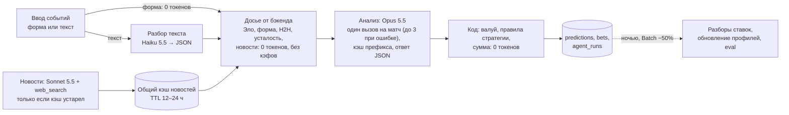

# Экономия токенов без потери качества

Документ о том, как сделать анализ дешевле и не ухудшить прогнозы. Связанные документы:

- [PLAN.md](PLAN.md) — архитектура, схема БД (`agent_runs`, `predictions`, `player_news` и др.), этапы работ.
- [LLM_LEARNING.md](LLM_LEARNING.md) — как система учится на ставках. Метрики качества (лог-лосс, Brier, калибровка, CLV) подробно разобраны там, здесь они нужны только как защита от ухудшения.
- Макет, экран «ИИ и расходы» (`#costs`, см. [../mockup/README.md](../mockup/README.md)) показывает часть данных из раздела 1. Какой блок макета какому разделу соответствует и чем цифры макета отличаются от расчета — в 1.5.

Цены — по справочнику Claude API на момент написания (октябрь 2026); перед запуском сверить со страницей цен Anthropic. Все расчеты стоимости — **оценки с явными допущениями**. Реальные цифры появятся, когда начнем логировать расход (раздел 1).

---

## Коротко

1. **Сейчас один анализ двух матчей стоит, по оценке, $1–4,5, типично $1,3–2** (раздел 3; в [PLAN.md](PLAN.md) — ≈$1,3 при более скромных допущениях). Дорого обходится не модель, а цикл: бот до 20 раз отправляет Claude одно и то же — 36 КБ инструкций, историю ставок и все, что прочитал до этого.
2. **Главный рычаг — архитектурный.** Числа считает код, Claude получает готовое компактное досье: один вызов Opus на матч (ответ не прошел проверку кодом — до 3, `analysis_max_iterations`) вместо цикла из 10–20 итераций. Это экономит больше, чем все остальные приемы вместе, и заодно убирает выдуманную статистику.
3. Дальше по убыванию эффекта: кэширование промпта, сокращение инструкций, ответ в виде JSON вместо длинного текста, выбор effort и модели для каждого шага, Batch API для фоновых задач, дисциплина веб-поиска.
4. **Оценка после всех изменений — около $0,22–0,32 за анализ** и ≈$15,8 в месяц при 40 анализах (раздел 5, по живой цене новостей на 12 октября 2026). Это на ≈$0,8 выше ориентира $15 из макета; запас дает прежде всего общий кэш новостей (4.8).
5. **Если перенести нынешний цикл на Opus 5.5 как есть, станет дороже — около $3,7 за анализ.** Новый токенизатор дает больше токенов на тот же текст, а размышления (thinking) у Opus 5.5 не отключаются.
6. **Правило:** любая экономия включается только после проверки на eval-наборе. Метрики качества не должны стать хуже с учетом доверительного интервала (раздел 2). Без этого правила экономию нельзя отличить от тихой деградации прогнозов.

---

## 1. Принцип: сначала измерить, потом экономить

Сейчас бот ничего не измеряет. В `bot.py:306` логируются только `stop_reason` и число блоков, в `bot.py:67` — длина промпта в символах. Сколько стоит анализ, неизвестно. Поэтому первый шаг — учет, и только потом оптимизация.

### 1.1. Что записывать на каждый вызов API

Одна строка в `agent_runs` (схема в [PLAN.md](PLAN.md)) на каждый вызов `messages.create`. Строки связываются с анализом через `analysis_id`. Поля из PLAN.md оставляем как есть; поля с пометкой «+» предлагается добавить.

| Поле | Откуда | Зачем |
|---|---|---|
| `kind` | код: `parse`, `analysis`, `refresh`, `postmortem`; + `news`, `eval`, `shadow` | расход по типам задач |
| `model`, + `effort` | параметры запроса | сравнение конфигураций |
| `prompt_version`, + `schema_version` | хеш текста system + tools и версия JSON-схемы ответа | связать стоимость и качество с версией промпта |
| + `step` | код: номер итерации внутри анализа | длина цикла |
| `input_tokens` | `usage.input_tokens` | вход **без** кэша, по полной цене |
| `cache_write_tokens` | `usage.cache_creation_input_tokens` | запись в кэш всего (1,25× цены входа при TTL 5 мин, 2× при TTL 1 час) |
| + `cache_write_5m_tokens`, + `cache_write_1h_tokens` | `usage.cache_creation.ephemeral_5m_input_tokens`, `usage.cache_creation.ephemeral_1h_input_tokens` | в одном запросе бывают обе записи (явная точка кэша на 1 час и автокэш хвоста на 5 минут), а цена у них разная |
| `cache_read_tokens` | `usage.cache_read_input_tokens` | чтение из кэша (доля цены входа) — главный индикатор, что кэш работает |
| `output_tokens` | `usage.output_tokens` | выход, включая размышления (thinking) |
| + `thinking_tokens` | `usage.output_tokens_details.thinking_tokens` (поле есть в SDK 1.12.1, сверено на этапе 3) | сколько стоят размышления |
| `web_searches` | `usage.server_tool_use.web_search_requests` (имя сверено на этапе 3) | поиски оплачиваются отдельно |
| `stop_reason`, `error` | ответ API, код | `max_tokens` и `refusal` считаем сбоями |
| `duration_ms` | код | задержка для пользователя |
| + `request_id` | `resp._request_id` | разбор инцидентов с Anthropic |
| + `batch`, + `eval_run_id` | код | отделить фон и эксперименты от боевых запусков (`eval_runs` — в [LLM_LEARNING.md](LLM_LEARNING.md)) |
| `cost_usd` | считает код по таблице цен | один источник правды для экрана расходов |

Полный вход запроса = `input_tokens + cache_write_tokens + cache_read_tokens`. В API поле `input_tokens` — только та часть входа, которая не попала в кэш.

Минимальный код:

```python
u = resp.usage
stu = getattr(u, "server_tool_use", None)
cc = getattr(u, "cache_creation", None)       # разбивка записи в кэш по TTL
await save_agent_run(
    analysis_id=analysis_id, kind="analysis", step=step_no, model=resp.model,
    input_tokens=u.input_tokens,
    cache_write_tokens=u.cache_creation_input_tokens or 0,
    cache_write_5m_tokens=(cc.ephemeral_5m_input_tokens or 0) if cc else (u.cache_creation_input_tokens or 0),
    cache_write_1h_tokens=(cc.ephemeral_1h_input_tokens or 0) if cc else 0,
    cache_read_tokens=u.cache_read_input_tokens or 0,
    output_tokens=u.output_tokens,
    web_searches=(getattr(stu, "web_search_requests", 0) or 0) if stu else 0,
    stop_reason=resp.stop_reason, request_id=resp._request_id,
)
```

### 1.2. Таблица цен и расчет стоимости

Цены меняются, поэтому храним их в БД с датой начала действия, а не в коде (`model_prices`, команда `prices` показывает действующие). Цены на октябрь 2026 ($ за 1 млн токенов), сверены с живой страницей цен 11 октября 2026:

| Модель | Вход | Выход | Чтение кэша | Запись кэша, TTL 5 мин (1,25×) | Batch |
|---|---|---|---|---|---|
| Claude Opus 5.5 `claude-opus-5-5` | 4 | 20 | 0,20 (0,05×) | 5 | −50% на токены |
| Claude Sonnet 5.5 `claude-sonnet-5-5` | 2 | 10 | 0,10 (0,05×) | 2,50 | −50% на токены |
| Claude Haiku 5.5 `claude-haiku-5-5` | 0,10 | 0,50 | 0,01 (0,1×) | 0,125 | −50% на токены |
| Claude Haiku 4.5 `claude-haiku-4-5` (прежняя, в программе не используется) | 1 | 5 | 0,10 (0,1×) | 1,25 | −50% на токены |
| Claude Sonnet 4.6 (в старом боте, `bot.py:29`) | 3 | 15 | — | — | — |

Запись в кэш с TTL 1 час стоит 2× цены входа: $8 у Opus 5.5, $4 у Sonnet 5.5, $0,20 у Haiku 5.5. **У Haiku 5.5 есть вторая ступень:** если весь вход запроса (вход, запись и чтение кэша) больше 100 тыс. токенов, все цены токенов × 5 (вход $0,50, выход $2,50). Разбор текста — около 2 тыс. токенов, до второй ступени далеко. Веб-поиск — $10 за 1000 поисков, то есть $0,01 за поиск. Claude Fable 5.1 ($10/$50) проекту не нужен.

```python
def cost_usd(p, inp, write_5m, write_1h, cache_read, out, searches, batch=False):
    # p — строка из таблицы model_prices, цены за 1 млн токенов
    # write_5m / write_1h — cache_write_5m_tokens / cache_write_1h_tokens из agent_runs (1.1):
    # один запрос может содержать обе записи, поэтому TTL не параметр вызова, а разбивка из usage
    tokens = (inp * p.input
              + write_5m * p.input * 1.25 + write_1h * p.input * 2.0
              + cache_read * p.cache_read + out * p.output) / 1e6
    return tokens * (0.5 if batch else 1.0) + searches * p.search_price  # 0.01
```

Скидка Batch применяется к токенам, в том числе к записи и чтению кэша. **Поиск в Batch не дешевле** (сверено на этапе 3): в формуле выше поиск без скидки.

### 1.3. Что должен показывать экран «ИИ и расходы»

- Расход за месяц против бюджета, по дням и прогноз до конца месяца.
- Расход по типам запусков: анализ, разбор текста, новости, обновление профилей, разборы ставок, эксперименты.
- Доля кэша: `cache_read / весь вход` по анализам. Если доля упала, что-то сломало кэш (раздел 4.2).
- Средняя стоимость анализа по версиям промпта **рядом с лог-лоссом той же версии** (в макете пока нет). Экономию оцениваем только вместе с качеством.
- Таблица запусков: время, тип, модель, вход / кэш / выход, поиски, длительность, $, признак Batch.
- Настройки экономии: модель и effort для каждого шага (effort в макете пока нет), лимиты, TTL кэша новостей, бюджет.

Что из этого уже есть в макете и где его цифры расходятся с расчетом — в 1.5.

### 1.4. Быстрое действие уже в текущем боте (до v2)

1. Логировать `resp.usage` после `bot.py:298–304`. Одна неделя логов даст реальную стоимость вместо оценки из раздела 3.
2. Посчитать токены инструкций через `client.messages.count_tokens(...)` для `SYSTEM_PROMPT` (`bot.py:66`). В `anthropic==0.34.0` (`requirements.txt:2`) метода `count_tokens` нет — считать отдельным скриптом в отдельном venv с актуальным SDK, бота не трогая. Считать нужно для той модели, на которой будем работать: у новых моделей другой токенизатор. Сторонние счетчики вроде `tiktoken` для Claude не подходят: это токенизатор другой модели, ошибка может быть в любую сторону.

### 1.5. Как это выглядит в макете (`#costs`)

Макет выровнен по этому документу после ревью. Таблица показывает, где что лежит и что осталось демонстрационным.

| Блок макета | Раздел | Что показывает | Что осталось отличаться |
|---|---|---|---|
| «Потрачено в октябре» + прогноз | 6 | у участника — его лимит на ключе администратора ($10 по умолчанию, Р13), у администратора — бюджет ключа администратора ($60 в демо); остаток, темп в день; $15 остался только как ориентир администратора; на 100% анализы на ключе администратора останавливаются до решения администратора | прогноз ≈$9,9 считается по демо-запускам 1–7 октября; канонический расчет раздела 5 — ≈$15,8 (по живой цене новостей на 12 октября 2026) |
| Четыре плитки: цена анализа, доля кэша, токены, поиски | 1.3 | средняя цена анализа и разница с ботом (база ≈$2,01, как в 3.2), вход из кэша, токены за месяц, поиски | средний анализ $0,17 — демо; в разделе 5 ≈$0,28–0,32 с шагом новостей |
| «Расходы по дням» | 1.3 | столбцы по дням, состав дня по задачам, таблица | — |
| «Где экономим» | 4.0 | досье 4.1, кэш 4.2, сжатые инструкции 4.3, ответ JSON по схеме 4.4, лимит поисков и кэш новостей 4.8, модели по шагам 4.6, Batch 4.7; кандидаты «Effort анализа medium → low» (4.5) и «Анализ на Sonnet 5.5» (4.6) с проверкой по 2.4; карточка «Версии: цена анализа и качество» | 4.9 и 4.10 на экране не показаны; 4.11 — кандидат v4 на экране «Обучение» |
| «На что уходят деньги» | 4.6 | расход по типам задач с моделью, токенами и ценой запуска | поиски новостей учтены внутри запусков анализа, отдельной строки для шага Sonnet 5.5 нет |
| «До и после» | 3.2, 5 | бот (≈$2,01, до 20 запросов, без кэша) против новой схемы (Opus 5.5, один вызов на матч, при ошибке проверки — до 3, `analysis_max_iterations`; текст — Haiku, новости — Sonnet отдельными шагами) | — |
| «Журнал запусков» и окно разбора стоимости | 1.1 | время, задача, модель, effort, вход и доля кэша, выход, поиски, длительность, $; формула стоимости | одна строка на запуск, а не на вызов API (нет `step`); запись в кэш отдельно не выделена |
| «Цены моделей» | 1.2 | цены входа, выхода и чтения кэша; поиск, Batch, запись в кэш ×1,25 | нет записи с TTL 1 час (×2) |
| «Настройки экономии» | 4.5, 4.6, 6 | модель и effort для каждой задачи; лимиты: на месяц, мягкий $0,50 и жесткий $1,00 на анализ, до 6 поисков на анализ и 15 в день; прогноз с новыми настройками | кэш новостей 12 ч (в 4.8 — 12–24 ч) |
| Окно «Проверка на eval-наборе» | 2.4, 2.7 | наборы для анализа, разбора текста, разборов ставок и профилей; разница с 95% ДИ по каждой метрике и вердикт по правилу «не хуже с допуском» (лог-лосс ≤ +0,01, Brier ≤ +0,005, ECE ≤ +2 п.п.) | — |

**Сверка цифр.** Цены запусков в макете считаются по формуле демо-данных (`mockup/js/data.js`): некэшированный вход по обычной цене, без записи в кэш (×1,25, в примере раздела 5 это ≈$0,08 на анализ) и без роста контекста между итерациями. Поэтому $0,17 за анализ и ≈$9,9 в месяц в макете ниже, чем в разделе 5. **Канонический расчет — раздел 5, лимиты — раздел 6.**

---

## 2. Защита качества: eval-набор и правило «не хуже»

Почти любая экономия что-то меняет в том, как модель рассуждает. Нужен способ отличить «то же качество дешевле» от «дешевле и хуже». Субъективное впечатление после пары анализов таким способом не является.

### 2.1. Что защищаем

| Метрика | Роль в защите | Почему |
|---|---|---|
| Лог-лосс вероятностей | **основная, по ней решаем** | чувствительна к уверенным ошибкам, используется на каждом событии |
| Brier | основная, дублирует | легче интерпретировать, менее шумная |
| Калибровка (кривая, ECE) | проверка на здравый смысл | экономия не должна сделать модель самоувереннее |
| CLV (кэф взятия против закрывающего) | вторичная | показывает, есть ли преимущество перед рынком; шумит меньше ROI |
| Совпадение решений (состав экспресса, рынки) | вторичная | дешевая проверка «модель делает то же самое» |
| ROI | **только наблюдение, решения по нему не принимаем** | слишком шумный, расчет ниже |
| Ошибки формата, `max_tokens`, `refusal` | обязательная | экономия не должна ломать ответы |

Подробнее о метриках — в [LLM_LEARNING.md](LLM_LEARNING.md).

### 2.2. Из чего состоит eval-набор

**Единица** — событие (матч) с вероятностями по рынкам, которые выдал анализ: П1/П2, фора ±1,5 по сетам.

1. **Рассчитанные события пользователя.** Самый ценный источник: реальные входные данные и реальные кэфы. В v2 каждый анализ сохраняет **снимок входа**: досье целиком, новости на момент анализа, кэфы, версии промпта и схемы. В схеме [PLAN.md](PLAN.md) признаки на момент прогноза лежат в `predictions.features`. Любую новую конфигурацию можно прогнать на точно тех же данных («реплей»).
2. **Исторические матчи из открытых данных** (Jeff Sackmann, tennis-data.co.uk — см. [PLAN.md](PLAN.md)) в виде **снимков на момент матча** (point-in-time): рейтинг Эло только по матчам до этой даты, форма — до предыдущего матча, кэфы — из исторических данных. Будущее не должно протечь в досье.
   - **Ловушка — память модели.** Матчи до даты среза знаний модели (у Opus 5.5 — июнь 2026; на странице Models overview проверить и «training data cutoff» — брать матчи после более поздней из двух дат плюс ~1 месяц запаса) могли попасть в обучающие данные, и модель может «помнить» результат. Поэтому в основной набор берем матчи **после даты среза** и собственные рассчитанные события. Более ранние матчи годятся только для отладки конвейера.
   - Новости задним числом корректно не восстановить: поиск сегодня вернет сегодняшние статьи. Для исторических матчей досье собираем без новостей и помечаем это. Наборы с новостями и без анализируем раздельно.
3. **«Трудный хвост»**, 15–20% набора: отказы и травмы, смена покрытия, возвращение после перерыва, квалифаеры, пятисетовики накануне. На легких событиях все конфигурации выглядят одинаково, а деньги теряются на трудных.

Набор замораживаем и версионируем. Все сравниваемые конфигурации прогоняются на одном и том же наборе.

### 2.3. Какого размера нужен набор и почему

Шум задает размер. Две формулы, σ — разброс метрики на одно событие:

- **точность оценки:** полуширина 95% интервала равна h при n ≈ (1,96 · σ / h)²;
- **решение «не хуже с допуском δ»** (2.4): чтобы конфигурация, которая на самом деле не хуже (истинная Δ = 0), проходила правило в 80% случаев (мощность 80%), нужно n ≈ ((1,96 + 0,84) · σ / δ)².

Значения σ ниже — **допущения для старта**; после первых прогонов замеряем реальные σ и пересчитываем n.

| Что сравниваем | σ на событие (допущение) | n для точности ±h | n для правила «не хуже» (мощность 80%) |
|---|---|---|---|
| Разница лог-лосса двух конфигураций на **одних и тех же** событиях | 0,06 | ±0,01 → ≈140; ±0,005 → ≈550 | δ = 0,01 → **≈280** |
| Разница Brier, парная | 0,025 | ±0,005 → ≈100; ±0,0025 → ≈380 | δ = 0,005 → **≈200** (при δ = 0,003 — ≈550) |
| CLV одной ставки | 6 п.п. | ±1 п.п. → ≈140 | — |
| ROI одной ставки при кэфе ~1,9 | ≈95 п.п. | ±10 п.п. → ≈350; ±5 п.п. → **≈1400** | для решений не используется |

σ для Brier — допущение этого документа. Симуляция в [LLM_LEARNING.md](LLM_LEARNING.md) (раздел 3.3) дает стандартную ошибку разницы Brier 0,002–0,004 на 220 событиях, то есть σ ≈ 0,03–0,06. Тогда для δ = 0,005 нужно ≈280–1100 событий, и набор придется увеличивать. Какое из допущений ближе к правде, покажет первый же прогон.

Выводы:

- **Основной набор — 200–300 событий, быстрый (smoke) — 40.** Размер выбран под допуск правила 2.4, а не под точность ±h. При 140 событиях конфигурация, которая на самом деле не хуже, проходит правило по лог-лоссу лишь примерно в половине случаев, при 250 — примерно в 75%, при 280 — в 80%. Smoke отсекает явные поломки: формат, грубые сдвиги вероятностей. Полный набор нужен для решения о включении.
- Сравнение **парное**: обе конфигурации считаются на одних событиях, анализируем разницу по каждому событию. Так шум самих исходов матчей почти уходит, и нужно в разы меньше данных, чем при сравнении двух независимых выборок.
- **ROI для решений не годится:** чтобы отличить +5% от 0%, нужны сотни и тысячи ставок. Это не недостаток метода — так устроены ставки.

### 2.4. Правило включения

Для изменений, которые должны **улучшить** качество, действует правило из [LLM_LEARNING.md](LLM_LEARNING.md#34-как-сравнивать-две-версии): интервал разницы целиком ниже нуля. Для экономии правило другое: «не хуже с допуском» (non-inferiority). Оптимизация включается, только если выполнены **все** условия:

1. **Лог-лосс не хуже:** верхняя граница 95% бутстрэп-интервала для `Δ = лог-лосс(новая) − лог-лосс(старая)` ≤ **+0,01**. По Brier — ≤ **+0,005**: это порог шума из [LLM_LEARNING.md](LLM_LEARNING.md) (раздел 3.3), более жесткий допуск при 200–300 событиях отсекал бы и нейтральные изменения (2.3).
2. **Калибровка не хуже:** верхняя граница бутстрэп-ДИ для ΔECE ≤ **+2 п.п.** (или наклон и сдвиг калибровки без значимого изменения). Точечное сравнение ECE не годится: при 10 корзинах на 200–300 событиях ECE шумит на несколько п.п.
3. **Решения не расходятся заметно сильнее собственного шума.** Сначала дважды прогоняем **старую** конфигурацию на одном наборе: ответы модели не детерминированы. Средняя |Δp| и доля совпадения состава экспресса между этими двумя прогонами — это порог шума. Расхождение новой конфигурации со старой — не больше 1,5× порога шума. Смена effort или модели почти всегда сдвигает ответы сильнее, чем повторный прогон той же конфигурации, поэтому при превышении смотрим, какие события изменились, а решение принимаем по п. 1–2.
4. Ошибок формата, остановок по `max_tokens` и отказов не больше, чем было.
5. **Стоимость реально упала** — по логам, а не по оценке.

Парный бутстрэп:

```python
import numpy as np

def logloss(p, y):                      # p — вероятность исхода, y — 1/0
    p = np.clip(p, 1e-6, 1 - 1e-6)
    return -(y * np.log(p) + (1 - y) * np.log(1 - p))

def paired_bootstrap(p_old, p_new, y, n_boot=10_000, seed=0):
    d = logloss(p_new, y) - logloss(p_old, y)       # > 0 — новая хуже
    rng = np.random.default_rng(seed)
    idx = rng.integers(0, len(d), size=(n_boot, len(d)))
    lo, hi = np.percentile(d[idx].mean(axis=1), [2.5, 97.5])
    return d.mean(), lo, hi

delta, lo, hi = paired_bootstrap(p_old, p_new, y)
ship = hi <= 0.01
```

Если в наборе много событий одного дня или турнира (ноги одного экспресса), события коррелированы. Тогда пересэмплируем блоками по дням (блочный бутстрэп), иначе интервал получится обманчиво узким.

### 2.5. Теневой A/B на реальных анализах

Eval-набор проверяет конфигурацию на прошлом, теневой режим — на текущем потоке:

- Новая конфигурация считается в фоне на тех же снимках входа, что и боевая. Пользователь ее результат не видит.
- Теневые прогоны идут через **Batch API** (−50%), потому что результат не нужен срочно. Новостей заново не ищем: используем снимок.
- После расчета ставок сравниваем по правилу 2.4. Для решения нужно накопить ~100+ событий. При 40 анализах в месяц по 2 матча это 1–1,5 месяца, поэтому тень — подтверждение, а не основной инструмент.
- На ~100 событиях полуширина интервала для Δ лог-лосса ≈0,012 — шире допуска 0,01. Поэтому тень ловит только грубые ухудшения (Δ лог-лосса больше ~0,02), а тонкие решает полный eval-набор.

### 2.6. Сколько стоит сама проверка

Реплей одного события на Opus 5.5 через Batch — досье и ответ, без цикла: ≈6 тыс. входа и 2–4 тыс. выхода вместе с размышлениями. Это ≈$0,03 (2 тыс. выхода) … $0,05 (4 тыс.); без Batch вдвое дороже, как в [LLM_LEARNING.md](LLM_LEARNING.md). Полный прогон на 250–300 событиях — **≈$8–16 за конфигурацию**, а повторы для порога шума (2.4, п. 3) умножают сумму. Это сопоставимо с месячным бюджетом на анализы, поэтому:

- на эксперименты выделяем отдельный бюджет и отдельный API-ключ (раздел 6);
- за один эксперимент меняем один рычаг, иначе непонятно, что сработало;
- smoke-прогон (40 событий, ≈$1–2) — для мелочей, полный — для серьезных изменений: модель, effort, язык промпта, сжатие досье.

Реплей возможен через Batch, только если анализ укладывается в один вызов с полным досье: Batch-запросы не поддерживают цикл с инструментами. Это еще один довод за досье (рычаг 4.1).

### 2.7. Качество вспомогательных задач

Правило 2.4 защищает вероятности. Разбор текста, новости и разборы ставок тоже переводятся на дешевые модели (4.6), и у каждой такой задачи свой набор, метрика и порог. Принцип тот же: сначала набор и порог, потом экономия. Размеры наборов совпадают с окном проверки в макете.

| Задача (модель) | Метрика | Набор | Порог |
|---|---|---|---|
| Разбор текста в JSON (Haiku 5.5, effort `low`) | точное совпадение с эталонным JSON по игрокам, рынкам и кэфам | 150 реальных сообщений из `История-ставок.json` и Telegram (стартовать можно с 50) | 100%; каждую ошибку разбираем и чиним промпт или проверки в коде |
| Новости и ночное обновление профилей (Sonnet 5.5: новости — effort `low`, профили — через Batch) | полнота (recall) по травмам и снятиям | 30 «игроко-дней» (досье), сверенных вручную; в набор специально включаем дни с реальными травмами и снятиями | ≥ 95% — на таком наборе это фактически ни одного пропуска |
| Разборы ставок (Sonnet 5.5, Batch) | доля гипотез с условием из словаря признаков (`lessons.scope`: SQL по нему собирает код, Т7; см. [LLM_LEARNING.md](LLM_LEARNING.md)) и согласие с ручной проверкой | 40 синтетических и архивных случаев (формат), затем 40 настоящих разборов (Т14) | условие из словаря ≥ 90%; согласие с ручной проверкой — не ниже, чем у текущей конфигурации |

**Эталон разбора текста** проверяет команда `parse-eval --file ПАРЫ.json` (на своем компьютере — `bash deploy/local.sh parse-eval --file ПАРЫ.json`). Файл — JSON-список пар «текст — ожидаемые события»:

```json
[
  {
    "text": "Текущий банк: 48 000 ₽\nБукмекер: Fonbet\n\nСобытия:\nСиннер vs Руне, Шанхай, хард, 1/8\nКэфы: П1 = 1.17, П2 = 5.10\nФора по сетам: П1(-1.5) = 1.62, П2(+1.5) = 2.30",
    "expected": {
      "events": [
        {
          "player1": "Sinner",
          "player2": "Rune",
          "odds": {"ML": ["1.17", "5.10"], "HCP_-1.5": ["1.62", null], "HCP_+1.5": [null, "2.30"]}
        }
      ]
    }
  }
]
```

- Игрок — имя (ищется в базе так же, как игрок из разбора) или id из базы. Порядок событий и игроков — как в тексте.
- Рынки — `ML`, `HCP_-1.5`, `HCP_+1.5`, у каждого пара кэфов `[П1, П2]`; `null` — кэфа нет. Рынка нет в `expected` — у него нет кэфов.
- Сообщение верно, если совпали число событий, игроки после поиска в базе и все шесть кэфов. Критерий — 100% сообщений на эталоне от 50 сообщений; на меньшем — пробный прогон (код 3), приемкой он не считается. Банк и букмекер не сверяются.
- Черновик эталона из чата со старым ботом: в Telegram Desktop «Экспорт истории чата» в формате JSON, затем `parse-eval --draft --from-telegram result.json --out ПАРЫ.json`. Берутся сообщения владельца в формате бота (строка «A vs B» и строка «Кэфы: П1 = …»), не больше 150 последних (`--limit`); ответы самого бота (в том числе справка на /start с образцом ввода) и сообщения со строками-командами («/статистика — …») не берутся. Каждое разбирается текущим разбором; ответ записывается в `expected`, а в поле `check` — что проверить руками (игрок не найден или найден не наверняка, непонятая строка). Ошибки разбора исправьте в `expected`, поля `source` и `check` можно не трогать.
- Цена — около $0,001 на сообщение; вызовы идут из бюджета проверок (`agent_runs.kind = eval`).

---

## 3. Где сейчас уходят токены (`bot.py`)

Старый бот перенесен в `legacy/telegram-bot/` (Р20): пути к файлам бота ниже — относительно этой папки.

### 3.1. Источники расхода

| # | Что | Где в коде | Почему дорого |
|---|---|---|---|
| 1 | Шесть markdown-файлов инструкций склеиваются в один system prompt: 36 193 байта, 22 184 символа, из них 13,4 тыс. кириллицей. Оценка — **12–18 тыс. токенов**, точнее покажет `count_tokens` | `bot.py:50–66`, отправка в `bot.py:301` | Отправляется **в каждой итерации** цикла. Кэширования нет — ни одного `cache_control` |
| 2 | Цикл до 20 итераций; на каждой заново отправляется весь разговор | `bot.py:30`, `bot.py:297–304`, рост истории в `bot.py:316` и `bot.py:350` | Стоимость растет примерно квадратично от числа итераций: прочитанное на первой итерации к двенадцатой оплачено уже 12 раз |
| 3 | 10 последних ставок в JSON с `indent=2` и русскими ключами добавлены к первому сообщению | `bot.py:284–293` | Еще ~3–8 тыс. токенов в каждой итерации. Компактный JSON на том же примере короче на 28% (1080 → 778 символов на ставку), с короткими английскими ключами — еще короче |
| 4 | Чтение файлов игроков через инструмент: файл возвращается целиком | `bot.py:197–207` | Шесть файлов на игрока (шаблоны — 9 тыс. символов, заполненные больше), четыре игрока на два матча. Все это остается в истории до конца цикла |
| 5 | Запись файлов через инструмент: Claude сам генерирует **все содержимое файла** | `bot.py:210–224`, требование в `Инструкция-Авто.md:66–73` | Выходные токены в 5 раз дороже входных. Затем этот текст еще раз оплачивается как вход в каждой следующей итерации. Полную `История-ставок.json` при `max_tokens=4000` (`bot.py:300`) по мере роста записать невозможно: ответ обрежется, JSON не пройдет проверку, будет повтор |
| 6 | DuckDuckGo Instant Answer возвращает короткие справки, а не статистику | `bot.py:158–194` | Токенов мало, но статистики нет. Модель тратит итерации на новые запросы или заполняет поля по памяти. Самое дорогое здесь — потеря качества |
| 7 | Противоречия в инструкциях: «Файл матча (.md) — КРИТИЧНО» против «файла матча нет» | `Стратегия-ставок.md:21`, `:34`, `:157`, `:316` против `Инструкция-Авто.md:11`, `Инструкция-3-анализ.md:5` | Модель может тратить итерации на `list_files` и `read_file` в поисках несуществующего файла или остановиться с «⛔ Анализ невозможен» |
| 8 | Дубли в инструкциях | формат ввода: `CLAUDE.md:42–50` = `Инструкция-Авто.md:17–27`; алгоритм: `CLAUDE.md:59–66` ≈ `Инструкция-Авто.md:31–73`; адаптация и аудит: `Инструкция-Авто.md:149–171` ≈ `Стратегия-ставок.md:232`, `:295` | Платим за один и тот же текст дважды на каждой итерации |
| 9 | Инструкции 1 и 2 (заполнение и обновление профилей, до 4 и до 6 поисков на игрока) входят в промпт **каждого** анализа | `Инструкция-1-заполнение-базы.md:54`, `Инструкция-2-обновление.md:76` | Это работа для фоновой задачи, а не для анализа |
| 10 | Ответ — длинный текст с эмодзи по шаблону | `Стратегия-ставок.md:246–292` | Русский текст дорог на выходе, а из него потом еще нужно вытаскивать числа |
| 11 | Модель и SDK устарели: `claude-sonnet-4-6`, `anthropic==0.34.0` | `bot.py:29`, `requirements.txt:2` | Модель на поколение старше текущей; старый SDK не знает актуальных параметров (`output_config` со схемой ответа и `effort`, новые версии веб-поиска) и `count_tokens`. Переход 0.x → 1.x — мажорное обновление (`httpx` → `httpx2`, удаленные параметры, Python ≥ 3.10 — в `Dockerfile` 3.11, подходит), делается отдельным шагом |

### 3.2. Грубая оценка стоимости одного анализа сейчас

**Сценарий:** два матча, четыре игрока уже в базе, файлы 05 устарели — по инструкции их надо обновить. Допущения:

- system prompt ≈ 15 тыс. токенов, описания пяти инструментов ≈ 1 тыс.;
- первое сообщение с 10 ставками ≈ 5,3 тыс.;
- 12 итераций (бывает 8–20);
- к концу цикла в истории накапливается ≈ 55 тыс. токенов: чтение 24 файлов игроков (~24 тыс.), чтение истории ставок (~10 тыс.), результаты поиска (~4 тыс.), записи восьми файлов 05/06 (~12 тыс.), служебные вызовы и промежуточный текст (~3–5 тыс.); в среднем на итерацию ≈ 27 тыс.;
- выход ≈ 18 тыс.: записи файлов ~12 тыс., итоговый ответ ~2,5 тыс., вызовы инструментов и пояснения ~3 тыс.

| Что отправляется | Токенов за итерацию | × итераций | Всего | Доля входа |
|---|---|---|---|---|
| Инструкции и описания инструментов | 16 тыс. | 12 | 192 тыс. | 33% |
| Запрос и 10 ставок | 5,3 тыс. | 12 | 64 тыс. | 11% |
| Накопленные результаты инструментов и записи | 0 → 55 тыс. (в среднем 27) | 12 | 324 тыс. | 56% |
| **Итого вход** | | | **≈580 тыс.** | |
| **Выход** | | | **≈18 тыс.** | |

**Стоимость на Sonnet 4.6:** 580 тыс. × $3/млн + 18 тыс. × $15/млн ≈ $1,74 + $0,27 ≈ **$2 за анализ**. Разброс по сценариям — от ~$1 (8 итераций, мало чтений) до ~$4,5 (20 итераций, большая история). В [PLAN.md](PLAN.md) та же оценка дает ≈$1,3: там не учтены запись файлов через `write_file` и чтение истории ставок, а прирост истории взят 3 тыс. токенов за итерацию. Обе цифры — оценки одного порядка. Какая ближе к правде, покажут логи (1.4).

**Если просто сменить модель на Opus 5.5 и ничего больше не менять:**

- новый токенизатор дает примерно на 0–35% больше токенов на тот же текст; берем +30%;
- размышления включены всегда; берем +1 тыс. выходных токенов на итерацию при effort `medium`.

Получается ≈750 тыс. × $4/млн + ≈35 тыс. × $20/млн ≈ $3,0 + $0,7 ≈ **$3,7**. Если в том же цикле включить только кэширование, выйдет ≈ **$1,3**: большая часть входа станет чтением кэша по $0,20 за млн. Это хорошо показывает силу кэша, но цикл все равно остается главной проблемой.

---

## 4. Рычаги экономии

### 4.0. Сводка по убыванию эффекта

| # | Рычаг | Экономия (оценка) | Риск для качества | Этап ([PLAN.md](PLAN.md)) |
|---|---|---|---|---|
| 4.1 | Досье от бэкенда вместо чтения файлов в цикле | −70…85% входа; один вызов Opus на матч (до 3 при ошибке проверки) вместо 10–20 итераций | **отрицательный**: реальные данные вместо выдуманных | 2–3 |
| 4.2 | Кэширование промпта | −30…50% стоимости оставшегося входа; на старом цикле ≈−65% общей стоимости | нет | 3 |
| 4.3 | Сокращение и чистка инструкций | −60…70% system prompt | низкий, проверить smoke | 3 |
| 4.4 | Структурированный ответ (JSON-схема) | −40…60% видимого выхода | низкий; плюс надежный разбор | 3 |
| 4.5 | Effort для каждого шага | −20…50% выхода и размышлений | **есть**, только через eval | 5 |
| 4.6 | Своя модель для каждого шага | −50…75% на вспомогательных шагах | **есть**, только через eval | 3, затем 5 |
| 4.7 | Batch API для фоновых задач | −50% на них | нет; результат приходит позже | 3–5 |
| 4.8 | Дисциплина веб-поиска и общий кэш новостей | −50…90% платы за поиски | низкий | 2–3 |
| 4.9 | Повторное использование анализов | от 0 до 100% на повторах | низкий при правильном ключе | 3 |
| 4.10 | Лимиты цикла и бюджет задачи | срезает дорогой хвост | низкий | 3 |
| 4.11 | Английский язык инструкций | вероятно −20…40% system prompt (измерить) | **есть**, только через eval | 5 |

Пункты 4.1–4.4, 4.7, 4.8 и 4.10 почти бесплатны для качества, с них начинаем. Пункты 4.5, 4.6 и 4.11 — обмен «интеллекта» на деньги; они идут последними и только по результатам eval. Оценки экономии частично пересекаются, складывать их нельзя: итог считаем в разделе 5.

Как устроен анализ в v2 и где тратятся токены:



### 4.1. Досье от бэкенда вместо чтения файлов в цикле

- **Что.** Принцип «числа считает код, контекст — Claude». Бэкенд до вызова Claude собирает по каждому матчу компактное досье: Эло по покрытию и базовая вероятность модели, форма за последние 10 матчей, агрегаты подачи и приема, H2H, дни отдыха и нагрузка, кэфы пользователя и вероятности без маржи, свежие новости из кэша, 3–5 релевантных уроков. Это ~2–3 тыс. токенов на матч.
- **Как.**
  - Досье передается в первом сообщении как компактный JSON: `json.dumps(d, ensure_ascii=False, sort_keys=True, separators=(",", ":"))`, короткие английские ключи, числа округлены (0.63, а не 0.6312345).
  - Инструментов остается 1–2 узких, например `get_match_details(match_id)`, на случай если Claude нужна деталь. Никаких `read_file` и `list_files`.
  - Если инструменту надо вызвать несколько вещей, Claude делает **параллельные вызовы** в одной итерации; все `tool_result` возвращаются одним сообщением.
  - Запись в БД делает код по JSON-ответу, а не Claude через `write_file`.
- **Эффект.** Итераций 2–4 вместо 10–20; накопленная история ~10–15 тыс. вместо ~55 тыс.; выходных токенов на запись файлов нет совсем. Итог −70…85% входа.
- **Риск.** Модель видит только то, что положили в досье. Если важного поля нет, она его не узнает. Лечится составом досье и узким инструментом для деталей, а не возвратом к чтению файлов.
- **Проверка.** Полный eval: старый цикл против досье. Ожидаем, что качество вырастет, потому что статистика перестанет быть выдуманной. Плюс логи: `iterations` и вход на анализ.

### 4.2. Кэширование промпта

- **Что.** Повторяющееся начало запроса (префикс) API берет из кэша: чтение стоит $0,20 за млн у Opus 5.5 и $0,10 у Sonnet 5.5 (5% цены входа у обеих). Запись в кэш стоит 1,25× цены входа при TTL 5 минут и 2× при TTL 1 час.
- **Как.**
  - Порядок частей запроса фиксирован: `tools → system → messages`. Кэш работает **по совпадению префикса**: изменение любого байта сбрасывает все, что идет после него.
  - Один явный `cache_control` в конце system (общая часть для всех пользователей и запусков) и автоматическое кэширование «хвоста» на уровне запроса — для итераций цикла.
  - В system **нет** даты, имени пользователя, банка, номера запуска: все переменное идет в `messages` после точки кэша.
  - Набор и порядок инструментов не меняются от запроса к запросу. JSON в промпте сериализуется с сортировкой ключей.
  - Внутри одного разговора не меняем модель, effort и JSON-схему ответа: любое из этого сбрасывает кэш. Разные шаги — разные запросы, у каждого своя модель.

  ```python
  resp = await client.messages.create(
      model="claude-opus-5-5",
      max_tokens=16000,
      tools=ANALYSIS_TOOLS,                       # фиксированный набор и порядок
      system=[{"type": "text", "text": STRATEGY_PROMPT,   # без дат и личных данных
               "cache_control": {"type": "ephemeral"}}],
      messages=messages,                          # досье + цикл, только дописываем
      cache_control={"type": "ephemeral"},        # автокэш хвоста для итераций
      output_config={"effort": "medium"},         # задаем явно, не полагаемся на умолчание
  )
  ```

- **Честное ограничение.** Кэш живет 5 минут или час. Если один пользователь запускает 1–2 анализа в день, между запусками кэш не доживет. Он окупается **внутри одного анализа** (итерации идут с разницей в секунды), в сериях запусков, в eval и при нескольких пользователях с общим system prompt. Минимальный размер кэшируемого префикса — 512 токенов у всех трех моделей 5.5 (Opus, Sonnet, Haiku; сверено на этапе 3, у Haiku 4.5 было 4096). Префикс короче минимума молча не кэшируется (`cache_creation_input_tokens: 0`), без ошибки.
- **Эффект.** −30…50% стоимости входа в v2; на старом цикле −75…80% стоимости входа, ≈−65% общей стоимости (раздел 3.2: ≈$3,7 → ≈$1,3 на Opus 5.5).
- **Риск для качества.** Нет: модель видит тот же текст.
- **Проверка.** Со второй итерации `cache_read_input_tokens > 0`, а `cache_creation_input_tokens` примерно равен размеру одного нового шага, а не всего разговора. Оповещение, если доля кэша в анализах ниже 50% (раздел 6).

### 4.3. Сокращение и чистка инструкций

- **Что.** Сейчас в каждом анализе все шесть файлов. Анализу нужна только суть стратегии: роль, как оценивать вероятности (шаги 2–3), ограничения.
- **Как.**

  | Сейчас | Куда переходит |
  |---|---|
  | Шаги 0–1 «проверить и прочитать файлы» | проверка полноты досье в коде |
  | Шаги 4–5: правила экспресса и суммы | код: фильтры кэфов, максимум 3 события, таблица ставок от банка, адаптация по серии. Claude предлагает состав экспресса и объясняет его, но только в рамках этих правил |
  | Шаг 6: шаблон ответа | JSON-схема (рычаг 4.4) |
  | Аудит каждые 10 ставок | отдельная фоновая задача (разборы, Batch) — см. [LLM_LEARNING.md](LLM_LEARNING.md) |
  | Инструкции 1 и 2 | промпты ночного обновления профилей |
  | `CLAUDE.md`, `Инструкция-Авто.md` | не нужны: описывают работу с файлами, которой больше нет |

  Заодно убираем противоречия про «файл матча» и дубли (раздел 3.1, пункты 7–8). Цель — ~5–7 тыс. символов вместо 22 тыс.
- **Эффект.** −60…70% system prompt. Модель меньше путается.
- **Риск.** Можно выбросить правило, которое на самом деле работало. Поэтому сначала smoke, при заметных сдвигах вероятностей — полный eval.
- **Проверка.** `count_tokens` до и после, eval по правилу 2.4.

### 4.4. Структурированный ответ вместо длинного текста

- **Что.** Анализ возвращает JSON по схеме: по каждому матчу вероятности по рынкам, уверенность, ключевые факторы (коды), короткое обоснование до ~300 символов по-русски для интерфейса. Текстовые блоки для экрана анализа собирает фронтенд из полей JSON.
- **Как.** `output_config={"format": {"type": "json_schema", "schema": ...}}` или `client.messages.parse(..., output_format=AnalysisResult)` с моделью Pydantic. Для инструментов — `strict: true`. Схема версионируется (`schema_version`), ее смена сбрасывает кэш.
- **Эффект.** −40…60% видимого выхода. Отпадает угадывание экспресса по ключевым словам в тексте (`bot.py:553`).
- **Риск.** Слишком тесная схема может подрезать рассуждение. Размышления (thinking) при этом остаются, а схема ограничивает только итоговый ответ.
- **Проверка.** Smoke, доля ответов, прошедших схему (должна быть 100%), длина `output_tokens`.

### 4.5. Effort для каждого шага

- **Что.** `output_config.effort` (`low` | `medium` | `high` | `xhigh` | `max`) управляет глубиной размышлений и, следовательно, выходными токенами. Умолчания: у Opus 5.5 — `medium`, размышления у этой модели **отключить нельзя**, effort — единственная ручка. У Sonnet 5.5 — `high`; при effort `low` адаптивные размышления остаются включенными. У Sonnet 5.5 `thinking: {type: "disabled"}` → 400; выключить размышления на шаге новостей можно `{type: "between_tools"}` при effort ≤ `high` — проверять через eval (2.7). Haiku 5.5 effort поддерживает (`low`…`max`, по умолчанию `medium`); у Haiku 4.5 он давал ошибку. Разбор текста идет с `low`.
- **Как.** Effort задаем явно для каждого шага. Начальные значения: анализ — `medium`, новости — `low`, разборы ставок — `low`/`medium`. Затем перебор `low` / `medium` / `high` для анализа на eval-наборе, каждый уровень отдельным прогоном. Внутри одного разговора уровень не меняем: это сбрасывает кэш.
- **Эффект.** В v2 после рычагов 4.1–4.4 **основной расход — выход Opus, включая размышления** (раздел 5). Поэтому effort становится главным рычагом второго круга: −20…50% выхода.
- **Риск.** Реальный: на трудных матчах меньшая глубина может стоить качества. Решаем только по eval, отдельно смотрим «трудный хвост».
- **Проверка.** Перебор effort на полном наборе, правило 2.4.

### 4.6. Своя модель для каждого шага

- **Что и как.** Стартовая раскладка (как в макете):

  | Шаг | Модель | Почему |
  |---|---|---|
  | Разбор свободного текста в JSON | Haiku 5.5, effort `low` | простая проверяемая задача; при вводе через форму шаг не нужен вовсе |
  | Сводка новостей с веб-поиском | Sonnet 5.5, effort `low` | извлечение фактов, а не оценка вероятностей |
  | Анализ и вероятности | Opus 5.5 | ключевое решение, здесь экономить в последнюю очередь |
  | Разборы ставок, обновление профилей | Sonnet 5.5 через Batch | фон, большой объем |

- **Эффект.** −50…75% на вспомогательных шагах.
- **Риск.** Ошибка дешевой модели на разборе текста (не тот игрок, не тот кэф) портит весь анализ. Поэтому результат разбора проверяет код (игроки найдены в БД, кэфы в разумных пределах) и подтверждает пользователь на экране «Новый анализ». Замену Opus на Sonnet в самом анализе проверяем так же, как effort: сначала Opus с меньшим effort, потом Sonnet — по eval, а не по ощущениям.
- **Проверка.** Для разбора текста, новостей и разборов ставок — наборы и пороги из 2.7 (для разбора — 50–150 реальных сообщений с эталонным JSON, точность 100% по игрокам, рынкам и кэфам). Для анализа — правило 2.4.

### 4.7. Batch API для фоновых задач

- **Что.** Асинхронная обработка за 50% цены, скидка суммируется с кэшем. Большинство пакетов готово в течение часа, максимум — 24 часа.
- **Для чего.** Ночное обновление профилей игроков с матчами в ближайшие 48 часов, разборы рассчитанных ставок, eval-прогоны, теневые прогоны.
- **Ограничение.** Пакетный запрос одношаговый: цикла с вашими инструментами внутри нет. Все данные надо положить в запрос заранее — это снова досье. Работает ли серверный веб-поиск внутри Batch — проверить. Если нет, новости собираем отдельным синхронным шагом.
- **Риск.** Нет; результат приходит позже.
- **Проверка.** В `agent_runs` флаг `batch`, стоимость фоновых задач уменьшилась вдвое.

### 4.8. Дисциплина веб-поиска и общий кэш новостей

- **Что.** Веб-поиск нужен **только для новостей** (травмы, снятия, мотивация). Статистику берем из данных (рычаг 4.1), а не из поиска.
- **Как.**
  - Серверный инструмент `web_search_20260209` с `max_uses` (задается на запрос; запрос — на матч, по умолчанию 2: один поиск на игрока) и `allowed_domains` (официальные сайты тура и турниров, 2–3 проверенных новостных; список утверждает владелец).
  - Версия `_20260209` умеет фильтровать результаты кодом до попадания в контекст (по документации [programmatic tool calling](https://platform.claude.com/docs/en/agents-and-tools/tool-use/programmatic-tool-calling) — в среднем −24% входа и +11% качества на тестах поиска BrowseComp и DeepSearchQA). По умолчанию поиск прямой (`allowed_callers: ["direct"]`): так проще сверить адреса. Фильтрация — вариант для сравнения (`news_dynamic_filtering`, ниже).
  - Ошибки поиска приходят блоком результата с `error_code`, а не исключением, — код должен их обрабатывать.
  - Новости сохраняются в `player_news` с источником и датой и **общие для всех пользователей**. Повторный поиск по игроку — только если кэш старше TTL (12–24 часа) или до матча меньше суток.
- **Почему это важно для бюджета.** Поиск стоит $0,01: 20 поисков в день — это $6 в месяц, 40% бюджета $15 из макета. Плюс результаты поиска попадают во вход как токены: на живой проверке ≈ 14–16 тыс. на поиск, а не 4 тыс., как в макете. На каждой следующей итерации серверного цикла этот вход читается снова.
- **Живая проверка 12 октября 2026: новости одного игрока на Sonnet 5.5, 2 поиска.** Вход без кэша 262 токена, запись в кэш 32 444, чтение 4 498, выход 1 076: 262 × $2 + 32 444 × $2,50 + 4 498 × $0,10 + 1 076 × $10 (за млн) + 2 × $0,01 = $0,0005 + $0,0811 + $0,0004 + $0,0108 + $0,02 = **$0,113**, из них запись в кэш — $0,081.
- **Откуда запись в кэш.** Это не наша точка кэша. Если в запросе есть хоть одна точка `cache_control` (у нас — на system шага новостей), сервер сам ставит точку на 5 мин после каждого результата серверного инструмента. Так следующие итерации серверного цикла читают растущий префикс из кэша, а не обрабатывают его заново. Без точек в запросе такой записи нет ([Tool use with prompt caching](https://platform.claude.com/docs/en/agents-and-tools/tool-use/tool-use-with-prompt-caching), «Server tool results are cached automatically»).
- **Можно ли убрать запись без потерь — нет, это не доказано.** Без точки те же токены не исчезают: результаты поиска считаются входом в каждой итерации, где они есть, и в следующих ходах ([Web search](https://platform.claude.com/docs/en/agents-and-tools/tool-use/web-search-tool), «Usage and pricing»). Кусок входа, который попадает во вход k итераций, с точкой стоит 1,25 + 0,05·(k − 1) цены входа, без точки — k: при k = 1 точка дороже на 0,25, уже при k = 2 — дешевле. Если оба поиска шли сразу, а потом record_news, без точки выходило бы ≈ $0,074 вместо $0,082 за вход: −$0,008, не больше 20% записи. Если поиски шли подряд, первый результат читается снова, и без точки дороже. Кроме того, точка на system дает чтение кэша у следующего матча того же анализа: новости матчей идут по очереди, и system с инструментами общий. С точкой каждый следующий матч читает этот префикс по $0,10 за млн вместо $2, а первый платит за его запись $2,50 вместо $2. Поэтому точка остается (`news_prompt_cache` = true).
- **Как проверить на живом ключе — по итерациям одного запуска.** Форму запроса показывает `usage.iterations` ответа: вход, запись и чтение кэша каждой итерации серверного цикла (SDK 1.12.1 хранит это поле в обычном `Usage`, хоть и не описывает его). `agent-smoke --only news` печатает итерации каждого вызова и по ним считает цену того же разговора без точки: весь вход каждой итерации — по цене обычного входа, выход и поиски как были. Так один запуск с точкой отвечает на вопрос. Два запуска, с точкой и с `--news-no-cache`, не ответят: у них разные результаты поиска и разное число итераций, и такой шум больше эффекта в $0,008. Чтение system следующим матчем анализа один запрос не покажет — его считать отдельно, по формуле выше.
- **Что действительно дешевле.** Меньше поисков: `news_max_uses` 2 на матч (по одному на игрока), не больше 6 на анализ. Фильтрация результатов кодом: `news_dynamic_filtering`, нужна модель с programmatic tool calling. Новости на Haiku 5.5 (`news_model`): вход $0,10 против $2, запись в кэш $0,125 против $2,50. На тех же токенах, что у живой проверки, это ≈ $0,025 вместо $0,113, из них $0,02 — сами поиски. По документации Haiku 5.5 поддерживает programmatic tool calling, а значит, и фильтрацию поиска кодом. Принимает ли модель веб-поиск, проверяет `agent-smoke --only news` по API моделей (`capabilities.server_tools.web_search`) до платного вызова. Версия инструмента одна: `web_search_20260209` работает и у моделей без programmatic tool calling, если `allowed_callers: ["direct"]` ([Server tools](https://platform.claude.com/docs/en/agents-and-tools/tool-use/server-tools), «ZDR and allowed_callers»). Качество вариантов не проверено: сравнить на одних и тех же игроках, потом решать.
- **Риск.** Устаревшая новость: снятие объявили час назад. Смягчаем коротким TTL в день матча и кнопкой «обновить новости» на экране анализа.
- **Проверка.** `web_search_requests` на анализ и в день, доля анализов, обслуженных из кэша новостей.

### 4.9. Повторное использование анализов

- **Что.** Не платить второй раз за тот же вопрос.
- **Как.** Отделяем то, что зависит от игроков, от того, что зависит от кэфов:
  - вероятности исходов матча (данные, новости, стратегия) считает Claude;
  - валуй, проверку правил экспресса и сумму (кэфы, банк пользователя) считает код.

  Ключ повторного использования — хеш канонического досье **без кэфов и банка** вместе с `model`, `effort`, `prompt_version` и `schema_version`. Если оценка для того же ключа моложе N часов, Claude не вызываем. Сдвинулись кэфы — код пересчитывает валуй за 0 токенов. Появилась новость — меняется версия новостей в досье, а с ней и ключ, и анализ считается заново. Матч общий для всех пользователей, поэтому оценка тоже может быть общей.
- **Риск.** Модель не видит рыночный кэф. Помогает это или мешает калибровке — вопрос для eval: можно сравнить «досье с вероятностью рынка без маржи» и «досье без нее». Это ловушка «Якорь на рынок» из [LLM_LEARNING.md](LLM_LEARNING.md): там же предложен способ учитывать рынок явно, в стэкинге, а не «в голове» модели.
- **Проверка.** Доля анализов, обслуженных из кэша; на них качество совпадает с исходными по определению.

### 4.10. Лимиты цикла и бюджет задачи

- **Жесткие лимиты в коде.** Один вызов Opus на матч; ответ не прошел проверку кодом — еще вызовы в том же разговоре, всего не больше `analysis_max_iterations` (3; у бота было до 20 итераций, `bot.py:30`). После каждого вызова суммируем стоимость и останавливаемся, если превышен лимит на анализ (раздел 6). Остановку по `max_tokens` считаем сбоем, а не поводом повторить с тем же лимитом. `max_tokens` — страховка от обрыва, а не способ экономии: зажатый лимит обрезает ответ, и за повтор платим еще раз.
- **Бюджет задачи (task budgets, бета `task-budgets-2026-03-13`).** Модель видит лимит токенов на всю задачу и сама распределяет усилия. Параметр рекомендательный, минимум 20 000 токенов, поддерживается на Opus 5.5 и Sonnet 5.5, используется с потоковым режимом. При одном вызове на матч (до 3) он вряд ли нужен; включать только если логи покажут длинный хвост.
- **Очистка контекста (context editing, `clear_tool_uses_20250919`) и сжатие (compaction)** — инструменты для разговоров, которые не помещаются в контекст, а **не способ экономии**: каждая очистка переписывает историю и сбрасывает кэш. В коротком цикле v2 они не нужны.
- **Эффект.** Срезается дорогой хвост: редкие анализы, которые сейчас уходят в 20 итераций.
- **Проверка.** Распределение `iterations` и стоимости по анализам: смотрим 90-й перцентиль, а не среднее.

### 4.11. Язык инструкций

- **Что.** Кириллица обычно занимает больше токенов на символ, чем английский текст. Инструкции на английском при ответе на русском могут заметно сократить system prompt.
- **Как.** Перевести сжатую стратегию (4.3) на английский, оставить в схеме требование `rationale_ru` на русском. Измерить через `count_tokens` обе версии на целевой модели. Ключи JSON в досье и ответе — короткие английские в любом случае.
- **Эффект.** Ожидаем −20…40% system prompt. Это оценка, точную цифру даст `count_tokens`. После рычагов 4.1–4.3 system prompt уже небольшой, и в долларах эффект скромный.
- **Риск.** Перевод может сместить смысл правил, а модель может начать вставлять английские термины в русский текст. Поэтому полный eval (в макете это версия стратегии v4 «промпт на английском, сжатое досье» в статусе кандидата) и выборочная проверка текстов глазами.
- **Проверка.** `count_tokens`, правило 2.4, ручной просмотр 20 обоснований.

---

## 5. Пример расчета: анализ двух матчей до и после

**Это оценка, а не измерение.** Допущения v2:

- ввод текстом (с формой шаг разбора отпадает);
- для двух игроков из четырех новости в кэше устарели, нужно 3 поиска; результаты поиска — ≈4 тыс. входных токенов на поиск (как в макете), серверный поиск перечитывает контекст на каждом шаге, поэтому вход шага новостей — 8–30 тыс.;
- анализ на Opus 5.5 с effort `medium` за 3 итерации;
- статическая часть (сжатая стратегия + 2 инструмента) — 5 тыс. токенов;
- досье + контекст — 6 тыс.;
- каждая итерация добавляет 2,5–3 тыс. (шаг модели + результат инструмента);
- выход 1,5 + 1,5 + 3,5 тыс., из них размышлений ~4 тыс. — главное неизвестное, уточнится по логам;
- кэш между разными анализами не переживает (один пользователь), работает только внутри анализа.

| Шаг | Модель | Вход без кэша | Запись в кэш | Чтение кэша | Выход | Поиски | Стоимость |
|---|---|---|---|---|---|---|---|
| **До: текущий бот** (раздел 3.2) | Sonnet 4.6 | 580 тыс. | — | — | 18 тыс. | без платы (DuckDuckGo) | **≈$2,01** |
| До, на Opus 5.5 без переделки | Opus 5.5 | 750 тыс. | — | — | 35 тыс. | — | ≈$3,70 |
| **После:** разбор текста | Haiku 5.5 | 1,5 тыс. | — | — | 0,4 тыс. | — | $0,0004 |
| **После:** новости (2 игрока) | Sonnet 5.5, `low` | 8–30 тыс. | — | — | 0,8 тыс. | 3 | $0,05–0,10 |
| **После:** анализ, 3 итерации | Opus 5.5, `medium` | — | 16,5 тыс. | 25 тыс. | 6,5 тыс. | — | $0,218 |
| **После, итого** | | | | | | | **≈$0,28–0,32** |

Расчет строки анализа: 16,5 тыс. × $5 + 25 тыс. × $0,20 + 6,5 тыс. × $20 (за млн) = $0,083 + $0,005 + $0,130. Строки новостей: 8–30 тыс. × $2 + 0,8 тыс. × $10 (за млн) + 3 × $0,01 = $0,016–0,060 + $0,008 + $0,030. Живая проверка 12 октября дала больше: новости одного игрока с 2 поисками — 37 тыс. входа (из них 32 тыс. записи в кэш), 1,1 тыс. выхода, $0,113 (разбор — в 4.8).

Что видно из таблицы:

- После переделки **60% стоимости анализа — выходные токены Opus**, в основном размышления. Поэтому следующий рычаг — effort (4.5) и краткость схемы (4.4), а не дальнейшее урезание входа.
- Если новости уже в кэше (ночное обновление) и события введены через форму, анализ стоит ≈$0,22.
- Если eval подтвердит, что effort `low` не хуже, выход сократится примерно до 4 тыс., и анализ подешевеет до ≈$0,17. **Только при подтверждении.**

**Как сделано на этапе 3: один вызов Opus на матч.** В коде анализ не цикл из 3 итераций, а отдельный вызов на каждый матч с общим system в кэше (инструкции и сжатая стратегия). Пример на два матча: system 6 тыс. токенов, досье 4 тыс. на матч, выход 1,6–1,7 тыс.

- Матч 1 пишет кэш: 6 тыс. × $5 + 4 тыс. × $4 + 1,7 тыс. × $20 (за млн) = $0,030 + $0,016 + $0,034 = **$0,080**.
- Матч 2 читает кэш: 6 тыс. × $0,20 + 4 тыс. × $4 + 1,6 тыс. × $20 = $0,001 + $0,016 + $0,032 = **$0,049**.
- Итого ≈ $0,13 за два матча плюс новости (≈ $0,11 на матч, где новости устарели, — живая проверка; в оценке до запуска $0,1275) и разбор текста ($0,0004).

Для резерва бюджета код берет оценку с запасом (настройки `estimate_*`): на матч 7 тыс. входа по цене записи кэша и 4 тыс. выхода — $0,115, плюс новости Sonnet по живой проверке (37 тыс. входа по $2,50, 1,5 тыс. выхода, 2 поиска) — $0,1275; итого ≈ $0,24 на матч. Новости в оценку входят только у матчей, на которые хватает лимита поисков анализа (6 поисков по 2 — три матча): анализ из 5 матчей оценивается в 5 × $0,115 + 3 × $0,1275 ≈ $0,96. Перед каждым вызовом проверяется худший случай: весь `max_tokens` (у анализа 16 тыс. выхода — до $0,32) и все поиски, вместе с худшим случаем уже идущих вызовов того же анализа. Вызов, которому мешают только свои вызовы в полете, ждет их конца. Если остатка потолка или лимита не хватает и без них, `max_tokens` оценки матча урезается до остатка, но не ниже 6 тыс. (`analysis_min_tokens`): последний вызов анализа из 5 матчей за $0,11 не должен останавливать анализ из-за худшего случая $0,36.

### Месяц для одного пользователя

Допущения: 40 анализов, 40 разборов ставок, ночное обновление ~10 профилей в день.

| Статья | Расчет | $ в месяц |
|---|---|---|
| Анализы | 40 × $0,22 | 8,8 |
| Новости по запросу (по живой проверке 12 октября: Sonnet 5.5, 2 поиска) | 40 × $0,113 | 4,5 |
| Разборы ставок (Sonnet 5.5, Batch, effort `low`: ≈ 5 тыс. входа × $1 + 1 тыс. выхода × $5 за млн; без Batch ≈$0,02, как в PLAN.md) | 40 × ~$0,01 | 0,4 |
| Ночное обновление профилей (Sonnet 5.5, Batch) | 10 игроков × ~$0,007 × 30 дней | 2,1 |
| Разбор текста (Haiku 5.5) | 40 × $0,0004 | 0,02 |
| **Итого** | | **≈$15,8** |
| Для сравнения: сейчас | 40 × $2 (разброс $1–4,5) | ≈80 (40–180) |

По живой цене новостей итог выше бюджета $15 на ≈ $0,8 (раньше, при оценке новостей $0,05–0,10, выходило $13,5–15,2). Запас дает прежде всего общий кэш новостей (4.8): если новости по игроку еще свежие, шаг новостей не нужен. Дешевле сами новости станут, если сравнение на живом ключе (4.8) покажет, что Haiku 5.5 или фильтрация поиска кодом не хуже по качеству: на Haiku 5.5 те же токены стоят ≈ $0,025 вместо $0,113. Немного экономит и ввод через форму: шаг разбора текста не нужен. Если ночное обновление тоже ищет новости по 2 поиска на игрока, добавится ~$6 в месяц, и бюджет $15 будет превышен. Поэтому поиск — только по игрокам из ближайших событий пользователя (4.8). Эксперименты (eval, тень) в эту таблицу не входят: у них отдельный бюджет.

---

## 6. Бюджеты и оповещения

Значения — как в коде на 14 октября 2026 (этап 4, решение Т18: где документы расходились, главнее [PLAN.md](PLAN.md)). Меняет их администратор в кабинете («Ключ и бюджет») или командой `agent-config`; через 2–4 недели логов уточняем.

| Лимит | Значение по умолчанию | Что происходит при достижении |
|---|---|---|
| Месячный бюджет на рабочие задачи | общий бюджет ключа администратора $60 в месяц (Р9) и лимит участника $10 (Р13); $15 на активного пользователя — только ориентир расчета раздела 5 | порог `budget_alert_pct` (50, 70, 80 или 90%, по умолчанию 80%) — уведомление: `limit_80` участнику и администратору, `budget_80` администратору; остатка не хватает на анализ (100%) — новые анализы на ключе администратора не запускаются, `limit_100` и `budget_100` ([PLAN.md](PLAN.md), раздел 7). Расход месяца — по UTC |
| Один анализ | мягкий потолок $0,50 (предупреждение о цене в «Перед запуском»), жесткий $1,00 (потолок анализов администратора); у участника — потолок из его лимитов | перед каждым вызовом худший случай этого вызова и уже идущих должен поместиться в потолок, лимит месяца и бюджет: не помещается — `max_tokens` урезается до остатка, но не ниже `analysis_min_tokens` (6 000), иначе анализ останавливается до вызова с причиной `ai.*`, ставка не формируется |
| Вызовы Opus на матч | один вызов; ответ не прошел проверку кодом — еще вызовы в том же разговоре, всего не больше `analysis_max_iterations` (3) | после последнего — ошибка `ai.bad_output`, за вызовы уже заплачено |
| Поиски | `max_uses` 2 на запрос матча (один поиск на игрока), не больше 6 на запуск, не больше 30 в день на всю программу (кроме прогонов приемки `acceptance-runs`: их ограничивает лимит на запуск, и дневной лимит участникам они не уменьшают) | лишний поиск не выполняется, используется кэш новостей |
| Фоновые Batch-задачи | $0,30 за ночь — ориентир. Разборы ставок (этап 5, волна 2): пакет раз в `postmortem_every_minutes` (60 мин), не больше `postmortem_batch_max` (100) разборов, из общего бюджета ключа администратора (в лимит участника не входят); худший случай пакета (весь вход по цене записи кэша и `postmortem_max_tokens` 4 000 выхода, половина цены — Batch, ≈ $0,03 на матч) держится в резерве общего бюджета до сбора результатов | не помещается в остаток общего бюджета — разборы ждут в очереди, администраторам уведомление раз в сутки |
| Эксперименты (eval, тень) | бюджет проверок `eval_budget_usd` $25 в месяц на ключе администратора (Т18, [PLAN.md](PLAN.md), раздел 7); в расход участников и общий бюджет не входит | `smoke-eval` и `parse-eval` спрашивают подтверждение и не стартуют, если худший случай не помещается в остаток бюджета проверок; быстрая проверка урока (40 матчей, Opus 5.5 через Batch, `eval_max_tokens` 8 000: худший случай ≈ $0,11 на запрос, по живым числам smoke ≈ $0,6 за проверку) — так же, цена и худший случай показываются до запуска; прогоны приемки `acceptance-runs` идут из общего бюджета ключа |
| Участник на ключе администратора | лимит $ в месяц, анализов в день и потолок на анализ — задает администратор ([PLAN.md](PLAN.md), раздел 7, «Кабинет администратора») | при 80% — уведомление участнику и администратору, при 100% — анализ на ключе администратора не запускается |
| Участник на своем ключе | только потолок на анализ; месячный лимит он ставит сам в консоли Anthropic | расход не входит в общий бюджет администратора |
| Последний рубеж | лимит расходов рабочего пространства (workspace) в консоли Anthropic | API перестает принимать запросы; актуальные настройки консоли проверить |

Боевые задачи и проверки идут с одного ключа администратора, но из разных бюджетов: расход проверок (`kind` eval и shadow) считается отдельно и не уменьшает лимиты участников, поэтому ошибка в eval-скрипте не съест боевой бюджет. Отдельный ключ для экспериментов можно завести позже, если понадобится развести и лимиты Anthropic.

**Оповещения** (центр уведомлений и push-уведомление браузера; Telegram-бота нет — решение Р2 в [PLAN.md](PLAN.md)). С этапа 4 их считает код (`backend/app/services/ai_alerts.py`): задача воркера раз в час проверяет правила и шлет активным администраторам уведомление `ai_alert` — вид один, правило в `params.rule`, текст своего правила. Одно уведомление на правило в сутки каждому; администратор может выключить вид в «Уведомлениях». Пороги — в одном месте (`AlertRules`), дневной лимит поисков — из настроек агента. Проверки качества (eval, shadow) в правила не входят; прогоны приемки (`acceptance-runs`) не входят в долю кэша, цену анализа и поиски.

| Сигнал | Порог (как в коде) | Что обычно означает |
|---|---|---|
| Доля кэша в анализах | < 50% входа шагов оценки матча по 10 последним анализам без прогонов приемки (цель в [PLAN.md](PLAN.md) — ≥ 60%); меньше 10 анализов — не проверяется | что-то сбрасывает кэш: дата в system, другой порядок инструментов, смена схемы |
| Стоимость анализа | анализ за последние сутки дороже 2× медианы цены анализа за 7 дней (медиана — не меньше чем по 5 анализам; прогоны приемки не считаются) | цикл разросся, досье распухло, модель много размышляет |
| `stop_reason = max_tokens` или `refusal` | > 2% вызовов за сутки | обрезанные ответы, платим за повторы |
| Поиски в день | дошли до дневного лимита `news_max_searches_per_day` настроек агента (30, Т19; дальше поиск не идет, новости берутся из кэша), день — по UTC, прогоны приемки не считаются | кэш новостей не работает |
| Модель без цены в таблице `model_prices` | у модели из настроек агента нет цены на сейчас | расход не учитывается — запуск блокируется |
| Ответы 429 (лимит запросов) | 3 и больше за час (повторы SDK уже не помогли) | нужен другой режим очереди задач |

---

## 7. Чек-лист внедрения

Этапы — из [PLAN.md](PLAN.md). Внутри этапа — по порядку. Каждый рычаг из группы «обмен качества на деньги» — отдельное изменение со своим eval-прогоном.

**Сейчас, в текущем боте (по желанию, до v2)**

- [ ] Логировать `resp.usage` в `bot.py` после вызова на `bot.py:298–304` и неделю собирать реальные цифры.
- [ ] Посчитать токены `SYSTEM_PROMPT` через `count_tokens` на целевой модели — отдельным скриптом в отдельном venv с актуальным SDK (в `anthropic==0.34.0` метода нет, 1.4).
- [ ] Не переносить старый цикл на Opus 5.5 без переделки (раздел 3.2).

**Этап 1 — фундамент**

- [ ] Таблица `agent_runs` с полями из 1.1, включая предложенные добавления.
- [ ] Таблица `model_prices` с датой начала действия и функция `cost_usd`.
- [ ] Отдельные API-ключи: боевой и для экспериментов.

**Этап 2 — данные и базовая модель**

- [ ] Сборщик досье: Эло, форма, подача и прием, H2H, отдых, кэфы без маржи.
- [ ] Таблица `player_news` с TTL и общий кэш новостей.
- [ ] Исторические снимки на момент матча для eval: только матчи после более поздней из дат «knowledge cutoff» и «training data cutoff» модели плюс ~1 месяц запаса (2.2).

**Этап 3 — агент v2 и ввод событий**

- [ ] Эталон разбора текста: 50–150 реальных сообщений (из `История-ставок.json` и Telegram) с эталонным JSON; Haiku 5.5 — 100% по игрокам, рынкам и кэфам (2.7).
- [ ] Smoke-набор: 40 событий после даты среза (2.2) из снимков этапа 2. Критерии: v2 без ошибок формата; лог-лосс `p_claude` не хуже `p_base` (базовая вероятность из досье) с допуском +0,01 — грубая проверка, на 40 событиях интервал широкий. 4.3 и 4.4 включаются только после smoke.
- [ ] Набор для новостей (2.7): 30 вручную сверенных «игроко-дней»; шаг новостей на Sonnet 5.5 `low` включается после проверки.
- [ ] Сжатая стратегия вместо шести файлов (4.3), противоречия и дубли убраны.
- [ ] Стабильный префикс: `tools → system → messages`, без дат в system, сортированный JSON, явная точка кэша и автокэш хвоста (4.2).
- [ ] JSON-схема ответа с версией, `messages.parse` или `output_config.format` (4.4).
- [ ] Модель и effort заданы явно для каждого шага (4.5, 4.6).
- [ ] Лимит вызовов Opus на матч (`analysis_max_iterations`, 3) и лимит стоимости на анализ (4.10).
- [ ] `web_search_20260209` с `max_uses` и `allowed_domains`, обработка `error_code` (4.8).
- [ ] Снимок входа каждого анализа (досье, новости, кэфы, версии) и ключ повторного использования (4.9).
- [ ] Проверить: со второй итерации `cache_read_input_tokens > 0`.

**Этап 4 — дашборд и аналитика**

- [ ] Экран «ИИ и расходы»: виджеты из 1.3, включая те, которых нет в макете (1.5): effort по шагам, стоимость рядом с лог-лоссом по версиям.
- [ ] Бюджеты и оповещения из раздела 6.

**Этап 5 — петля обучения и эксперименты**

- [ ] Полный eval-набор: 200–300 событий (размер под допуск, 2.3), заморожен и версионирован; 15–20% трудных случаев; smoke из этапа 3 входит в него.
- [ ] Набор для разборов ставок (2.7): 40 ставок с подтвержденными выводами — до перевода разборов на Sonnet 5.5 через Batch.
- [ ] Скрипт прогона через Batch и отчет: парный бутстрэп, калибровка, совпадение решений, стоимость (2.4).
- [ ] Порог шума: двойной прогон текущей конфигурации.
- [ ] Batch для ночного обновления профилей и разборов ставок (4.7).
- [ ] Эксперименты по одному: перебор effort → английский промпт → Sonnet 5.5 против Opus 5.5 в анализе → сжатие досье. Каждый включается только по правилу 2.4, затем подтверждается тенью.

---

## Ограничения, о которых важно помнить

- **Все цифры стоимости в разделах 3 и 5 — оценки.** Реальные даст первая неделя логов. Если они сильно расходятся с оценкой, верим логам и пересчитываем.
- **Eval защищает от ухудшения, но не доказывает выгоду.** Рынок ставок эффективен, маржа букмекера — 5–8%. Дешевый и хорошо откалиброванный прогноз все равно может не обыгрывать закрывающую линию. Об этом — [LLM_LEARNING.md](LLM_LEARNING.md).
- **Сами веса Claude поменять нельзя.** Дообучение моделей Claude через стандартный API недоступно. Экономия и улучшение достигаются промптом, досье, выбором модели и effort, а не «переобучением Claude».
- **Малые выборки шумят.** Разница в паре сотых лог-лосса на 50 событиях ничего не значит. Решаем по интервалу, а не по одной цифре.
